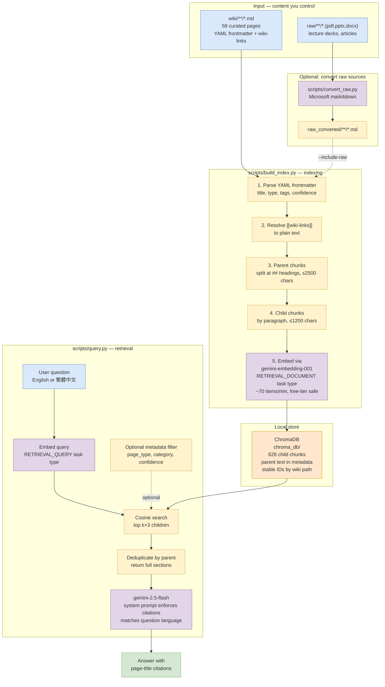

# rrag — LLM Wiki

### A knowledge base compiled and maintained by an LLM agent

An Obsidian vault implementing the [LLM Wiki pattern](https://gist.github.com/karpathy/442a6bf555914893e9891c11519de94f) by Andrej Karpathy. Raw sources go in, a structured, cross-referenced wiki comes out — all compiled and maintained by Claude.

---

## How It Works

```
raw/                    LLM reads           wiki/                  Schema governs
(immutable sources) ──────────────────► (LLM-owned markdown) ◄──────────────── CLAUDE.md
  docs, articles,                         sources, concepts,                    workflows/
  courses, images                         entities, analyses,
                                          MOCs, overview
```

**Three operations** drive the wiki:

| Operation | What happens | Slash command |
|-----------|-------------|---------------|
| **Ingest** | Source -> wiki pages, cross-links, index updates | `/ingest` |
| **Query** | Question -> synthesized answer -> optionally filed back | `/query` |
| **Lint** | Health check -> find issues -> fix with approval | `/lint` |

**Two actors**:
- **Human**: curates raw sources, asks questions, approves changes
- **LLM Agent**: summarizes, cross-references, maintains the wiki

## Configuration

Everything lives in one file:

- **`CLAUDE.md`** — The wiki schema. Defines page types, frontmatter fields, directory structure, linking conventions, formatting rules, and workflow index. This is the LLM's "constitution" for maintaining the vault.

Claude Code reads `CLAUDE.md` automatically at session start. No separate config file needed.

## Topics Covered

- **Claude Code** — CLI tool, hooks, skills, harness, settings, IDE integration
- **Claude API** — Anthropic SDK, tool use, streaming, batch API
- **Agent SDK** — Custom agents, multi-agent orchestration
- **MCP** — Model Context Protocol servers, tools, resources
- **Prompt Engineering** — System prompts, best practices, evaluation
- **AI Tools** — Knowledge graphs (Graphify), automation
- **University Courses** — academic notes and public references

## Features

- **Traditional Chinese summaries** — Every page opens with a 概述 section in 繁體中文
- **Confidence levels** — Every page rated high/medium/low based on source quality
- **17 workflows** — Ingest, query, lint, review, slides, visualize, web-enrich, and more
- **Slash commands** — `/ingest`, `/query`, `/lint`, `/review`, `/slides`, `/batch-ingest`
- **Claude Code hooks** — Auto-orient on session start, lint reminders after wiki edits

## Vault Structure

```
rrag/
├── raw/                    # Immutable source documents
│   ├── docs/              # Official documentation
│   ├── articles/          # Web-clipped articles
│   ├── courses/           # University course materials
│   └── assets/            # Images
├── wiki/                   # LLM-generated wiki
│   ├── sources/           # Source summaries by theme
│   ├── concepts/          # Cross-cutting concepts
│   ├── entities/          # Tools, orgs, people
│   ├── analyses/          # Comparisons, syntheses
│   ├── mocs/              # Maps of Content
│   ├── journal/           # Daily thoughts
│   ├── slides/            # Marp presentations
│   ├── index.md           # Wiki index
│   ├── log.md             # Local activity log (gitignored)
│   └── overview.md        # Knowledge landscape
├── workflows/              # 17 operational playbooks
├── scripts/                # Local RAG pipeline (Python)
│   ├── build_index.py     # Chunk + embed wiki/ into ChromaDB
│   ├── query.py           # CLI question-answering with citations
│   ├── convert_raw.py     # markitdown: PDF/PPTX -> markdown
│   ├── requirements.txt
│   └── RAG.md             # Full pipeline guide
├── chroma_db/              # Local vector index (gitignored)
├── .env                    # GEMINI_API_KEY (gitignored)
├── .claude/                # Claude Code config
│   ├── commands/          # Custom slash commands
│   └── settings.local.json # Hooks
├── CLAUDE.md               # Wiki schema (single config file)
└── README.md
```

## Quick Start

```bash
# Open this folder as an Obsidian vault
# Enable community plugins when prompted
# Start with: wiki/overview.md or wiki/index.md
```

## Usage

### Ingest new material

Drop files into `raw/`, then tell Claude:

```
I put new files in raw/docs/. Please ingest and clean up.
```

Or be specific:

```
I put lecture notes in raw/courses/. Ingest them, extract all knowledge
points as concept pages, update the courses hub, and delete the originals.
```

For a single file:

```
/ingest raw/docs/some-article.md
```

For a URL (no file needed):

```
Ingest this: https://example.com/some-article
```

For 3+ files at once:

```
/batch-ingest
```

### Ask questions

```
/query What is the relationship between GARCH and co-integration?
```

Substantial answers can be filed back into the wiki as analysis pages.

### Daily thoughts

Write in `wiki/journal/`. One file per day:

```
wiki/journal/2026-04-07.md
```

Or just tell Claude:

```
I have a thought about revenue management and how it connects to DeFi pricing.
```

### Maintain the wiki

```
/lint          # Health check — find broken links, stale claims
/review        # Full once-over — lint + enrich + depth check
/slides topic  # Generate Marp slide deck from wiki content
```

### Graph view

Open Obsidian's graph view to see all knowledge connections. Color-coded:

| Color | What |
|-------|------|
| Teal | Course source pages |
| Green | Concept pages (knowledge points) |
| Blue | AI tool sources |
| Orange | Entity pages |
| Red-orange | Journal entries |

## RAG Pipeline

The wiki is also queryable as a local RAG system. Three Python scripts, a
local ChromaDB vector store, and the free Google Gemini API. No external
services. The API key lives in `.env` (gitignored) — it never leaves your
machine.

### Full methodology



The whole thing is **~600 lines of Python**. The "model" itself is Google's
Gemini API; what's local is the embedded shadow copy of your wiki.

### One-time setup

```bash
pip install -r scripts/requirements.txt
cp .env.example .env             # paste your key from https://aistudio.google.com/apikey
python3 scripts/build_index.py   # first build: ~9 min, ~628 embedding calls
```

### Daily usage

```bash
# Ask questions — English or 繁體中文
python3 scripts/query.py "Explain the newsvendor critical ratio"
python3 scripts/query.py --interactive

# Filter by metadata
python3 scripts/query.py "A/B testing" --filter page_type=concept
python3 scripts/query.py "bitcoin"     --filter source_type=courses

# After editing wiki pages — incremental, only embeds what changed
python3 scripts/build_index.py
```

### Reusability

Chunk IDs are stable hashes of `wiki_path:parent_idx:child_idx`, so the
build is **fully incremental**:

| Scenario | Command | Embedding cost |
|---|---|---|
| Edit page content | `python3 scripts/build_index.py` | Only changed chunks (free) |
| Edit frontmatter only | `python3 scripts/build_index.py --metadata-only` | Zero |
| Add new wiki page | `python3 scripts/build_index.py` | ~5–15 calls per page (free) |
| Full rebuild | `python3 scripts/build_index.py --reset` | ~628 calls, ~9 min |
| Add raw lecture PDFs | `python3 scripts/convert_raw.py` then `--include-raw` | One-time per source |

The build paces embeddings at ~70 items/min to stay under the
`gemini-embedding-001` free-tier 100 RPM cap. Daily quota is 1000 RPD →
roughly one full rebuild per day. Incremental rebuilds usually cost nothing.

Full guide: [`scripts/RAG.md`](scripts/RAG.md).

---

## Methodology

Based on Karpathy's [LLM Wiki pattern](https://gist.github.com/karpathy/442a6bf555914893e9891c11519de94f):

1. **Explicit** — The knowledge artifact is navigable and inspectable
2. **Yours** — Local files on your computer, not locked in a provider
3. **File over app** — Universal formats (markdown, images), interoperable with any tool
4. **BYOAI** — Use whatever LLM you want; the schema is provider-agnostic
