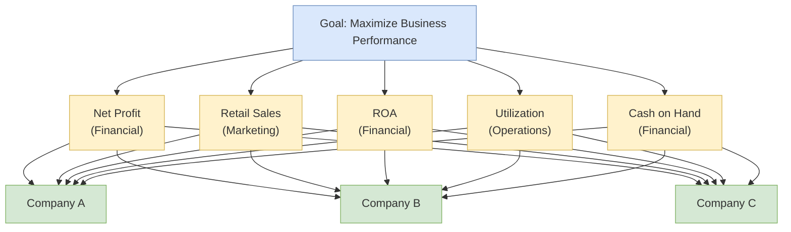

## 概述

層次分析法（AHP）是由 Thomas L. Saaty 於1970年代在華頓商學院開發的結構化多準則決策（MCDM）方法，將複雜決策問題分解為「目標-準則-備選方案」三層層次結構，透過成對比較矩陣（$n \times n$ 的互反矩陣，對角元素為1，$a_{ji} = 1/a_{ij}$）量化各準則的相對重要性，再用特徵值法（$Aw = \lambda_{\max} w$）或幾何平均近似法計算優先權向量，並以一致性比率 $CR = CI/RI < 0.10$ 驗證判斷的邏輯一致性（其中 $CI = (\lambda_{\max} - n)/(n-1)$，RI 為隨機一致性指數）。AHP 的核心優勢在於統一處理定量與定性準則：EEMT5560 課程以五準則 KPI 加權為例（淨利潤0.361 > 現金儲備0.257 > 利用率0.211 > ROA0.109 > 零售銷售0.062），展示了幾何平均近似法與完整特徵值法的誤差僅在 ±0.006以內，實務中可跳過迭代特徵值計算。Bloom & Grow 案例的真實應用揭示了 AHP 的關鍵教訓：財務最優選項（MYOB，NPV +$747K）因定性功能適配差而失去競爭力，定性最優選項（SAP，AHP得分0.307）因成本超出而無法通過財務門檻，只有結合 AHP 權重與 NPV/TCO 分析的結構化多準則評估才能在兩者之間取得平衡（最終選出 NetSuite）。成對比較矩陣的規模限制是 AHP 的主要實務約束：比較次數隨準則數量以 $n(n-1)/2$ 增長，$n=10$ 時需完成45次比較；秩反轉問題（增刪備選方案可能改變排序）和準則間依賴性問題（需升級至分析網絡過程 ANP 處理）是理論上的主要局限。在運籌學中，AHP 可與[[wiki/concepts/balanced-scorecard|BSC]]四視角結合賦予 KPI 權重，也可用於[[wiki/concepts/scor-model|SCOR]]五大績效屬性的加權，或在[[wiki/concepts/decision-trees|決策樹]]難以表達多目標偏好時提供互補的多準則評估視角。

## Core Mechanism

The **Analytic Hierarchy Process (AHP)** is a multi-criteria decision-making (MCDM) framework that decomposes a complex decision into a hierarchy of more manageable sub-problems. Developed by Thomas L. Saaty at the Wharton School in the 1970s, it provides a mathematically rigorous way to incorporate both quantitative data and subjective judgment into a single decision framework. AHP is taught in EEMT5560 at [[wiki/entities/hkust|HKUST]] as the primary tool for weighting KPIs in the [[balanced-scorecard|Balanced Scorecard]] and for converting subjective managerial judgment into defensible priority vectors.

### Hierarchical Decomposition

Every AHP problem is structured as a three-level hierarchy:

1. **Goal** -- The overall objective (e.g., "Select the best supplier")
2. **Criteria** -- The factors that matter for the decision (e.g., cost, quality, delivery time, flexibility)
3. **Alternatives** -- The options being evaluated (e.g., Supplier A, Supplier B, Supplier C)

Sub-criteria can be added to create deeper hierarchies when criteria need further decomposition (e.g., "Quality" broken into defect rate, certification level, and inspection pass rate).

This hierarchy mirrors the EEMT5560 worked example where five KPIs (Net profit, Retail sales, ROA, Utilization, Cash on hand) are weighted with respect to an overall business performance objective.

### Pairwise Comparison Matrix

The core data-gathering step uses **pairwise comparisons** -- comparing every pair of elements at a given level with respect to the level above. Saaty's fundamental scale assigns intensity values:

| Intensity | Definition | Explanation |
|-----------|------------|-------------|
| 1 | Equal importance | Two elements contribute equally |
| 3 | Moderate importance | Experience slightly favors one over the other |
| 5 | Strong importance | Experience strongly favors one |
| 7 | Very strong importance | One is strongly favored and dominance is demonstrated |
| 9 | Extreme importance | The evidence favoring one over the other is of the highest order |
| 2, 4, 6, 8 | Intermediate values | When compromise is needed between adjacent judgments |

For an $n$-criteria problem, the comparison matrix **A** is an $n \times n$ matrix where entry $a_{ij}$ represents how much criterion $i$ is preferred over criterion $j$. The matrix has three properties:

- **Diagonal entries** are always 1 (each element is equally important to itself)
- **Reciprocal property**: $a_{ji} = \frac{1}{a_{ij}}$ (if A is 5 times more important than B, then B is 1/5 as important as A)
- Only $\frac{n(n-1)}{2}$ comparisons need to be made (upper triangle)

### Eigenvalue Method for Priority Weights

Once the pairwise comparison matrix is constructed, priority weights are derived using the **eigenvalue method**. Mathematically, we seek the principal (largest) eigenvalue $\lambda_{\max}$ and corresponding eigenvector $w$ of the matrix $A$ such that:

$$A w = \lambda_{\max} w$$

The procedure:

1. Compute the principal eigenvector of the comparison matrix $A$.
2. Normalize the eigenvector so its components sum to 1: $w_i = \frac{w_i}{\sum_j w_j}$.
3. The resulting normalized vector gives the **priority weights** (relative importance) of each criterion.

In practice, a **geometric mean approximation** is commonly used in spreadsheets because it avoids iterative eigenvalue computation:

1. Compute the geometric mean of each row: $g_i = \left( \prod_{j=1}^{n} a_{ij} \right)^{1/n}$
2. Normalize: $w_i = \frac{g_i}{\sum_{k=1}^{n} g_k}$
3. This yields approximate priority weights sufficient for most applications.

An even simpler column-normalization method (used on the EEMT5560 AHP worksheet):

1. Sum each column of $A$.
2. Divide each element by its column sum to obtain a normalized matrix.
3. Average each row of the normalized matrix -- the row averages are the priority weights.

### Consistency Ratio (CR)

Human judgments are rarely perfectly consistent. If a decision-maker says A is 3x more important than B, and B is 2x more important than C, then perfect consistency requires A to be 6x more important than C. In practice, people may judge A as 5x or 7x more important than C.

AHP quantifies this inconsistency through the **Consistency Ratio**:

1. **Compute $\lambda_{\max}$** (the principal eigenvalue of the comparison matrix)
2. **Consistency Index**: $CI = \frac{\lambda_{\max} - n}{n - 1}$
3. **Consistency Ratio**: $CR = \frac{CI}{RI}$

Where **RI** (Random Index) is the average CI of randomly generated reciprocal matrices:

| n | 1 | 2 | 3 | 4 | 5 | 6 | 7 | 8 | 9 | 10 |
|---|---|---|---|---|---|---|---|---|---|---|
| RI | 0 | 0 | 0.58 | 0.90 | 1.12 | 1.24 | 1.32 | 1.41 | 1.45 | 1.49 |

**Decision rule**: If $CR < 0.10$, the judgments are sufficiently consistent. If $CR \geq 0.10$, the decision-maker should revisit and revise the pairwise comparisons to improve consistency. Saaty argued that a small amount of inconsistency is actually desirable because it reflects the real-world fuzziness of human judgment -- a perfectly consistent matrix that is contrived can mask weak reasoning.

## Worked Example: KPI Weighting from EEMT5560

The course uses this five-criteria example where Net profit is judged 5x more important than Retail sales, 3x more than ROA, 3x more than Utilization, and equal to Cash on hand.

**Step 1 -- Pairwise comparison matrix** $A$:

|  | Net profit | Retail sales | ROA | Utilization | Cash on hand |
|--|-----------|--------------|-----|-------------|--------------|
| Net profit   | 1    | 5   | 3   | 3   | 1   |
| Retail sales | 1/5  | 1   | 1/3 | 1/3 | 1/3 |
| ROA          | 1/3  | 3   | 1   | 1/3 | 1/3 |
| Utilization  | 1/3  | 3   | 3   | 1   | 1   |
| Cash on hand | 1    | 3   | 3   | 1   | 1   |

**Step 2 -- Column sums**: 2.867, 15, 10.333, 5.667, 3.667

**Step 3 -- Normalize each column, then average each row**:

| Criterion | Weight (Approx.) | Weight (Eigenvector) |
|-----------|-----------------|----------------------|
| Net profit   | 0.355 | 0.361 |
| Retail sales | 0.064 | 0.062 |
| ROA          | 0.113 | 0.109 |
| Utilization  | 0.211 | 0.211 |
| Cash on hand | 0.258 | 0.257 |

The approximation method matches the eigenvector method within $\pm 0.006$ -- close enough that practitioners often skip the eigenvalue computation entirely. Net profit emerges as the most important criterion (36%), followed by Cash on hand (26%) and Utilization (21%).

**Step 4 -- Check consistency**. With $n = 5$ and $RI = 1.12$, if $\lambda_{\max} \approx 5.28$ then $CI = (5.28 - 5)/4 = 0.070$ and $CR = 0.070 / 1.12 = 0.0625 < 0.10$. The judgments are consistent.

**Step 5 -- Score alternatives**. Each company is scored on each KPI (e.g., normalized across the competitive set), and the overall score is:

$$S_k = \sum_{i=1}^{n} w_i \cdot s_{ik}$$

where $w_i$ is the AHP weight for criterion $i$ and $s_{ik}$ is the score of alternative $k$ on criterion $i$.

### MBS Judge-Score Composite

The EEMT5560 AHP worksheet drives directly into MBS grading. Students weight five simulation KPIs -- NPV, Net profit margin, Fill rate, Urgent purchase expense (lower is better, so comparisons are inverted), and Equipment/maintenance expense ratio -- into a single composite judge score. A typical student submission might set Net profit weight = 5 vs. Fill rate, Net profit = 3 vs. NPV, yielding weights around NPV 0.40 / Net profit 0.28 / Fill rate 0.12 / Urgent purchase 0.10 / Equip+maint 0.10 after normalization. The course insists that **the AHP consistency check must pass before the composite is used for grading**; teams that construct inconsistent matrices ($CR \ge 0.10$) are required to revise before the composite is accepted. This exercise doubles as a worked demonstration that AHP, not spreadsheet intuition, is the defensible way to combine incommensurate metrics (dollars, percentages, unit counts) into a single ranking.

### Miniature Three-Criterion Example

For a smaller case (laptop selection by Performance, Price, Battery):

|  | Performance | Price | Battery |
|--|-------------|-------|---------|
| Performance | 1 | 3 | 5 |
| Price | 1/3 | 1 | 2 |
| Battery | 1/5 | 1/2 | 1 |

Geometric means: Performance $(1 \cdot 3 \cdot 5)^{1/3} = 2.47$; Price $(0.33 \cdot 1 \cdot 2)^{1/3} = 0.87$; Battery $(0.2 \cdot 0.5 \cdot 1)^{1/3} = 0.46$. Normalized weights: **0.65 / 0.23 / 0.12**. With $\lambda_{\max} \approx 3.004$ this gives $CI = 0.002$ and $CR \approx 0.003$, well within tolerance.

## Practical Applications

- **Vendor/supplier selection** -- Weighting criteria such as cost, quality, delivery reliability, and financial stability. Often combined with [[Data Envelopment Analysis (DEA)|Data Envelopment Analysis]] for a hybrid subjective-objective assessment.
- **Project portfolio prioritization** -- Ranking competing projects by strategic alignment, ROI, risk, and resource requirements. [[npv|NPV]] and [[irr|IRR]] become individual criteria within the hierarchy.
- **Site selection** -- Evaluating potential locations by cost, labor availability, infrastructure, and regulatory environment
- **Technology selection** -- Comparing [[erp|ERP]] systems, software platforms, or equipment based on multiple performance dimensions
- **Resource allocation** -- Determining budget splits across departments or initiatives
- **KPI weight assignment** -- Converting a long list of [[balanced-scorecard|Balanced Scorecard]] KPIs into a single weighted composite score that ranks business units or companies. In EEMT5560, this is the primary pedagogical use.
- **MBS simulation tactics** -- The AHP worksheet asks students to weight NPV, Net profit margin, Fill rate, Urgent purchase expense, and Equipment/maintenance expense to build a composite judge score aligned with Marco Business Simulation performance criteria.

## Tools and Software

| Tool | Purpose | Notes |
|------|---------|-------|
| **BPMSG AHP Calculator** (bpmsg.com/ahp/ahp-calc.php) | Online free tool | Computes eigenvector weights + CR in browser; used in the EEMT5560 group exercise |
| **Super Decisions** | Desktop AHP/ANP software | Official tool supported by the Creative Decisions Foundation |
| **Expert Choice** | Commercial AHP suite | Industry standard for enterprise decision support |
| **Excel with geometric-mean formula** | Ad-hoc analysis | Works for small $n$; manual CR check required |
| **R `ahpsurvey` / Python `pyAHP`** | Programmatic AHP | Batch processing and integration with pipelines |

## Strengths and Limitations

**Strengths**:
- Handles both quantitative and qualitative criteria in a unified framework
- The consistency check provides a built-in quality control for subjective judgments
- Hierarchical structure makes complex decisions more tractable
- Well-established mathematical foundation with extensive academic validation

**Limitations**:
- Number of pairwise comparisons grows as $\frac{n(n-1)}{2}$ -- becomes burdensome for large numbers of criteria or alternatives
- Rank reversal can occur when alternatives are added or removed
- Relies on decision-maker expertise and honest judgment -- garbage in, garbage out
- The 1-9 scale may oversimplify nuanced distinctions in some contexts
- Does not handle interdependencies between criteria (the Analytic Network Process, ANP, extends AHP to address this)

## Comparison with Other MCDM Methods

| Method | Key Difference from AHP |
|--------|------------------------|
| **Weighted Sum Model (WSM)** | Simpler but lacks consistency checks; assumes linear utility |
| **TOPSIS** | Ranks by distance to ideal solution; no pairwise comparisons needed |
| **ELECTRE** | Outranking method; better for large alternative sets but less transparent |
| **ANP** | Extends AHP to handle criterion interdependencies via network structure |

## Related Concepts

- [[Data Envelopment Analysis (DEA)|Data Envelopment Analysis]] -- Complementary quantitative tool taught alongside AHP in EEMT5560; DEA benchmarks efficiency objectively from data while AHP prioritizes criteria subjectively from expert judgment. Combined approaches use AHP to set weight restrictions inside DEA LP models.
- [[balanced-scorecard|Balanced Scorecard]] -- The four BSC perspectives (Financial, Customer, Internal Process, Learning & Growth) form a natural AHP hierarchy, with AHP used to weight perspectives and KPIs within them.
- [[porters-five-forces|Porter's Five Forces]] -- Strategic analysis framework whose factors can serve as AHP criteria for competitive positioning decisions.
- [[scor-model|SCOR Model]] -- SCOR's five performance attributes (Reliability, Responsiveness, Agility, Cost, Asset Management) are a ready-made AHP criterion set for supply chain benchmarking.
- [[decision-trees|Decision Trees]] -- Alternative decision tool; decision trees handle sequential decisions under uncertainty while AHP handles multi-criteria trade-offs.
- [[linear-regression|Linear Regression]] -- A data-driven alternative for deriving weights when sufficient outcome data exists.
- [[npv|NPV]] -- Financial criterion frequently included in AHP-based investment decisions.
- [[wiki/mocs/operations-research|Operations Research MOC]] — Part of the OR PhD reading spine (Multi-Criteria Decision Analysis)

## Source Materials

- EEMT5560 Lecture 02: AHP
- AHP Worksheet (EEMT5560)
- [[wiki/sources/courses/integrated-business|EEMT5560 Integrated Business Solutions]]
