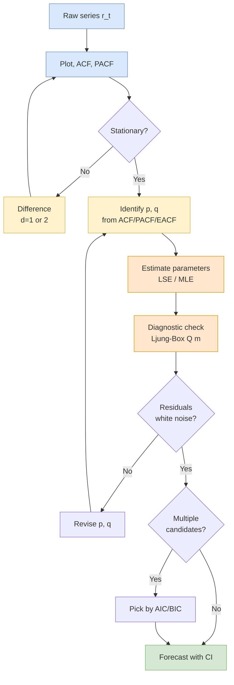

## 概述

自迴歸移動平均模型（Autoregressive Moving Average, ARMA）是單變量線性時間序列分析的核心框架，將序列的當前值表達為過去值的線性組合（AR 部分）與過去白噪音衝擊的線性組合（MA 部分）之疊加。AR(p) 模型的定態條件等價於特徵多項式 $\phi(z) = 1 - \sum_{i=1}^p \phi_i z^i$ 的所有根位於單位圓外；MA(q) 則恆定態但需可逆性以確保唯一識別；ARMA(p,q) 的 ACF 與 PACF 同時衰減，令 Box-Jenkins 建模（辨識→估計→診斷→預測）成為必要的迭代流程。非定態序列通過差分 $d$ 次後轉化為 ARIMA(p,d,q)，而 Augmented Dickey-Fuller（ADF）檢驗在非標準 Dickey-Fuller 分佈下驗證單位根假設。在金融時間序列中，ARMA 描述條件均值的線性動態結構，並幾乎總是與 [[garch|GARCH]] 模型配對使用，後者負責描述條件變異數；當多個金融序列存在長期均衡關係時，則需進一步引入 [[cointegration|VAR/VECM]] 框架。在運籌學應用方面，ARIMA 的單步及多步預測輸出直接作為報童模型（[[newsvendor-problem|Newsvendor Problem]]）的需求均值與預測誤差標準差，以及收益管理（[[revenue-management|Revenue Management]]）中預訂曲線建模的需求輸入；季節性 ARIMA 廣泛用於零售、能源及航空需求的季節性模式捕捉。AIC 傾向預測精度而 BIC 傾向模型精簡，二者在適度樣本量時的分歧是模型選擇的實踐難點。MSBD5006 課程以美國 30 年按揭利率、CRSP 小市值月回報及 Alcoa 季度 EPS 三個真實數據集，系統示範了完整的 Box-Jenkins 建模循環。

## Foundations: Stationarity and White Noise

A time series $\{r_t\}$ is **weakly stationary** (second-order stationary) if it satisfies three conditions: (1) its mean $E(r_t) = \mu$ is constant over time, (2) its variance $\text{Var}(r_t) = \gamma_0 < \infty$ is finite, and (3) the autocovariance $\text{Cov}(r_t, r_{t-l}) = \gamma_l$ depends only on the lag $l$, not on the time index $t$. **Strict stationarity** is a stronger condition requiring that the joint distribution of any finite subset of observations be invariant under time shifts. For Gaussian processes, weak and strict stationarity coincide because the first two moments fully characterize a multivariate normal.

The building block for all ARMA models is **white noise** $\{a_t\}$: a sequence of uncorrelated random variables with $E(a_t) = 0$ and $\text{Var}(a_t) = \sigma_a^2$. If additionally the $a_t$ are independent and identically distributed, the sequence is **iid noise**. **Gaussian white noise** further specifies that $a_t \sim N(0, \sigma_a^2)$. Uncorrelatedness is a weaker condition than independence, and the distinction matters for nonlinear models such as [[garch|GARCH]] where returns are serially uncorrelated yet their squares are not.

## Autoregressive Models: AR(p)

An **AR(p)** model expresses the current value as a linear combination of $p$ past values plus noise:

$$r_t = \phi_0 + \phi_1 r_{t-1} + \phi_2 r_{t-2} + \cdots + \phi_p r_{t-p} + a_t$$

where $\phi_0$ is a constant related to the mean via $\phi_0 = \mu(1 - \phi_1 - \cdots - \phi_p)$, and $\{a_t\}$ is white noise. Under mean-zero reparameterization, $r_t - \mu = \sum_{i=1}^p \phi_i (r_{t-i} - \mu) + a_t$. AR models are a special case of [[linear-regression|linear regression]] with lagged dependent variables as regressors, but standard OLS inference must account for the stochastic regressors.

### Stationarity Conditions

The AR(p) process is stationary if and only if all roots of the **characteristic polynomial**

$$\phi(z) = 1 - \phi_1 z - \phi_2 z^2 - \cdots - \phi_p z^p = 0$$

lie strictly outside the unit circle in the complex plane. For AR(1), this simplifies to $|\phi_1| < 1$. For AR(2), the three conditions are: $\phi_1 + \phi_2 < 1$, $\phi_2 - \phi_1 < 1$, and $|\phi_2| < 1$ — together they define a triangular stationarity region in $(\phi_1, \phi_2)$ space.

### ACF and PACF Signatures

- **ACF**: Decays exponentially, as damped sinusoids when characteristic roots are complex, but never cuts off sharply.
- **PACF**: Cuts off after lag $p$. The partial autocorrelation at lags $p+1, p+2, \ldots$ is zero in population.

Under the null of no dependence, sample ACF values are approximately $N(0, 1/T)$, so $\pm 1.96/\sqrt{T}$ provides asymptotic 95% significance bands. This signature (tailing ACF, sharp-cutoff PACF) is the primary identification tool for AR models.

### AR(1) Properties

For $r_t = \phi_0 + \phi_1 r_{t-1} + a_t$ with $|\phi_1| < 1$:

- Mean: $E(r_t) = \phi_0 / (1 - \phi_1)$
- Variance: $\text{Var}(r_t) = \sigma_a^2 / (1 - \phi_1^2)$
- ACF: $\rho_l = \phi_1^l$ (geometric decay)
- Half-life of shocks: $\ln(0.5) / \ln(|\phi_1|)$

For $\phi_1 = 0.9$ the half-life is about 6.6 periods; for $\phi_1 = 0.5$ it is 1 period. This gives an intuitive feel for the persistence of shocks at different coefficient magnitudes.

## Moving Average Models: MA(q)

An **MA(q)** model represents the current value as a linear combination of current and past white-noise innovations:

$$r_t = c_0 + a_t - \theta_1 a_{t-1} - \theta_2 a_{t-2} - \cdots - \theta_q a_{t-q}$$

### Key Properties

- **Always stationary**: Since MA(q) is a finite linear combination of white-noise terms, it is stationary for any values of $\theta_1, \ldots, \theta_q$ (no constraints needed).
- **Invertibility**: For a unique identified MA representation, all roots of $\theta(z) = 1 - \theta_1 z - \cdots - \theta_q z^q = 0$ must lie outside the unit circle. Invertibility ensures the MA model can be rewritten as an infinite-order AR, which is required for forecasting and residual recovery.

For MA(1): mean $E(r_t) = c_0$, variance $\text{Var}(r_t) = (1 + \theta_1^2)\sigma_a^2$, lag-1 autocovariance $\gamma_1 = -\theta_1 \sigma_a^2$, and

$$\rho_1 = \frac{-\theta_1}{1 + \theta_1^2}, \qquad \rho_l = 0 \text{ for } l > 1$$

The mapping $\theta_1 \mapsto \rho_1$ is not one-to-one: $\theta_1$ and $1/\theta_1$ yield the same $\rho_1$, so the invertibility constraint $|\theta_1| < 1$ is needed for identification.

### ACF and PACF Signatures

- **ACF**: Cuts off after lag $q$.
- **PACF**: Tails off (decays exponentially or with damped oscillation).

This is the mirror image of the AR pattern: sharp-cutoff ACF, tailing PACF. MA invertibility is the dual property of AR stationarity.

## ARMA(p,q) Models

The **ARMA(p,q)** model combines both mechanisms:

$$r_t = \phi_0 + \sum_{i=1}^{p} \phi_i r_{t-i} + a_t - \sum_{j=1}^{q} \theta_j a_{t-j}$$

or, using the backshift operator $B$ with $B r_t = r_{t-1}$:

$$\phi(B) r_t = \phi_0 + \theta(B) a_t$$

Both the ACF and PACF tail off for ARMA models, making order identification more challenging than for pure AR or MA. In practice, the **extended autocorrelation function (EACF)** by Tsay and Tiao (1984) or information-criteria grid search is used for joint order selection. Stationarity depends only on the AR factor $\phi(z)$; invertibility depends only on the MA factor $\theta(z)$.

### Order Identification Summary

| Model | ACF | PACF |
|---|---|---|
| AR(p) | Tails off | Cuts off after lag $p$ |
| MA(q) | Cuts off after lag $q$ | Tails off |
| ARMA(p,q) | Tails off | Tails off |

## Non-Stationary Models: Unit Roots and ARIMA

When the characteristic polynomial of an AR model has a root *on* the unit circle, the process is **non-stationary**. The simplest example is the **random walk**:

$$r_t = r_{t-1} + a_t$$

an AR(1) with $\phi_1 = 1$. The variance $\text{Var}(r_t) = t \sigma_a^2$ grows linearly in $t$, and shocks have permanent effects. Log asset prices are typically well-described as random walks (or random walks with drift), so their first differences — log returns — are stationary.

### ARIMA(p,d,q)

The **ARIMA(p,d,q)** model handles unit-root non-stationarity by differencing $d$ times before fitting an ARMA:

$$\phi(B)(1 - B)^d r_t = \phi_0 + \theta(B) a_t$$

In practice, $d = 1$ suffices for most financial series: $(1 - B) \log P_t = \log P_t - \log P_{t-1} = r_t$ (the log return).

### Unit Root Testing

The **Augmented Dickey-Fuller (ADF)** test is the standard tool for detecting unit roots. The regression

$$\Delta r_t = \alpha + \rho r_{t-1} + \sum_{i=1}^{k} \gamma_i \Delta r_{t-i} + a_t$$

tests $H_0: \rho = 0$ (unit root) versus $H_a: \rho < 0$. Under the null the t-statistic has the non-standard **Dickey-Fuller distribution**, not a Student-$t$, so specialized critical values are required. The Phillips-Perron (PP) test provides a non-parametric alternative robust to serial correlation in errors.

## Box-Jenkins Methodology

The **Box-Jenkins procedure** is a four-step iterative approach to time series model building:



1. **Specification (Identification)**: Examine the sample ACF and PACF to determine candidate model orders. Apply EACF or information criteria when both tail off.
2. **Estimation**: Fit the candidate model using least-squares (LSE) or maximum likelihood (MLE). For pure AR, OLS is efficient. For MA/ARMA components, use conditional MLE. The **conditional likelihood** for MA(1) is derived by setting $a_0 = 0$ and recursing $a_t(\theta) = r_t + \theta a_{t-1}(\theta)$; minimizing $\sum_{t=1}^T a_t^2(\theta)$ yields the conditional LSE. Asymptotically $\sqrt{T}(\hat{\theta} - \theta_0) \to N(0, \Omega)$.
3. **Diagnostic Checking**: Verify that residuals are white noise via:
   - **Ljung-Box Q**: $Q(m) = T(T+2)\sum_{l=1}^m \hat{\rho}_l^2 / (T - l) \sim \chi^2(m - p - q)$
   - Visual inspection of residual ACF/PACF
   - Normality tests (QQ-plot, Jarque-Bera)
4. **Forecasting**: Compute minimum MSE forecasts $\hat{r}_{t+h} = E(r_{t+h} | \mathcal{F}_t)$ with prediction intervals that widen as the horizon $h$ grows.

## Model Selection Criteria

When multiple models pass diagnostic checks, information criteria guide the final choice:

| Criterion | Formula | Behavior |
|---|---|---|
| AIC | $-2\ln L + 2k$ | Efficient for prediction; may overfit |
| BIC (SIC) | $-2\ln L + k\ln T$ | Consistent; prefers parsimony |
| HQIC | $-2\ln L + 2k \ln\ln T$ | Between AIC and BIC |

In practice, BIC tends to select more parsimonious models as sample size grows, while AIC is preferred when the goal is out-of-sample forecasting. The two often disagree for moderate $T$ and borderline lag orders.

## R Implementation

```r
# Specification and identification
acf(r, lag.max=30)
pacf(r, lag.max=30)
Box.test(r, lag=10, type="Ljung-Box")

# Fit AR(2) via OLS
ar2 <- arima(r, order=c(2, 0, 0))
# Fit ARMA(1,1)
arma11 <- arima(r, order=c(1, 0, 1))
# Fit ARIMA(0,1,1) on log prices
arima011 <- arima(log_price, order=c(0, 1, 1))

# Compare by BIC
AIC(ar2, arma11); BIC(ar2, arma11)

# Diagnostic check
Box.test(residuals(arma11), lag=12, type="Ljung-Box",
         fitdf=2)  # subtract p+q degrees of freedom

# Forecast 10 periods ahead
fc <- predict(arma11, n.ahead=10)
# fc$pred, fc$se give point forecasts and standard errors

# Unit root test
library(tseries)
adf.test(log_price)           # tests H0: unit root
```

## Worked Examples

These worked examples are drawn from the MSBD5006 homework sets (see [[financial-time-series|MSBD5006]] for the full dataset catalog). Each illustrates one step of the Box-Jenkins loop on a real financial series.

### CRSP Decile 1 Monthly Returns (Ljung-Box on Levels)

Testing the first 12 ACF lags of CRSP Decile 1 monthly simple returns (1970-2006) for joint-zero autocorrelation yields $Q(12) = 69.652$ with $p = 3.72 \times 10^{-10}$ — well below any reasonable significance level and far exceeding the $\chi^2_{12}$ critical value of $21.026$ at $\alpha=5\%$. Conclusion: the hypothesis that the first twelve autocorrelations are jointly zero is decisively rejected. This is the canonical textbook demonstration that **small-cap portfolios exhibit serial dependence** even at monthly frequency — a finding consistent with the autocorrelation-induced size premium literature. Decile 9 (large-cap) under the same test fails to reject, illustrating that the dependence is *size-specific*, not a market-wide effect. When reporting, be careful to subtract $p+q$ from the Ljung-Box degrees of freedom whenever $Q(m)$ is computed on *fitted* residuals, but not on raw returns.

### US 30-Year Mortgage Rate: Seasonal ARIMA

Fitting the monthly 30-year conventional mortgage rate (FRED, 1976-2007) on the log scale after double differencing $w_t = (1-B)(1-B^{12})\log X_t$ gives a final model of the form

$$(1 - 0.0214 B)(1-B)(1-B^{12})\log X_t = (1 + 0.4928 B)\, a_t$$

i.e. $\text{ARIMA}(1,1,1)\times(0,1,0)_{12}$ with $\hat\phi_1 = 0.0214$ and $\hat\theta_1 = 0.4928$. Model selection AIC/BIC $= -1284/-1273$ dominated a $(p=0,d=1,q=1)(1,1,1)_{12}$ alternative. Forecast for the first four post-sample months aligns with actuals $\{6.17, 6.26, 6.34, 6.66\}$ within the 95% prediction interval. The example is a clean illustration of **multiplicative seasonal differencing**: regular $d=1$ removes the trend, seasonal $D=1$ removes the 12-month periodicity, and the residual ARMA(1,1) captures what remains.

### Alcoa Quarterly EPS with Negative Values

Alcoa earnings per share (1991Q4 onward) contain negative values, so a log transform is disallowed without shifting. The course recommends adding a constant large enough to guarantee positivity (Tsay §2.8.1) and inverting the shift at forecast time. A $\text{SARIMA}(1,0,1)\times(1,0,1)_{12}$ fitted on the differenced log-plus-constant series yields coefficients $\hat\phi_1 = -0.5533$, $\hat\Phi_1 = -0.7412$, $\hat\theta_1 = -0.5169$ and residual $Q(12) = 7.44$, $p = 0.83$ — clean diagnostic pass. This example illustrates the practical headache of sign-changing level series and is a template for **inventory-cost, accounting-earnings, or net-flow time series** that frequently arise in OR.

### R: Reproducing the Mortgage Example

```r
library(forecast)
# Assume x is a ts() object of the monthly mortgage rate
lx  <- log(x)
fit <- Arima(lx, order = c(1, 1, 1),
             seasonal = list(order = c(0, 1, 0), period = 12))
summary(fit)               # AIC / BIC
Box.test(residuals(fit), lag = 12,
         type = "Ljung-Box", fitdf = 2)   # p + q = 2
fc <- forecast(fit, h = 4)
exp(fc$mean)               # convert back to level scale
```

## Practical Considerations in Finance

Financial return series present several challenges for ARMA modeling:

- **Weak serial correlation in returns**: Daily equity returns often show little linear autocorrelation, meaning low-order ARMA models may be unnecessary for the mean equation. Monthly returns may exhibit slightly stronger dynamics.
- **Volatility clustering**: Even when returns show no autocorrelation, squared returns typically do. This motivates pairing ARMA with [[garch|GARCH]]: ARMA for the conditional mean, GARCH for the conditional variance.
- **Non-normality**: Financial returns exhibit heavy tails and sometimes negative skewness, violating the Gaussian assumption in MLE. Student-$t$ or GED (generalized error distribution) innovations are common alternatives.
- **Structural breaks**: Long time series may span multiple market regimes (e.g. crisis vs. calm), violating the constant-parameter assumption. Rolling-window estimation or regime-switching models address this.
- **Spurious regression risk**: When both dependent and independent variables are I(1) but not cointegrated, OLS yields misleading "significant" results. See [[cointegration|cointegration]] for the proper multivariate treatment.

## Comparison With Alternative Approaches

| Approach | Strengths | Weaknesses |
|---|---|---|
| ARMA | Interpretable, well-understood, efficient estimators | Linear, Gaussian, assumes stationarity |
| Exponential smoothing | Simple, robust, adaptive | Ad-hoc parameter tuning, weaker theory |
| State-space / Kalman | Handles missing data, unobserved components | More complex; setup-sensitive |
| Machine learning (RNN, LSTM) | Captures nonlinearities | Less interpretable, overfits small samples |
| Deep learning | High capacity | Needs large $T$; unstable in low-SNR finance |

For typical daily-to-monthly financial frequencies with moderate $T$, ARMA remains a competitive baseline and is almost always the appropriate starting point before introducing non-linearity.

## Related Concepts

- [[garch|GARCH Models]] -- Models conditional variance dynamics; standard companion to ARMA for mean modeling
- [[cointegration|Cointegration and Multivariate Time Series]] -- Extends univariate ARIMA to vector settings; cointegration links I(1) series
- [[linear-regression|Linear Regression]] -- AR models are a special case of regression with lagged dependent variables
- [[pca|Principal Component Analysis]] -- Dimension reduction useful for large VAR systems and factor models
- [[logistic-regression|Logistic Regression]] -- Discrete-response counterpart for modeling the sign of returns
- [[newsvendor-problem|Newsvendor Problem]] -- ARMA/ARIMA demand forecasts feed the $\mu$, $\sigma$ inputs of the critical-ratio calculation; forecast error variance is the operationally relevant $\sigma$, not the raw demand standard deviation
- [[revenue-management|Revenue Management]] -- Seasonal and weekday demand structure in booking curves is routinely captured by seasonal ARIMA before optimization
- [[wiki/mocs/operations-research|Operations Research MOC]] — Part of the OR PhD reading spine (Financial Time Series and Econometrics)

## Source Materials

- [[wiki/sources/courses/financial-time-series|MSBD5006 Quantitative Analysis of Financial Time Series]]
- Lecture 2: Linear Time Series Models
- Lecture 3: ARMA and Non-Stationary Models
