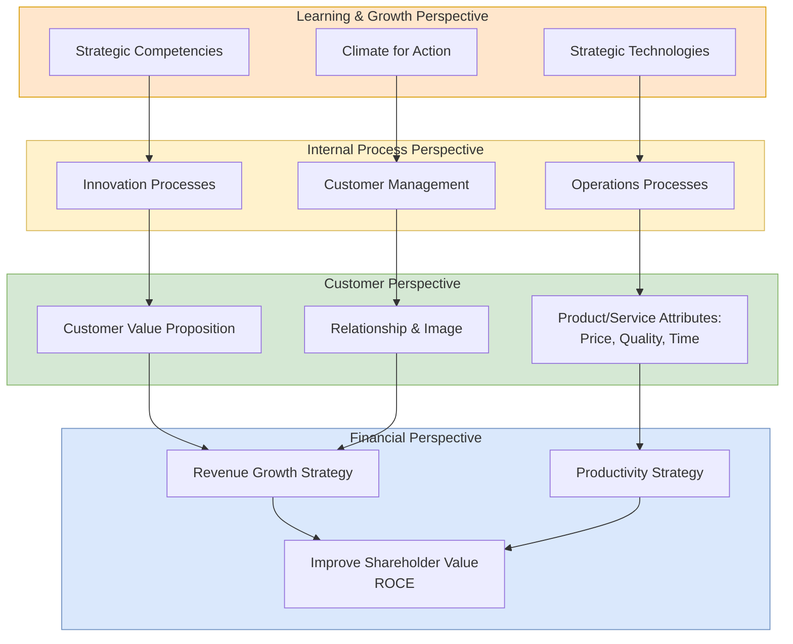

## 概述

平衡計分卡（BSC）是由 Robert Kaplan 和 David Norton 於1992年在《哈佛商業評論》首次發表的策略管理與績效衡量框架，從財務、顧客、內部流程及學習與成長四個維度全面評估組織績效，解決了傳統財務指標（ROE、ROA）作為落後指標無法反映未來競爭力的根本缺陷。策略地圖是 BSC 的核心視覺化工具，以自下而上的因果鏈呈現策略邏輯：投資人才與技術（學習與成長）→卓越流程執行（內部流程）→客戶價值傳遞（顧客）→財務成果（財務），確保每個 KPI 都有明確的策略驅動邏輯而非孤立的指標列表。BSC 的財務視角以杜邦分解（$ROE = \text{淨利率} \times \text{資產周轉率} \times \text{財務槓桿}$）和 NPV 為核心，EEMT5560 課程以 Apple 2021年報數據量化了一個反直覺發現：削減5%成本使 ROA 提升3.4個百分點，而增加5%營收僅提升2.2個百分點，因為節省的成本100%流入利潤而新增收入帶有等比例變動成本。財務槓桿扭曲效應（相同 EBIT 的公司 X ROE 達30%而公司 Y 僅8.4%，因資本結構截然不同）進一步說明為何單一財務指標會誤導績效比較。SIREN 儀表板（市場份額 S、庫存率 I、收入 R、費用比 E、稅後淨利 N）在 MBS 模擬中直接體現 BSC 的核心教訓：只優化滯後財務指標 N 的團隊往往在兩輪後因忽視先導客戶指標 S 而導致需求崩潰，與 Kaplan-Norton 反對純財務衡量的警示完全吻合。實施 BSC 時，15-25個指標是最優規模（每視角4-7個），過多指標導致「分析癱瘓」；最大失效模式是指標與策略目標脫鉤，或視角間假定的因果鏈在現實中不成立。

## Core Framework

The **Balanced Scorecard (BSC)** is a strategic planning and management framework developed by Robert Kaplan and David Norton, first introduced in a 1992 Harvard Business Review article. It addresses a fundamental limitation of traditional performance measurement: over-reliance on financial metrics, which are lagging indicators that reflect past decisions rather than future potential.

The BSC supplements financial measures with metrics from three additional perspectives, creating a "balanced" view of organizational performance that links short-term operational activities to long-term strategic objectives.

### The Four Perspectives

#### 1. Financial Perspective

**Key question**: "How do we look to shareholders?"

The financial perspective retains traditional financial metrics but places them within a strategic context. Common measures include:

- **Revenue growth** -- New revenue sources, customer profitability, sales mix
- **Cost reduction / productivity** -- Cost per unit, operating expense ratio
- **Asset utilization** -- Return on assets (ROA), return on equity (ROE), asset turnover
- **Shareholder value** -- Return on capital employed (ROCE), economic value added (EVA), NPV

In the MBS simulation, the financial perspective is measured through DuPont analysis and [[npv|NPV]] optimization. The DuPont decomposition is:

$$ROE = \text{Net Margin} \times \text{Asset Turnover} \times \text{Financial Leverage}$$

$$ROE = \frac{\text{Net Income}}{\text{Sales}} \times \frac{\text{Sales}}{\text{Total Assets}} \times \frac{\text{Total Assets}}{\text{Equity}}$$

Using Apple's 2021 annual report as the base case ($384.1B sales, $223.6B COGS, net income $96.6B, ROA 30.7%, asset turnover 1.04), the EEMT5560 lecture compares two operational improvements:

| Scenario | New Sales | New COGS | New Net Income | New Net Margin | New ROA |
|----------|----------|----------|----------------|----------------|---------|
| Baseline (2021) | $365.8B | $213.0B | $108.0B | 29.5% | 30.7% |
| +5% sales (COGS up proportionally) | $384.1B | $223.6B | $115.6B | 30.1% | **32.9% (+2.2 pp)** |
| -5% COGS (operational improvement) | $365.8B | $202.3B | $119.7B | 32.7% | **34.1% (+3.4 pp)** |

Cost reduction delivers a 55% larger ROA lift than the equivalent revenue increase -- because saved costs flow entirely to the bottom line while new revenue carries proportional variable costs with it. This is a cornerstone lesson of the course.

**Financial leverage distortion example** (from Lecture 14): Company X has $500 equity and $1,800 long-term debt ($2,500 assets), generating $280 EBIT; Company Y has $2,000 equity and zero debt, same $280 EBIT. After $180 interest expense, X earns net income of $60, giving ROA = 2.4% but ROE = **30%**. Y earns $168, giving ROA = 6.72% but ROE = only 8.4%. Same operating performance, wildly different ROE -- demonstrating how capital structure can dominate performance comparisons and why the Balanced Scorecard must look beyond a single financial metric.

#### 2. Customer Perspective

**Key question**: "How do customers see us?"

This perspective captures the value proposition delivered to target customers:

- **Customer acquisition** -- New customer count, market share in target segments
- **Customer retention** -- Repeat purchase rate, customer churn
- **Customer satisfaction** -- Survey scores, Net Promoter Score
- **Customer profitability** -- Revenue per customer, lifetime value

The three generic value propositions that organizations typically pursue:
- **Product leadership** -- Best product through innovation and quality (driven by R&D investment in MBS)
- **Customer intimacy** -- Best total solution through deep customer relationships
- **Operational excellence** -- Best total cost through efficiency and reliability

In MBS, the customer perspective is reflected in market-specific pricing strategies, marketing investment impact on potential demand, and product quality driven by R&D expenditure.

#### 3. Internal Process Perspective

**Key question**: "What must we excel at?"

This perspective identifies the critical internal processes that create and deliver the customer value proposition:

- **Innovation processes** -- R&D pipeline, new product development cycle time, patent portfolio
- **Operations processes** -- Production efficiency, quality rates, cycle times, capacity utilization
- **Customer management processes** -- Order fulfillment, post-sale service
- **Regulatory and social processes** -- Compliance, environmental impact

In MBS, internal process metrics include production efficiency (material conversion rates), equipment maintenance effectiveness, inventory management (avoiding stockouts and excess), and production-logistics coordination across markets.

#### 4. Learning and Growth Perspective

**Key question**: "Can we continue to improve and create value?"

This foundation perspective ensures the organization can sustain improvement:

- **Human capital** -- Employee skills, training hours, knowledge retention
- **Information capital** -- IT infrastructure, data analytics capabilities, system integration
- **Organization capital** -- Culture, leadership, teamwork, strategic alignment

This perspective is the least directly measured in MBS but is implicitly present in the progressive learning across Models 1-4, where teams develop increasingly sophisticated decision-making capabilities.

## Strategy Maps

A **strategy map** is a visual representation of how objectives across the four BSC perspectives are causally linked. It tells the "story" of the strategy:

The causal chain flows bottom-up: investing in people and technology (Learning & Growth) enables process excellence (Internal), which delivers customer value (Customer), which drives financial results (Financial).

## BSC in the MBS Simulation

The EEMT5560 course explicitly connects BSC to the MBS simulation's departmental performance evaluation. The MBS performance metrics map to BSC perspectives:

| BSC Perspective | MBS Performance Area | Example Metrics |
|-----------------|---------------------|-----------------|
| Financial | Financial department | Revenue / total financial expense & interest; ROE via DuPont |
| Customer (Marketing) | Marketing department | Revenue - total expenses per market |
| Internal (Operations) | Production department | Internal transfer pricing - total production expenses |
| Internal (Planning) | Planning department | Sales volume / (potential demand - sales volume) |
| Asset Management | Purchasing department | Internal transfer pricing - sum of purchase expenses |

Each department is evaluated using internal transfer pricing as a common baseline, ensuring that departmental performance reflects genuine value creation rather than accounting allocations.

### The SIREN Dashboard

The MBS management console exposes a five-KPI "SIREN" dashboard that functions as the simulation's live Balanced Scorecard:

| Letter | KPI | Formula | BSC Perspective |
|-------|-----|---------|-----------------|
| **S** | Market **S**hare | Company sales / total industry sales | Customer |
| **I** | **I**nventory rate | FG inventory / sales volume | Internal Process (Asset mgmt) |
| **R** | **R**evenue | Total sales revenue across all markets | Financial |
| **E** | **E**xpense ratio | (Marketing + Admin expense) / revenue | Financial / Internal |
| **N** | **N**et profit after tax | Revenue - COGS - Opex - Depreciation - Interest - Tax | Financial |

SIREN is paired with a financial index block (Current ratio, Debt ratio, Asset turnover, ROE, Net margin). The pedagogical point is that **SIREN intentionally spans multiple BSC perspectives** -- Market Share is a leading-indicator customer metric that predicts future Revenue, while Net Profit is the lagging financial outcome. Teams that optimize only N (net profit) often starve S (share) and watch demand collapse two rounds later via the deferred market-share effect -- a live demonstration of Kaplan and Norton's warning against pure financial measurement.

## Implementation Considerations

### Selecting KPIs

- **Limit to 15-25 measures** across all four perspectives (4-7 per perspective)
- Each measure should have a clear causal link to strategic objectives
- Balance **leading indicators** (drivers of future performance) with **lagging indicators** (outcomes)
- Ensure measures are actionable -- the responsible team must be able to influence the metric

### Common Pitfalls

- **Too many metrics** -- Leads to "paralysis by analysis" (as warned in the supply chain dashboard reading)
- **Misalignment** -- Metrics that don't connect to strategic objectives become bureaucratic exercises
- **Gaming** -- People optimize measured metrics at the expense of unmeasured outcomes
- **Static scorecard** -- Failing to update metrics as strategy evolves
- **Missing causality** -- Assuming correlation between perspectives without validating causal links

## Strengths and Limitations

**Strengths**:
- Forces strategic thinking beyond short-term financial results
- Creates explicit cause-and-effect links between activities and outcomes
- Enables communication of strategy throughout the organization
- Provides a framework for aligning initiatives, resources, and budgets to strategy

**Limitations**:
- Causal links between perspectives are assumed, not proven -- they may not hold in practice
- Can become a rigid measurement system rather than a dynamic management tool
- Implementation requires significant organizational commitment and cultural change
- Does not prescribe specific metrics -- organizations must design their own, which requires strategic clarity

## Related Concepts

- [[financial-ratios|Financial Ratios]] -- Traditional financial metrics that populate the Financial Perspective of the BSC.
- [[scor-model|SCOR Model]] -- Provides operational metrics that feed into the Internal Process perspective.
- [[porters-five-forces|Porter's Five Forces]] -- Industry analysis that informs the strategic objectives the BSC translates into metrics.
- [[crm|CRM]] -- Customer relationship management systems that generate data for the Customer Perspective.
- [[ahp|Analytic Hierarchy Process]] -- Can be used to assign weights to BSC perspectives and individual KPIs when composite scoring is required.
- [[Data Envelopment Analysis (DEA)|Data Envelopment Analysis]] -- Efficiency benchmarking can be applied across BSC dimensions to find best-practice business units.
- [[npv|NPV]] -- Shareholder-value metric prominent in the Financial Perspective; the primary MBS performance criterion.
- [[cvp-analysis|CVP Analysis]] -- Underpins the Financial Perspective's cost management levers.
- [[financial-statements|Financial Statements]] -- Income statement, balance sheet, and cash flow statement feed the Financial Perspective.
- [[marketing-mix|Marketing Mix]] -- Customer Perspective levers (4Ps/7Ps) translate into BSC metrics like share, satisfaction, and retention.
- [[stp-marketing|STP Marketing]] -- Segmentation and targeting shape which customer metrics matter most.
- [[littles-law|Little's Law]] -- Internal Process metrics like cycle time and work-in-process are related through this operations identity.
- [[wiki/mocs/operations-research|Operations Research MOC]] — Part of the OR PhD reading spine (Multi-Criteria Decision Analysis)

## Source Materials

- EEMT5560 Lecture 01: IPX Introduction
- EEMT5560 Lecture 02: AHP (KPI Weighting)
- EEMT5560 Lecture 14: MBS Model 4 (DuPont & BSC Strategy Map)
- Reading: Supply Chain Performance Dashboards
- [[wiki/sources/courses/integrated-business|EEMT5560 Integrated Business Solutions]]
