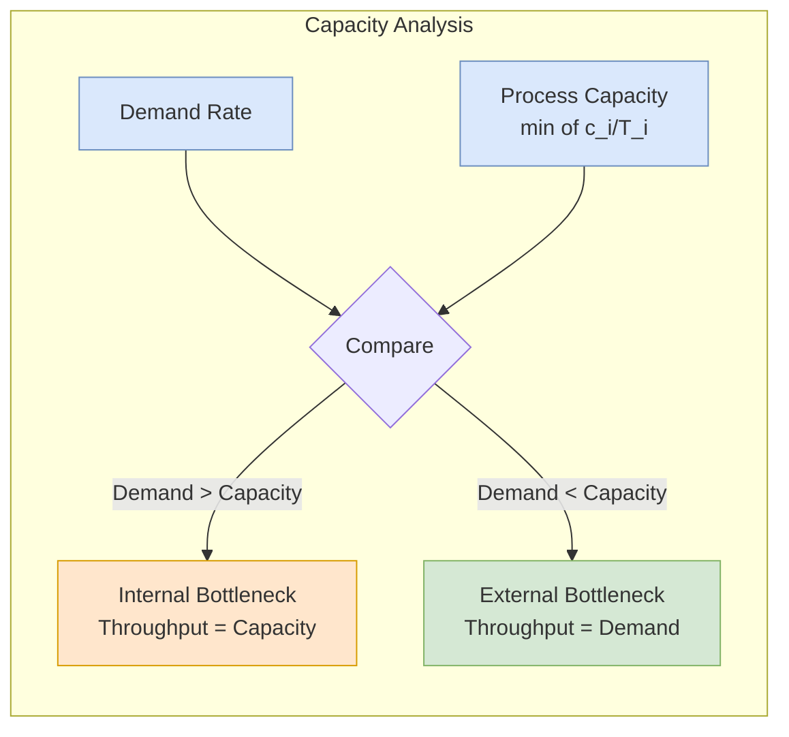

## 概述

產能規劃是確定系統最大可持續產出量並識別限制因素的管理方法，核心概念包括：理論產能、有效產能（等於資源數量除以單位處理時間，即 ci/Ti）、瓶頸（有效產能最低的資源池）及利用率（ρi = 吞吐率 × Ti/ci）。瓶頸決定整個製程的最大吞吐率，任何非瓶頸資源的產能提升皆不能增加系統總產出，除非先解除瓶頸。產能浪費因子（Capacity Waste Factor, CWF）量化計劃外停機、清潔及休息等非增值時間對有效產能的侵蝕，理論產能 = 有效產能 ÷ (1 − CWF)。在服務系統中，排隊理論補充了產能規劃的確定性框架：即使利用率低於 100%，隨機到達與服務的變異仍會造成等候，因此建議目標利用率維持在 70–85% 以控制等候時間。產能規劃是供應鏈設計（設施選址、倉庫規模）、收益管理（最優產能配置）及營運改善（流程重設計、交叉培訓）的前提決策，在運籌學研究中與整數規劃模型（如 CFLP）、隨機規劃及排隊優化密切相關。

## Core Definitions

**Capacity** is the maximum rate at which a system can process flow units (customers, orders, products) over a given time period. Several related definitions apply at different levels:

| Term | Definition | Formula |
|------|-----------|---------|
| **Theoretical capacity** | Maximum output under ideal conditions (no downtime, no variability) | Designed output rate |
| **Effective capacity** | Maximum output accounting for planned stoppages (maintenance, breaks) | $c_i / T_i$ per resource pool |
| **Demonstrated capacity** | Actual observed output over a historical period | Measured throughput |
| **Best operating level** | Output rate that minimizes average unit cost | Where economies of scale balance against diseconomies |

The gap between theoretical and effective capacity is captured by the **capacity waste factor** (CWF):

$$\text{Theoretical capacity} = \frac{\text{Effective capacity}}{1 - \text{CWF}}, \qquad \text{Theoretical unit load} = T_i \times (1 - \text{CWF})$$

**Example (bakery)**: Three bakers each take 30 min to bake a loaf. Pool effective capacity = $3 \times (1/30) = 0.1$ loaves/min = 6 loaves/hr. If 25% of process time is lost to cleaning, restocking, and breaks, the theoretical capacity is $6/(1-0.25) = 8$ loaves/hr and the theoretical unit load is $30 \times 0.75 = 22.5$ min. The 2 loaves/hr gap defines the improvement potential from eliminating non-value-added time.

The general hierarchy is:

$$\text{Throughput} \leq \text{Effective capacity} \leq \text{Theoretical capacity}$$

## Process Capacity Analysis

### Resource Pools and Activities

A process consists of **activities** performed by **resource pools**. Each resource pool i has:
- $c_i$ = number of resource units (servers, machines, workers)
- $T_i$ = unit processing time (time for one unit of resource to process one flow unit)

**Effective capacity of resource pool i** $= c_i / T_i$

### Bottleneck Identification

The **bottleneck** is the resource pool with the lowest effective capacity:

$$\text{Bottleneck} = \arg\min_i (c_i / T_i)$$

The bottleneck determines the **process capacity** -- the maximum sustainable throughput of the entire process. No matter how fast other resources are, the system cannot produce faster than its bottleneck.

**Bottleneck types**:
- **Internal bottleneck**: The constraint is within the process (a slow machine, an understaffed station).
- **External bottleneck**: The constraint is market demand -- the process has excess capacity but insufficient demand to use it.

### Throughput and Utilization

**Throughput** = min(demand rate, process capacity)

- If demand > process capacity: throughput = process capacity (system is capacity-constrained; internal bottleneck)
- If demand < process capacity: throughput = demand (system is demand-constrained; external bottleneck)

**Utilization** of resource pool i:

$$\rho_i = \frac{\text{throughput}}{c_i / T_i} = \text{throughput} \times \frac{T_i}{c_i}$$

Key insight: **the bottleneck always has the highest utilization** among all resources. When demand equals process capacity, bottleneck utilization = 100%.

## Flow Time Analysis

**Flow time** is the total time a flow unit spends from entry to exit:

$$\text{Flow time} = \sum \text{processing times} + \sum \text{waiting times}$$

In deterministic processes (no variability), flow time is simply the sum of activity times along the critical path. In stochastic processes, [[queueing-theory|queueing effects]] add waiting time that grows nonlinearly as utilization approaches 100%.

[[littles-law|Little's Law]] connects flow time to inventory: $L = \lambda W$, meaning higher flow times imply higher work-in-progress inventory for a given throughput rate.

## Capacity Levers

Managers can increase effective capacity through several mechanisms:

### Short-Term Adjustments
- **Add resource units**: Hire temporary workers, rent equipment (increases $c_i$).
- **Reduce processing time**: Streamline procedures, eliminate non-value-added steps (decreases $T_i$).
- **Overtime/extra shifts**: Extend operating hours (increases available time).
- **Cross-training**: Enable workers to cover multiple stations, reducing idle time from imbalanced loads.

### Long-Term Investments
- **Process redesign**: Restructure activities to rebalance workload across resources.
- **Automation**: Replace manual steps with faster, more consistent automated processes.
- **Facility expansion**: Add new production lines or service channels.

### Pooling Resources
Combining separate resource pools into one shared pool (analogous to the [[queueing-theory|pooling effect]] in queueing):
- Reduces idle time from demand variability
- Smooths workload fluctuations
- Increases effective throughput without adding capacity

## Practical Examples

### T-Shirt Production Line
A three-station process: cutting (5 min/unit), sewing (8 min/unit), packaging (3 min/unit).
- Station capacities: cutting = 12/hr, sewing = 7.5/hr, packaging = 20/hr
- Bottleneck: sewing at 7.5 units/hr
- Process capacity = 7.5 units/hr
- Adding a second sewing worker: sewing capacity = 2/8 = 15/hr, new bottleneck shifts to cutting

### Insurance Claims Processing
Activities: receive claim (10 min), verify coverage (15 min), assess damage (20 min), authorize payment (10 min).
- With one worker per activity: bottleneck = damage assessment at 3/hr
- Cross-training workers to handle both verification and assessment: effective capacity increases through workload balancing

### Hair Salon Operations
Two stylists, three activities (wash 10 min, cut 25 min, dry 15 min):
- If each stylist handles all three activities: capacity = 2/(50 min) = 2.4 customers/hr
- If one stylist specializes in cutting while an assistant handles wash/dry: bottleneck analysis shifts, potentially increasing throughput

### Fat Angelo's Restaurant
The Fat Angelo's case (HKUST ISOM, ST23) analyzes a 26-table Italian restaurant at Tsuen Wan. With average meal duration 90 minutes and capacity 26 tables, steady-state table-turn capacity is $26 / 1.5 \text{ hr} \approx 17$ parties/hr. Observed peak arrivals in the 8:00-8:45 pm window run 10-12 parties per 15 minutes ($\approx 40$-48 parties/hr), roughly **2.5× effective dining-room capacity**, producing the long queues and 40% balk rate at 30+ minute waits. The case illustrates:

- **Table turnover** as bottleneck: meal duration × table count sets the ceiling; kitchen is not the binding resource.
- **Kitchen vs. dining-room capacity**: kitchens scale incrementally (more cooks) whereas dining rooms require capital investment, so restaurant bottlenecks are typically seating.
- **Demand-side levers**: Early-bird 15% discount before 8 pm, HK\$250K Groupon off-peak campaign, bar diversion for pre-process waiting experience — all cheaper than adding seats.
- **Cost structure** (from the case): 75% fixed costs (30% rent/utilities, 30% labor, 15% overhead), 25% variable food cost; average dinner ticket HK\$200 at 20% net margin.

### Cathay Pacific Cargo Terminal
The Cathay Pacific case (see [[revenue-management|revenue management]]) is a long-horizon capacity decision: HACTL's SuperTerminal 1 caps out at 2.6M tonnes, and Cathay alone accounts for ~60% of that throughput. The captive build alternative was HK\$4.8B (revised to HK\$5.5B) over a 20-year concession. The case worksheet builds an NPV model at WACC $= 0.36 \times 4.1\% + 0.64 \times 11.9\% + 3\% \text{ premium} \approx 12.1\%$, with estimated HK\$1.3B annual max net income, 60% initial utilization rising 2%/yr, 1% organic growth, and HK\$240M straight-line depreciation. Result: NPV $\approx$ HK\$2.67B — positive but sensitive to utilization ramp and cargo-freight-rate assumptions, underscoring that capacity decisions at this scale are as much about demand forecast confidence as about engineering economics.

### LeadNitro SaaS Scaling
LeadNitro (HKUST case, 2024) frames capacity as **staffing and capability growth** for an AI-enabled B2B SaaS. The startup starts at 11 employees in Austin, TX and projects 20 by end-2024, 50 within a few years; client count grows from 40 → 180 → 300 → 400 → 500 over four fiscal years with corresponding revenue from USD 120K to USD 2.5M. The operational challenge is to ramp software-developer capacity (4 → 15) and sales headcount (5 → 10) in time to meet a 350% then 94% then 57% then 52% YoY revenue growth curve — a classic **capacity-precedes-demand** service-ops decision. LeadNitro also illustrates pooling (end-to-end integration of prospecting + CRM + outbound email into one workflow absorbs capacity that would otherwise sit idle in three separate tools) and the Greater Bay Area talent-pool option as an alternative to scaling local headcount.

## Capacity-Utilization-Congestion Trade-off

A critical insight connecting capacity planning to [[queueing-theory|queueing theory]]:

Operating at or near 100% utilization causes extreme congestion. In service systems:
- **Target utilization of 70-85%** balances cost efficiency against customer waiting time.
- The relationship between utilization and waiting is convex -- small increases in utilization near the maximum cause disproportionately large increases in waiting time.
- [[revenue-management|Revenue management]] helps maximize the revenue extracted from available capacity without necessarily increasing physical capacity.

## Related Concepts

- [[littles-law|Little's Law]]
- [[queueing-theory|Queueing Theory]]
- [[newsvendor-problem|Newsvendor Problem]]
- [[revenue-management|Revenue Management]]
- [[wiki/mocs/operations-research|Operations Research MOC]] — Part of the OR PhD reading spine (Queueing and Stochastic Service Systems)

## Source Materials

- [[wiki/sources/courses/service-ops|EEMT5520 Service Operations Management]]
- Capacity Planning Slides
- Process Capacity
- Process Analysis
