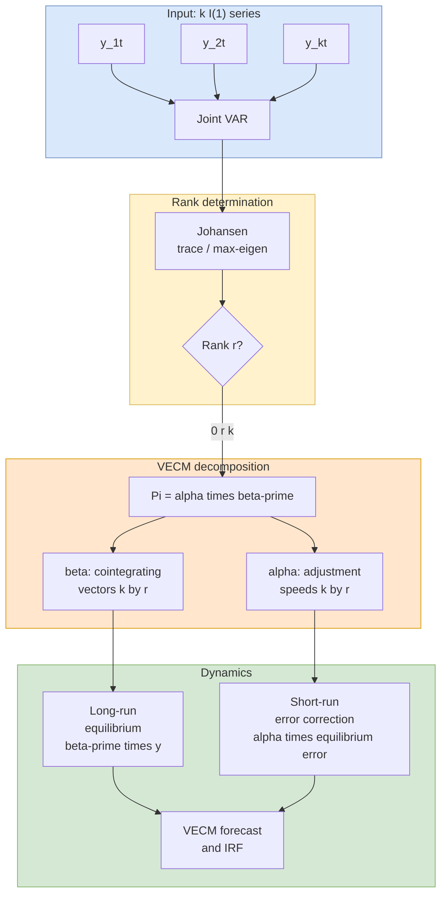

## 概述

共整合理論（Cointegration）與多元時間序列模型是同時分析多個非定態金融序列長期均衡關係的核心框架。其形式化定義由 Engle & Granger（1987）給出：若 $k$ 個 I(1) 序列存在非零向量 $\beta$ 使得 $\beta' y_t \sim I(0)$，則稱這些序列共整合，共享 $k - r$ 個共同隨機趨勢（$r$ 為共整合階數）。向量自迴歸模型（VAR(p)）是多元動態分析的基本工具，其每條方程可分別以 OLS 估計（SUR 等效性），但參數數目 $k^2 p$ 隨維度快速增長，易在有限樣本中過擬合。Granger 表現定理揭示：I(1) 共整合系統等價於向量誤差修正模型（VECM）$\Delta y_t = \alpha\beta' y_{t-1} + \sum \Phi_i^* \Delta y_{t-i} + \varepsilon_t$，其中 $\beta$ 為共整合向量矩陣，$\alpha$ 為各序列對偏離均衡的調整速度；此分解清晰地區分了長期均衡關係（$\beta$）與短期動態修正（$\alpha$）。Johansen 迹統計量與最大特徵值統計量是確定共整合階數 $r$ 的標準工具，可一次性估計所有共整合向量，克服了 Engle-Granger 兩步法僅適用於雙變量、且需指定因變量的局限。在實際應用中，共整合是配對交易策略的理論基礎——均衡誤差 $\hat{z}_t = \beta' y_t$ 的均值回歸速度（半衰期）決定了策略的交易頻率與盈利潛力；殖利率曲線中短期與長期利率的共整合關係則是利率衍生品定價與養老基金免疫策略（duration matching）的核心假設。在 OR 研究中，供應鏈各層次的需求信號往往具有共整合結構，VECM 的誤差修正項可量化牛鞭效應（bullwhip effect）中各層次庫存調整的速度與方向。MSBD5006 課程以美國一年期與三年期國庫券殖利率共整合、香港 Centa-City 指數驅動因素的雙變量 VAR，以及港電與中電的 GARCH-pairs-trading 策略為主要實證案例。

## From Univariate to Multivariate

While [[arma-models|ARMA models]] analyze one series at a time, many financial questions involve relationships between multiple series: How do bond yields at different maturities co-move? Does the S&P 500 lead or lag individual stocks? Can we exploit long-run equilibria between related assets? Does monetary policy transmit to both output and inflation?

**Multivariate time series models** analyze a $k$-dimensional vector $z_t = (z_{1t}, z_{2t}, \ldots, z_{kt})'$ jointly, capturing both within-series dynamics and cross-series interactions. The building block is the **cross-covariance matrix**

$$\Gamma(l) = \text{Cov}(z_t, z_{t-l}) = E[(z_t - \mu)(z_{t-l} - \mu)']$$

with lag-$l$ cross-correlation matrix $\rho(l) = D^{-1} \Gamma(l) D^{-1}$ where $D = \text{diag}(\sqrt{\gamma_{11}(0)}, \ldots, \sqrt{\gamma_{kk}(0)})$. Note that $\Gamma(l) = \Gamma'(-l)$, so the full autocovariance structure is not symmetric across lags.

## Vector Autoregressive Models: VAR(p)

The **VAR(p)** model is the multivariate extension of the AR(p):

$$z_t = \phi_0 + \Phi_1 z_{t-1} + \Phi_2 z_{t-2} + \cdots + \Phi_p z_{t-p} + a_t$$

where $z_t$ is a $k \times 1$ vector, $\phi_0$ is a $k \times 1$ intercept, each $\Phi_i$ is a $k \times k$ coefficient matrix, and $a_t$ is a $k \times 1$ white-noise vector with $E(a_t) = 0$ and $\text{Cov}(a_t) = \Sigma_a$ (a $k \times k$ cross-covariance matrix, not generally diagonal).

### Estimation

Each equation of a VAR(p) can be estimated by **OLS** separately. This is efficient because all equations share the same regressors $(1, z_{t-1}', \ldots, z_{t-p}')$ — a classical result (Zellner 1962): SUR reduces to equation-by-equation OLS when regressors are identical. Total parameters: $k^2 p + k$ (coefficient matrices plus intercepts), plus $k(k+1)/2$ in $\Sigma_a$. For a bivariate VAR(5), there are already $2^2 \times 5 + 2 = 22$ coefficient parameters — VAR models grow dimensionally fast and can overfit when $T$ is modest.

### Order Selection

The lag order $p$ is selected using multivariate information criteria:

$$\text{AIC}(p) = \ln|\hat{\Sigma}(p)| + \frac{2 k^2 p}{T}$$
$$\text{BIC}(p) = \ln|\hat{\Sigma}(p)| + \frac{k^2 p \ln T}{T}$$
$$\text{HQIC}(p) = \ln|\hat{\Sigma}(p)| + \frac{2 k^2 p \ln\ln T}{T}$$

where $|\hat{\Sigma}(p)|$ is the determinant of the residual covariance matrix. In R, `VARselect()` from the `vars` package or `VARorder()` from `MTS` compute these criteria across a lag grid. Lütkepohl (2005) recommends HQIC as a balance between AIC and BIC for macro-finance data.

### VAR Properties

- **Stationarity**: All eigenvalues of the $kp \times kp$ **companion matrix** must lie strictly inside the unit circle. Equivalently, all roots of $|I_k - \Phi_1 z - \cdots - \Phi_p z^p| = 0$ lie outside the unit circle.
- **Granger causality**: Series $z_{1t}$ Granger-causes $z_{2t}$ if past values of $z_1$ help predict $z_2$ beyond $z_2$'s own past. Tested by restricting the relevant off-diagonal blocks of $\Phi_i$ (for all $i$) to zero; under the null it is a Wald/F test or LR test.
- **Impulse response functions**: Trace the dynamic effect of a one-unit shock in one series on all other series over time. Orthogonalized IRFs use a Cholesky decomposition $\Sigma_a = U'U$ so shocks are uncorrelated; however, results depend on variable ordering. Generalized IRFs (Pesaran & Shin 1998) avoid ordering dependence.
- **Forecast error variance decomposition (FEVD)**: Splits forecast-error variance at each horizon among shocks to each variable.

### Multivariate Ljung-Box

Diagnostic testing of VAR residuals uses the **multivariate portmanteau (Hosking) statistic**:

$$Q_k(m) = T^2 \sum_{l=1}^m \frac{1}{T - l} \text{tr}\left[\hat{\Gamma}'(l) \hat{\Gamma}^{-1}(0) \hat{\Gamma}(l) \hat{\Gamma}^{-1}(0)\right] \sim \chi^2(k^2 m - g)$$

where $g$ is the number of estimated VAR parameters. Implemented as `serial.test()` in `vars` or `mq()` in `MTS`.

## Vector Moving Average and VARMA

The **VMA(q)** model expresses $z_t$ as a linear combination of current and past innovations:

$$z_t = c_0 + a_t - \Theta_1 a_{t-1} - \cdots - \Theta_q a_{t-q}$$

Invertibility requires all roots of $|I_k - \Theta_1 z - \cdots - \Theta_q z^q| = 0$ to lie outside the unit circle. For a VMA($q$) process, $\Gamma(l) = 0$ for $|l| > q$, providing a direct identification tool.

The **VARMA(p,q)** model combines both:

$$\Phi(B) z_t = \phi_0 + \Theta(B) a_t$$

where $\Phi(B) = I_k - \Phi_1 B - \cdots - \Phi_p B^p$ and $\Theta(B) = I_k - \Theta_1 B - \cdots - \Theta_q B^q$. VARMA is more parsimonious than pure VAR for some DGPs but estimation is more complex and subject to identification issues.

### Identification Issues

Unlike univariate ARMA, VARMA models suffer from **identifiability problems**: different VARMA parameterizations can produce the same autocovariance structure. A classical example (Hannan 1971) shows that a VARMA(1,1) with certain parameter restrictions is observationally equivalent to a pure VAR. Identification requires that the only common left divisors of $\Phi(B)$ and $\Theta(B)$ be unimodular matrices. Practical approaches include:

- **Kronecker indices**: Assigning McMillan degrees to each output.
- **Scalar Component Models (SCM)**: Tsay's approach in the `MTS` package.
- **Echelon form**: Imposing a canonical structure.

Many analysts prefer pure VAR models to avoid these complications, accepting a potentially higher lag order. The `MTS` package provides `VARMA()` for conditional MLE and `refVARMA()` to iteratively remove insignificant parameters, producing a more parsimonious final model.

## Cointegration Theory

### The Problem with Differencing

When individual series are **I(1)** (non-stationary, requiring one difference to achieve stationarity), the standard approach is to model their first differences. But differencing discards information about **long-run equilibrium relationships** between the series. If two prices are tied together by arbitrage or economic theory, a VAR on differences would miss this. Cointegration recovers this information.

### Definition (Engle & Granger, 1987)

A set of I(1) series $y_t = (y_{1t}, \ldots, y_{kt})'$ are **cointegrated** if there exists a non-zero vector $\beta$ such that

$$\beta' y_t = \beta_1 y_{1t} + \beta_2 y_{2t} + \cdots + \beta_k y_{kt} \sim I(0)$$

More generally, $y_t$ is $CI(d, b)$ if each component is $I(d)$ and $\beta' y_t \sim I(d - b)$ for some $b > 0$. The vector $\beta$ is the **cointegrating vector**, and $z_t = \beta' y_t$ is the **cointegrating residual** (or equilibrium error). Intuitively, although each series wanders randomly (unit root), they are "tied together" by a long-run equilibrium: deviations from the equilibrium are stationary and mean-reverting.

### Common Stochastic Trends

If $k$ series have $r$ cointegrating relationships ($0 < r < k$), they share $k - r$ **common stochastic trends** (Stock & Watson 1988). For example, two cointegrated I(1) series share one common trend: they move together in the long run, with temporary deviations that revert to equilibrium. The matrix $\beta$ (dimension $k \times r$) is not uniquely identified — any non-singular rotation $\beta H$ yields an equivalent basis for the cointegration space — so normalization conventions are used (e.g., unit coefficient on one variable).

## Engle-Granger Two-Step Method

The **Engle-Granger method** (1987) is the simplest approach to testing for and estimating cointegration between two I(1) series:

**Step 1 — Cointegrating regression**: Estimate by OLS using [[linear-regression|linear regression]]:

$$y_t = \alpha + \beta x_t + z_t$$

Save the residuals $\hat{z}_t = y_t - \hat{\alpha} - \hat{\beta} x_t$. Under cointegration, the OLS estimator $\hat{\beta}$ is **super-consistent**: $\hat{\beta} - \beta_0 = O_p(T^{-1})$ rather than the usual $O_p(T^{-1/2})$ rate. Standard errors, however, are non-standard.

**Step 2 — Unit root test on residuals**: Apply the ADF test to $\hat{z}_t$. If the null of a unit root is rejected, the series are cointegrated. Critical values differ from standard ADF tables because $\hat{z}_t$ is estimated, not observed — use **Engle-Granger** or **Phillips-Ouliaris** critical values. Package `urca::po.test()` in R performs this directly.

### Limitations

Engle-Granger has drawbacks that motivate the Johansen procedure:

- Requires choosing a dependent variable (asymmetric treatment).
- Assumes at most one cointegrating relationship; cannot distinguish $r = 1$ from $r = 2$ in a 3-variable system.
- Statistical inference on $\hat{\beta}$ is complicated because the asymptotic distribution depends on nuisance parameters.
- Small-sample bias in the cointegrating regression can be substantial (Banerjee, Dolado, Galbraith, Hendry 1993).

## Johansen Procedure

The **Johansen test** (1988, 1991, 1995) uses **reduced-rank regression** on the VECM representation to estimate all cointegrating vectors simultaneously and test the cointegration rank $r$.

### VECM Representation

Starting from a VAR(p), subtract $y_{t-1}$ from both sides and rearrange to get the **Vector Error Correction Model (VECM)**:

$$\Delta y_t = \Pi y_{t-1} + \sum_{i=1}^{p-1} \Phi_i^* \Delta y_{t-i} + \varepsilon_t$$

where $\Pi = -\Phi(1) = -(I_k - \Phi_1 - \cdots - \Phi_p)$ and $\Phi_i^* = -\sum_{j=i+1}^p \Phi_j$. The rank of $\Pi$ determines the cointegration structure:

- $\text{rank}(\Pi) = 0$: No cointegration; VAR in first differences is appropriate.
- $\text{rank}(\Pi) = k$: All components are stationary; fit a VAR in levels.
- $0 < \text{rank}(\Pi) = r < k$: $r$ cointegrating relationships; decompose $\Pi = \alpha \beta'$ where $\beta$ ($k \times r$) contains the cointegrating vectors and $\alpha$ ($k \times r$) contains the **adjustment speeds** — how quickly each series corrects toward equilibrium.

This is the **Granger Representation Theorem**: I(1) cointegrated systems admit both a VAR and a VECM representation, with $\beta' y_{t-1}$ acting as an error-correction term pulling the system back toward equilibrium.

### Trace and Maximum-Eigenvalue Tests

Johansen derives two likelihood-ratio tests based on the ordered eigenvalues $\hat{\lambda}_1 > \cdots > \hat{\lambda}_k$ from a canonical correlation / reduced-rank regression:

- **Trace statistic**: Tests $H_0$: rank $\leq r$ against $H_a$: rank $> r$.

  $$\lambda_{\text{trace}}(r) = -T \sum_{i = r+1}^k \ln(1 - \hat{\lambda}_i)$$

- **Maximum-eigenvalue statistic**: Tests $H_0$: rank $= r$ against $H_a$: rank $= r + 1$.

  $$\lambda_{\max}(r) = -T \ln(1 - \hat{\lambda}_{r+1})$$

Both statistics follow non-standard distributions that depend on the deterministic terms (constant, trend, none), tabulated by Johansen & Juselius (1990) and MacKinnon, Haug, Michelis (1999). Implemented in `urca::ca.jo()` in R and `ECMvar()` in `MTS`.

The procedure to determine $r$: start from $r = 0$ and increment until the null is not rejected.

## VECM System Structure



## Diagnostic Checking for Multivariate Models

After fitting a VAR or VARMA, diagnostics parallel the univariate case:

1. **Multivariate Ljung-Box (Hosking)**: Tests whether residual cross-correlations are jointly zero. `serial.test()` in `vars` or `MTSdiag()` / `mq()` in `MTS`.
2. **Cross-correlation matrices (CCM)**: `ccm()` in `MTS` displays and tests individual cross-correlations at various lags.
3. **Multivariate ARCH-LM test**: `arch.test()` in `vars` tests for multivariate volatility clustering in residuals (relevant when ARCH effects suggest a multivariate GARCH layer).
4. **Multivariate normality**: Jarque-Bera-type tests on residuals.
5. **Stability check**: Verify that VAR companion-matrix eigenvalues all lie inside the unit circle.
6. **Model refinement**: `refVARMA()` in `MTS` removes parameters with $|t|$ below a threshold (commonly 1.96) and re-estimates, yielding a parsimonious reduced-parameter VARMA.

## Financial Applications

### Pairs Trading

Cointegration is the theoretical foundation for **pairs trading**: identify two cointegrated assets, go long the undervalued one and short the overvalued one when the spread $\hat{z}_t = y_t - \hat{\beta} x_t$ deviates from its mean, and close the position when the spread reverts. Key practical considerations:

- The cointegrating relationship must be stable out-of-sample. Rolling tests are standard.
- Mean reversion speed ($\alpha$ in the VECM) determines profitability; half-life of the spread is $\ln(0.5) / \ln(1 + \alpha)$ under an AR(1) approximation of the spread.
- Transaction costs, execution risk, and hard-to-borrow costs can erode theoretical profits.
- Relationships can break via structural change (corporate actions, regime shifts). Out-of-sample breakdowns are common.

### Yield Curve Modeling

Interest rates at different maturities (e.g., 1-year and 3-year Treasury yields GS1/GS3) are typically cointegrated: the spread between long and short rates is stationary even though individual rates are I(1). This is demonstrated in the MSBD5006 course using Federal Reserve GS1 and GS3 monthly data. The same principle underlies **affine term-structure models**.

### Purchasing Power Parity and Exchange Rates

Log spot exchange rates and relative price levels should, in theory, be cointegrated with a known vector $(1, -1, 1)$ under long-run PPP. Empirical tests are mixed; PPP holds weakly over multi-decade horizons.

### Portfolio Construction

Cointegration-based portfolios are constructed to be stationary (delta-neutral in the stochastic trend), providing a basis for mean-reversion strategies that differ structurally from correlation-based diversification. **Minimum-variance portfolios** computed on I(1) series are biased; cointegration-aware weighting avoids this.

## Worked Examples

These worked examples are drawn from MSBD5006 selected projects (see [[financial-time-series|MSBD5006]] for the full project catalog). Each applies one multivariate tool — bivariate return correlation, VAR-based lead-lag analysis, or pairs-based mean reversion — to a named real-world dataset.

### CLP vs HK Electric: Bivariate GARCH on the Log Price-Ratio

The 2009 MAFS513 project analyzes **China Light & Power (`0002.HK`)** and **HK Electric (`0006.HK`)** — two HK utilities with nearly identical business models — using 331 weeks of data from 2003 to May 2009. The two weekly log-return series are strongly correlated (null of independence decisively rejected at $p < 0.0001$), justifying the construction of a log price-ratio series $\log(P_{\text{CLP},t} / P_{\text{HKE},t})$ as the target for a pairs-trading strategy. The project fits a $\text{GARCH}(1,1)$ on the price-ratio log-returns (selected by AIC over a grid of GARCH orders), uses the conditional standard deviation to build a *range forecast*, and enters long-short positions when the observed ratio deviates from the forecast beyond a $\pm k\hat\sigma_t$ band. The refinement matters: a plain fixed-threshold pairs trade on the ratio is dominated out-of-sample by the GARCH range-based version, because the trading band expands during volatile regimes and contracts during calm ones. This is a clean empirical illustration of the theoretical claim that **volatility-aware pairs trading** is preferable to threshold-based variants when the spread itself is heteroscedastic.

Methodologically the project stops short of a full cointegration test — it relies on return correlation and business-similarity arguments rather than testing $\beta' y_t \sim I(0)$ directly. For an OR research extension, the natural upgrade is: (1) Engle-Granger or Johansen on $(\log P_{\text{CLP}}, \log P_{\text{HKE}})$, (2) VECM for short-run error-correction dynamics, and (3) an optimal-stopping formulation of the trade entry/exit problem on the stationary spread (cf. Jurek-Yang 2007; Leung-Li 2016).

### HK Centa-City Index: Bivariate VAR on Property Drivers

The 2011 MAFS513 project studies the **Centa-City Index (CCI)** — a monthly HK residential-property index — and asks which macro variables Granger-cause its returns. Each driver is tested via a bivariate $\text{VAR}(p)$ on $(\Delta \log \text{CCI}_t, \Delta X_t)$ for $p \in \{1,3,4\}$:

| Driver $X_t$ | Transformation | VAR order | Finding |
|---|---|---|---|
| Aggregate Balance (HKMA) | level | 1 | Granger-causes $\Delta\log \text{CCI}$ |
| 1M HIBOR | first difference | 1 | First-difference non-stationary (ADF fails); no causality detected |
| 3M HIBOR | first difference | 1 | Same as 1M |
| HSBC Prime Rate | first difference | 1 | No significant causality |
| USD Index | $\Delta \log$ | 1, 3, 4 | Fails Granger at all three lag orders |
| Hang Seng Index | $\Delta \log$ | 1 | Bidirectional lead-lag; strongest signal |
| CPI, GDP | various | 1 | Weak relationships only |

The key methodological lesson is the interaction between **unit-root testing** and **VAR construction**: differencing twice (once for trend, once because HIBOR itself is still non-stationary after one difference) destroys enough structure that Granger-causality tests return no signal. A proper cointegrated VAR / VECM treatment would likely recover the HIBOR-property link via a stationary linear combination, but the pure VAR-on-differences approach used in the project does not. This is exactly the **"differencing discards long-run information"** failure mode that motivates Engle-Granger and Johansen. A PhD-level reanalysis of this dataset with Johansen is a low-hanging research extension directly relevant to **HK mortgage-portfolio ALM** and **real-estate-backed securitization risk**.

### Yield-Curve Cointegration: 1-Year vs 3-Year Treasury Yields

The MSBD5006 lecture on cointegration uses monthly 1-year and 3-year Treasury constant-maturity yields (`m-gs1.txt` / `m-gs3.txt` from FRED) as the running example. Each individual yield is $I(1)$ (ADF fails to reject), yet the term spread $y_{3,t} - y_{1,t}$ is stationary — the textbook demonstration that **the cointegrating vector $\beta = (1, -1)'$ is known a priori from no-arbitrage theory** even when it could also be estimated freely. The Johansen trace test on this pair rejects $r=0$ but fails to reject $r=1$, confirming exactly one cointegrating relationship. The VECM yields a negative adjustment speed on the long rate, meaning the long end corrects toward the short end when the spread widens — empirically consistent with the **expectations hypothesis** over short horizons.

### R: Reproducing the Yield-Curve Example

```r
library(urca)
# y = cbind(gs1, gs3) monthly Treasury yields
VARselect(y, lag.max = 12, type = "const")$selection   # pick p
jo <- ca.jo(y, type = "trace", K = 2,
            ecdet = "const", spec = "longrun")
summary(jo)                           # trace stats + critical values
# Estimate VECM and convert back to level-VAR for forecasting
vecm <- cajorls(jo, r = 1)
var_lvl <- vec2var(jo, r = 1)
predict(var_lvl, n.ahead = 6, ci = 0.95)
```

## R Implementation

The course demonstrates two R ecosystems for multivariate analysis:

**`vars` package**:

```r
library(vars)
VARselect(y, lag.max=10, type="const")$selection     # AIC/BIC/HQ/FPE
fit <- VAR(y, p=2, type="const")
summary(fit)
serial.test(fit, lags.pt=20, type="PT.adjusted")     # residual autocorr
arch.test(fit, lags.multi=5)                         # residual ARCH
normality.test(fit)
irf(fit, impulse="r1", response="r2",
    n.ahead=10, boot=TRUE, ortho=TRUE)
fevd(fit, n.ahead=10)
predict(fit, n.ahead=6, ci=0.95)
```

**`MTS` package**:

```r
library(MTS)
VARorder(y, maxp=13)                 # sequential chi-sq + IC
m1 <- VARMA(y, p=2, q=1)             # conditional MLE
m2 <- refVARMA(m1, thres=1.96)       # drop insignificant params
MTSdiag(m2, gof=24)                  # comprehensive diagnostics
VARMApred(m2, h=4)                   # multi-step forecasts
```

**Johansen cointegration (via `urca`)**:

```r
library(urca)
jo <- ca.jo(y, type="trace", K=2, ecdet="const", spec="longrun")
summary(jo)                          # trace statistics + critical values
# Convert VECM to VAR in levels
vec2var(jo, r=1)
```

## Related Concepts

- [[arma-models|ARMA Models]] -- Univariate foundation; ARIMA models handle single I(1) series via differencing
- [[garch|GARCH Models]] -- Multivariate GARCH (DCC, BEKK, CCC) extends volatility modeling to vector settings; VAR residuals often exhibit multivariate ARCH effects
- [[linear-regression|Linear Regression]] -- The cointegrating regression in step 1 of Engle-Granger is an OLS regression; spurious regression arises when non-cointegrated I(1) series are regressed on each other (Granger-Newbold 1974)
- [[pca|Principal Component Analysis]] -- Related to common-trend extraction; the Stock-Watson common trends representation is analogous to PCA on I(1) data; useful for dimension reduction in large VARs
- [[financial-ratios|Financial Ratios]] -- Spread-based ratios and yield-curve metrics connect to cointegration analysis
- [[logistic-regression|Logistic Regression]] -- Discrete-choice modeling of regime switches and spread sign changes
- [[supply-chain-management|Supply Chain Management]] -- Upstream and downstream demand signals are often cointegrated; the bullwhip effect can be diagnosed as a cointegration break between echelons, and VECM error-correction terms quantify the speed of inventory adjustment
- [[newsvendor-problem|Newsvendor Problem]] -- Multi-product newsvendor with correlated demand requires a multivariate model; cointegration and VAR identify the common trends that drive joint order quantities
- [[wiki/mocs/operations-research|Operations Research MOC]] — Part of the OR PhD reading spine (Financial Time Series and Econometrics)

## Source Materials

- [[wiki/sources/courses/financial-time-series|MSBD5006 Quantitative Analysis of Financial Time Series]]
- Lecture 7-8: Multivariate Time Series
- Lecture 9: Multivariate Models, Cointegration, VECM, Johansen
- R: VARMA Analysis
- MTS Package Documentation
- vars Package Documentation
