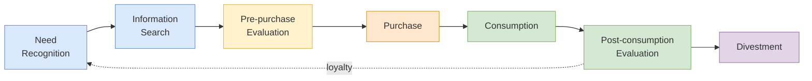

## 概述

消費者行為是研究個人、群體及組織如何選擇、購買、使用及處置產品與服務的跨學科領域，整合心理學（動機、感知、學習、信念與態度）、社會學（參照群體、家庭、角色）、人類學（文化、亞文化）和經濟學（效用、價格彈性）的視角。刺激-反應「黑箱」模型是基礎分析框架：行銷刺激（4P）和環境刺激（經濟、技術、文化）進入消費者黑箱（特徵×決策過程），輸出可觀察的購買行為，而黑箱內部正是行銷研究試圖理解的核心。購買決策過程遵循七步驟 CDP 模型（需求認知→信息搜尋→購前評估→購買→消費→購後評估→處置），但參與程度決定執行深度：高參與（汽車、房產）完整展開七步驟，低參與（牙膏、口香糖）壓縮為近自動習慣性反應。評估替代品時，補償性模型（加權多屬性）允許強項抵消弱項，非補償性模型（聯合、分離、字典序）設置硬性截止點——高參與者常先用非補償模型篩選，再用補償模型做最終選擇；Fishbein 多屬性模型 $A_o = \sum_i b_i e_i$ 將態度形式化為信念強度與屬性評價的加權積。可口可樂「新配方」事件是核心案例：耗資400萬美元、19萬次口味測試的研究未能捕捉品牌忠誠作為情感與文化紐帶的本質，說明消費者行為研究必須同時涵蓋理性（屬性）和情感（身份認同、懷舊）兩個維度，這與[[wiki/concepts/behavioral-economics|行為經濟學]]對「理性消費者」假設的系統性挑戰相呼應。東西方文化差異（集體主義vs個人主義、高情境vs低情境溝通、面子驅動的品牌信號vs個人表達）對跨國行銷策略有深遠影響，而數字時代的顧客旅程地圖（CJM）和用戶角色（Persona）將消費者行為理論轉化為跨觸點設計的可操作工具，[[wiki/concepts/recommendation-systems|推薦系統]]和[[wiki/concepts/nlp-basics|NLP]]情感分析則實現了大規模的個體行為模式識別。

## What Consumer Behavior Is

**Consumer behavior** is the study of how individuals, groups, and organizations select, buy, use, and dispose of goods, services, ideas, or experiences to satisfy their needs and wants. It draws on psychology, sociology, anthropology, and economics to explain why people make the purchasing decisions they do. For marketers, understanding consumer behavior is not academic -- it directly determines how to segment markets ([[wiki/concepts/stp-marketing|STP Marketing]]), what value propositions to build, and how to design every element of the [[wiki/concepts/marketing-mix|Marketing Mix]].

## The Stimulus-Response Model

The foundational model of consumer behavior taught in SBMT5030 is the **Stimulus-Response Model** (also called the "Black Box" model). It works as follows:

```
Marketing Stimuli + Environmental Stimuli
            |
            v
    Buyer's Black Box
    (Buyer Characteristics + Buyer Decision Process)
            |
            v
    Buyer Responses
    (Product choice, Brand choice, Dealer choice,
     Purchase timing, Purchase amount)
```

**Marketing stimuli** are the 4Ps: product, price, place, and promotion. **Environmental stimuli** include economic conditions, technological changes, political factors, and cultural forces. These stimuli enter the buyer's "black box" -- a metaphor for the internal processes marketers cannot directly observe -- where buyer characteristics and the decision process interact to produce observable purchase behavior.

The marketer's challenge is to understand what happens inside the black box: how stimuli are transformed into responses. This requires studying the four categories of factors that shape buyer characteristics.

## Four Factor Categories

### Cultural Factors

Cultural factors exert the broadest and deepest influence on consumer behavior.

- **Culture** -- the set of basic values, perceptions, wants, and behaviors learned from family and other important institutions. Culture is the most fundamental determinant of a person's wants and behavior.
- **Subculture** -- groups within a culture that share value systems based on common life experiences (nationalities, religions, racial groups, geographic regions). Each subculture represents a potential market segment.
- **Social class** -- relatively permanent, ordered divisions in a society whose members share similar values, interests, and behaviors. Social class is determined by a combination of occupation, income, education, wealth, and other variables.

### Social Factors

- **Reference groups** -- groups that serve as direct (face-to-face) or indirect points of comparison or reference in forming attitudes or behavior. These include **membership groups** (groups a person belongs to), **aspirational groups** (groups a person wishes to join), and **dissociative groups** (groups a person rejects).
- **Opinion leaders** -- people within a reference group who, because of special skills, knowledge, personality, or other characteristics, exert social influence on others. Also called **influencers** or **leading adopters**. Marketers increasingly identify and recruit opinion leaders through social media and influencer marketing programs.
- **Family** -- the most important consumer-buying organization in society. Marketers study the roles and influence of husband, wife, and children in purchase decisions. Family influence patterns vary significantly across cultures and product categories.
- **Roles and status** -- a person holds many roles (employee, parent, club member) each carrying a status. People choose products that reflect and communicate their role and status in society.

### Personal Factors

- **Age and life-cycle stage** -- people change the goods and services they buy over their lifetime. Family life-cycle stages (young single, married with children, empty nesters) create distinct buying patterns.
- **Occupation** -- influences the goods and services a person buys. Blue-collar workers buy more rugged work clothes; executives buy business suits.
- **Economic situation** -- affects product and store choice. Marketers of income-sensitive goods closely monitor trends in personal income, savings, and interest rates.
- **Lifestyle** -- a person's pattern of living as expressed in activities, interests, and opinions (AIOs). Lifestyle captures something beyond social class or personality -- it profiles a person's whole pattern of acting and interacting in the world.
- **Personality and self-concept** -- each person's distinct personality influences buying behavior. Brand personality (sincerity, excitement, competence, sophistication, ruggedness) attracts consumers whose self-concept matches.

### Psychological Factors

- **Motivation** -- a need becomes a motive when it is sufficiently pressing to direct the person to seek satisfaction. Maslow's hierarchy of needs (physiological, safety, social, esteem, self-actualization) and Freud's theory of unconscious motivations provide frameworks for understanding what drives consumers.
- **Perception** -- the process by which people select, organize, and interpret information to form a meaningful picture. Three perceptual processes affect behavior: **selective attention** (screening out most stimuli), **selective distortion** (interpreting information to support existing beliefs), and **selective retention** (remembering information that supports attitudes).
- **Learning** -- changes in behavior arising from experience. Most human behavior is learned through the interplay of drives, stimuli, cues, responses, and reinforcement.
- **Beliefs and attitudes** -- a belief is a descriptive thought about something; an attitude is a person's consistently favorable or unfavorable evaluations, feelings, and tendencies toward an object or idea. Attitudes are difficult to change, so marketers usually try to fit products into existing attitudes rather than changing them.

## The Buyer Decision Process

The consumer purchase decision follows an extended seven-stage Consumer Decision-making Process (CDP) as taught in SBMT5030, though buyers may skip or reverse stages for routine low-involvement purchases:



1. **Need recognition** -- the buyer senses a difference between an actual and desired state. Triggered by internal stimuli (hunger, thirst, status deficit) or external stimuli (advertising, peer observation, store displays). Consumption can be **hedonic** (affect-based gratification) or **utilitarian** (functional problem-solving). Marketers can activate need recognition by creating dissatisfaction with the actual state (comparison ads) or creating a new ideal state (innovation, aspirational imagery).
2. **Information search** -- the consumer gathers internal information (memory, past experience, stored beliefs) and external information from marketing-controlled sources (ads, websites, salespeople), non-marketing-controlled sources (friends, reviews, media), public sources, and experiential sources (handling the product). The result is a **consideration set** (or **evoked set**) -- the subset of brands the consumer will actually evaluate from the larger universe of brands they are aware of.
3. **Pre-purchase evaluation of alternatives** -- the consumer processes information to arrive at brand choices using evaluative criteria with importance weights. This stage produces purchase intentions, not yet decisions.
4. **Purchase decision** -- purchase intention becomes actual purchase subject to three conditions: **ability to buy** (financial capacity), **willingness to buy** (preference), and **authority to buy** (approval). Intention can be derailed by attitudes of others or unexpected situational factors (the item is out of stock, a better discount appears, a friend disapproves).
5. **Consumption** -- how, when, where, and how much the product is used. Marketers can influence usage occasions ("breakfast at McDonald's"), consumption rates (Orange Juice Board "a glass at every meal"), and application contexts.
6. **Post-consumption evaluation** -- satisfaction is the quality of match between expectations and outcomes. Positive match reinforces the decision and drives repeat purchase; negative match produces **cognitive dissonance** (buyer's remorse). Delighted customers generate word-of-mouth; unhappy customers tell on average 11 others. Retaining an existing customer costs far less than acquiring a new one.
7. **Divestment** -- disposal, resale, recycling, or trade-in. Increasingly important for sustainability positioning (Patagonia's Worn Wear, Apple's trade-in program, IKEA's buy-back furniture scheme).

### Types of Buying Behavior and Involvement

The effort consumers put into each stage varies with **involvement**:

| Behavior Type | Involvement | Frequency | Risk | Info Needed | Example |
|---------------|-------------|-----------|------|-------------|---------|
| **Routinized Response** | Low | High | Low | Little | Toothpaste, gum |
| **Limited Problem Solving** | Medium | Medium | Medium | Some | Clothing, snacks |
| **Extensive Problem Solving** | High | Low | High | Much | Car, house, insurance |

High-involvement decisions expand all seven stages; routinized decisions collapse them into near-automatic habit.

### Compensatory vs. Non-compensatory Evaluation Models

The course teaches four formal choice models used during evaluation:

| Model | Type | Processing | Rule |
|-------|------|------------|------|
| **Additive / Weighted Additive** | Compensatory | By brand | Sum attribute scores; positives offset negatives |
| **Conjunctive** | Non-compensatory | By brand | Reject if any attribute falls below cutoff |
| **Disjunctive** | Non-compensatory | By brand | Accept if any attribute exceeds a high cutoff |
| **Lexicographic** | Non-compensatory | By attribute | Pick best on most important attribute; tiebreak on second |
| **Elimination by Aspects** | Non-compensatory | By attribute | Successively eliminate brands failing cutoffs on each attribute |

**Compensatory** models allow strong features to offset weak ones; **non-compensatory** models enforce hard thresholds. High-involvement buyers often start non-compensatory (eliminate bad options) then switch to compensatory for the shortlist.

### The Fishbein Multi-Attribute Model

The Fishbein model formalizes attitudes as a weighted sum of beliefs:

$$A_o = \sum_{i=1}^{N} b_i e_i$$

where $A_o$ is attitude toward object, $b_i$ is the strength of belief that the brand possesses attribute $i$, $e_i$ is the evaluation of attribute $i$ (good/bad on a bipolar scale), and $N$ is the number of salient attributes. Marketers can change attitudes by changing beliefs (improve or reposition an attribute), changing evaluations (shift what the consumer values), or adding new attributes. The model overlaps substantively with discrete-choice analysis and [[wiki/concepts/logistic-regression|logistic regression]] utility specifications.

### New Product Adoption: The Diffusion Curve

For new products, the course teaches the adoption hierarchy (awareness → interest → evaluation → trial → adoption) and Rogers's five adopter categories:

- **Innovators** (2.5%) -- venturesome, try new ideas at risk
- **Early adopters** (13.5%) -- guided by respect, community opinion leaders
- **Early majority** (34%) -- deliberate, adopt before average but not first
- **Late majority** (34%) -- skeptical, adopt only after majority has tried
- **Laggards** (16%) -- tradition-bound, suspicious of change

Five product characteristics drive adoption rate: **relative advantage** (superiority to existing alternatives), **compatibility** (fit with values and experiences), **complexity** (difficulty of understanding), **divisibility** (trialability on small scale), and **communicability** (ease of describing benefits). Beyond Meat's "try some free -- zip, zero, zilch" campaign targeted the trial barrier directly.

## East vs. West Cultural Differences

The SBMT5030 course emphasizes how cultural context fundamentally alters consumer behavior patterns, a critical insight for firms operating across Asian and Western markets:

| Dimension | Western (e.g., US, Europe) | Eastern (e.g., China, Japan, Korea) |
|-----------|---------------------------|--------------------------------------|
| **Self-concept** | Independent, individualistic | Interdependent, collectivistic |
| **Decision influence** | Individual preferences dominate | Group harmony, family consensus |
| **Communication** | Low-context, explicit, direct | High-context, implicit, indirect |
| **Brand role** | Self-expression, personal identity | Social signaling, gift-giving, face |
| **Risk attitude** | Moderate risk tolerance, variety-seeking | Higher risk aversion, brand loyalty for safety |
| **Information processing** | Analytical, attribute-by-attribute | Holistic, relationship-focused |

These differences have direct implications for marketing strategy. In collectivist cultures, advertising that emphasizes group belonging and family harmony outperforms individualistic appeals. Reference group influence is stronger, making word-of-mouth and opinion leader strategies more effective. The concept of "face" (mianzi) elevates the importance of brand prestige in purchase decisions, particularly for visible consumption goods.

## B2B Buyer Behavior

Business-to-business buying differs from consumer buying in several important ways:

- **Fewer, larger buyers** with more concentrated purchasing power. Losing one B2B customer can dwarf the loss of thousands of B2C customers.
- **Derived demand** -- business demand derives from consumer demand. Steel demand rises when car demand rises; packaging demand follows FMCG demand.
- **More inelastic demand** -- a small business-input price change rarely shifts total purchase quantity in the short run, because inputs are needed regardless.
- **More complex decision process** involving a **buying center** with distinct roles:
  - **Users** -- those who will actually use the product
  - **Influencers** -- help define specifications and evaluate alternatives (often engineers, consultants)
  - **Buyers** -- formal authority to select supplier and negotiate terms
  - **Deciders** -- formal or informal power to approve final supplier
  - **Gatekeepers** -- control information flow into the buying center (assistants, purchasing agents)
  - **Initiators** -- request the purchase
- **More rational evaluation** criteria, though personal relationships and organizational politics play major roles. Major influences on B2B buyer behavior include environmental (economy, regulation), organizational (objectives, procedures, structure), interpersonal (authority, status, empathy), and individual (age, education, risk attitude) factors.
- **Longer decision cycles** with formal processes: problem recognition → general need description → product specification (and value analysis) → supplier search → proposal solicitation → supplier selection → order-routine specification → performance review.
- **Three buying situations**: **straight rebuy** (reorder without modification), **modified rebuy** (adjust terms, specs, or suppliers), **new task** (first-time complex purchase with many decision participants).

B2B segmentation variables follow a nested hierarchy from broad to narrow: demographic (industry, company size, location), operating variables (technology, capabilities, usage), purchasing approaches (centralized vs. decentralized, negotiation vs. bidding, purchasing criteria, power structure), situational factors (urgency, order size, specific application), and personal characteristics of decision-makers (buyer-seller similarity, risk attitudes, loyalty).

E-procurement and B2B digital/social media marketing have reshaped this landscape -- extranets, company-buying sites, and social platforms now enable around-the-clock engagement. Benefits include faster processing, lower costs, and broader supplier access; the trade-off is that traditional relationship-based supplier loyalty erodes as buyers can shop globally.

## Applications in Marketing Strategy

Understanding consumer behavior directly informs every element of marketing strategy:

- **Segmentation** uses behavioral variables (usage rate, loyalty, benefits sought) alongside demographic and psychographic factors
- **Product design** must address the actual decision criteria consumers use, not what managers assume they value
- **Pricing** must account for reference prices, price-quality inferences, and price sensitivity that varies by involvement level
- **Promotion** messages must navigate selective attention, distortion, and retention -- the perceptual filters that determine whether communication reaches and persuades
- **Distribution** must match the consumer's preferred purchase channel and service level expectations

The Cola Wars case from SBMT5030 powerfully illustrates the danger of incomplete consumer behavior analysis. Coca-Cola's "Project Kansas" spent $4M on 190,000 taste tests that showed consumers preferred a sweeter formula. But the research failed to capture **brand loyalty as an emotional and cultural bond** -- consumers' attachment to "Coke" went beyond taste to identity, nostalgia, and cultural meaning. The lesson: consumer behavior research must capture both rational (attributes, preferences) and emotional (attachment, identity, cultural meaning) dimensions. This connects to the broader field of [[wiki/concepts/behavioral-economics|Behavioral Economics]], which studies how psychological factors cause deviations from the "rational consumer" model.

## Customer Journey Maps and Personas

SBMT5030's Music2Go simulation debrief (Decision 5 Finale) introduces two operational tools that translate consumer-behavior theory into workable design artifacts: **Customer Journey Maps (CJMs)** and **personas**.

A **Customer Journey Map** is a visualization of every step a target customer takes as they move toward and through a purchase, with the company's touchpoints layered on top. At each step the CJM captures three lenses:

- **Context** -- where and when the interaction takes place (in-store, phone, web, mobile, social media) and what else is going on around the customer that shapes behavior.
- **Progression** -- how each step enables the next, and where customers get stuck or drop out.
- **Emotion** -- how the customer feels at each step (engaged, bored, frustrated, delighted), since emotion drives retention and word-of-mouth more than functional attributes alone.

Concrete CJMs shown in the course include **McDonald's "five distinct customer journeys"** (including the canonical "Weekday Lunch in a Rush" persona), a **Spotify** journey map, an **online bill payment** flow, and a worked **BanX loans/mortgage** example walking Awareness → Information → Advice → Becomes a Customer → Service & Transaction → Share across website, CSR agent, mobile app, ATM/branch, and social-media touchpoints. The McDonald's case is especially instructive because it shows that a single firm may need multiple, parallel CJMs -- each keyed to a distinct occasion-based segment -- rather than one generic funnel.

A **persona** is a one- to two-page profile of a hypothesized target user that goes beyond demographics to capture lifestyle, goals, behavior patterns, skills, attitudes, and environment. The course frames personas as a form of **hyper-segmentation**: where traditional demographic segments describe "who," personas describe "how they live and why they buy." The canonical example is NBTC Holland Marketing's Chinese-market personas **Ding Yi** (32-year-old open-minded web designer, prefers handmade/fashionable products, travels solo in shoulder seasons) and **Zhang Xiang** (38-year-old manager, purposeful, family-oriented, prefers organized tours and buys souvenirs), built from regional field research across Beijing, Shanghai, Guangzhou, Hangzhou, Xiamen, and Chengdu. These personas directly drove NBTC's creative, media, and channel decisions for the Netherlands tourism brand -- an instance of lifestyle segmentation producing actionable marketing tactics.

Personas feed CJMs: each persona's journey is mapped separately, and the CJM is the bridge from the segmentation/targeting abstraction of [[wiki/concepts/stp-marketing|STP Marketing]] to concrete touchpoint design across the [[wiki/concepts/marketing-mix|Marketing Mix]]. Personas should be living artifacts -- refreshed as new data arrives -- not carved in stone.

## Implications for Digital Marketing

In the digital era, consumer behavior has evolved with new dynamics:

- **Information search** is now dominated by search engines, review sites, and social media rather than traditional commercial and personal sources
- **Evaluation of alternatives** happens through real-time price comparison, user reviews, and recommendation algorithms ([[wiki/concepts/recommendation-systems|Recommendation Systems]])
- **Post-purchase behavior** is amplified through online reviews and social media sharing, making customer satisfaction management more critical
- **Digital footprints** enable unprecedented behavioral data collection, supporting the data-driven approaches of [[wiki/concepts/crm|CRM]] systems and [[wiki/concepts/nlp-basics|NLP]]-powered sentiment analysis

## Related Concepts

- [[wiki/concepts/stp-marketing|STP Marketing]]
- [[wiki/concepts/marketing-mix|Marketing Mix]]
- [[wiki/concepts/behavioral-economics|Behavioral Economics]]
- [[wiki/concepts/crm|CRM]]
- [[wiki/concepts/nlp-basics|NLP Basics]]
- [[wiki/concepts/recommendation-systems|Recommendation Systems]]
- [[wiki/concepts/logistic-regression|Logistic Regression]]
- [[wiki/concepts/ab-testing|A/B Testing]]
- [[wiki/concepts/clustering|Clustering]]
- [[wiki/mocs/operations-research|Operations Research MOC]] — Part of the OR PhD reading spine (Behavioral Operations)

## Source Materials

- [[wiki/sources/courses/marketing|SBMT5030 Marketing Management and Strategy]]
- Lecture 05: Consumer and Buyer Behavior
- Lecture 04: Marketing Information (Cola Wars Case)
