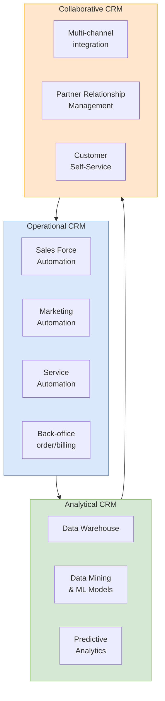

## 概述

客戶關係管理（CRM）是管理企業與現有及潛在客戶全週期互動的策略與技術系統，分為三大互補類型：作業型（Sales Force Automation 自動化銷售漏斗管理、行銷活動及服務工單）、分析型（透過資料倉儲-ETL-OLAP-資料探勘管道挖掘客戶洞察）、以及協作型（跨電話/郵件/社媒/Web整合多通路體驗）。分析型 CRM 的成熟度沿「描述性→診斷性→預測性→指示性」四階段推進——大多數組織停留在描述層，競爭優勢來自掌握預測與指示分析；其核心工具包括[[wiki/concepts/clustering|分群]]（K-means 客戶細分）、[[wiki/concepts/logistic-regression|邏輯迴歸]]（流失預測）、[[wiki/concepts/decision-trees|決策樹]]（信貸評分）、關聯規則（購物籃分析）及[[wiki/concepts/nlp-basics|NLP]]（情感分析），並以 Salesforce Einstein 等平台集成機器學習、NLP 和計算機視覺三大技術族群，實現銷售線索優先排序、服務聊天機器人及商品圖像識別。真實案例揭示了數據驅動 CRM 的威力與邊界：Target 從購物行為預測顧客懷孕並投放定向廣告（揭示過度個性化的隱私風險）、Tesco 每年發出1億張個性化優惠券（兌換率提升3.6倍）、Netflix 投入100萬美元改善推薦算法。CRM 與[[wiki/concepts/erp|ERP]]的深度整合是其效能的前提：機會→報價流程在 CRM 端完成，銷售訂單→生產→交貨→開票在 ERP 端執行，客戶需求信號反哺[[wiki/concepts/supply-chain-management|SCM]]需求規劃模塊，從而形成完整的訂單到收款閉環。全球 CRM 市場規模（~700億美元）已超過核心 ERP 市場（~400億美元），反映企業投資重心向客戶面系統的系統性轉移。

## What It Is

**Customer Relationship Management (CRM)** is both a business strategy and a category of enterprise software for managing an organization's interactions with current and potential customers. CRM systems consolidate customer data from multiple touchpoints -- sales, marketing, customer service, social media, e-commerce -- into a unified platform that enables organizations to build stronger relationships, improve retention, and increase revenue.

CRM operates as an extension of [[wiki/concepts/erp|ERP]] systems, covering the customer-facing side of the business that core ERP modules (focused on internal operations like manufacturing, finance, and HR) do not fully address. In the ERP evolution framework, CRM is a key component of **ERP II** and beyond, enabling inter-organizational efficiency and customer-centric transformation. As of 2020 Gartner figures cited in the course, the global CRM market (~$70B) is already larger than the core ERP market (~$40B), reflecting how much enterprise investment has shifted toward customer-facing systems.

## Why It Matters

Customer acquisition costs typically far exceed retention costs, making effective relationship management a critical competitive lever. CRM matters because:

- **Customer lifetime value** is maximized through deeper understanding of customer needs, preferences, and behavior patterns
- **Sales pipeline visibility** enables accurate forecasting and resource allocation
- **Service quality** improves through consistent access to complete customer history across all channels
- **Marketing effectiveness** increases through targeted campaigns based on segmentation and predictive analytics
- **Cross-selling and upselling** opportunities are identified through analytical insights

The course materials list five pain points that CRM directly addresses: (1) **lack of centralization** -- customer data scattered across spreadsheets, business cards, and meeting notes; (2) **inability to close deals on the move** -- sales reps in the field cannot keep stakeholders updated; (3) **lack of knowledge** -- growing customer bases overwhelm individual memories; (4) **communication breakdown between Marketing and Sales** -- marketing nurtures the lead but sales doesn't know what has been promised; (5) **high turnovers cost time and money** -- departing sales reps take customer relationships with them.

In the context of competitive strategy, CRM directly supports **customer intimacy** (one of Treacy & Wiersema's three value disciplines) by enabling organizations to tailor products and services to individual customer needs. It also supports **differentiation** in Porter's framework by creating switching costs through superior customer experience, and complements [[wiki/concepts/porters-five-forces|Porter's Five Forces]] thinking by increasing buyer switching costs.

## How It Works

### Three Types of CRM

CRM systems are categorized into three complementary types, each addressing a different aspect of customer relationship management:

#### 1. Operational CRM

Operational CRM automates and streamlines customer-facing business processes in both the **front office** and **back office**:

- **Sales Force Automation (SFA)**: Lead management, opportunity tracking, pipeline management, quote generation, and sales forecasting. Automates repetitive sales tasks and provides visibility into the sales funnel.
- **Marketing Automation**: Campaign management, email marketing, lead scoring and nurturing, event management. Enables targeted, multi-channel marketing campaigns with measurable ROI.
- **Service Automation**: Case management, service ticketing, knowledge bases, field service management. Ensures consistent service quality and resolution tracking.
- **Back-office integration**: Order management, billing, fulfillment, and returns processing. Connects customer-facing activities with ERP back-end systems for seamless order-to-cash execution.

Operational CRM is the most widely deployed type and serves as the data collection foundation for analytical CRM.

#### 2. Analytical CRM

Analytical CRM transforms raw customer data into actionable business insights through a layered architecture:

- **Data Warehouse**: Centralized repository that consolidates customer data from operational CRM, ERP, e-commerce, social media, and external sources. Designed for query and analysis rather than transaction processing.
- **Data Mining**: Application of statistical and machine learning techniques to discover patterns in customer data. Data mining is inherently **multidisciplinary**, drawing from statistics, machine learning, database systems, and domain expertise.
- **Predictive Analytics**: Models that forecast future customer behavior -- churn probability, purchase likelihood, credit risk, response propensity. Enables proactive rather than reactive customer management.

The analytical CRM architecture follows a pipeline: data sources -> ETL (extract, transform, load) -> data warehouse -> OLAP cubes and data mining models -> dashboards, reports, and alerts -> business decisions. In the S/4HANA era, this pipeline collapses: OLTP and OLAP run on the same in-memory data, eliminating most ETL latency and enabling real-time analytics on live transactional tables.

The three "dots" framing from the lecture captures the analytical challenge: **finding the dots** (locating useful data), **connecting the dots** (integrating across sources), and **understanding the dots** (extracting meaning). A parable used in class: "A lady sees a man looking for keys under a streetlight. 'Did you drop them here?' 'No, but the light is much better here.'" -- most analytics stays descriptive because that's where the "light" (readily available data) is brightest.

#### 3. Collaborative CRM

Collaborative CRM manages **multi-channel customer interactions** to ensure a consistent experience regardless of how the customer engages:

- **Channel integration**: Phone, email, web chat, social media, mobile apps, in-person -- all feeding into a unified customer record
- **Partner relationship management**: Sharing customer insights with channel partners, distributors, and resellers
- **Customer self-service**: Portals, knowledge bases, and community forums that empower customers to resolve issues independently

Collaborative CRM bridges the gap between operational and analytical CRM by ensuring that insights derived from analytics are delivered to the right touchpoint at the right time.

### Marketing Analytics Progression

CRM analytics follows a maturity progression aligned with the broader business analytics framework:

| Analytics Type | Question Answered | CRM Application | Example |
|---|---|---|---|
| **Descriptive** | What happened? | Customer segmentation, purchase history reports | Online purchase preferences broken down by age groups |
| **Diagnostic** | Why did it happen? | Root cause analysis, churn drivers | Why did payment defaults increase 20% last quarter? |
| **Predictive** | What will happen? | Churn prediction, propensity models, CLV forecasting | Based on 12 months of data, this customer is likely to default |
| **Prescriptive** | What should we do? | Next-best-action, campaign optimization, pricing | How can we prevent customers from switching to a competitor? |

Each level adds increasing value and complexity. Most organizations operate at the descriptive and diagnostic levels; competitive advantage comes from mastering predictive and prescriptive analytics.

### Data Mining Techniques in CRM

Data mining applied to CRM encompasses several key technique families, each mapped to a canonical use case:

| Technique | Concept | CRM Use Case |
|---|---|---|
| [[wiki/concepts/clustering|Clustering]] (k-means, hierarchical) | Unsupervised segmentation | Group customers by behavior, demographics, value tier |
| [[wiki/concepts/logistic-regression|Logistic Regression]] | Binary classification | Churn prediction, credit-card signup likelihood |
| [[wiki/concepts/decision-trees|Decision Trees]] | Interpretable classification | Response scoring, underwriting rules |
| [[wiki/concepts/linear-regression|Linear Regression]] | Continuous outcome modelling | Customer lifetime value estimation, spend forecasting |
| Association Rules | Market-basket analysis | Cross-sell and product affinity |
| [[wiki/concepts/nlp-basics|NLP]] | Text understanding | Sentiment analysis on reviews and tickets |
| [[wiki/concepts/recommendation-systems|Recommendation Systems]] | Collaborative filtering / content-based | Next-best-offer, personalized search |

Real-world applications demonstrate the power of CRM analytics:

- **Target** predicts customer pregnancy from shopping behavior to send targeted offers related to newborn needs (the Target pregnancy prediction case is frequently cited in the course as both a success and a cautionary tale about privacy)
- **Tesco (UK)** issues 100 million personalized coupons annually at grocery cash registers across 13 countries, increasing redemption rates by a factor of **3.6** through predictive analytics
- **Netflix** invested **$1 million** in a competition to improve movie recommendation algorithms
- A top-5 US **health insurance company** predicts the likelihood an elderly policyholder will die within **18 months** to trigger end-of-life counseling
- **Con Edison** predicts energy distribution cable failure, updating risk levels on operator screens three times per hour
- **Microsoft** has developed technology to predict future locations from GPS data years in advance

### Salesforce Einstein: AI-Augmented CRM

**Salesforce Einstein** is the canonical example of AI integrated into a CRM platform. Einstein's applications span three technique families:

| Technique Family | Einstein Product | Capability |
|---|---|---|
| **Machine Learning** | Einstein Discovery | Automated pattern recognition |
| Machine Learning | Einstein Prediction Builder | Predict churn, lifetime value, custom outcomes |
| Machine Learning | Einstein Next Best Action | Recommendations + action strategies + automation |
| **NLP** | Einstein Language | Intent and sentiment classification, routing |
| NLP | Einstein Bots | Custom chatbots connected to CRM data |
| **Computer Vision** | Einstein Vision | Image recognition for brand/product monitoring |

Einstein is applied across Salesforce clouds:

- **Sales**: Lead prioritization, buying-signal alerts, pipeline trend analysis, automated data capture
- **Service**: Chatbots, predicted case fields, automatic triage/routing, in-context suggestions
- **Marketing**: Predictive insights from engagement/brand/social data, personalized content, engagement timing optimization
- **Commerce**: Product recommendations, tailored sorting, anticipatory search, automated merchandising

### Brand Relationship Landscape

CRM extends beyond transactional data to encompass the broader **brand relationship landscape** -- the full ecosystem of touchpoints, emotions, and experiences that shape how customers perceive and interact with a brand. This includes:

- Direct interactions (purchases, service calls)
- Indirect interactions (advertising, social media mentions, word of mouth)
- Contextual factors (economic conditions, competitive alternatives, cultural trends)

Understanding this landscape requires integrating structured CRM data with unstructured data from social media, reviews, and market research. As Fournier and Avery (2011) put it in their MIT Sloan Management Review piece used in the course: "It's not the customer you are managing; it's the relationship."

## CRM and Enterprise Systems Integration

CRM does not operate in isolation. Its effectiveness depends on tight integration with other enterprise systems:

- **ERP integration**: Customer orders flow from CRM (opportunity -> quote) to ERP (sales order -> production -> delivery -> invoice). Financial data flows back for profitability analysis.
- **[[wiki/concepts/supply-chain-management|SCM]] integration**: Customer demand signals from CRM feed into demand planning modules for more accurate forecasting and inventory optimization.
- **Business analytics integration**: CRM data feeds into enterprise-wide analytics platforms for cross-functional insights. SAP's FI and CO modules provide financial accounting and management accounting capabilities that complement CRM analytics, while SAP-SEM supports [[wiki/concepts/balanced-scorecard|Balanced Scorecard]] strategy tracking.

The CLP Power example illustrates this integration: their IS-U/CRM module manages 2.2 million customers with 18 million billing documents, tightly integrated with MM (procurement), HR (workforce), PM (maintenance), and FI/CO (financials).

## Trade-offs and Challenges

- **Data quality**: CRM is only as good as its data. Duplicate records, incomplete profiles, and stale information undermine analytics accuracy.
- **User adoption**: Sales teams often resist CRM adoption, viewing data entry as overhead rather than value. Change management is critical, and turnover remains a risk whenever relationships live in individual reps' heads rather than in the system.
- **Privacy and regulation**: GDPR, CCPA, and similar regulations constrain how customer data can be collected, stored, and used. Analytical CRM must be designed with privacy by design.
- **Over-personalization risk**: Overly targeted marketing can feel intrusive (the Target pregnancy prediction case became a cautionary tale about privacy boundaries when a father learned of his teenage daughter's pregnancy from coupon mail).
- **Implementation complexity**: Full CRM deployment across operational, analytical, and collaborative dimensions is a multi-year, multi-million dollar effort.
- **Analytics maturity gap**: Most organizations live at the descriptive level; moving to predictive and prescriptive requires both technical skill and a data-oriented culture.

## Related Concepts

- [[wiki/concepts/erp|Enterprise Resource Planning (ERP)]] -- CRM extends ERP to customer-facing processes
- [[wiki/concepts/supply-chain-management|Supply Chain Management (SCM)]] -- CRM demand signals feed SCM planning
- [[wiki/concepts/clustering|Clustering]] -- customer segmentation technique
- [[wiki/concepts/logistic-regression|Logistic Regression]] -- churn and response modelling
- [[wiki/concepts/decision-trees|Decision Trees]] -- interpretable churn and propensity models
- [[wiki/concepts/linear-regression|Linear Regression]] -- CLV and spend forecasting
- [[wiki/concepts/recommendation-systems|Recommendation Systems]] -- commerce personalization
- [[wiki/concepts/nlp-basics|NLP Basics]] -- sentiment analysis, Einstein Language, chatbots
- [[wiki/concepts/stp-marketing|STP Marketing]] -- segmentation, targeting, positioning as the strategic frame for CRM campaigns
- [[wiki/concepts/marketing-mix|Marketing Mix]] -- channel and promotion decisions informed by analytical CRM
- [[wiki/concepts/consumer-behavior|Consumer Behavior]] -- theoretical grounding for customer analytics
- [[wiki/concepts/balanced-scorecard|Balanced Scorecard]] -- SAP-SEM customer perspective metrics
- [[wiki/concepts/porters-five-forces|Porter's Five Forces]] -- CRM raises buyer switching costs

## Source Materials

- [[wiki/sources/courses/enterprise-systems|EEMT5360 Enterprise Systems for Digital Transformation]]
