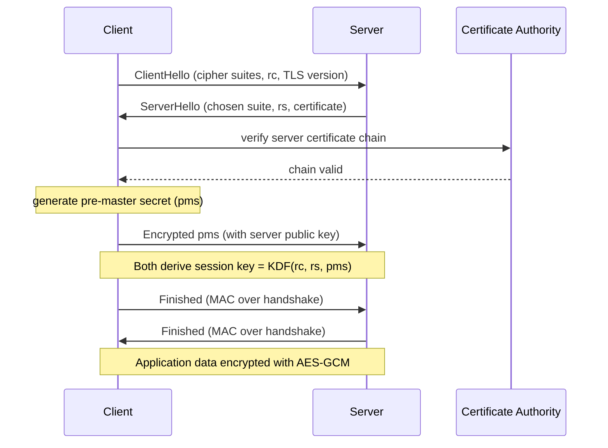

## 概述

密碼學是電子商務與區塊鏈安全的核心技術，提供機密性（加密防竊聽）、完整性（雜湊防篡改）、身份驗證（數位憑證防偽冒）和不可否認性（數位簽章防抵賴）四大安全屬性。對稱加密（AES-256-GCM）以高速批量加密見長，但面臨 $O(n^2)$ 的金鑰分配問題；非對稱加密（RSA 依整數分解難題、ECDSA 依橢圓曲線離散對數問題）以公私金鑰對解決金鑰交換，但速度較慢，因此 TLS 採用「非對稱交換對稱密鑰，對稱加密數據」的混合架構。SHA-256 等密碼雜湊函數的單向性（preimage resistance）和碰撞抵抗性是數位簽章與比特幣工作量證明的數學基礎；ECDSA 以256位金鑰達到相當於 RSA-3072 的安全強度，在行動設備和區塊鏈場景取代 RSA 成為主流。公鑰基礎建設（PKI）的信任鏈（根 CA → 中間 CA → 終端實體憑證）是 HTTPS 身份驗證的制度基礎，而2011年 DigiNotar 事件揭示了集中式信任模型的單點失效風險。TLS 1.3 通過強制前向保密（ECDHE 臨時金鑰）、刪除不安全算法族（RC4、3DES、CBC 模式）和將握手壓縮至1個 RTT，代表了現代安全通信協定的最高水準；零知識證明（zk-SNARKs）則在不披露秘密的情況下驗證陳述為真，是隱私保護計算與 DeFi 擴容的前沿技術。

## Core Mechanism

### Threat Model

Modern cryptography is designed against a catalogue of attacker capabilities:

| Attack class | Mechanism | Defence |
|---|---|---|
| **Passive** | Packet sniffing, wiretap, traffic analysis | Encryption |
| **Active** | Spoofing, replay, MITM, injection | Authentication + integrity |
| **Cryptographic** | Brute-force key search, known-plaintext, chosen-ciphertext | Large keys, IND-CCA2 schemes |
| **Denial of service** | Resource exhaustion, flood attacks | Rate limiting (outside crypto) |
| **Social engineering** | Phishing, pretexting | User training (outside crypto) |

Cryptographic primitives address the first three classes. DoS and social engineering require organisational controls.

Cryptography provides four fundamental security properties:

| Property | Meaning | Mechanism |
|---|---|---|
| **Confidentiality** | Only authorized parties can read the data | Encryption (AES, RSA) |
| **Integrity** | Data has not been tampered with in transit | Hash functions (SHA-256) |
| **Authentication** | The sender is who they claim to be | Digital signatures, certificates |
| **Non-repudiation** | The sender cannot deny having sent the message | Digital signatures |

### Symmetric Encryption

Symmetric encryption uses the **same key** for both encryption and decryption. It is fast and efficient for bulk data encryption.

**AES (Advanced Encryption Standard)**:
- Block cipher operating on 128-bit blocks.
- Key sizes: 128, 192, or 256 bits. AES-256 is the standard for high-security applications.
- **Modes of operation** determine how blocks are chained:
  - **ECB (Electronic Codebook)**: Each block encrypted independently. Insecure — identical plaintext blocks produce identical ciphertext blocks, leaking patterns.
  - **CBC (Cipher Block Chaining)**: Each block XORed with the previous ciphertext block before encryption. Requires an initialization vector (IV). Widely used.
  - **CTR (Counter)**: Converts block cipher into a stream cipher. Parallelizable. Used in modern protocols.
  - **GCM (Galois/Counter Mode)**: CTR mode with built-in authentication. Provides both encryption and integrity. The standard for TLS 1.3.

**Key distribution problem**: Both parties must share the secret key securely before communication. For $N$ mutually communicating parties, the number of keys required grows quadratically as $\binom{N}{2} = \frac{N(N-1)}{2}$ — 100 parties need 4,950 keys, 1,000 parties need nearly half a million. This is impractical at Internet scale, motivating asymmetric encryption.

### XOR — The Core Idea

At the heart of most symmetric ciphers is the bitwise XOR operation, which satisfies:

$$A \oplus 0 = A, \quad A \oplus A = 0, \quad (A \oplus B) \oplus C = A \oplus (B \oplus C)$$

The key property is that XORing with a shared key is self-inverse: $(D \oplus K) \oplus K = D$. This gives a trivially correct symmetric cipher:

```text
plaintext  = 01000001 01001010   ("AJ" in ASCII)
key        = 01010000 01010001
ciphertext = 00010001 00011011   (plaintext XOR key)
recovered  = 01000001 01001010   (ciphertext XOR key = plaintext)
```

This is exactly the **one-time pad**, which is information-theoretically secure if the key is truly random, as long as the message, and never reused. AES and DES use XOR as one step inside a more elaborate round function that mixes substitution (S-boxes) and permutation (P-boxes) to build practical block ciphers from short keys.

### Asymmetric Encryption

Asymmetric encryption uses a **key pair**: a public key (shared openly) and a private key (kept secret). Data encrypted with one key can only be decrypted with the other.

**RSA (Rivest-Shamir-Adleman)**:
- Security based on the **integer factorization problem** — multiplying two large primes is easy; factoring their product is computationally infeasible.
- Key generation: Choose primes $p, q$ → compute $n = p \times q$ → compute $\varphi(n) = (p-1)(q-1)$ → choose public exponent $e$ (commonly 65537) → compute private exponent $d$ such that $e \times d \equiv 1 \pmod{\varphi(n)}$.
- Encryption: $c = m^e \bmod n$. Decryption: $m = c^d \bmod n$.
- Typical key sizes: 2048 or 4096 bits. RSA-2048 is considered secure through ~2030.
- **Drawback**: Slow compared to symmetric encryption. Used primarily for key exchange and digital signatures, not bulk data.

#### RSA Worked Example (from EEMT5540 Lecture 02)

Alice picks primes $p = 23, q = 41$ and publishes:
- Modulus $n = pq = 943$
- Totient (private) $\varphi(n) = (p-1)(q-1) = 22 \cdot 40 = 880$
- Public exponent $e = 7$ (must be coprime to 880; $\gcd(7, 880) = 1$)

Bob wants to send message $M = 35$:

$$C = M^e \bmod n = 35^7 \bmod 943 = 545$$

Alice decrypts. She computes $d$ satisfying $ed \equiv 1 \pmod{880}$, i.e. $7d \equiv 1 \pmod{880}$. Extended Euclidean gives $d = 503$ (check: $7 \times 503 = 3521 = 4 \times 880 + 1$).

$$M' = C^d \bmod n = 545^{503} \bmod 943 = 35 \;\checkmark$$

Real-world RSA uses $p, q$ of ~1024 bits each so that $n$ is 2048 bits. The security rests on the believed hardness of factoring 2048-bit semiprimes — the best known classical algorithm (general number field sieve) runs in sub-exponential time, but Shor's algorithm on a large-enough quantum computer would break it in polynomial time, motivating the post-quantum cryptography transition.

**ECDSA (Elliptic Curve Digital Signature Algorithm)**:
- Security based on the **elliptic curve discrete logarithm problem** (ECDLP).
- Achieves equivalent security to RSA with much shorter keys: a 256-bit ECDSA key ≈ a 3072-bit RSA key in security strength.
- Advantages: Smaller keys, faster computation, lower bandwidth. Dominant in mobile and IoT contexts.
- Used in Bitcoin (secp256k1 curve), TLS certificates, and modern SSH keys.

### Comparison: RSA vs. ECDSA

| Property | RSA-2048 | ECDSA-256 |
|---|---|---|
| Key size | 2048 bits | 256 bits |
| Equivalent security | ~112-bit | ~128-bit |
| Signature size | 256 bytes | 64 bytes |
| Speed (signing) | Slower | Faster |
| Speed (verification) | Faster | Slower |
| Adoption | Legacy systems, certificates | Modern protocols, blockchain |

### Hash Functions

A **cryptographic hash function** maps arbitrary-length input to a fixed-length digest. Properties:

- **Deterministic**: Same input always produces the same hash.
- **One-way (preimage resistance)**: Given a hash $h$, it is computationally infeasible to find any input $m$ such that $H(m) = h$.
- **Collision resistance**: It is infeasible to find two distinct inputs $m_1 \neq m_2$ such that $H(m_1) = H(m_2)$.
- **Avalanche effect**: A single-bit change in input produces a drastically different hash.

**SHA-256** (part of the SHA-2 family):
- Produces a 256-bit (32-byte) digest.
- Used in TLS certificate fingerprints, digital signatures, Bitcoin proof-of-work, and file integrity verification.
- Example: `SHA-256("hello") = 2cf24dba5fb0a30e26e83b2ac5b9e29e1b161e5c1fa7425e73043362938b9824`

**MD5** and **SHA-1** are deprecated for security purposes due to practical collision attacks.

### Digital Signatures

A digital signature is the asymmetric-key analogue of a handwritten signature. The process:

1. **Signing**: The sender computes a hash of the message, then encrypts the hash with their **private key**. The encrypted hash is the signature.
2. **Verification**: The receiver decrypts the signature using the sender's **public key** to recover the hash, independently hashes the received message, and compares. If they match, the message is authentic and unaltered.

```text
# Signing (Bob's side)
h          = SHA256(message)            # 256-bit digest
signature  = RSA_sign(h, Bob_private)   # encrypt hash with private key
send(message, signature)

# Verification (Alice's side)
h_recv     = SHA256(message)            # recompute digest
h_sig      = RSA_verify(signature, Bob_public)
assert h_recv == h_sig                  # reject if unequal
```

Digital signatures provide:
- **Authentication**: Only the holder of the private key could have produced the signature.
- **Integrity**: Any modification to the message changes the hash, invalidating the signature.
- **Non-repudiation**: The signer cannot deny signing, since only their private key could produce the signature.

Digital signatures are the foundation of blockchain transactions: a Bitcoin transfer is a message "A sends X BTC to B" signed by A's ECDSA private key over the secp256k1 curve, and nodes verify the signature against the public key (address) before accepting the transaction into a block. See [[wiki/concepts/smart-contracts|Smart Contracts]] for the on-chain execution model.

### Public Key Infrastructure (PKI)

PKI solves the trust problem: how do you know a public key truly belongs to the claimed entity?

**Certificate Authorities (CAs)**:
- A CA is a trusted third party that issues **digital certificates** binding a public key to an identity (domain name, organization).
- Certificate format: X.509 — contains subject name, public key, issuer (CA), validity period, serial number, and the CA's digital signature.

**Certificate Chain (Chain of Trust)**:
- **Root CA** → self-signed, embedded in browsers/OS trust stores. Must be guarded offline.
- **Intermediate CA** → signed by root CA. Handles day-to-day issuance.
- **End-entity certificate** → signed by intermediate CA. This is what web servers present.
- Verification walks the chain upward: verify end-entity cert against intermediate CA cert, then intermediate against root. If the root is in the trust store, the chain is valid.

**Certificate Revocation**:
- **CRL (Certificate Revocation List)**: Periodic list of revoked certificates. Can be stale.
- **OCSP (Online Certificate Status Protocol)**: Real-time check of individual certificate status. More current but adds latency.

### SSL/TLS in Practice

TLS (the successor to SSL) combines all the above primitives into a secure channel:

1. **Asymmetric encryption** for key exchange (RSA or ECDHE).
2. **Symmetric encryption** for bulk data (AES-GCM).
3. **Hash functions** for message integrity (HMAC-SHA256).
4. **Digital certificates** for server (and optionally client) authentication.



In the EEMT5540 simplified handshake description, the client generates a random $r_c$, the server a random $r_s$, and after certificate exchange the client picks a pre-master secret `pms` and encrypts it with the server's public key. Both sides then derive the session password `pass = KDF(r_c, r_s, pms)` and switch to symmetric AES-GCM for the remainder of the session on port 443.

**TLS 1.3** (current standard) simplified the handshake to a single round trip, removed insecure cipher suites (RC4, 3DES, CBC mode), and mandated forward secrecy via ephemeral key exchange (ECDHE). **Forward secrecy** means that even if the server's long-term private key is compromised later, past sessions remain secure because the ephemeral key was discarded after use. This makes mass surveillance of recorded traffic infeasible — an attacker who records all TLS 1.3 ciphertext today and later compromises the server key still cannot decrypt the old sessions.

## Key Findings

- The layered combination of symmetric and asymmetric encryption is the practical solution to the key distribution problem: use asymmetric crypto to exchange a symmetric session key, then use the fast symmetric cipher for data.
- ECDSA is replacing RSA as the default in modern systems due to superior performance-to-security ratios, driven by mobile and IoT constraints.
- PKI is a centralized trust model — its security depends entirely on the integrity of root CAs. Compromised CAs (e.g., DigiNotar, 2011) undermine the entire system.
- TLS 1.3's mandatory forward secrecy represents a significant security improvement, making mass surveillance of recorded traffic infeasible even with server key compromise.
- Blockchain systems like Bitcoin use cryptographic hash functions and ECDSA signatures without PKI, substituting decentralized consensus for centralized trust.

## Zero-knowledge proofs (cross-course from EEMT6000H)

Classical TLS cryptography shows *what you know* by revealing a signed artifact; **zero-knowledge proofs (ZKPs)** let a prover convince a verifier that a statement is true without revealing the underlying witness. **zk-SNARKs** (succinct non-interactive arguments of knowledge) are the practical instantiation used in modern blockchain systems — they produce short proofs (hundreds of bytes) that can be verified in milliseconds even when the statement being proven is an arbitrary arithmetic circuit. zk-rollups extend the same primitive to L2 scaling: batch thousands of transactions, post one validity proof on-chain, and keep the data available off-chain. ZKPs compose cleanly with the homomorphic-encryption and SMPC primitives, which together form the privacy-preserving-computation toolkit that underpins modern [[defi|DeFi]] and confidential-compute research.

## Related Concepts

- [[wiki/concepts/web-architecture|Web Architecture]] — HTTPS and TLS secure the web protocol stack
- [[wiki/concepts/ecommerce-models|E-Commerce Models]] — Payment security relies on cryptographic infrastructure
- [[wiki/concepts/smart-contracts|Smart Contracts]] — Blockchain cryptography enables trustless execution
- [[wiki/concepts/defi|DeFi]] — Decentralized finance built on signature-verified transactions
- [[wiki/entities/hkust|HKUST]] — Source institution for course material

## Source Materials

- [[wiki/sources/courses/ecommerce|EEMT5540 IT for E-Commerce Applications]]
- Lecture 02: Basics of Secure Communications
