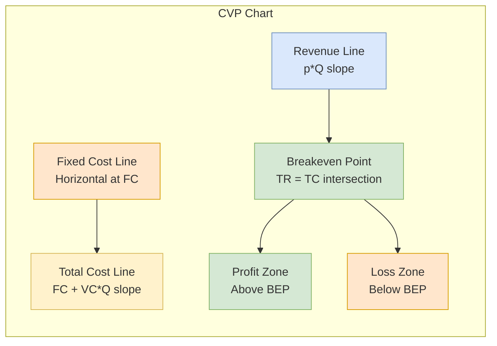

## 概述

成本-產量-利潤分析（Cost-Volume-Profit Analysis, CVP）是管理會計中研究固定成本、變動成本、銷售量與利潤四者關係的核心框架。其最基本的結果是損益平衡點公式 $Q_{BE} = FC / (p - VC)$，即固定成本除以單位貢獻毛利；將損益平衡點延伸至目標利潤分析、安全邊際計算，以及經營槓桿度（$DOL = \text{總貢獻毛利} / \text{利潤}$），構成了靜態定價決策的完整工具集。當需求與價格之間存在線性反需求關係 $p = a - bD$ 時，利潤函數變為二次式，利潤最大化產量 $D^* = (a - c_v)/(2b)$ 與收益最大化產量 $D^*_R = a/(2b)$ 不同，此非線性擴展比線性 CVP 更接近現實的需求環境。多產品情境下，加權平均貢獻毛利率需保持固定銷售組合假設，其隱含的靈敏度則連結至 [[linear-programming|線性規劃]] 的影子價格：當某一稀缺資源限制生產時，最優決策等效於最大化每單位約束資源的貢獻毛利，二者本質上求解的是同一個線性規劃對偶問題。在工程設計優化中，CVP 的「競爭成本分量最小化」思路（如速度對運營成本加持貨成本的最優化）是成本驅動設計（cost-driven design）的方法論基礎，體現了 OR 中連續決策優化的典型結構。CVP 的靜態、單期假設在多期投資評估中需借助 [[time-value-of-money|TVM]] 延伸為折現損益平衡分析，而蒙地卡羅模擬則常用於將不確定性引入 CVP 的價格與需求假設中。

## Core Mechanism

**Cost-Volume-Profit (CVP) analysis** examines how changes in costs, volume, and price affect profit. It builds directly on the cost classification framework from engineering economics: **fixed costs** remain constant regardless of output, while **variable costs** change proportionally with activity level.

### Fundamental Relationships

**Total cost**:
$$TC = FC + VC \cdot Q$$

where $FC$ = total fixed costs, $VC$ = variable cost per unit, and $Q$ = quantity produced/sold.

**Total revenue**:
$$TR = p \cdot Q$$

where $p$ = selling price per unit.

**Profit**:
$$\Pi = TR - TC = pQ - FC - VC \cdot Q = (p - VC) \cdot Q - FC$$

### Breakeven Point

The **breakeven point (BEP)** is the volume at which total revenue equals total cost (profit = 0):

$$Q_{BE} = \frac{FC}{p - VC} = \frac{FC}{CM}$$

where $CM = p - VC$ is the **contribution margin per unit** — the amount each unit contributes toward covering fixed costs and generating profit.

In revenue terms:

$$TR_{BE} = \frac{FC}{CM\%} = \frac{FC}{1 - VC/p}$$

where $CM\% = CM/p$ is the **contribution margin ratio**.

### Target Profit Analysis

To achieve a target profit $\Pi^*$:

$$Q_{\text{target}} = \frac{FC + \Pi^*}{p - VC}$$

This extends the breakeven formula by treating the target profit as an additional "fixed cost" that must be covered.

### Nonlinear CVP with Linear Demand

In the L2 framework, price and demand are linked via an **inverse demand function** $p = a - bD$, turning the revenue curve into a quadratic $R = aD - bD^2$ rather than a straight line. Profit becomes:

$$\Pi(D) = -bD^2 + (a - c_v)D - FC$$

Profit maximization: $D^* = (a - c_v)/(2b)$, with maximum profit $\Pi^* = (a - c_v)^2/(4b) - FC$. Breakeven volumes are the roots of the quadratic:

$$D_1, D_2 = \frac{(a - c_v) \pm \sqrt{(a - c_v)^2 - 4b \cdot FC}}{2b}$$

Production is profitable in the interval $(D_1, D_2)$, bounded above by an upper breakeven — not unbounded as in linear CVP.

### L2 Worked Example (Circuit Boards)

$FC = \$42{,}000$/month, $c_v = \$53$, $p = 150 - 0.02D$, capacity $= 4{,}000$ units.

- Profit-max: $D^* = (150 - 53)/(2 \cdot 0.02) = 2{,}425$ units
- Max profit: $\Pi^* = \$75{,}612.50$/month
- Breakeven volumes: $D_1 \approx 481$, $D_2 \approx 4{,}369$
- Feasible profitable range: $(481, 4{,}000]$ — upper breakeven exceeds capacity, so capacity binds.

### HW1 Problem 1 (Photocopy Machines)

$p = 1000 - 0.2D$, $FC = \$200{,}000$, $c_v = \$200$.

- **Revenue max**: $\partial R/\partial D = 1000 - 0.4D = 0 \Rightarrow D^*_R = 2{,}500$
- **Profit max**: $\partial \Pi/\partial D = 800 - 0.4D = 0 \Rightarrow D^*_\Pi = 2{,}000$
- Price at optimum: $p = 1000 - 0.2(2000) = \$600$
- Profit: $(600 - 200)(2000) - 200{,}000 = \$600{,}000$

Revenue-max and profit-max output levels differ — maximizing revenue is **not** the same as maximizing profit whenever variable costs are positive.

## Graphical Representation

The CVP chart plots TR and TC against volume. The intersection is the breakeven point. The vertical distance between TR and TC at any volume represents profit (above BEP) or loss (below BEP).

## Contribution Margin Analysis

The **contribution margin** is arguably the most important concept in CVP analysis:

| Metric | Formula | Interpretation |
|--------|---------|---------------|
| CM per unit | $p - VC$ | Dollars each unit contributes to FC and profit |
| CM ratio | $(p - VC)/p$ | Fraction of each revenue dollar available after variable costs |
| Total CM | $CM \times Q$ | Total contribution from all units sold |

**High CM ratio** means a small increase in volume produces a large profit increase. Businesses with high fixed costs and low variable costs (e.g., software, airlines) have high CM ratios and high **operating leverage**.

## Operating Leverage

**Operating leverage** measures the sensitivity of profit to changes in volume:

$$\text{Degree of Operating Leverage (DOL)} = \frac{\text{Total CM}}{\text{Profit}} = \frac{(p - VC) \cdot Q}{(p - VC) \cdot Q - FC}$$

At the breakeven point, DOL is infinite (small changes in volume cause large percentage changes in profit). As volume increases above BEP, DOL decreases.

**High operating leverage** (high FC, low VC) means:
- Greater profit potential at high volumes.
- Greater loss risk at low volumes.
- Higher breakeven point.

**Low operating leverage** (low FC, high VC) means:
- More stable profits across volumes.
- Lower breakeven point.
- Less upside at high volumes.

## Multi-Product CVP

When a firm sells multiple products, the weighted-average contribution margin is used:

$$CM_{\text{weighted}} = \sum_{i=1}^{n} CM_i \times w_i$$

where $w_i$ is the sales mix proportion of product $i$. The breakeven point in total units:

$$Q_{BE,\text{total}} = \frac{FC}{CM_{\text{weighted}}}$$

The analysis assumes a **constant sales mix**. If the mix shifts toward higher-margin products, BEP decreases; if toward lower-margin products, BEP increases.

## Assumptions and Limitations

CVP analysis makes several simplifying assumptions:

1. **Linear cost and revenue functions**: Total cost and revenue are straight lines. This holds only within a **relevant range** of activity.
2. **Fixed cost constancy**: Fixed costs remain truly fixed. In reality, they may change in steps (e.g., adding a shift).
3. **Constant variable cost per unit**: No economies or diseconomies of scale.
4. **Single product or constant mix**: Multi-product analysis requires a stable sales mix assumption.
5. **All units produced are sold**: No inventory buildup.
6. **Static, single-period**: Standard CVP is a snapshot. Multi-period analysis requires [[time-value-of-money|TVM]] adjustments.

### Extensions

- **Nonlinear CVP**: Uses quadratic or piecewise-linear cost/revenue functions for more realism.
- **CVP under uncertainty**: Incorporates probability distributions for price, volume, and costs. Monte Carlo simulation is common.
- **Multi-period CVP**: Discounted breakeven analysis using [[npv|NPV]] framework.

## CVP in Engineering Economics Context

In engineering economy, CVP analysis appears in several contexts:

- **Make vs. buy decisions**: Compare total cost of in-house production (high FC, low VC) against outsourcing (low FC, high VC). The indifference volume is the breakeven point.
- **Equipment selection**: Different machines have different fixed-variable cost structures. CVP identifies which machine is cheapest at each production volume.
- **Pricing strategy**: Given cost structure, determine minimum price for profitability at expected volume.
- **Capacity planning**: Assess whether projected demand exceeds breakeven volume with sufficient margin of safety.

The **margin of safety** measures how far actual or expected sales exceed the breakeven point:

$$\text{Margin of Safety} = \frac{Q_{\text{actual}} - Q_{BE}}{Q_{\text{actual}}} \times 100\%$$

### Cost-Driven Design Optimization

CVP extends to engineering design via **cost-driven optimization**: identify a design variable (e.g., ship velocity, pipe diameter, insulation thickness), write total cost as a function, and minimize. For the L2 ship example: $C_O = knv^2$ (operating cost proportional to speed squared, $k = 0.694$ calibrated at 12 mph costing \$100/mile) plus cargo holding cost $C_C = 1500n/v$. Minimize $C_T = knv^2 + 1500n/v$ over velocity:

$$\frac{dC_T}{dv} = 2knv - \frac{1500n}{v^2} = 0 \implies v^* = \left(\frac{1500}{2k}\right)^{1/3} = 10.26 \text{ mph}$$

This pattern — write a total cost with competing components, differentiate, and solve — generalizes to EOQ, component sizing, and material thickness problems.

### Choosing Between Methods (L2 Ex. 2.9)

Method A extracts 80% of gold per ton of seawater at \$210/ton; Method B extracts 60% at \$150/ton. Gold content is 0.8 oz/ton, sold at \$380/oz.

- **Per-ounce cost comparison**: A gives \$210/(0.8 × 0.80) = \$328.13/oz; B gives \$150/(0.8 × 0.60) = \$312.50/oz — **select B**.
- **Per-ton profit comparison**: A gives \$380(0.64) - 210 = \$33.20; B gives \$380(0.48) - 150 = \$32.40 — **select A**.

The results contradict because per-ton comparison does not normalize output. Principle 2 (**focus on the differences**) mandates using the same denominator (per-ounce) whenever the alternatives scale differently — a subtle pitfall in CVP reasoning.

## Related Concepts

- [[npv|NPV]] — Extends static CVP to multi-period discounted analysis
- [[time-value-of-money|TVM]] — Foundation for dynamic breakeven analysis
- [[depreciation|Depreciation]] — Depreciation is a fixed cost in CVP calculations
- [[financial-ratios|Financial Ratios]] — Operating margin and contribution margin are related metrics
- [[irr|IRR]] — Breakeven IRR is the rate at which NPV = 0
- [[behavioral-economics|Behavioral Economics]] — Framing effects influence how breakeven information is perceived
- [[wiki/mocs/operations-research|Operations Research MOC]] — Part of the OR PhD reading spine (Financial Engineering and Capital Budgeting)

## Source Materials

- L2 - Cost Terminology
- [[wiki/sources/courses/engineering-economics.md|EEMT5510 Engineering Economics and Cost Management]]
