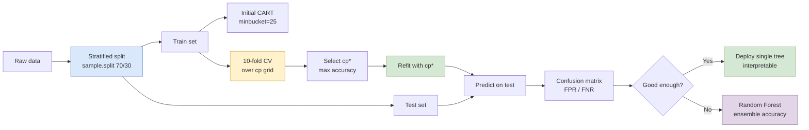

## 概述

決策樹（CART）是一種透過遞歸二元分割建構的監督式學習模型，在每個節點選擇能最大化純度增益（Gini 指數或資訊增益用於分類、SSE 用於迴歸）的變數與切點，以樹狀結構呈現決策規則，具有高度可解釋性且無需對數據分佈作任何假設。EEMT5500 課程以美國最高法院判決預測（CART 75% vs. 法律專家 59%）和 Apple 推文情感分析為雙重案例，展示 CART 如何以簡單的二元規則（如「含有 'freak' 一詞？」）在文字分類任務中達到接近最優的效果。複雜度參數 cp 控制剪枝深度，其最優值需透過 K 折交叉驗證確定，而非憑直覺設定；這一調參流程是避免過擬合的關鍵。隨機森林（Random Forest）透過 Bootstrap 取樣和隨機特徵子集的集成機制進一步降低方差，但代價是失去單棵樹的可解釋性，因此存在準確率與可解釋性之間的根本性權衡。在運籌學與管理研究中，CART 廣泛用於異質性處理效應分析（Causal Tree）、需求細分以及製造業異常偵測，而梯度提升樹（XGBoost、LightGBM）作為其集成延伸，已成為結構化數據預測競賽的主流工具。

## Core Mechanism

**CART (Classification and Regression Trees)** is a non-parametric supervised learning method that recursively partitions the feature space into regions using binary splits. At each node, the algorithm selects the variable and split point that best separates the data according to a purity criterion.

### Tree Construction

1. **Start** with all observations in the root node
2. **Select** the variable and split value that most reduces impurity (Gini index or information gain for classification; SSE for regression)
3. **Split** the data into two child nodes based on the selected threshold
4. **Repeat** recursively on each child node
5. **Stop** when a stopping criterion is met (minimum observations per leaf, maximum depth, or no further improvement)

### Key Parameters

| Parameter | Description | Effect |
|-----------|-------------|--------|
| **cp** (complexity parameter) | Minimum improvement in R² required for a split | Higher cp = simpler tree; lower cp = more complex |
| **minbucket** | Minimum number of observations in a terminal (leaf) node | Larger values prevent overfitting to small subgroups |
| **maxdepth** | Maximum depth of the tree | Limits tree complexity directly |
| **minsplit** | Minimum observations required to attempt a split | Controls when splitting stops |

### Pruning and the Complexity Parameter

Without constraints, CART will grow until each leaf contains a single observation — perfectly fitting the training data but **overfitting** badly. **Pruning** addresses this by removing splits that do not improve out-of-sample performance.

The **complexity parameter (cp)** controls pruning: a split is only retained if it improves the overall R² by at least cp. The optimal cp is selected via **cross-validation**.

## Cross-Validation for Model Selection

**K-fold cross-validation** is the primary technique for selecting the optimal cp:

1. **Divide** the training data into K equally sized folds (typically K = 5 or K = 10)
2. **For each fold**: Train the model on the other K-1 folds, evaluate on the held-out fold
3. **Average** the out-of-sample performance across all K folds
4. **Select** the cp value that maximizes average out-of-sample accuracy

This procedure provides an unbiased estimate of how the model will perform on unseen data, avoiding the optimistic bias of training-set evaluation.

## Case Study: U.S. Supreme Court Prediction (Lecture 5)

Political scientist **Andrew Martin** (Washington University in St. Louis), with collaborators **Kevin Quinn, Theodore Ruger, and Pauline Kim**, built a CART model in 2002 to predict U.S. Supreme Court decisions, pitting it against a panel of legal experts. The lecture motivates CART by first showing a logistic regression fit to the same data — coefficients like "2nd circuit: +1.66, 4th circuit: +2.82, lower court liberal: -1.22" are difficult to aggregate into an intuitive prediction for a new case, whereas a tree can be traversed by eye.

### Study Design

- **Training data**: 628 Supreme Court cases with known outcomes (1994-2001), a rare dataset because the same nine justices (Breyer, Ginsburg, Kennedy, O'Connor, Rehnquist, Scalia, Souter, Stevens, Thomas) presided for the entire period — the longest such stretch in 180+ years.
- **Test data**: 68 cases from October Term 2002 (decided after the model was built and predictions were locked in).
- **Variables**: Circuit of origin (1st through 11th, DC, FED), Issue area (e.g., civil rights, economic activity, federal taxation), Petitioner type, Respondent type, Lower court direction (liberal/conservative), Unconstitutionality argument.
- **Outcome**: Binary — affirm (0) or reverse (1) the lower court decision.
- **Experts panel**: 83 legal experts (71 academics, 12 attorneys), including 38 former Supreme Court clerks and 33 chaired professors. Each was asked only about their specialty and could not communicate with other experts.

### R Workflow (from the course notes)

```r
library(caTools); library(rpart); library(rpart.plot); library(caret)
set.seed(3000)
spl = sample.split(stevens$Reverse, SplitRatio = 0.7)  # 396 train / 170 test

# Initial tree with minbucket=25
StevensTree = rpart(Reverse ~ Circuit + Issue + Petitioner + Respondent + LowerCourt + Unconst,
                    data = TrainingSet, method = "class", minbucket = 25)
# Test-set accuracy 65.88%

# 10-fold CV over cp grid
numFolds = trainControl(method = "cv", number = 10)
cpGrid = expand.grid(cp = seq(0.1, 0.3, 0.05))
train(Reverse ~ ., data = TrainingSet, method = "rpart",
      trControl = numFolds, tuneGrid = cpGrid)
# Optimal cp = 0.15

StevensTreeCV = rpart(Reverse ~ ., data = TrainingSet, method = "class", cp = 0.15)
PredictCV = predict(StevensTreeCV, newdata = TestSet, type = "class")
table(TestSet$Reverse, PredictCV)
#         0  1
#     0  59 18
#     1  29 64
# Accuracy = (59 + 64)/170 = 72.35%
```

### Results

Martin's full-study numbers (predicting all 9 justices, majority-aggregated):

| Method | Overall Case Accuracy | Individual Justice Accuracy |
|--------|-----------------------|------------------------------|
| **CART two-stage model** | **75%** (51/68) | 67% |
| **Legal experts** | 59% (40/68) | 68% |

At the case level, a simple tree trained on high-level features beats domain experts by 16 percentage points. At the individual-justice level, experts who can absorb detailed oral-argument cues hold their own. The experiment was featured in the *New York Times* and *The New Yorker*, and remains a touchstone example of machine prediction outperforming human judgment in law.

### Cross-Validation Results (Stevens Subset)

The lecture walks through 10-fold cross-validation on the 396-case training set. Accuracy by cp:

| cp | Accuracy | Kappa |
|----|----------|-------|
| 0.10 | 0.6444 | 0.2829 |
| 0.15 | **0.6444** | **0.2829** |
| 0.20 | 0.5931 | 0.1648 |
| 0.25 | 0.5454 | 0.0000 |
| 0.30 | 0.5454 | 0.0000 |

`caret` picks the largest cp that attains the best accuracy (Occam's razor), giving cp = 0.15. Out-of-sample accuracy jumps from 65.88% (minbucket-only) to **72.35%**, a 6.5-point improvement purely from parameter tuning.

### Individual Justice Trees

Separate CART trees for individual justices reveal different decision patterns:

- **Justice O'Connor**: the tree splits first on **Lower court direction** — when the lower court is liberal, she tends to reverse; when conservative, she tends to affirm, with case topic refining the leaves. This matches her reputation as a "swing" justice.
- **Justice Souter**: a different top split (frequently **Issue area**) reveals that his decision calculus is driven by subject matter more than by circuit politics.

Each subtree is a compact decision rule for a specific decision-maker, which is CART's value proposition: **understanding heterogeneous actors** rather than a single population average.

## Case Study: Tweet Sentiment (Lecture 6)

CART was also applied to **Apple tweet sentiment classification**, demonstrating the technique's versatility across domains:

| Model | cp | Key Split Variables | Accuracy | False Positive Rate | False Negative Rate |
|-------|-----|-------------------|----------|--------------------|--------------------|
| CART 1 | 0.2 | "freak" only | 87.89% | 0.33% | 76.64% |
| CART 2 | 0.001 | "freak", "hate", "wtf", "like", "look" | 87.61% | 2.67% | 65.45% |
| CART 3 | 0.034 (CV optimal) | "freak", "hate" | **88.45%** | 1.00% | 69.09% |
| Baseline | — | Always predict majority | 84.51% | 0% | 100% |

The cross-validated optimal cp = 0.034 produced the best balance of accuracy and error rates, confirming the importance of systematic parameter tuning over arbitrary choices.

## Worked Example: State Life Expectancy (HW2)

HW2 frames CART as a regression problem on `StateData.csv` (50 US states, 1970s census data, 70/30 split). The task is to predict `LifeExp` from Population, Murder, Frost, Income, Illiteracy, Area, and HighSchoolGrad. A `rpart(..., method="anova", minbucket=5)` tree splits first on **Murder rate** (the top predictor), then on **HighSchoolGrad** — low-murder, high-graduation states live longer, which matches intuition. On the held-out states, however, the tree achieves only $R^2 \approx 0.13$, and a 100-tree random forest (`nodesize=5`) lifts that to $\approx 0.19$. Both are beaten by the reduced four-variable [[linear-regression|linear regression]] at $R^2 = 0.60$. The case makes two points simultaneously: (1) CART remains the most interpretable answer — the two-split tree is legible in a single glance — while (2) with only 35 training rows and approximately linear structure, tree methods have too little data to stabilize and OLS wins on accuracy. The HW question explicitly asks which model to pick if "out-of-sample accuracy is the most important" (linear regression) versus "interpretability is the most important" (CART), making the trade-off unavoidable.

## Worked Example: Wikipedia Vandalism Detection (Midterm)

The midterm exam uses `Wikipedia.csv` — revision history for the English article "Language", where reverted edits are labelled as vandalism. Features are `Minor`, `LoggedIn`, `HTTP`, `NumWordsAdded`, `NumWordsRemoved`. A 70/30 split gives roughly balanced classes so the majority-class baseline sits near 53%. A CART model with `minbucket=20` splits primarily on **LoggedIn** (anonymous edits are far more likely to be vandalism) and **NumWordsRemoved**, reaching test accuracy in the low-to-mid 60s. A 200-tree random forest with `nodesize=20` edges the single tree out by a few points. This is a compact classification counterpart to the HW2 State regression: same machinery (`rpart` / `randomForest`), same interpretability-vs-accuracy trade-off, but now on a binary outcome where the single CART tree's splits tell the moderator exactly which red flags to monitor in real time.

## Random Forest Extension

**Random Forest** extends CART by building many trees and aggregating their predictions (ensemble method):

1. Each tree is trained on a **bootstrapped** (randomly sampled with replacement) subset of the data
2. At each split, only a **random subset of variables** is considered
3. Final prediction is the **majority vote** across all trees

In the tweet sentiment case, Random Forest achieved **88.73% accuracy** (highest of all models) with a reduced false negative rate of 60.00%. The trade-off: Random Forest loses the interpretability that makes single CART trees valuable. The model becomes a "black box" — you cannot visualize a single decision path.

### Random Forest Parameters

| Parameter | R name | Description |
|-----------|--------|-------------|
| Number of trees | `ntree` | More trees = better but slower; diminishing returns after ~200 |
| Min node size | `nodesize` | Analogous to minbucket in CART |
| Variables per split | `mtry` | Number of candidate variables at each split (default: sqrt(p)) |

## Strengths and Limitations

### Strengths
- **Interpretability**: Single trees can be visualized and explained to non-technical stakeholders
- **Non-linearity**: Automatically captures complex, non-linear relationships without feature engineering
- **No assumptions**: No distributional assumptions (unlike [[linear-regression|Linear Regression]] or [[logistic-regression|Logistic Regression]])
- **Mixed types**: Handles both numerical and categorical predictors naturally
- **Feature importance**: Split variables reveal which predictors matter most

### Limitations
- **Instability**: Small changes in data can produce very different trees
- **Greedy algorithm**: Each split is locally optimal, not globally optimal
- **Overfitting**: Without pruning, trees memorize training data
- **Bias toward variables with many levels**: Variables with more unique values have more potential split points, creating selection bias

## Decision Flow



## Related Concepts

- [[linear-regression|Linear Regression]] — parametric alternative for continuous outcomes
- [[logistic-regression|Logistic Regression]] — parametric alternative for binary classification with interpretable coefficients
- [[nlp-basics|NLP Basics]] — text classification tasks where CART and Random Forest are commonly applied
- [[clustering|Clustering]] — unsupervised partitioning analogous to tree-based splitting
- [[recommendation-systems|Recommendation Systems]] — can use decision tree features for content-based filtering
- [[ab-testing|A/B Testing]] — experimental framework where decision trees can analyze heterogeneous treatment effects
- [[pca|PCA]] — usually unnecessary before CART since trees handle high-dimensional inputs natively
- [[wiki/entities/hkust|HKUST]] — course home institution
- [[wiki/mocs/operations-research|Operations Research MOC]] — Part of the OR PhD reading spine (Statistical Learning for OR)

## Source Materials

- Lecture 5: Supreme Court (Decision Trees)
- Lecture 6: Text Analytics (CART and Random Forest for NLP)
- [[wiki/sources/courses/applied-statistics|EEMT5500 Applied Probability, Statistics and Data Analytics]]
