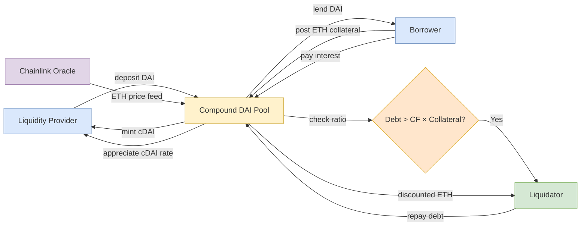

## 概述

去中心化金融（DeFi）是建立在以太坊等區塊鏈[[smart-contracts|智能合約]]上的開放金融系統，旨在以無需許可、透明且可組合的方式重建傳統金融服務——以代碼取代機構、以超額抵押取代信用評估、以[[cryptography|密碼學]]保證取代公證機構。DeFi 在功能上涵蓋傳統金融的每個環節：穩定幣（USDT/USDC 法幣抵押、DAI 加密資產超額抵押、Terra/UST 算法穩定幣——2022年5月崩潰抹去逾400億美元）充當記賬單位；Aave/Compound 等借貸協議以跳躍利率模型 $r(U) = r_0 + U \cdot m$ 在利用率激增時自動拉升借款成本；Uniswap 以恒積公式 $x \cdot y = k$ 取代傳統撮合引擎，實現永久在線流動性。可組合性（「Money Legos」）是 DeFi 最大的創新：EVM 共享執行環境和 ERC-20 代幣標準使協議間無許可組合成為可能，單筆交易可原子性地完成閃電貸→套利→還款，同樣的互聯互通也製造了系統性風險傳染路徑。無常損失（$\text{IL}(p) = 2\sqrt{p}/(1+p) - 1$，當價格比 $p=4$ 時約 -20%）是流動性提供者面臨的核心權衡，而預言機操縱（TWAP 緩解）和清算連鎖（抵押品拋售壓低資產價格觸發更多清算）是系統性風險的主要傳導機制。Layer-2 擴容（Optimistic Rollup、zk-SNARK 有效性證明）和跨鏈橋（同時也是最大單類別損失來源）代表 DeFi 基礎設施的當前前沿，其中 zk-Rollup 通過鏈上發布一個簡潔有效性證明而非重新執行所有交易，將每筆交易的 L1 成本降低一至兩個數量級。

## Definition and Scope

**Decentralized Finance (DeFi)** refers to an ecosystem of financial applications built on blockchain networks — primarily Ethereum — that replicate, extend, and compose traditional financial services without centralized intermediaries. Instead of banks, brokers, and clearinghouses, DeFi uses [[smart-contracts|Smart Contracts]] to automate financial logic, with rules enforced by code rather than institutions. Security rests on [[cryptography|cryptographic]] primitives (hashes, ECDSA signatures) and on economic incentives that align validators and liquidators.

The core thesis: every financial service that exists in traditional finance (TradFi) can be rebuilt as a permissionless, transparent, programmable protocol. The EEMT6000H course maps this systematically:

| TradFi Function | DeFi Equivalent | Examples |
|---|---|---|
| Money | Stablecoins | USDT, USDC, DAI, FRAX |
| Banking (deposits/lending) | Lending protocols | Aave, Compound, MakerDAO |
| Exchanges | DEXes (AMMs, order books) | Uniswap, Curve, dYdX |
| Brokerage (derivatives) | Derivatives protocols | Synthetix, GMX, Perpetual Protocol |
| Insurance | Decentralized insurance | Nexus Mutual, InsurAce |
| Payments | Payment channels, bridges | Lightning Network, cross-chain bridges |
| Asset management | Yield aggregators, vaults | Yearn Finance, Convex |

Compared with TradFi, DeFi replaces **creditworthiness with collateral**, **institutions with code**, and **KYC with pseudonymity** — changing the trust model entirely.

## Stablecoins

Stablecoins are the foundational layer of DeFi — the unit of account, medium of exchange, and primary collateral type. Without a stable reference asset, DeFi lending, trading, and yield strategies would be impractical due to crypto volatility.

### Fiat-Collateralized (Custodial)

**USDT** (Tether) and **USDC** (Circle) are backed 1:1 by reserves held by a custodian (fiat currency, Treasury bills, commercial paper). Redemption is guaranteed by the issuer. US-regulated stablecoins — **GUSD** (Gemini Dollar) and **PUSD** (Paxos Dollar) — were approved by the New York Department of Financial Services (NYDFS) in September 2018, providing externally audited monthly reserve attestations. These dominate by market cap due to simplicity and trust in the peg mechanism.

A minimal custodial stablecoin contract extends the ERC-20 interface with `issue` and `redeem` functions guarded by reserve checks:

```solidity
function issue(uint256 value) public {
    require(reserve >= value, "insufficient reserve");
    totalSupply += value;
    balances[msg.sender] += value;
    reserve -= value;
    emit Issued(value);
}

function redeem(uint256 value) public {
    require(balances[msg.sender] >= value, "insufficient balance");
    totalSupply -= value;
    balances[msg.sender] -= value;
    reserve += value;
    emit Redeemed(value);
}
```

### Crypto-Collateralized (Synthetic)

**DAI** (MakerDAO) is the canonical example. Users deposit crypto assets (ETH, WBTC, USDC) into **vaults** as collateral and mint DAI against it, maintaining an **over-collateralization ratio** (typically ≥150%). If collateral value falls below the liquidation threshold, the position is automatically liquidated via auction. The **stability fee** (paid by borrowers) and **DAI Savings Rate (DSR)** (paid to DAI holders) act as a PID-like peg controller:

- DAI trading below $1 → raise stability fee / DSR → encourage holding, discourage minting → peg recovers.
- DAI trading above $1 → lower stability fee / DSR → encourage minting → peg recovers.

**RAI** (Reflexer) takes a more radical approach — it is not pegged to any fiat currency but instead targets a floating redemption price adjusted by a PID controller, making it a purely crypto-native stable asset. When collateral auctions fail to recover enough DAI to cover outstanding debt, MakerDAO's **seigniorage-shares backstop** mints new MKR tokens and auctions them to plug the shortfall — similar to how traditional banks issue new equity under stress.

### Algorithmic (Un-Collateralized)

Algorithmic stablecoins attempt to maintain their peg through supply-adjustment mechanisms rather than collateral. **FRAX** uses a fractional-algorithmic model (partially collateralized, partially algorithmic). **FEI** and **OHM** (Olympus) use protocol-controlled value and bonding mechanisms. **IRON** (Iron Finance) demonstrated the fragility of this category — its algorithmic component collapsed in a bank-run dynamic, with the share token entering a reflexive death spiral. The **May 2022 Terra/UST collapse** is the most dramatic case: a $40+ billion ecosystem unwound in days when mint/burn arbitrage between UST and LUNA failed, pushing LUNA supply to near-infinity and UST to near-zero.

### Stablecoin Taxonomy

| Category | Peg Mechanism | Collateral | Example | Key Risk |
|---|---|---|---|---|
| Fiat-collateralized | Custodial issuance / redemption | Fiat reserves, T-bills, CP | USDT, USDC, GUSD | Counterparty, reserve composition |
| Crypto-collateralized | Over-collateralization + liquidation | ETH, BTC, LSTs | DAI, RAI | Liquidation cascade, oracle |
| Algorithmic | Supply rebasing, seigniorage shares | None / partial | UST (failed), FRAX | Bank-run reflexivity |
| CBDC | Central bank liability | Government backing | e-CNY, digital euro | Policy / surveillance |

### Market Growth and Macro Implications

The stablecoin market grew from **$5.6B in 2020 to over $130B by early 2022**. Policy implications highlighted in the course: stablecoin issuers holding non-deposit reserves can cause **deposit disintermediation** — shrinking bank balance sheets and impairing credit creation. Stablecoin demand drove US commercial paper issuance and briefly altered CP yields in 2021. **HKMA** launched a stablecoin issuer sandbox to prepare regulation. Events such as the USDC depeg to $0.87 on March 11, 2023 (after Circle held $3.3B of reserves at failed Silicon Valley Bank) show the direct link between traditional bank stress and DeFi's unit of account.

## Automated Market Makers (AMMs)

Traditional exchanges use **order books** — buyers and sellers post limit orders, and a matching engine pairs them. This model requires active market makers and sufficient liquidity depth. AMMs replace matching engines with a mathematical pricing curve and a liquidity pool.

### Constant Product Formula

The foundational AMM design, pioneered by **Uniswap v2**, uses the **constant product invariant**:

$$x \cdot y = k$$

Where $x$ and $y$ are the reserves of two tokens in a liquidity pool, and $k$ is a constant. When a trader swaps token A for token B, they add A to the pool and remove B, such that the product remains constant. The price is determined by the ratio of reserves — no order book, no market maker, no counterparty matching.

Including the 0.30% swap fee $f = 0.003$, the output for a deposit of $\Delta y$ is:

$$\Delta x = x - \frac{x \cdot y}{y + (1-f)\Delta y}$$

**Worked example from the lecture**: a pool holds 100 Token A and 10 Token B ($k = 1000$). Alice swaps 1 Token B for Token A:

1. $y' = 10 + (1 - 0.0003) = 10.9997$
2. $x' = \frac{100 \cdot 10}{10.9997} = 90.9116$
3. Alice receives $100 - 90.9116 = 9.0884$ Token A.

The effective marginal price of Token B fell from 10 A → 8.26 A purely from price impact — demonstrating AMM slippage on thin pools.

**LP shares** are issued as $\sqrt{xy}$ when liquidity is first deposited. A provider depositing $(100, 10)$ receives $\sqrt{1000} \approx 31.62$ LP tokens.

**Implications**:
- **Always-on liquidity**: The pool always quotes a price, though slippage increases non-linearly with trade size relative to pool depth.
- **Deterministic pricing**: Price is a pure function of reserves — fully transparent and predictable.
- **Permissionless listing**: Anyone can create a pool for any ERC-20 token pair by depositing equal value of both tokens.

### Impermanent Loss

Liquidity providers (LPs) earn trading fees but face **impermanent loss (IL)** — when the price ratio of pooled tokens diverges from the deposit ratio, the LP's position underperforms a simple hold strategy. For a constant-product pool with price ratio $p$ relative to the deposit price, IL is:

$$\text{IL}(p) = \frac{2\sqrt{p}}{1+p} - 1$$

At $p = 2$, IL $\approx -5.7\%$; at $p = 4$, IL $\approx -20\%$; at $p = 5$, IL $\approx -25.5\%$. The loss is "impermanent" because it reverses if prices return to the original ratio, but large divergences can make LP positions unprofitable even after fee income.

### AMM Variants

| Variant | Invariant | Use Case | Trade-off |
|---|---|---|---|
| Uniswap v2 | $x \cdot y = k$ | Any ERC-20 pair | Simple but high slippage at size |
| Curve Stableswap | Hybrid constant-sum / constant-product | Stable-stable pairs (USDC/USDT) | Tight spreads near parity, fails outside |
| Uniswap v3 | Concentrated liquidity per tick range | Capital-efficient LPing | Active management, higher IL |
| Balancer | $\prod_i x_i^{w_i} = k$ | Multi-asset pools with weights | Index-fund style |
| Virtual AMM (vAMM) | Synthetic curve, no real pool | Perp futures (dYdX, Perpetual) | Funding rate mechanism needed |

## Lending Protocols

DeFi lending eliminates credit assessment entirely. Instead of creditworthiness, **over-collateralization** enforces repayment.

**Aave** and **Compound** are the dominant lending protocols. The mechanism:

1. **Suppliers** deposit assets into a pool and receive interest-bearing tokens (**aTokens** on Aave, **cTokens** on Compound). The `ETH ↔ cETH` exchange rate appreciates each block as borrower interest accrues.
2. **Borrowers** post collateral and borrow from the pool. Each asset has a **collateral factor** $\in [0, 1]$ determining the maximum loan-to-value ratio — high-volatility assets get lower factors.
3. **Interest rates** adjust algorithmically based on pool utilization $U = \text{borrows} / \text{supplies}$. Compound's canonical "jump rate" model:

$$r_{\text{borrow}}(U) = \begin{cases} r_0 + U \cdot m & U \le U^* \\ r_0 + U^* \cdot m + (U - U^*) \cdot j & U > U^* \end{cases}$$

where $U^*$ is the kink point (~80-90%) and $j \gg m$ is the jump slope that spikes rates when utilization is high.

4. **Liquidation**: If $\text{value(debt)} > \text{collateralFactor} \times \text{value(collateral)}$, anyone can liquidate the position, repaying the debt and claiming discounted collateral (typically 5-13% liquidation bonus).

Representative Compound collateral factors from the lecture: **ETH, DAI 75%**, **UNI 60%**, **YFI 35%**.

Key innovations over TradFi lending:
- **Permissionless**: No credit checks, KYC, or approval process. Anyone with collateral can borrow.
- **Algorithmic rates**: Rates update every block — far faster than traditional loan pricing.
- **Composability**: Lending positions can be tokenized (cTokens are ERC-20) and used as collateral in other protocols.

### Flash Loans

**Flash loans** are uncollateralized loans that must be borrowed and repaid within a single transaction. If repayment fails, the entire transaction reverts — so from the lender's perspective, risk is zero. Use cases:

- **Risk-free arbitrage**: Borrow $1M USDC → swap USDC → DAI on Uniswap → swap DAI → USDC on Curve → repay loan → keep spread. The lecture walks through a concrete example yielding 0.001M USDC on a 0.1% cross-DEX spread.
- **Collateral swap**: Flash-borrow DAI → repay Compound debt → redeem ETH collateral → swap ETH to USDC → redeposit USDC as collateral → borrow new DAI → repay flash loan. All in one transaction, avoiding the need to own $3000 DAI upfront.
- **Self-liquidation**: Liquidate oneself at no cost to reclaim collateral at better rates.
- **Oracle manipulation attacks**: Flash-borrow enough capital to skew an on-chain DEX price feed, then exploit downstream protocols relying on that price. The lecture cites an sUSD/ETH exploit extracting ~1935.87 ETH in a single transaction.

Flash loans are a DeFi-native financial primitive with no TradFi equivalent — they exist only because atomic multi-step transactions allow conditional reversal.

## DeFi Lending Flow Diagram



## Yield Farming and Composability

**Yield farming** is the practice of deploying capital across DeFi protocols to maximize returns. Strategies include:

- **Liquidity mining**: Providing liquidity to AMMs and earning both trading fees and protocol governance tokens as incentives.
- **Leveraged yield farming**: Borrowing assets to increase LP position size, amplifying both returns and risk.
- **Recursive lending**: Depositing collateral, borrowing against it, redepositing the borrowed asset as collateral, and repeating — multiplying exposure to lending incentives.
- **Yield aggregation**: Protocols like **Yearn Finance** and **Convex** automate strategy selection, compounding, and rebalancing across multiple protocols.

### Composability ("Money Legos")

DeFi's defining architectural property is **composability** — protocols can be combined permissionlessly because they share a common execution environment (EVM), common token standards (ERC-20, [[smart-contracts|ERC-4626]]), and common state (the Ethereum blockchain). A single transaction can:

1. Flash-borrow USDC from Aave
2. Swap USDC for ETH on Uniswap
3. Deposit ETH as collateral on Compound
4. Borrow DAI against it
5. Repay the flash loan

This "money Legos" property enables rapid innovation — new protocols can build on existing ones without permission or integration agreements. However, it also creates **systemic risk**: a bug or exploit in one protocol can cascade through all protocols that depend on it. Systemic risk parallels traditional financial contagion, and [[behavioral-economics|reflexive dynamics]] (bank runs, fire sales) appear in identical form.

## Oracles

DeFi protocols frequently need off-chain data — asset prices, interest rates, event outcomes. **Oracles** are the bridge between on-chain contracts and off-chain information.

**Chainlink** is the dominant oracle network, using a decentralized network of node operators that aggregate data from multiple sources and post it on-chain. Oracle designs range from 1-signer trusted oracles (simplest, fully centralized) to M-of-N aggregated oracles to **Schelling-point oracles** where reporters are rewarded for agreeing with the median (subject to whale manipulation). For on-chain assets, DEXes themselves can serve as oracles, but spot prices are vulnerable to flash-loan manipulation — robust implementations use **time-weighted average prices (TWAP)** over multiple blocks.

Oracle security is critical: if a price feed is manipulated, lending protocols may trigger incorrect liquidations, AMMs may be drained through arbitrage, and derivatives may settle at wrong prices.

## Incident Timeline

| Date | Incident | Loss / Impact |
|---|---|---|
| Jun 2016 | The DAO reentrancy hack | ~$60M; Ethereum hard fork |
| Feb 2020 | bZx flash-loan oracle exploit #1 | $350K |
| Feb 2021 | Alpha Homora / Cream flash-loan exploit | $37M |
| May 2021 | IRON (Iron Finance) algorithmic collapse | Near-total |
| Aug 2021 | Poly Network cross-chain exploit | $611M (returned) |
| Oct 2021 | Compound distribution bug | $147M over-rewards |
| Feb 2022 | Wormhole bridge exploit | $320M |
| May 2022 | Terra / UST collapse | $40B+ ecosystem wiped |
| Mar 2023 | USDC depeg to $0.87 (SVB failure) | Temporary |

## Risks and Limitations

- **Smart contract risk**: Bugs in immutable code can lead to catastrophic fund loss. Even audited code can harbor subtle bugs (reentrancy, storage collisions, incorrect math).
- **Oracle manipulation**: Flash-loan-funded price manipulation can exploit protocols relying on single-block spot prices.
- **Impermanent loss**: LP returns can underperform simple holding, especially in volatile markets.
- **Liquidation cascades**: In market crashes, mass liquidations create a feedback loop — liquidated collateral floods the market, pushing prices lower, triggering more liquidations.
- **Regulatory uncertainty**: DeFi's permissionless nature conflicts with securities law, KYC/AML requirements, and emerging stablecoin regulation. Post-Tornado Cash sanctions, even protocol front-ends face legal exposure.
- **Gas costs**: During network congestion, transaction fees can make small-value DeFi interactions uneconomical.
- **Bridge risk**: Cross-chain bridges concentrate billions of dollars behind shared validator sets and have been the largest source of DeFi losses by absolute value.

## Layer-2 Scaling and zk-Rollups

DeFi's gas-cost and throughput problems push activity onto **Layer-2 (L2)** networks. **Optimistic rollups** (Arbitrum, Optimism) post compressed transaction data to L1 with a fraud-proof window; **zk-Rollups** (zkSync, Starknet, Polygon zkEVM) post a succinct cryptographic validity proof — typically a **zk-SNARK** — that the entire L2 state transition was valid. The L1 contract verifies one proof rather than re-executing every transaction, reducing per-transaction L1 cost by 1-2 orders of magnitude while inheriting L1 security. The remaining trust assumption is **data availability** — the rollup operator must publish enough transaction data for users to reconstruct L2 state if the operator goes offline; recent work (Huang et al. 2024, see [[wiki/sources/courses/blockchain|blockchain references]]) explores erasure-coded data availability schemes for zk-rollups. The same primitive — batching many off-chain events into a single on-chain validity proof — has applications outside DeFi, notably in IoT access control where each smart-home device emits high-frequency state updates that would otherwise saturate any Layer-1 blockchain.

## Key Findings

- DeFi successfully replicates nearly every TradFi function but with fundamentally different trust assumptions — code replaces institutions, collateral replaces creditworthiness, and [[cryptography|cryptography]] replaces notarization.
- Stablecoins are the critical infrastructure layer; algorithmic designs remain fragile and prone to reflexive collapse, as UST's May 2022 implosion definitively demonstrated.
- AMMs represent a genuinely novel market structure with no TradFi precedent — they sacrifice capital efficiency for permissionless, always-on liquidity, and quantify slippage via a pure function of reserves.
- **Composability is DeFi's greatest innovation and its greatest systemic risk** — the same interconnection that enables money-Legos creates contagion pathways.
- **Flash loans** are a DeFi-native financial primitive — simultaneously enabling efficient arbitrage and powering the most common exploit vector.
- Over-collateralization makes DeFi lending safer for lenders than TradFi unsecured lending, but less capital-efficient — the trade-off for eliminating credit risk assessment.

## Related Concepts

- [[smart-contracts|Smart Contracts]] — The programmable foundation enabling all DeFi protocols
- [[cryptography|Cryptography]] — Cryptographic primitives securing transactions, identity, and oracle attestations
- [[financial-ratios|Financial Ratios]] — Traditional financial analysis metrics applicable to DeFi protocol evaluation
- [[financial-statements|Financial Statements]] — Reserve disclosure, audit, and solvency concepts applied to stablecoin issuers
- [[revenue-management|Revenue Management]] — Pricing and yield optimization parallels in DeFi yield farming
- [[behavioral-economics|Behavioral Economics]] — Reflexive dynamics, bank-run behavior, and incentive design in tokenomics

## Source Materials

- [[wiki/sources/courses/blockchain|EEMT6000H Introduction to Blockchain Technology]] — Lectures 5-6 (primary), Lectures 4, 7 (supporting)
