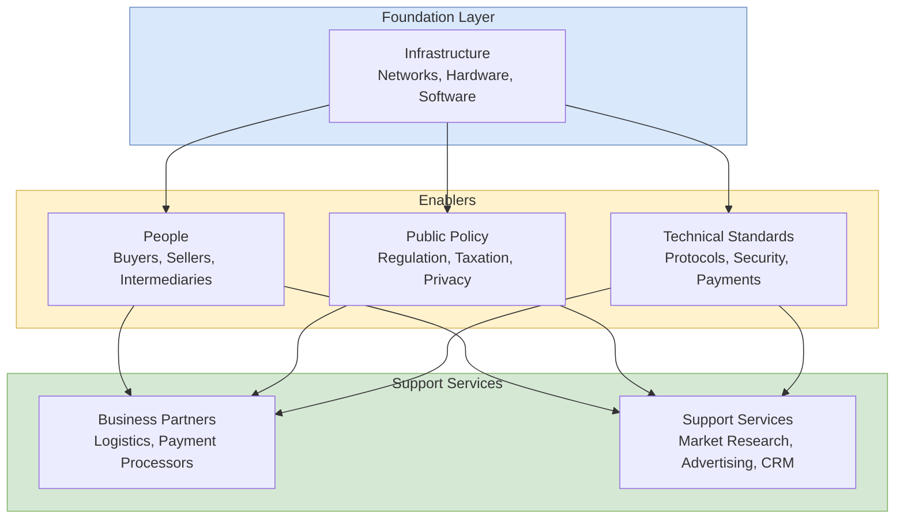
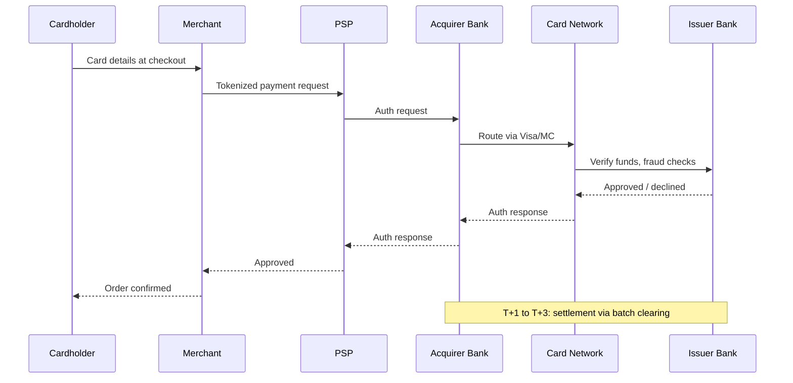

## 概述

電子商務模型涵蓋企業對企業（B2B）、企業對消費者（B2C）、消費者對消費者（C2C）、消費者對企業（C2B）及政府對公民（G2C）等交易架構，以及支撐這些模型的支付系統、平台經濟學和數位廣告機制。數位經濟的結構性特徵——近零邊際複製成本、網絡效應（Metcalfe 定律：價值 ∝ $n^2$）、長尾經濟學（數位分發使利基市場可盈利）和資訊不對稱降低——從根本上改變了傳統市場結構的假設。三大支付架構（信用卡五方生態系統、P2P 移動支付如微信支付/支付寶、區塊鏈分佈式賬本）各有其結算延遲、手續費率、可逆性與吞吐量的取捨：Visa 每秒處理65,000筆交易而比特幣僅7筆，但後者無需信任任何中介。Airbnb、Uber 等共享經濟平台通過冷啟動問題（Airbnb 早期爬取 Craigslist 的增長黑客）和信任機制設計（評分系統、身份驗證、保險）展示了雙邊市場如何解決先有雞還是先有蛋的問題；越南 Peacesoft/eBay.vn 案例則揭示在新興市場中，Turban 框架的公共政策與業務合作夥伴層（貨到付款、末端配送）才是真正的制約因素而非技術。社交商務（直播帶貨、群購、可購物貼文）和隱私保護廣告的轉型（Apple ATT、Cookie 棄用、第一方數據策略）代表了行業的下一個結構性轉變。

## Core Mechanism

E-commerce models describe the structural relationships between participants in electronic transactions. The classification is based on **who sells to whom** and **through what intermediary infrastructure**.

### Transaction Model Taxonomy

| Model | Parties | Examples | Key Characteristics |
|---|---|---|---|
| **B2B** | Business → Business | Alibaba.com, SAP Ariba, EDI networks | High volume, negotiated pricing, long-term contracts, integration with [[wiki/concepts/erp|ERP]] systems |
| **B2C** | Business → Consumer | Amazon, JD.com, Zalando | Catalog-driven, marketing-heavy, logistics-intensive, personalization |
| **C2C** | Consumer → Consumer | eBay, Carousell, Facebook Marketplace | Platform-mediated, trust mechanisms (ratings, escrow), variable quality |
| **C2B** | Consumer → Business | Freelancer platforms, Priceline (name-your-price) | Consumer sets terms, reverse auction dynamics |
| **G2C** | Government → Citizen | Tax filing, permit applications, e-voting | Compliance-driven, accessibility requirements, security-critical |

### Pure vs. Partial E-Commerce

The distinction depends on three dimensions: **product**, **process**, and **delivery agent**.

- **Pure e-commerce**: All three are digital. Example: buying an e-book on Kindle — the product (digital file), process (online purchase), and delivery (download) are entirely electronic.
- **Partial e-commerce** (click-and-mortar): At least one dimension involves a physical component. Example: ordering groceries online (digital process) for physical delivery of physical goods.
- **Traditional commerce**: All three are physical. A customer walking into a store, selecting items, and paying cash.

Most real-world e-commerce is partial. Even Amazon, the archetypal e-commerce company, operates massive physical warehouse and logistics networks.

### The Turban E-Commerce Framework

The Turban et al. framework identifies the structural components necessary for an e-commerce ecosystem:



The framework emphasizes that e-commerce is not just a website — it requires coordinated development across technology, policy, and business services. Failure in any layer (e.g., inadequate payment infrastructure in emerging markets) constrains the entire system.

### Digital Economy Characteristics

The digital economy differs structurally from traditional markets in several ways:

- **Reduced information asymmetry**: Comparison shopping, reviews, and price aggregators give consumers more information than sellers may prefer. This reshapes the assumptions of [[wiki/concepts/consumer-behavior|Consumer Behavior]] models.
- **Lower transaction costs**: Coase's theory predicts that lower transaction costs enable smaller firms to compete and reduce the advantage of vertical integration.
- **Network effects**: The value of a platform increases with its user base. **Metcalfe's law** states that value scales as $O(n^2)$ for $n$ users, since each pair of users is a potential connection. This creates winner-take-most dynamics and high switching costs — the dominant strategic force identified in [[wiki/concepts/porters-five-forces|Porter's Five Forces]] analyses of platform markets.
- **Long tail economics**: Digital distribution has near-zero marginal cost, making it profitable to serve niche markets that physical retail cannot support (Chris Anderson, 2006). Amazon's millions of obscure book titles generate meaningful revenue even though individually they sell fewer than 10 copies per year.
- **Zero marginal cost of reproduction**: Digital goods (software, media, data) can be copied at negligible cost, fundamentally altering pricing and piracy dynamics.
- **Globalization & digitization**: Global communication enables collaboration and sales without physical presence; music, books, software, and video are digitized for fast inexpensive storage and distribution — a driver of rapid [[wiki/concepts/depreciation|Depreciation]] of legacy physical media assets.

## Payment Systems

Payment is the critical trust bottleneck in e-commerce. Three dominant architectures have emerged:

### Credit Card Payments

The credit card ecosystem involves five parties in a carefully orchestrated flow:

1. **Cardholder** initiates payment at checkout.
2. **Merchant** sends transaction details to their **Payment Service Provider (PSP)** (e.g., Stripe, Adyen).
3. **PSP** routes the transaction to the **Acquirer** (merchant's bank).
4. **Acquirer** sends an authorization request through the **Card Network** (Visa, Mastercard) to the **Issuer** (cardholder's bank).
5. **Issuer** checks the cardholder's credit/funds, approves or declines, and sends response back through the chain.
6. **Settlement** happens later (typically T+1 to T+3 days) via batch processing through the card network.



**Fee structure**: Interchange fee (paid by acquirer to issuer, ~1.5-3%) + network fee + PSP markup. Total merchant cost: 2-4% per transaction. This is why large merchants negotiate direct interchange rates and why [[wiki/concepts/financial-ratios|Financial Ratios]] like gross margin in retail are sensitive to payment mix.

**Security layers**: CVV verification, 3D Secure (Verified by Visa / Mastercard SecureCode), tokenization (replacing card numbers with single-use tokens), PCI-DSS compliance requirements. These rely directly on primitives from [[wiki/concepts/cryptography|Cryptography]] — tokenization is a keyed hash, 3DS uses challenge-response signed by the issuer.

### P2P and Mobile Payments

Peer-to-peer payment systems bypass the traditional card network:

- **WeChat Pay / AliPay** (China): QR-code-based payments linked to bank accounts or wallet balances. Dominant in China with >90% mobile payment penetration. Operate as closed-loop systems — both sender and receiver must be on the same platform.
- **PayPal**: Email/phone-based transfers. Acts as an intermediary holding funds. Supports cross-border transactions but with significant fees (3-5%).
- **Apple Pay / Google Pay**: Tokenize existing credit cards for contactless NFC payments. Not a new payment network — they ride on existing card rails but add biometric authentication and tokenization.

Key advantages: Lower fees than credit cards (especially in domestic markets), instant settlement, integration with social platforms (red packets on WeChat). Key risk: platform lock-in and regulatory dependence on a single company.

### Blockchain-Based Payments

Bitcoin introduced a fundamentally different payment architecture:

- **Distributed ledger**: Transaction history replicated across thousands of nodes. No single point of failure or control.
- **Proof of Work**: Miners compete to solve computationally expensive puzzles to validate blocks. The winner appends the block and receives a reward. This mechanism prevents double-spending without a trusted third party.
- **Pseudonymity**: Transactions are linked to public keys (addresses), not real-world identities. Privacy is partial — the ledger is transparent, but ownership is pseudonymous.
- **Immutability**: Once confirmed (typically 6 blocks deep), transactions are practically irreversible.

```text
# Bitcoin transaction structure (simplified)
tx = {
  inputs:  [{prev_tx: ..., prev_index: 0, signature: ECDSA_sign(tx_hash, A_private)}],
  outputs: [{value: 1.0 BTC, to: B_address}],
}
# Nodes verify: ECDSA_verify(tx_hash, signature, A_public) == true
#               and sum(inputs) >= sum(outputs) + fee
```

Each transaction is an ECDSA signature over the transaction hash using the sender's private key (secp256k1 curve). Nodes independently verify the signature against the public key associated with the input UTXO, then append the transaction to the mempool. Miners assemble transactions into candidate blocks and compete to find a nonce such that `SHA256(SHA256(block_header)) < target`, a puzzle whose difficulty adjusts every 2016 blocks to maintain a ~10-minute block time.

**Quantitative comparison**:

| Property | Bitcoin | Ethereum (post-merge) | Visa |
|---|---|---|---|
| Block time | ~10 min | ~12 s | instant |
| Finality (blocks) | 6 (~60 min) | ~2 epochs (~13 min) | T+1 chargeback window |
| Throughput | ~7 tx/s | ~15 tx/s | ~65,000 tx/s |
| Energy / tx | ~1,200 kWh | ~0.03 kWh (PoS) | ~0.0015 kWh |
| Reversibility | None | None | Chargebacks available |
| Fee | dynamic, 0.1-20 USD | dynamic, 0.1-50 USD | 2-4% merchant fee |

**Limitations for e-commerce**: Slow confirmation, historically high energy consumption (pre-PoS Ethereum), price volatility, limited throughput vs. Visa, and lack of consumer protections (no chargebacks).

**Layer 2 solutions** (Lightning Network for Bitcoin, Optimism/Arbitrum for Ethereum) address throughput by batching thousands of off-chain transactions into a single on-chain settlement. Stablecoins (USDT, USDC) address volatility by pegging to fiat currencies and are increasingly used for cross-border B2B settlement. See [[wiki/concepts/defi|DeFi]] and [[wiki/concepts/smart-contracts|Smart Contracts]] for the programmable layer built on top.

## Online Advertising

Digital advertising is the primary revenue model for many e-commerce platforms:

| Model | Pricing | Use Case |
|---|---|---|
| **CPM** (Cost per Mille) | Per 1,000 impressions | Brand awareness campaigns |
| **CPC** (Cost per Click) | Per click-through | Search advertising, performance marketing |
| **CPA** (Cost per Action) | Per conversion (purchase, signup) | Affiliate marketing, ROI-focused campaigns |

**Search advertising** (Google Ads) uses keyword auction mechanisms. **Display advertising** uses programmatic real-time bidding (RTB) through ad exchanges. **Social media advertising** leverages user profile data for targeting precision.

The shift toward **privacy-preserving advertising** (Apple ATT, Google Privacy Sandbox, cookie deprecation) is restructuring the industry toward first-party data and contextual targeting.

## Sharing Economy and Social Commerce

### Sharing Economy

Platforms like **Uber** and **AirBnB** exemplify **two-sided markets**: the platform's value depends on having both supply (drivers, hosts) and demand (riders, guests). Key characteristics:

- **Asset-light model**: The platform owns no vehicles or properties — it orchestrates transactions between asset owners and consumers.
- **Trust mechanisms**: Ratings, reviews, identity verification, insurance, and escrow replace the institutional trust of traditional businesses.
- **Dynamic pricing**: Algorithmic pricing (surge pricing) balances supply and demand in real time.
- **Regulatory friction**: Sharing economy platforms often operate in regulatory gray areas, disrupting incumbents (taxi companies, hotels) and prompting new legislation.

### Social Commerce

Social commerce integrates shopping directly into social media platforms:

- **Product discovery**: Influencer recommendations, shoppable posts, live-stream selling (极为流行 in China via Douyin/TikTok).
- **Group buying**: Pinduoduo's model — prices decrease as more users join a purchase group, incentivizing social sharing.
- **Reviews and social proof**: User-generated content (reviews, unboxing videos) influences purchase decisions more than brand advertising for many product categories.

## Case Illustrations

Two teaching cases from the EEMT5540 course show the models above operating under real constraints:

- **Airbnb / Etsy / Uber — acquiring the first thousand customers** (HBS 516-094, Teixeira & Brown, 2016). The canonical **cold-start problem** in two-sided marketplaces: without suppliers there is nothing for demand to match with, and without demand no supplier will list. Airbnb's growth hack was a custom bot that scraped Craigslist listings and cross-posted higher-quality Airbnb listings back to Craigslist — unauthorized, technically non-trivial, but devastatingly effective at importing Craigslist's existing demand-side user base. Combined with the Obama O's / Cap'n McCain's cereal stunt that raised ~$30K before Y Combinator funding, the case is a textbook demonstration that network effects only pay off *after* an asymmetric cold-start push. The sharing-economy trust mechanisms described above (ratings, verified identity) were layered on later.
- **Peacesoft / eBay.vn partnership** (JITTC JIT083, Le-Nguyen & Guo, 2016). A cross-border e-commerce strategy case set in Vietnam circa 2014. Peacesoft had solved three local bottlenecks — secure online transactions (Vietnam was then predominantly cash-on-delivery), buyer-side trust, and the shipping last mile — to become a top-five domestic player via its eBay.vn partnership. The strategic dilemma is whether to extend the proven domestic ecosystem into Southeast Asia or build a new cross-border platform from scratch, with Alibaba, Rakuten, and Lazada already moving into the same region. The case underscores how **public policy and business-partners layers** of the Turban framework are the binding constraints in emerging-market e-commerce, not technology.

## Key Findings

- E-commerce models are converging: pure B2C platforms add marketplace features (B2C → C2C hybrid), while C2C platforms add managed services (eBay Guaranteed Delivery).
- Payment system evolution follows a pattern of disintermediation: credit cards disintermediated cash, P2P payments disintermediate card networks, and blockchain aims to disintermediate all financial intermediaries.
- Network effects create natural monopolies in platform markets, but multi-homing (users on multiple platforms) and regulatory intervention can counterbalance this concentration.
- The Turban framework's emphasis on **public policy** as a structural component is validated by real-world cases: China's mobile payment dominance was enabled by regulatory tolerance, while cryptocurrency adoption varies dramatically by jurisdiction.
- Social commerce blurs the line between content consumption and shopping, making the [[wiki/concepts/marketing-mix|Marketing Mix]] framework's "place" dimension increasingly digital and social.

## Related Concepts

- [[wiki/concepts/web-architecture|Web Architecture]] — Technical infrastructure enabling e-commerce
- [[wiki/concepts/cryptography|Cryptography]] — Security foundations for payment systems
- [[wiki/concepts/crm|CRM]] — Customer relationship management in digital commerce
- [[wiki/concepts/marketing-mix|Marketing Mix]] — Marketing frameworks applied to e-commerce
- [[wiki/concepts/stp-marketing|STP Marketing]] — Segmentation, targeting, positioning for digital audiences
- [[wiki/concepts/consumer-behavior|Consumer Behavior]] — Buying decisions under reduced info asymmetry
- [[wiki/concepts/supply-chain-management|Supply Chain Management]] — Logistics backbone of e-commerce fulfillment
- [[wiki/concepts/revenue-management|Revenue Management]] — Pricing strategies in digital markets
- [[wiki/concepts/recommendation-systems|Recommendation Systems]] — Driving product discovery at scale
- [[wiki/concepts/smart-contracts|Smart Contracts]] — Blockchain-based automated commerce
- [[wiki/concepts/defi|DeFi]] — Decentralized alternative to traditional payment rails
- [[wiki/concepts/porters-five-forces|Porter's Five Forces]] — Strategic analysis of platform markets
- [[wiki/concepts/ab-testing|A/B Testing]] — Experimental optimisation of storefronts
- [[wiki/concepts/erp|ERP]] — Back-office integration for B2B commerce
- [[wiki/entities/hkust|HKUST]] — Source institution for course material

## Source Materials

- [[wiki/sources/courses/ecommerce|EEMT5540 IT for E-Commerce Applications]]
- Lecture 10: E-Commerce Systems
