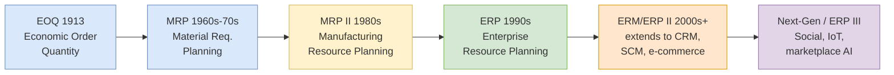

## 概述

企業資源規劃（ERP）是透過單一共用資料庫整合製造、財務、人力資源、供應鏈及客戶管理等所有核心業務模組的企業應用系統，從根本上消除部門間數據孤島、消除重複輸入並實現跨功能流程的即時可視化。ERP 的演進遵循技術底座的擴展路徑：1913年 EOQ 庫存公式→1960-70年代 MRP（依 BOM 爆炸物料需求）→1980年代 MRP II（擴展至產能規劃）→1990年代 ERP（涵蓋所有業務功能，依賴 LAN 與客戶端-服務器架構）→2000年代 ERP II（跨組織邊界擴展至 CRM、SCM）→SAP S/4HANA（2015年，記憶體內列式 HANA 資料庫，OLTP 與 OLAP 合一，數據壓縮從593 GB壓至42 GB，財務過賬觸及的表從15張降至4張）。SAP 是全球最大 ERP 廠商（服務約437,000名客戶），其核心模組包括 SD（銷售）、MM（物料管理）、PP（生產計劃）、FI（財務會計）和 CO（管理會計），一張銷售訂單即可串聯所有模組完成訂單到收款的端到端流程。導入成本高且風險大：中型企業通常需要14-16個月、年收入的3-5%，大型企業則需31-34個月、2-3%，主要成本結構為專業服務(45%)、內部人員(20%)、軟件許可(20%)、IT基礎設施(15%)；大型失敗案例（Hershey 因旺季切換導致Q3利潤下降18.6%、Whirlpool 家電積壓裝卸場）表明「保持簡單、最小化定製化、強大的執行支持」是導入成功的關鍵因素。ERP 投資評估依賴 [[wiki/concepts/npv|NPV]]/[[wiki/concepts/irr|IRR]]/TCO 分析，而多準則供應商選擇（Bloom & Grow 案例）往往需要結合[[wiki/concepts/ahp|AHP]]才能在財務與功能適配之間取得平衡。

## What It Is

**Enterprise Resource Planning (ERP)** is an integrated suite of mission-critical application modules that span an organization's core business functions -- manufacturing, human resources, financials, supply chain, and customer management -- all connected through a single, shared database. Unlike functional (siloed) systems where each department maintains its own applications and data stores, an ERP system enforces a unified data model that eliminates redundancy and ensures consistency across the enterprise.

Per Davenport and Short's definition carried into the course materials, ERP is "a technology platform that enables organizations to integrate and coordinate their business processes, providing a single system that is central to the organization and ensuring that information can be shared across all functional levels and management hierarchies." The defining characteristics of ERP systems, as contrasted with functional systems, can be summarized across five dimensions:

| Dimension | Functional Systems | Enterprise Systems (ERP) |
|---|---|---|
| **Scope** | Single department | Cross-functional, enterprise-wide |
| **Database** | Separate per function | Single shared database |
| **Process** | Departmental workflows | Integrated end-to-end processes |
| **Output** | Local reports | Enterprise-wide visibility |
| **Adaptability** | Hard to change | Configurable via modules |
| **System design** | Legacy, highly customized | Standardized, off-the-shelf |
| **Communication** | Needs interfaces/bridges | All modules natively compatible |

ERP systems serve as the **transaction processing backbone** of the organization, recording every business event (sales orders, purchase orders, production orders, financial postings) in real time and making that data available to all authorized users immediately.

## Why It Matters

ERP matters because it solves the fundamental problem of **information fragmentation** in large organizations. Before ERP, companies operated with dozens or hundreds of incompatible systems that could not share data. A sales order entered in the sales system had to be manually re-entered into the production system, then again into the financial system. This caused delays, errors, and an inability to see the overall state of the business.

By integrating all functions, ERP enables:

- **Real-time visibility** into operations, inventory, and finances across the entire organization
- **Process standardization** through embedded best practices and configurable workflows
- **Data-driven decision making** with a single source of truth rather than conflicting departmental reports
- **Regulatory compliance** through consistent audit trails and financial controls
- **Scalability** as the organization grows, acquires other companies, or enters new markets

The strategic value of ERP extends beyond operational efficiency. Organizations that successfully implement ERP can achieve the digital transformation maturity progression: **automation -> integration -> synchronization -> optimization -> transformation**. Each stage builds on the previous, with ERP providing the foundational automation and integration layers.

## How It Works

### Historical Evolution

The evolution of ERP follows a clear trajectory of expanding scope:

1. **EOQ (1913)**: Economic Order Quantity -- mathematical formula for optimal inventory ordering
2. **MRP (1960s-70s)**: Material Requirements Planning -- computing material needs from a master production schedule using bill of materials
3. **MRP II (1980s)**: Manufacturing Resource Planning -- extending MRP to include capacity planning, shop floor control, and financial integration
4. **ERP (1990s)**: Enterprise Resource Planning -- integrating all business functions (not just manufacturing) into a unified system, enabled by network computing, LANs, Internet, and client-server architecture
5. **ERM/ERP II (2000s+)**: Enterprise Resource Management -- extending beyond organizational boundaries to include [[wiki/concepts/crm|CRM]], [[wiki/concepts/supply-chain-management|SCM]], e-commerce, and SOA/web services

Underlying each generation is a required technology substrate: mainframe data processing (1960s), relational databases (1970s), business application software for PCs (1980s), network computing and client-server (1990s), and SOA with web services (2000s).

### SAP as the Dominant ERP Platform

**SAP AG** (Systems, Applications, and Products in Data Processing), founded in 1972 by five former IBM engineers in Weinheim, Germany, is the world's largest enterprise software company. SAP's product line has evolved through four major generations:

- **R/2 (1979)**: Mainframe-based, real-time financial and manufacturing applications
- **R/3 (1992)**: Client/server architecture, the product that made SAP dominant globally
- **Business Suite (2004)**: Service-oriented architecture with expanded functionality; SME line-up added in 2006 (**All-in-One / A1** and **Business One / B1**)
- **S/4HANA (2015)**: Next-generation suite built on the **HANA in-memory, column-oriented database**

As of July 2024, SAP serves approximately **437,000 customers** across 190+ countries with roughly 107,000 employees. SAP S/4HANA represents a fundamental architectural shift by combining **OLTP** (transaction processing) and **OLAP** (analytical processing) in a single in-memory platform. This eliminates the need for separate data warehouses for many analytical workloads. The data compression is dramatic -- a benchmark example showed reduction from **593 GB (traditional DB)** to **118 GB (on HANA)** to **42 GB (S/4HANA)** -- and a typical booking transaction that used to touch **15 tables** (BKPF, BSEG x3, BSIS x2, BSIK, BSET, LFC1, GLT0 x3, COBK, COEP, COSP) now impacts just **4 tables**.

Globally, the ERP market is dominated by SAP and Oracle (including PeopleSoft and JD Edwards), with mid-market share taken by SAGE, Infor (SSA, Baan), and Microsoft. Chinese regional champions **Yonyou, Kingdee, and Inspur** dominate their home market. Gartner 2020 estimates put the global CRM market at ~$70B, ERP at ~$40B, and SCM at ~$23B.

### Core SAP ERP Modules

SAP ERP is organized into functional modules, each addressing a specific business area:

| Module | Full Name | Primary Function |
|---|---|---|
| **SD** | Sales & Distribution | Order-to-cash process, pricing, shipping |
| **MM** | Materials Management | Procurement, inventory, invoice verification |
| **PP** | Production Planning | MRP, BOM explosion, capacity planning, shop floor control |
| **FI** | Financial Accounting | General ledger, accounts receivable/payable, asset accounting |
| **CO** | Controlling | Cost center accounting, profitability analysis, activity-based costing |
| **AM** | Asset Management | Fixed asset lifecycle management |
| **QM** | Quality Management | Quality planning, inspection, certificates |
| **PM** | Plant Maintenance | Preventive and corrective maintenance |
| **HR/HCM** | Human Resources | Personnel administration, payroll, time management |
| **PS** | Project System | Project structures, milestones, cost tracking |
| **WF** | Workflow | Cross-module business workflow engine |
| **IS** | Industry Solutions | Industry-specific templates |

These modules are tightly integrated. For example, creating a sales order in SD automatically triggers availability checks in MM, production orders in PP, and revenue postings in FI -- all from a single transaction. The organizational hierarchy SAP enforces is **Client -> Company Code -> Plant -> Storage Location -> Work Center**, giving multinational companies a structured way to model legal entities, physical sites, and inventory locations. Transactions are initiated via **t-codes** (e.g., `MM01` for create material master, `MM02` for change material master, `FB50` for G/L account document entry) typed into the command field; `/n<tcode>` opens a t-code in the current window, `/o<tcode>` in a new one.

### Integrated Order Management

The canonical **order-to-cash** pipeline exercises nearly every ERP module:

1. **Pre-sales Activities** (SD) -- inquiries and quotations
2. **Sales Order Entry** (SD) -- with **credit check** against FI-AR
3. **Check Availability** (MM inventory + PP production capacity)
4. If stock is insufficient -> trigger **MPS / MRP run** (PP) -> generate **Planned Orders** that become **Production Orders** (PP) or **Purchase Requisitions** (MM)
5. **Purchase Order** (MM) -> **Goods Receipt** (MM) -> **Invoice Receipt** -> **Payment to Vendor** (FI-AP)
6. **Pick Materials -> Pack -> Post Goods Issue** (SD/MM) -- inventory is relieved, FI posts cost of goods sold
7. **Invoice Customer** (SD) -> **Receipt of Customer Payment** (FI-AR)

This cross-module flow illustrates how a single business transaction cascades through Sales, Production, Materials, and Finance without re-keying -- the essence of ERP's value proposition.

### Business Process Management and BPR

ERP implementation is inseparable from **business process management**. A business process is a collection of logically related tasks performed to achieve a defined business outcome (Davenport & Short, 1990), characterized by having customers, crossing organizational boundaries, and delivering value-added transformation. The shift from a **functional view** (vertical departmental silos) to a **process view** (horizontal cross-functional flows like order-to-cash or procure-to-pay) is a prerequisite for successful ERP adoption, typically requiring the appointment of process owners and integrated information systems.

**Business Process Reengineering (BPR)** -- the fundamental rethinking and radical redesign of business processes -- is often undertaken alongside ERP implementation. "Clean slate" BPR can create competitive advantage but carries reported failure rates of **60-80%**. **ERP-enabled reengineering** is a safer middle path that leverages pre-built reference models and industry blueprints ("paving the cow paths" is the anti-pattern to avoid). The **people-process-technology triangle** emphasizes that all three elements must be aligned; as Oliver Wight said, "you can have the best hammer in the world, but it doesn't necessarily make you a good carpenter."

McKinsey identifies five approaches for building a **next-generation operating model**: lean process redesign, digitization, business process outsourcing (BPO), intelligent process automation, and advanced analytics. Common process improvement patterns include converting serial to parallel steps, eliminating excess reviews/approvals/inspections, removing non-value-adding activities, and breaking bottlenecks.

### Implementation Methodology

ERP implementation follows four major stages:

1. **Planning**: Build the business case with **SMART** objectives (specific, measurable, achievable, relevant, time-bound), conduct feasibility and risk studies, assess organizational readiness (technical infrastructure, functional expertise, available resources, corporate culture rated Ready/Limited/Weak), establish project governance with an identified champion and a matrix organization
2. **Selection**: Define software requirements (must-have vs. nice-to-have), map current processes (as-is vs. to-be), evaluate vendors on financial and non-financial criteria
3. **Installation**: Choose methodology and approach, configure or customize the system (levels of change in order of increasing risk: **Configuration -> Enhancement -> Development -> Modification**; SAP's **Implementation Guide (IMG)** is the primary configuration tool), manage testing, training, and change management
4. **Deployment**: Determine transition strategy (**big bang**, **phased** by module/area/location, **parallel**, or **pilot**), perform system and data conversion, run a **conference room pilot** for end-to-end validation, provide ongoing support and maintenance

Implementation methodology naming varies by vendor: SAP uses Project Preparation -> Business Blueprint -> Realization -> Final Preparation -> Go Live + Support; Oracle uses Define -> Train -> Model -> Configure -> Go Live + Refine; Microsoft uses Planning/Analysis -> Design -> Construction -> Deliver & Install.

Implementation costs are substantial. According to the 2023 Digital Transformation Report by Third Stage Consulting Group:
- **Mid-size companies** ($50M-$1B revenue): 14-16 months duration, 3-5% of annual revenue
- **Large companies** (over $1B revenue): 31-34 months duration, 2-3% of annual revenue

Typical cost breakdown (Peerstone Research): professional services (45%), in-house staff (20%), software licenses (20%), IT infrastructure (15%). Benchmarking Partners industry-average ranges are wider: Internal 11-65%, Hardware 10-40%, Consulting 5-56%, Software 14-26%.

The **triple constraint** of scope, time, and cost determines project outcomes: **successful** (all three met), **challenged** (some met), or **failed** (terminated or none met). High-profile failures include Volkswagen (parts shipment delays), Hershey (18.6% Q3 earnings drop after a peak-season rollout), Whirlpool (appliances stranded on loading docks), and Dell (project cancelled after two years). Success factors: clear business objectives, strong executive support, user involvement, an experienced project manager, minimized customization, and adequate go-live preparation. Agile approaches are generally preferred over waterfall for large projects because end-to-end module-based teams reduce handoffs.

Financial justification uses [[wiki/concepts/npv|NPV]], [[wiki/concepts/irr|IRR]], payback period, and **TCO** analysis. Worked NPV example: $1,000 initial investment at 12% discount rate with projected cash flows of $350, $450, $400, $300 yields NPV = -1000 + 312.50 + 358.74 + 284.71 + 190.66 = **+$146.61**, indicating the project clears the hurdle rate. However, ROI is difficult to calculate because cost reductions are tangible and quantifiable while revenue and strategic benefits (communication, employee satisfaction, role clarity, teamwork) are hard to monetize. TCO is computed as the NPV of cash outflows only.

### Cloud vs. On-Premise

Cloud ERP adoption has accelerated dramatically, growing from just 6% of new implementations in 2017 to **47% in 2021**, nearly matching on-premise deployments (53%). SAP S/4HANA is offered both as a private-cloud subscription (SAP-managed maintenance, automatic quarterly innovation upgrades, In-App extensibility with limited ABAP) and as a traditional on-premise license (customer-controlled deployment, hardware at company location, individual customization, full ABAP extensibility up to core modification).

**Cloud ERP advantages**: easier maintenance, high scalability, access from anywhere at any time, automatic innovation upgrades. **Cloud ERP disadvantages**: SaaS model's perceived lower data security, dependence on internet stability, limited customization compared to on-premise.

### ERP Evolution: Looking Forward

The trajectory from ERP to ERP II to Next-Gen ERP (ERP III) shows expanding scope:

| Aspect | ERP | ERP II | Next-Gen ERP (ERP III) |
|---|---|---|---|
| **Value** | Operational efficiency | Inter-organizational efficiency | Full supplier/customer integration |
| **Focus** | Operational excellence | Innovation | Customer (end users) |
| **Key functions** | Back-office transactions | Decision making, collaboration | Emerging capabilities |
| **Technology** | Client/server | SOA, Internet | Social media, IoT, marketplace intelligence |
| **Change driver** | Process reengineering | Process innovation, outsourcing | Disruptive innovators |

## Practical Examples

- **CLP Power** (Hong Kong utility): SAP implementation spanning IS-U/CRM (2.2M customers, 18M billing documents), MM (83K materials, 76K purchase orders), HR (4,500 employees, 64K payroll transactions), PM/PS/MAM (561K functional locations, 185K work orders), and FI/CO (7K G/L accounts, 340K assets) -- illustrating how a single utility drives every core module simultaneously
- **NPV calculation example**: $1,000 initial investment with projected cash flows of $350, $450, $400, $300 over four years at 12% discount rate yields NPV of +$146.61, indicating the project exceeds the minimum desired rate of return
- **Global Bike Inc. (GBI)**: SAP's current training dataset with a two-legal-entity structure (Global Bike Inc. in Dallas, Global Bike Germany GmbH in Heidelberg), hierarchical plant and storage location setup, and pre-loaded material masters for bicycle assembly -- the default environment for student lab exercises in the course

### Case: Bloom & Grow (I) -- Cost-First Vendor Selection Gone Wrong

Bloom & Grow Asia, a 50-person Hong Kong distributor of 30+ maternity/baby brands across five Asian markets, picked **NetSuite** in 2011 because it was the cheapest cloud option on the shortlist and let them avoid hardware outlay. Five months of integration later, the system was live but missing four table-stakes requirements for the business: multi-subsidiary structure, multi-currency accounting, multi-language input, and FIFO inventory costing. Eighteen months of workarounds later the CTO ripped out NetSuite for open-source **xTuple**, built a custom FIFO module in six months, and promptly hit data-integrity bugs (purchasing kept ordering against phantom stock), erratic costing rolls (a product's cost could double overnight), and VPN failures at remote offices. The case is used to illustrate why a structured **requirements assessment** and a multi-criteria vendor scoring exercise must precede ERP selection, and why "cost" alone is a dangerous single objective -- the triple-constraint trap shows up as wasted cash, lost time, and eroded trust in IT.

### Case: Bloom & Grow (B) -- AHP + NPV Vendor Selection Worked Example

In the follow-up case, Peter Deacon re-runs the vendor decision formally using [[wiki/concepts/ahp|Analytic Hierarchy Process]] combined with NPV/TCO analysis on a 7-year horizon at a 15% required return. Four candidates are evaluated (SAP, NetSuite, QuickBooks, MYOB) against five criteria. Eigenvector weights from the pairwise criterion matrix come out **Functionality 0.361 > Maintenance 0.257 > Process Fit 0.211 > Support 0.109 > Technology 0.062**, confirming the (I) case's lesson that functional fit dominates. NPVs diverge sharply: **SAP -$30k** (fails the hurdle), **NetSuite +$525k**, **QuickBooks +$38k**, **MYOB +$747k** (highest). Raw AHP scores flip the order -- SAP 0.307, QuickBooks 0.277, NetSuite 0.267, MYOB 0.148 -- because MYOB is strong only on Support (0.524) and dominates nowhere else that matters. After normalizing AHP scores by relative TCO, **NetSuite wins** with the best balance of functional fit and lifecycle cost. This illustrates a core lesson: the financially best option (MYOB) loses on qualitative fit, and the qualitatively best option (SAP) loses on cost -- structured multi-criteria decision analysis is what reconciles them.

## Competitive Strategy Context

ERP does not automatically confer competitive advantage -- since most large organizations use ERP systems, it has become a **necessary condition** rather than a differentiator. Competitive advantage comes from how ERP is combined with strategy:

- **Porter's generic strategies**: cost leadership (ERP enables process efficiency), differentiation (ERP enables consistent quality), focus (ERP enables niche specialization) -- see [[wiki/concepts/porters-five-forces|Porter's Five Forces]] for the related industry-analysis lens
- **Treacy & Wiersema's value disciplines**: operational excellence (ERP core strength), product leadership (R&D integration), customer intimacy ([[wiki/concepts/crm|CRM]] extension)

R. Michael Donovan summarized the core failure mode: "When ERP implementations fail to deliver, it's because management hasn't taken the time to structure the organization to take advantage of these systems."

## Related Concepts

- [[wiki/concepts/crm|Customer Relationship Management (CRM)]] -- extends ERP to manage customer-facing processes
- [[wiki/concepts/supply-chain-management|Supply Chain Management (SCM)]] -- extends ERP to optimize inter-organizational supply chains
- [[wiki/concepts/scor-model|SCOR Model]] -- process-based KPIs for measuring SCM performance within ERP dashboards
- [[wiki/concepts/balanced-scorecard|Balanced Scorecard]] -- implemented via SAP-SEM for ERP-driven strategic metrics
- [[wiki/concepts/npv|Net Present Value]] and [[wiki/concepts/irr|Internal Rate of Return]] -- used for ERP investment justification
- [[wiki/concepts/time-value-of-money|Time Value of Money]] -- mathematical foundation of NPV/IRR discounting
- [[wiki/concepts/porters-five-forces|Porter's Five Forces]] -- competitive strategy context for ERP adoption
- [[wiki/concepts/ahp|Analytic Hierarchy Process]] -- structured vendor selection technique used in the Bloom & Grow case

## Source Materials

- [[wiki/sources/courses/enterprise-systems|EEMT5360 Enterprise Systems for Digital Transformation]]
