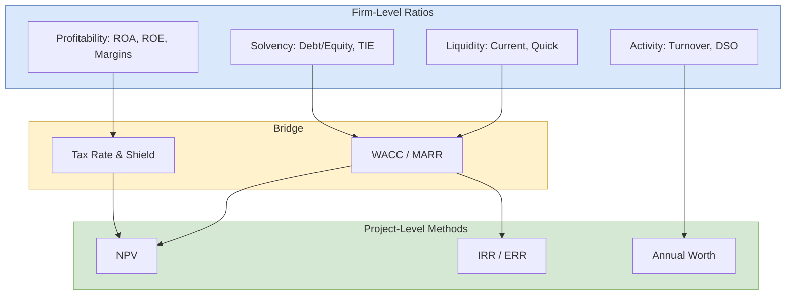

## 概述

財務比率是從資產負債表、損益表與現金流量表中提取的標準化指標，用以衡量企業的流動性、獲利能力、財務槓桿與營運效率。四大類別分別為：流動性比率（衡量短期償債能力，如流動比率與速動比率）、槓桿比率（衡量長期財務風險，如債務對股東權益比與利息保障倍數）、活動性比率（衡量資產利用效率，如存貨週轉率與應收帳款週轉天數）及獲利能力比率（衡量創造回報的能力，如 ROA、ROE 與各層毛利率）。其中 DuPont 分解將 ROE 拆解為利潤率、資產週轉率與財務槓桿三個驅動因子（$ROE = \frac{\text{淨利}}{收益} \times \frac{收益}{總資產} \times \frac{總資產}{股東權益}$），揭示高 ROE 究竟源於定價力、資產效率還是財務風險，是診斷企業競爭策略的有力工具。財務比率並非孤立指標，必須在同行業基準與時間趨勢中解讀；不同折舊政策（直線法 vs. MACRS 加速法）、存貨計價方式（FIFO vs. LIFO）及收入確認準則均會影響比率的跨企業可比性。在公司財務研究中，加權平均資本成本（WACC）透過槓桿與流動性比率的反饋形成項目評估的折現率，連結 [[financial-statements|財務報表]]分析與 [[npv|NPV]] 資本預算；[[behavioral-economics|行為經濟學]]文獻則指出，錨定效應常使分析師過度依賴單一比率值而忽視行業情境。EEMT5510 的 JD.com 集團作業（Sample2）以 21 季數據對比京東、阿里巴巴與亞馬遜，示範了 ERR 與比率分析的整合框架，並通過敏感性分析確認銷售成本（而非週轉率或槓桿）是低毛利零售商 ERR 的最關鍵驅動因子。

## Core Mechanism

**Financial ratios** are quantitative measures derived from financial statement data (balance sheet, income statement, cash flow statement) that assess different dimensions of organizational performance. They provide standardized metrics for comparison — across time periods, against industry benchmarks, and between companies of different sizes.

### Categories of Financial Ratios

Financial ratios are organized into four primary categories:

## Liquidity Ratios

Measure the firm's ability to meet **short-term obligations**:

| Ratio | Formula | Interpretation |
|-------|---------|---------------|
| **Current Ratio** | $\frac{\text{Current Assets}}{\text{Current Liabilities}}$ | Ability to pay short-term debts. Above 1.0 indicates positive working capital. |
| **Quick Ratio (Acid Test)** | $\frac{\text{Current Assets} - \text{Inventory}}{\text{Current Liabilities}}$ | Liquidity excluding illiquid inventory. More conservative than current ratio. |
| **Cash Ratio** | $\frac{\text{Cash + Marketable Securities}}{\text{Current Liabilities}}$ | Most conservative liquidity measure. |

**Guidelines**: Current ratio of 1.5-3.0 is typical for healthy firms. Quick ratio above 1.0 suggests adequate liquidity without relying on inventory sales. Extremely high ratios may indicate inefficient use of assets.

## Leverage (Solvency) Ratios

Measure the extent of **debt financing** and long-term solvency:

| Ratio | Formula | Interpretation |
|-------|---------|---------------|
| **Debt Ratio** | $\frac{\text{Total Debt}}{\text{Total Assets}}$ | Proportion of assets financed by debt. |
| **Debt-to-Equity** | $\frac{\text{Total Debt}}{\text{Total Equity}}$ | Leverage relative to owner investment. |
| **Interest Coverage (TIE)** | $\frac{\text{EBIT}}{\text{Interest Expense}}$ | Ability to service debt from operating income. |
| **Equity Multiplier** | $\frac{\text{Total Assets}}{\text{Total Equity}}$ | Asset leverage relative to equity. |

**Guidelines**: Higher debt ratios mean greater financial risk but potentially higher returns to equity (financial leverage). Interest coverage below 1.5 signals potential distress. The optimal capital structure balances tax benefits of debt against bankruptcy costs.

## Activity (Efficiency) Ratios

Measure how effectively the firm uses its **assets**:

| Ratio | Formula | Interpretation |
|-------|---------|---------------|
| **Inventory Turnover** | $\frac{\text{COGS}}{\text{Average Inventory}}$ | Times inventory is sold and replaced per year. |
| **Days Sales in Inventory** | $\frac{365}{\text{Inventory Turnover}}$ | Average days to sell inventory. |
| **Accounts Receivable Turnover** | $\frac{\text{Revenue}}{\text{Average AR}}$ | Efficiency of credit collection. |
| **Days Sales Outstanding** | $\frac{365}{\text{AR Turnover}}$ | Average collection period in days. |
| **Total Asset Turnover** | $\frac{\text{Revenue}}{\text{Total Assets}}$ | Revenue generated per dollar of assets. |
| **Fixed Asset Turnover** | $\frac{\text{Revenue}}{\text{Net Fixed Assets}}$ | Efficiency of fixed asset utilization. |

**Guidelines**: Higher turnover ratios generally indicate better efficiency. However, very high inventory turnover might indicate stockout risk. Industry context matters — capital-intensive industries naturally have lower asset turnover.

## Profitability Ratios

Measure the firm's ability to generate **returns**:

| Ratio | Formula | Interpretation |
|-------|---------|---------------|
| **Gross Margin** | $\frac{\text{Revenue} - \text{COGS}}{\text{Revenue}}$ | Profit margin after direct production costs. |
| **Operating Margin** | $\frac{\text{EBIT}}{\text{Revenue}}$ | Profit margin from core operations. |
| **Net Profit Margin** | $\frac{\text{Net Income}}{\text{Revenue}}$ | Bottom-line profitability per revenue dollar. |
| **Return on Assets (ROA)** | $\frac{\text{Net Income}}{\text{Total Assets}}$ | Return generated from total asset base. |
| **Return on Equity (ROE)** | $\frac{\text{Net Income}}{\text{Equity}}$ | Return to shareholders. |

### DuPont Analysis

**DuPont decomposition** breaks ROE into three drivers:

$$ROE = \underbrace{\frac{\text{Net Income}}{\text{Revenue}}}_{\text{Profit Margin}} \times \underbrace{\frac{\text{Revenue}}{\text{Total Assets}}}_{\text{Asset Turnover}} \times \underbrace{\frac{\text{Total Assets}}{\text{Equity}}}_{\text{Equity Multiplier}}$$

This reveals whether high ROE comes from:
1. **High margins** (pricing power, cost control).
2. **High asset turnover** (efficient asset use).
3. **High leverage** (debt financing — higher risk).

A firm with 5% margin, 2.0x turnover, and 2.0x leverage achieves ROE = 20%. The decomposition identifies which lever to target for improvement.

### Case — JD.com vs. Competitors (Sample2)

An EEMT5510 team project applied ratio-style cash-flow analysis to JD.com, Alibaba, and Amazon using quarterly data from 2017 Q1 to 2022 Q2 (21 periods). They defined a custom metric — the **External Rate of Return (ERR)** — where PW of outflows uses the 10-year CN government bond yield and FW of inflows uses the 3-month deposit rate:

$$PW_{\text{out}} \cdot (1 + \text{ERR})^{21} = FW_{\text{in}}$$

Results (nominal ERR): JD 4.79%, Alibaba 3.97%, Amazon 2.46%. Key competitive findings: JD had higher revenue but lower operating income than peers, driven by elevated cost of sales and depressed sales / R&D expense ratios. A sensitivity analysis (MARR = 5%) ranked **cost of sales** as the most influential factor on ERR — confirming the DuPont insight that for a low-margin retailer, cost discipline dominates over turnover or leverage levers.

## Ratio Analysis in Engineering Economics

Financial ratios complement project-level evaluation methods ([[npv|NPV]], [[irr|IRR]]):

### Project vs. Firm Level

- **NPV/IRR**: Evaluate individual projects or investments.
- **Financial ratios**: Evaluate overall firm performance and financial health.
- Both perspectives matter: a project may have positive NPV but be infeasible if the firm lacks liquidity or has excessive leverage.

### Depreciation Impact

[[depreciation|Depreciation]] method choice affects multiple ratios:
- **ROA**: Lower book value (accelerated depreciation) increases ROA in later years.
- **Asset turnover**: Lower net fixed assets increase turnover ratios.
- **Net profit margin**: Higher depreciation expense reduces reported profit.

MACRS (accelerated) vs. straight-line depreciation can produce meaningfully different ratio profiles for the same underlying business.

### Capital Structure Decisions

The mix of debt and equity financing affects:
- **MARR**: Higher leverage increases the required return on equity, raising the hurdle rate for [[npv|NPV]] analysis.
- **Weighted Average Cost of Capital (WACC)**: $WACC = w_d \cdot r_d(1-t) + w_e \cdot r_e$ where $w_d, w_e$ are debt/equity weights, $r_d, r_e$ are their costs, and $t$ is the tax rate.
- **Financial risk**: Higher leverage amplifies both returns and losses, analogous to operating leverage in [[cvp-analysis|CVP Analysis]].

### Project Ratio Diagnostics

The firm's balance-sheet ratios feed into the WACC and the effective tax rate, which in turn set the discount rate and tax shield used in after-tax [[npv|NPV]]. Project evaluation without firm context (or vice versa) misses half the picture.

## Cross-course cases (Service Ops)

- **759 Store** (EEMT5520) — Hong Kong grocery retailer whose **gross margin sits at 37.5% vs the 40–50% Wellcome/ParknShop duopoly**. The case illustrates how a ratio-level disadvantage is overcome at the turnover and working-capital level: direct import (90%+ of SKUs, bypassing distributors and slotting fees), fixed markup, wide assortment (23,500 SKUs from 61 countries), and rapid stock rotation. FY2019 consolidated revenue of HK\$1.84B with 280 stores, later retrenched to 179 after 2016 losses. A good worked counter-example to "always maximize gross margin" — the correct metric for a low-margin/high-turnover retailer is the **return on inventory investment**, not the margin alone.
- **LeadNitro** (EEMT5520) — B2B SaaS case where the analyst-style valuation hinges on the **ARR multiple (5–8×)** rather than classical ratios. EBITDA margin is deliberately suppressed to fund growth, so liquidity and leverage ratios read as distressed even though the firm is healthy on unit economics. Useful cautionary tale that ratios trained on mature manufacturers misprice growth-stage SaaS.

## Limitations

- **Historical data**: Ratios reflect past performance, not future prospects.
- **Accounting policies**: Different depreciation methods, inventory valuation (FIFO vs. LIFO), and revenue recognition standards make cross-company comparison challenging.
- **Industry dependence**: "Good" ratio values vary dramatically by industry. Always benchmark against industry peers.
- **Window dressing**: Companies may manipulate end-of-period balances to improve ratios.
- **Static snapshot**: Ratios capture a point in time. Trend analysis (multiple periods) is more informative than single-period ratios.
- **Ignores market value**: Book-based ratios may diverge significantly from market reality, especially for intangible-heavy firms.

## Related Concepts

- [[npv|NPV]] — Project-level evaluation; ratios provide firm-level context
- [[irr|IRR]] — ROE and ROA are firm-level analogs of project IRR
- [[depreciation|Depreciation]] — Directly affects asset values and profit metrics in ratio calculations
- [[cvp-analysis|CVP Analysis]] — Operating leverage parallels financial leverage in ratio analysis
- [[time-value-of-money|TVM]] — WACC connects ratio analysis to TVM-based project evaluation
- [[behavioral-economics|Behavioral Economics]] — Anchoring on specific ratio values can bias decisions

## Source Materials

- L2 - Cost Terminology
- [[wiki/sources/courses/engineering-economics.md|EEMT5510 Engineering Economics and Cost Management]]
