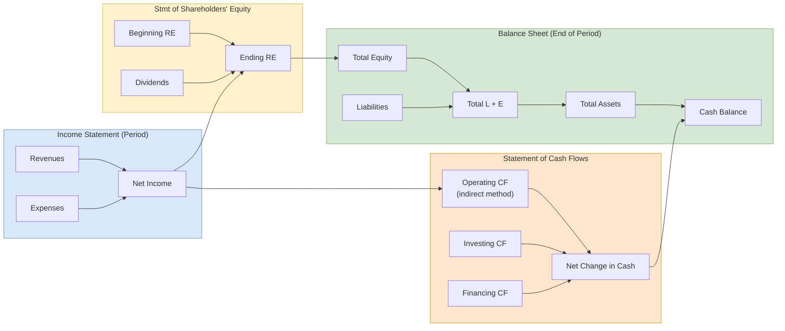

## 概述

財務報表是企業依據 GAAP（美國）或 IFRS（國際）準則，向外部利害關係人傳達財務狀況與經營成果的核心工具，由資產負債表（存量視角）、損益表（期間績效）、現金流量表（現金來源與用途）及股東權益變動表四張報表構成。四張報表以「$\text{資產} = \text{負債} + \text{股東權益}$」為根本恆等式相互扣連：損益表的淨利潤流入留存收益，進而影響資產負債表的權益項目；現金流量表的期末現金餘額需與資產負債表的現金科目完全吻合，間接法下則從淨利潤出發加回非現金費用（折舊、攤銷）並調整營運資本變動，完整呈現應計制與現金制之間的橋接。理解這一連動機制是識別盈餘管理（如應收帳款快速膨脹卻伴隨營業現金流下滑）的關鍵。GAAP 與 IFRS 在存貨計價（LIFO 禁用與否）、開發成本資本化及資產減值迴轉等方面存在差異，影響跨境比較的可靠性。本頁以國美零售 2023 年報（總資產 RMB 300 億卻面臨 RMB 93 億的股東權益赤字）與 Apple FY2023 報表作對比案例，示範了技術性資不抵債與健康企業的資產負債表外觀可能截然不同。在量化財務分析領域，財務報表數字是 [[financial-ratios|財務比率]]、DuPont 分解及 [[npv|DCF 估值]]的原始輸入；[[benfords-law|Benford 定律]]則被用於大規模財務報表的異常偵測，連結財務分析與運籌學中的數據審計方法。

## What Financial Statements Are

**Financial statements** are the standardized reports that companies prepare to communicate their financial position, performance, and cash flows to stakeholders. They are governed by **GAAP** (Generally Accepted Accounting Principles) in the United States and **IFRS** (International Financial Reporting Standards) in most other jurisdictions. The key standard-setting bodies — the **FASB** and **IASB** — define the rules for recognition, measurement, and disclosure. The SEC delegates rule-making authority to the FASB for U.S. public companies; roughly 140+ jurisdictions worldwide require or permit IFRS.

There are four primary financial statements, each serving a distinct purpose but collectively forming an integrated picture of a business:

| Statement | What It Shows | Time Dimension | Primary Question Answered |
|---|---|---|---|
| **Balance Sheet** | Assets, liabilities, and equity | Point in time (stock) | What do we own and owe *right now*? |
| **Income Statement** | Revenues, expenses, and net income | Period (flow) | Did we make money *this period*? |
| **Statement of Cash Flows** | Cash inflows and outflows | Period (flow) | Where did cash come from and go? |
| **Statement of Shareholders' Equity** | Changes in equity accounts | Period (flow) | How did owners' stake change? |

Together with the notes to the financial statements (which often occupy 60-80% of an annual report's length), they form the complete financial report package auditors opine on.

## The Accounting Equation

Every financial statement rests on the **accounting equation**:

$$\text{Assets} = \text{Liabilities} + \text{Stockholders' Equity}$$

This identity must hold after every transaction. It can be expanded to include flow accounts:

$$A = L + \underbrace{[\text{Contributed Capital} + (\text{Beginning RE} + \text{Revenues} - \text{Expenses} - \text{Dividends})]}_{\text{Stockholders' Equity}}$$

This expansion shows why revenues (which increase equity) have normal credit balances and expenses (which decrease equity) have normal debit balances.

**Double-entry bookkeeping** enforces the identity mechanically: each transaction affects at least two accounts, with total debits always equaling total credits. The normal-balance rules follow from the equation:

| Account Type | Normal Balance | Increased By | Decreased By |
|---|---|---|---|
| Assets | Debit | Debit | Credit |
| Expenses | Debit | Debit | Credit |
| Liabilities | Credit | Credit | Debit |
| Stockholders' Equity | Credit | Credit | Debit |
| Revenues | Credit | Credit | Debit |

**Worked example** (Marshall Ch. 4): If stockholders invest $2,000 cash, the entry is Dr. Cash 2,000 / Cr. Paid-in Capital 2,000 — both sides of $A = L + SE$ increase by 2,000. If the company then borrows $6,000, Dr. Cash 6,000 / Cr. Notes Payable 6,000 — assets and liabilities both grow. These post to **T-accounts** (debit on the left, credit on the right) and are later summed into a **trial balance**.

The accounting equation also reveals the fundamental claim structure: creditors (liabilities) and owners (equity) have claims on the company's resources (assets). Every financial statement can be understood as an expansion or decomposition of this equation. When equity turns negative — as with Gome Retail 2023 — liabilities exceed assets and creditors' claims formally exceed what exists to satisfy them.

## Balance Sheet

The **balance sheet** (also called the statement of financial position) reports what a company owns, owes, and the residual belonging to owners at a specific date.

**Assets** are classified by liquidity:

- **Current assets** — Expected to be converted to cash or consumed within one year or one operating cycle. Includes cash and cash equivalents, accounts receivable (reported at net realizable value after deducting the allowance for doubtful accounts), inventory, and prepaid expenses.
- **Noncurrent assets** — Long-lived resources such as property, plant and equipment (PP&E), intangible assets, and long-term investments. PP&E is reported at historical cost minus accumulated [[depreciation|depreciation]]; intangibles like goodwill are tested for impairment rather than amortized.

**Inventory valuation** deserves special attention because the choice of cost-flow assumption materially affects both the balance sheet and income statement. **FIFO** (First-In, First-Out) assigns older costs to cost of goods sold, leaving newer costs in ending inventory — producing higher reported assets and income during inflation. **LIFO** (Last-In, First-Out) does the reverse and is prohibited under IFRS (though permitted under U.S. GAAP, often for tax reasons via the LIFO conformity rule). **Weighted average** blends all costs. The **lower of cost or market (LCM)** rule requires write-downs when market value drops below cost, reflecting the conservatism principle.

**Liabilities** divide similarly:

- **Current liabilities** — Obligations due within one year: accounts payable, wages payable, unearned revenue, current portion of long-term debt.
- **Noncurrent liabilities** — Primarily bonds payable, long-term loans, lease liabilities, and deferred tax liabilities. Bonds may be issued at par, at a premium (when the market rate is below the coupon rate), or at a discount (when the market rate exceeds the coupon rate). Premium and discount amortization adjusts interest expense across the bond's life using the effective-interest method, which is itself an application of [[time-value-of-money|time-value-of-money]] mathematics.

**Stockholders' equity** includes contributed capital (common stock, additional paid-in capital, preferred stock) and earned capital (retained earnings) plus accumulated other comprehensive income. Treasury stock — shares repurchased by the company — reduces equity as a contra account. Preferred stock often carries cumulative dividend rights, meaning any unpaid dividends accumulate as **dividends in arrears** and must be paid before common dividends.

### Worked Example: Gome Retail 2023 Balance Sheet

All figures in RMB thousands, as at 31 December 2023:

| Section | 2023 | 2022 |
|---|---:|---:|
| **Non-current assets** | | |
| Property and equipment | 4,771,754 | 6,595,271 |
| Investment properties | 4,828,588 | 4,674,334 |
| Right-of-use assets | 11,922,187 | 15,451,082 |
| Goodwill | 62,208 | 903,364 |
| Other non-current | 2,888,254 | 3,560,174 |
| **Total non-current assets** | **24,472,991** | **31,184,225** |
| **Current assets** | | |
| Inventories | 202,077 | 432,639 |
| Trade receivables | 129,796 | 134,294 |
| Prepayments & other receivables | 3,123,761 | 3,274,560 |
| Pledged bank deposits | 443,215 | 5,690,571 |
| Cash and cash equivalents | 66,247 | 169,713 |
| Other current | 1,539,565 | 1,698,447 |
| **Total current assets** | **5,504,661** | **11,400,224** |
| **Total assets** | **29,977,652** | **42,584,449** |
| **Current liabilities** | | |
| Trade and bills payables | 4,860,606 | 5,887,555 |
| Other payables and accruals | 7,694,453 | 5,506,294 |
| Interest-bearing borrowings (current) | 24,266,291 | 25,894,974 |
| Other current liabilities | 1,437,944 | 3,305,349 |
| **Total current liabilities** | **38,259,294** | **40,594,172** |
| **Net current liabilities** | **(32,754,633)** | **(29,193,948)** |
| **Non-current liabilities** | **977,880** | **1,496,971** |
| **Total liabilities** | **39,237,174** | **42,091,143** |
| **Net (liabilities) assets** | **(9,259,522)** | **493,306** |

**Reading the numbers**: Total assets (RMB 30.0 bn) are less than total liabilities (RMB 39.2 bn), producing a **net deficit** of RMB 9.3 bn — the accounting equation still holds, but with negative equity. Working capital is RMB −32.8 bn: current liabilities dwarf current assets by a factor of 7. Cash fell from RMB 169.7 m to RMB 66.2 m, while short-term interest-bearing borrowings remained at RMB 24.3 bn. This is what technical insolvency looks like on paper, and why the auditor disclosed a material uncertainty about going concern.

### Contrast: Apple Inc. 2023 Balance Sheet

Placing Apple Inc.'s FY2023 (year ending 30 September 2023) balance sheet next to Gome's sharpens the lesson — these are the two case companies used throughout the SBMT5010 course:

| Line (US$ m / RMB m) | Apple FY2023 | Gome 2023 |
|---|---:|---:|
| Total current assets | 143,566 | 5,505 |
| Total non-current assets | 209,017 | 24,473 |
| **Total assets** | **352,583** | **29,978** |
| Total current liabilities | 145,308 | 38,259 |
| Total non-current liabilities | 145,129 | 978 |
| **Total liabilities** | **290,437** | **39,237** |
| **Total shareholders' equity** | **62,146** | **(9,260)** |
| Current ratio | 0.99 | 0.14 |
| Debt-to-assets | 0.82 | 1.31 |

Two things stand out. First, Apple also runs a current ratio near 1.0, but it is deliberate working-capital optimisation rather than distress — Apple holds only ~$30 bn in cash against $145 bn of current liabilities because it can roll commercial paper and term debt freely. Second, Apple's equity section includes an **accumulated deficit of $(214) m** despite $97 bn of FY2023 net income — a teaching artefact of relentless share buybacks that have returned more cash to shareholders over the years than cumulative retained earnings. Both facts illustrate that "healthy" balance sheets do not always look tidy; context and business-model interpretation matter as much as the ratios.

## Income Statement

The **income statement** (or profit-and-loss statement) measures financial performance over a period by matching revenues earned against expenses incurred.

**Revenue recognition** requires that revenue be recorded when it is both earned and realizable. Under the modern ASC 606 / IFRS 15 framework, this follows a five-step process: identify the contract, identify performance obligations, determine the transaction price, allocate the price to obligations, and recognize revenue as each obligation is satisfied. The **matching principle** then dictates that expenses incurred to generate those revenues be recognized in the same period.

Two presentation formats exist:

- **Single-step**: Groups all revenues together and all expenses together, producing net income in one subtraction.
- **Multi-step**: Separates operating activities from non-operating items, revealing intermediate measures — **gross profit** (net sales minus COGS), **operating income** (gross profit minus operating expenses), and **net income** (after interest, taxes, and extraordinary items).

**Cost of goods sold (COGS)** is calculated as: $\text{COGS} = \text{Beginning Inventory} + \text{Purchases} - \text{Ending Inventory}$. Since COGS is typically the largest expense, the inventory valuation method (FIFO, LIFO, weighted average) directly influences reported profitability.

**Gross profit ratio** $= \text{Gross Profit} \div \text{Net Sales}$ — a key first-look metric that can be inverted to set selling price from a target margin: $\text{Price} = \text{Cost} \div (1 - \text{Target Gross Margin})$.

**Earnings per share (EPS)** — the most watched metric by investors — is computed as $EPS = \frac{\text{Net Income} - \text{Preferred Dividends}}{\text{Weighted-Average Common Shares Outstanding}}$. Companies with complex capital structures must also report **diluted EPS**, which assumes conversion of all dilutive securities (options, convertible bonds, warrants).

### Worked Example: Gome Retail 2023 Income Statement

Gome's 2023 consolidated statement of profit or loss (RMB '000) shows a cascade from modest revenue to a catastrophic bottom line:

- Revenue RMB 646,904 (down 96.3% YoY from RMB 17.4 bn)
- Gross profit RMB 174,237 (gross margin ≈ 26.9%, vs 10.4% in 2022)
- Operating loss RMB (7,310,195) after RMB 1.7 bn selling and RMB 1.5 bn administrative expense, plus RMB 0.8 bn goodwill impairment and RMB 1.5 bn other impairments
- Finance costs RMB (2,816,911), driven by RMB 24.3 bn of interest-bearing borrowings
- Loss before tax RMB (10,082,602); loss for year RMB (10,091,024)
- Basic loss per share RMB (22.3 fen)

The arithmetic is unremarkable; the story is. Gross margin at 27% is healthy by retail standards — the problem is scale. At RMB 0.65 bn of revenue, gross profit cannot cover even a fraction of the fixed cost base built for a RMB 60 bn business.

## Statement of Cash Flows

The **statement of cash flows** reconciles the accrual-basis income statement with actual cash movements, answering the question: where did cash come from and where did it go?

Cash flows are classified into three categories:

- **Operating activities** — Cash generated from core business operations. The **indirect method** (most common globally) starts with net income and adjusts for non-cash items (depreciation, amortization, impairments, gains/losses on asset sales) and changes in working capital (increases in receivables reduce cash; increases in payables increase cash). The **direct method** lists actual cash receipts from customers and cash payments to suppliers and employees; it is more intuitive but less frequently used because most accounting systems are built around accruals.
- **Investing activities** — Cash spent on or received from long-term assets: purchasing or selling PP&E, acquiring or disposing of investments, business acquisitions.
- **Financing activities** — Cash from or to capital providers: issuing or repaying debt, issuing or repurchasing stock, paying dividends.

Non-cash transactions (e.g., converting bonds to equity, acquiring assets through capital leases) are disclosed in supplemental schedules rather than in the body of the statement.

A healthy mature company typically shows **positive operating**, **negative investing** (indicating growth investment), and financing flow that reflects its capital structure strategy. Aggressive discrepancies between net income and operating cash flow often signal earnings management and warrant investigation through [[financial-ratios|financial ratio]] analysis. A classic warning pattern is rising net income alongside falling operating cash flow — often driven by ballooning receivables or inventory.

### Worked Example: Gome 2023 Cash Flow

| Section | 2023 RMB'000 | 2022 RMB'000 |
|---|---:|---:|
| Loss before tax | (10,082,602) | (20,285,497) |
| + Finance costs | 2,816,911 | 1,703,331 |
| + Depreciation PP&E | 478,543 | 482,753 |
| + Depreciation ROU assets | 1,300,382 | 2,576,005 |
| + Impairment goodwill/ROU | 841,156 | 13,173,154 |
| + Other non-cash adjustments | 3,379,176 | 1,243,410 |
| = Operating CF before WC changes | (1,266,434) | (1,105,844) |
| Working-capital changes | 2,378,721 | 1,704,478 |
| **Net operating cash flow** | **+1,112,771** | **+820,725** |
| Net investing cash flow | +373,090 | (167,911) |
| Net financing cash flow | (1,589,276) | (4,727,350) |
| **Net change in cash** | **(103,415)** | **(4,074,536)** |
| Cash end of year | 66,247 | 169,713 |

Notice how starting from a RMB 10 bn loss, the indirect method adds back RMB 2.8 bn of finance costs, RMB 1.8 bn of depreciation, and RMB 4.2 bn of impairments to reach operating cash outflow before working capital of only RMB 1.3 bn — this single reconciliation demonstrates the accrual-to-cash bridge more vividly than any textbook example. Without the non-cash impairments, Gome's accounting loss would look far smaller and cash fairly close to profit.

**Derivation drill**: Marshall Ch.9 homework builds the indirect-method cash-flow statement from two comparative balance sheets plus one income statement. The mechanical rules are: subtract each increase in non-cash current assets (A/R, inventory, prepaids) from net income, add each increase in current operating liabilities (A/P, accrued expenses), add back depreciation/amortization, and reclassify gains or losses on asset sales to the investing section. Practising this reconciliation on synthetic data is the fastest way to internalise why net income and operating cash flow diverge — and why ratios built on one are not interchangeable with ratios built on the other.

## How the Statements Connect

The four statements form an interconnected system. The linkage is most easily seen in a flow diagram tying profit to retained earnings to equity:

Specifically:

1. The **income statement** produces net income, which flows into **retained earnings** on the statement of shareholders' equity: $\text{Ending RE} = \text{Beginning RE} + \text{Net Income} - \text{Dividends}$.
2. The closing balance of retained earnings feeds into the **balance sheet** equity section, closing the loop.
3. The **cash flow statement** explains the change in the cash balance shown on the balance sheet, starting from the net income reported on the income statement.
4. The **statement of shareholders' equity** bridges the income statement and balance sheet by tracking all equity movements (net income, dividends, stock issuances, treasury stock transactions, OCI).

This linkage means an error or misstatement in one statement cascades across all others — a property that auditors exploit when testing financial statement integrity. It also means that tools like [[benfords-law|Benford's Law]] can be applied to detect anomalies across large financial datasets, since manipulated numbers rarely preserve the natural distributional properties of legitimate accounting data.

## Key Ratios Derived from the Statements

See [[financial-ratios|financial ratios]] for the full treatment. Core families:

| Family | Example | Formula |
|---|---|---|
| Liquidity | Current ratio | Current assets ÷ Current liabilities |
| Liquidity | Quick ratio | (Current assets − Inventory) ÷ Current liabilities |
| Profitability | Gross margin | Gross profit ÷ Revenue |
| Profitability | Return on assets | Net income ÷ Average total assets |
| Profitability | Return on equity | Net income ÷ Average equity |
| Efficiency | Inventory turnover | COGS ÷ Average inventory |
| Efficiency | Receivables turnover | Net credit sales ÷ Average A/R |
| Solvency | Debt-to-equity | Total liabilities ÷ Total equity |
| Solvency | Interest coverage | EBIT ÷ Interest expense |

Gome 2023 plugs into these revealingly: current ratio = 5.5 bn ÷ 38.3 bn = 0.14 (vs. healthy > 1.0); debt-to-equity is undefined (negative denominator); interest coverage is negative because EBIT itself is negative.

## GAAP vs. IFRS

While both frameworks aim for faithful representation of economic reality, key differences affect financial statement comparability:

| Area | GAAP | IFRS |
|---|---|---|
| Inventory | LIFO permitted | LIFO prohibited |
| Development costs | Expensed (with limited exceptions) | Capitalized when criteria met |
| Impairment reversals | Not permitted (except inventory) | Permitted (except goodwill) |
| Presentation | More prescriptive | More flexible |
| Leases | ASC 842 (similar to IFRS 16) | IFRS 16 |
| Extraordinary items | Eliminated | Never existed |

**Convergence efforts**: The FASB and IASB have worked toward convergence on major standards (revenue recognition via ASC 606 / IFRS 15, leases via ASC 842 / IFRS 16), but full harmonization remains incomplete. For multinational managers, these differences mean that financial statements from companies in different jurisdictions may not be directly comparable without adjustments — a key concern for cross-border investment and M&A analysis.

## Practical Applications

Financial statements are not merely compliance documents — they are the raw material for management and investment decisions:

- **[[financial-ratios|Financial ratio analysis]]** uses statement data to assess liquidity, profitability, solvency, and efficiency.
- **[[cvp-analysis|CVP analysis]]** builds on income statement relationships to model how cost and volume changes affect profit.
- **[[npv|Capital budgeting]]** relies on projected cash flows derived from pro-forma financial statements; the discount rate ties back to [[time-value-of-money|time-value-of-money]] and weighted-average cost of capital.
- **[[erp|Enterprise resource planning systems]]** automate the transaction-to-statement pipeline, ensuring real-time financial visibility.
- **[[balanced-scorecard|Balanced scorecard]]** frameworks use financial statement metrics as one of four performance perspectives, linking financial outcomes to operational drivers.
- **[[benfords-law|Benford's Law]]** applies to forensic review of statement line items to detect possible manipulation.

Taught in the [[wiki/sources/courses/accounting|SBMT5010 Accounting for Managers]] course at [[wiki/entities/hkust|HKUST]].

## Related Concepts

- [[cvp-analysis|CVP Analysis]]
- [[financial-ratios|Financial Ratios]]
- [[depreciation|Depreciation]]
- [[npv|Net Present Value]]
- [[irr|Internal Rate of Return]]
- [[time-value-of-money|Time Value of Money]]
- [[erp|Enterprise Resource Planning]]
- [[balanced-scorecard|Balanced Scorecard]]
- [[benfords-law|Benford's Law]]

## Source Materials

- [[wiki/sources/courses/accounting|SBMT5010 Accounting for Managers]]
- Gome Retail 2023 Annual Report
- Marshall Ch.2 The Financial Statements
- Marshall Ch.4 Mechanics of Accounting
- Marshall Ch.9 Income Statement and Cash Flows
