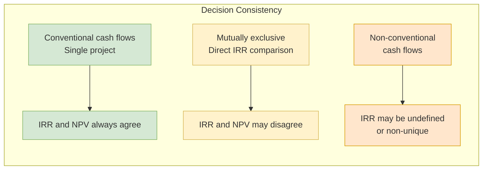

## 概述

內部收益率（Internal Rate of Return, IRR）是使項目所有現金流淨現值恰好等於零的折現率 $i^*$，求解方程 $\sum_{k=0}^N F_k(1+i^*)^{-k} = 0$。以百分比形式呈現的 IRR 直觀易懂，對非財務背景的利害關係人溝通尤為有效，但其背後隱含多個理論陷阱：Descartes 符號規則指出現金流符號切換次數決定 IRR 的最大正實根數目，非常規現金流可能產生多重解甚至無實數解；此外，IRR 隱含的再投資假設——所有中間現金流以 IRR 本身再投資——在 IRR 高企時往往脫離現實。外部收益率（ERR，亦稱 MIRR）通過分別指定外流折現率（通常為 MARR）與流入再投資率來修正此缺陷，確保唯一解。在互斥方案比較中，直接比較各方案 IRR 可能選出規模較小但回報率較高的劣勢方案，必須採用增量分析（Incremental IRR/ERR）方能得出正確結論。债券殖利率（Yield to Maturity）是 IRR 在固定收益領域的直接應用。在運籌學與公司財務研究中，IRR 概念延伸至隨機 IRR、機率性接受門檻（$\Pr(IRR > MARR)$）及實物期權的隱含回報率分析。EEMT5510 課程以 Pioneer Construction 五方案 ERR 增量分析為主軸，示範了接受門檻的系統性篩選流程。

## Core Mechanism

The **Internal Rate of Return (IRR)** is the discount rate $i^*$ at which the net present value of all cash flows equals zero:

$$PW(i^*) = \sum_{k=0}^{N} F_k (1+i^*)^{-k} = 0$$

Equivalently, the IRR is the rate at which the present worth of cash inflows exactly equals the present worth of cash outflows.

### Decision Rule

| Condition | Decision |
|-----------|----------|
| $IRR \geq MARR$ | Accept the project. It meets or exceeds the minimum required return. |
| $IRR < MARR$ | Reject the project. It does not provide sufficient return. |

The IRR gives the same accept/reject decision as [[npv|NPV]] for independent projects with conventional cash flows.

### Calculation

IRR is found by solving the PW equation for $i^*$, which is generally an $N$th-degree polynomial. Closed-form solutions exist only for simple cases (1-2 periods). In practice, IRR is computed by:

1. **Trial and error with interpolation**: Calculate PW at two rates that bracket zero, then linearly interpolate.
2. **Spreadsheet functions**: `IRR()` in Excel/Google Sheets, `numpy.irr()` in Python.
3. **Financial calculators**: Built-in IRR solvers.

## Drawbacks and Pitfalls

IRR has several well-documented shortcomings that practitioners must understand:

### 1. Multiple IRRs (Non-Unique Solutions)

By **Descartes' Rule of Signs**, the PW polynomial can have up to $m$ positive real roots, where $m$ is the number of sign changes in the cash flow sequence. A **non-conventional cash flow** (e.g., investment-revenue-investment pattern) may yield multiple IRRs, making the decision rule ambiguous.

Example: A project with cash flows {-\$100, +\$430, -\$560, +\$232} has three sign changes and potentially three IRRs.

### 2. No Real IRR (Infeasible Solutions)

Some cash flow patterns produce no real-valued IRR. The PW equation may have only complex roots. In such cases, the IRR method simply cannot be applied.

### 3. Reinvestment Assumption

IRR implicitly assumes that intermediate cash flows are reinvested at the IRR itself. For projects with very high IRRs, this is often unrealistic — the organization may not have other opportunities earning that rate. In contrast, [[npv|NPV]] assumes reinvestment at the MARR, which is generally more defensible.

### 4. Scale Insensitivity

IRR ignores the scale of investment. A small project earning 50% IRR may create less value than a large project earning 20% IRR. Selecting the project with the highest IRR can lead to suboptimal capital allocation.

### 5. Misleading for Mutually Exclusive Alternatives

**Critical rule**: Never compare IRRs directly when choosing among mutually exclusive alternatives. A project with higher IRR is not necessarily preferred. Use **incremental analysis** instead.

## External Rate of Return (ERR)

The **ERR** (also called **Modified Internal Rate of Return, MIRR**) addresses the reinvestment assumption problem:

1. All net cash outflows are discounted to time 0 at the MARR (the borrowing rate, $\epsilon$).
2. All net cash inflows are compounded to time $N$ at an explicit reinvestment rate (often the MARR).
3. ERR is the rate that equates these two values:

$$\sum_{\text{outflows}} |F_k|(P/F, \epsilon, k) \times (F/P, ERR, N) = \sum_{\text{inflows}} F_k(F/P, \epsilon, N-k)$$

ERR always yields a unique solution and uses a more realistic reinvestment assumption.

## Incremental IRR Analysis

When comparing mutually exclusive alternatives:

1. **Rank alternatives** by increasing initial investment.
2. **Establish the base alternative**: Do-nothing (for investment alternatives) or the lowest-cost option (for cost alternatives).
3. **Evaluate increments**: Compare the next alternative to the current best. Compute the IRR on the incremental cash flow (difference between the two).
4. **Accept the increment** if incremental IRR $\geq$ MARR; otherwise, retain the current best.
5. **Repeat** until all alternatives have been evaluated.

### Example

Two alternatives: A (costs \$100, returns \$150) and B (costs \$200, returns \$280). IRR_A = 50%, IRR_B = 40%. At MARR = 10%, which is better?

Incremental cash flow (B - A): invest \$100 more, get \$130 more. Incremental IRR = 30% > MARR. Therefore B is preferred, despite having the lower overall IRR. This illustrates why direct IRR comparison fails.

### Pioneer Construction (HW3 Problem 2)

Five 10-year equipment alternatives at MARR $= \epsilon = 18\%$:

| Alt | Investment | Annual Net | ERR |
|---|---|---|---|
| A | \$46,000 | \$10,000 | 17.7% |
| B | \$50,000 | \$14,100 | 20.8% |
| C | \$55,000 | \$16,300 | 21.4% |
| D | \$60,000 | \$16,800 | 20.7% |
| E | \$65,000 | \$20,000 | 21.9% |

A is immediately rejected because $ERR_A < MARR$. Base alternative becomes B. Now test increments:

| Increment | $\Delta$ Investment | $\Delta$ Annual | Incremental ERR | Decision |
|---|---|---|---|---|
| $\Delta(C-B)$ | \$5,000 | \$2,200 | 26.3% | Accept C |
| $\Delta(D-C)$ | \$5,000 | \$500 | 8.9% | Reject D; keep C |
| $\Delta(E-C)$ | \$10,000 | \$3,700 | 24.2% | Accept E |

**Final pick: E**. Note that the direct ERR ranking would have picked E anyway (highest individual ERR), but the incremental process is what **justifies** the choice — and crucially, when direct ranking picks C (the second-highest), the incremental method prevents that error.

### Sauer vs. Clock (HW3 Problem 1)

For mutually exclusive alternatives Sauer and Clock with MARR = 8%, the incremental cash flow (Sauer - Clock) yields IRR = 5.16% < MARR, so **select Clock** — the smaller/cheaper alternative.

## Relationship Between IRR and NPV

- For **independent projects with conventional cash flows**: IRR and NPV always agree. If NPV > 0 at MARR, then IRR > MARR, and vice versa.
- For **mutually exclusive alternatives**: NPV is preferred because it accounts for scale and avoids ranking errors. If IRR must be used, apply incremental analysis.
- For **non-conventional cash flows**: NPV is always reliable. IRR may fail entirely.

## Practical Guidance

| Situation | Recommended Method |
|-----------|-------------------|
| Single project, conventional cash flows | Either NPV or IRR |
| Single project, non-conventional cash flows | NPV (or ERR) |
| Mutually exclusive, similar scale | Either method (with incremental IRR) |
| Mutually exclusive, different scale | NPV preferred |
| Communicating to non-technical stakeholders | IRR (percentage is intuitive) |
| Formal capital budgeting decisions | NPV primary, IRR supplementary |

## Bond Yield as IRR Application

The **yield to maturity** of a bond is the IRR of its cash flow stream. Given the bond price $P$, coupon payments $rZ$, and face value $C$:

$$P = C(P/F, i^*, N) + rZ(P/A, i^*, N)$$

Solving for $i^*$ gives the bond yield — the return earned if held to maturity.

**Worked example (HW2 Problem 4)**: \$10,000 face-value 3-year bond with 4.75% annual coupon selling for \$10,200. Trial interpolation at 4.0% and 4.5% yields $i^* \approx 4.03\%$. Because $i^* < $ coupon rate (4.75%), the bond trades at a **premium** — investors pay more than par and accept a lower yield.

## Project IRR via Spreadsheet (Trionym Case)

The Ivey Trionym case computes the NPV of a 5-year \$50M investment with stochastic demand, competitor entry, and COGS scenarios. By computing IRR on the expected cash-flow stream and comparing to the 10% discount rate, analysts check whether the project meets the firm's **profitability index** criterion ($PI \geq 1.1$ implies roughly $IRR > $ discount rate for short-horizon projects). The case also demonstrates computing $\Pr(IRR > MARR)$ via decision-tree rollups, linking IRR to risk-adjusted acceptance thresholds.

## Related Concepts

- [[npv|NPV]] — The complementary (and often preferred) evaluation method
- [[time-value-of-money|TVM]] — Theoretical foundation for all discounting methods
- [[depreciation|Depreciation]] — Affects after-tax cash flows that determine IRR
- [[financial-ratios|Financial Ratios]] — ROI and ROE are related return metrics
- [[behavioral-economics|Behavioral Economics]] — Cognitive biases may cause over-reliance on IRR's intuitive percentage
- [[wiki/mocs/operations-research|Operations Research MOC]] — Part of the OR PhD reading spine (Financial Engineering and Capital Budgeting)

## Source Materials

- L5 - Evaluating a Single Project
- L6 - Project Comparison and Selection
- [[wiki/sources/courses/engineering-economics.md|EEMT5510 Engineering Economics and Cost Management]]
