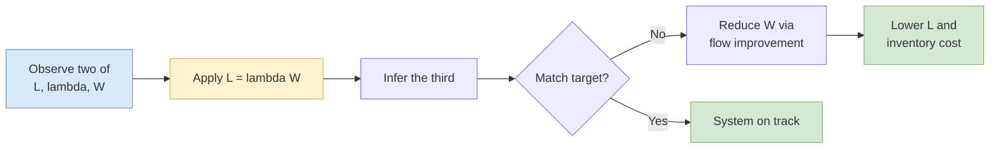

## 概述

Little's Law 是營運管理與運籌學中最基本的定律之一，描述任何穩定系統中平均存量（L）、平均到達率（λ）與平均流動時間（W）之間的關係：L = λW。此定律由 John D.C. Little 於 1961 年正式證明，其成立條件極為寬鬆，無論到達分佈、服務時間分佈、伺服器數量或排隊紀律為何，只要系統處於穩態（長期到達率不超過產能），公式便成立。實際應用時，此定律可在 L、λ、W 三個變數中知其二推算第三，特別適用於計量庫存（L）比追蹤個別流動時間（W）更容易的場合。在製造業，它直接連結在製品（WIP）水平與流動時間：縮短 W 即等比例降低 L，進而節省持有成本與佔地空間。在運籌學研究中，Little's Law 是 M/M/1、M/M/s 等排隊模型所有績效指標的一致性驗證工具，也是連結確定性製程分析與隨機服務系統的橋樑。

## Core Formula

**Little's Law** states that for any stable system in steady state:

$$L = \lambda W$$

Where:
- **L** = average number of flow units (items, customers, jobs) in the system
- $\lambda$ (lambda) = average arrival rate (or throughput rate, in steady state)
- **W** = average time a flow unit spends in the system (flow time)

The law is remarkably general: it holds regardless of the arrival distribution, service time distribution, number of servers, service discipline (FIFO, LIFO, priority), or any other system characteristic. The only requirement is that the system is **stable** (arrivals do not exceed capacity in the long run).

## Derivation and Intuition

The intuition behind Little's Law is straightforward. If customers arrive at rate λ and each spends an average of W time units in the system, then at any point in time, the average number present equals the product of the arrival rate and the time each one stays.

Consider a simple example: if 10 customers arrive per hour ($\lambda = 10/\text{hr}$) and each spends 30 minutes in the system ($W = 0.5$ hr), then on average there are $L = 10 \times 0.5 = 5$ customers in the system at any time.

John D.C. Little published the formal proof in 1961, showing the result holds with minimal assumptions -- essentially only requiring a stable, long-run average to exist.

## Variants and Extensions

Little's Law applies to any well-defined boundary within a system:

| Boundary | Formula | Interpretation |
|----------|---------|---------------|
| Entire system | $L = \lambda W$ | Total inventory = throughput x flow time |
| Queue only | $L_q = \lambda W_q$ | Queue length = throughput x wait time in queue |
| Server only | $L_s = \lambda(1/\mu)$ | Avg in service = throughput x service time |

For a system with queue and server: $L = L_q + L_s$ and $W = W_q + W_s$ (where $W_s = 1/\mu$, the average service time).

## Practical Applications

### Banking Operations
A bank branch serves an average of 200 customers per day during 8 hours. Each customer spends an average of 12 minutes inside. By Little's Law: $L = (200/480) \times 12 = 5$ customers in the branch on average.

### Manufacturing WIP
A factory produces 100 units per day with an average flow time of 3 days. Work-in-progress inventory: $L = 100 \times 3 = 300$ units. If management reduces flow time to 2 days, WIP drops to 200 units -- a direct reduction in carrying costs.

### Service Process Diagnosis
Little's Law enables computing any one of the three variables when the other two are known or measurable. This is especially useful when one variable is hard to observe directly:
- Counting inventory (L) is often easier than tracking individual flow times (W).
- Measuring throughput (λ) from transaction records is simpler than continuous monitoring.

## Relationship to Queueing Models

In [[queueing-theory|queueing models]], Little's Law connects the performance metrics:

- **M/M/1**: $L = \frac{\rho}{1-\rho}$, and since throughput equals $\lambda$ in steady state, $W = \frac{L}{\lambda} = \frac{1}{\mu-\lambda}$.
- **M/M/s**: The same relationships hold; $L_q = \lambda W_q$, $L = \lambda W$.

Little's Law serves as a consistency check on queueing calculations: any set of $L$, $\lambda$, $W$ values that violates $L = \lambda W$ indicates an error.

## Common Pitfalls

1. **Non-steady-state systems**: The law assumes long-run averages. During transient periods (e.g., a lunch rush), instantaneous values may deviate significantly.
2. **Mismatched boundaries**: L, λ, and W must all refer to the same system boundary. Mixing queue-only wait time with total inventory yields incorrect results.
3. **Throughput vs. arrival rate**: In a stable system, the long-run throughput equals the arrival rate. If customers balk or renege (leave before being served), λ in the formula should be the throughput (effective arrival rate), not the offered load.

## Worked Examples From the Course

### Emergency Room Flow
An urgent-care clinic sees 48 patients in a 12-hour shift. Average length-of-stay from arrival to discharge is 90 minutes. $\lambda = 48/12 = 4$ patients/hr; $W = 1.5$ hr; so $L = 4 \times 1.5 = 6$ patients present on average — used to size waiting-room seating and triage nurse coverage.

### AutoMoto Bakery WIP
AutoMoto sells 120 custom cakes per day with a production lead time of 2 days (batter prep, baking, cooling, decorating, packing). WIP inventory = $120 \times 2 = 240$ cakes in process. A redesign that cuts lead time to 1.5 days drops WIP to 180, freeing refrigerated storage space without changing output.

### Service Process Diagnosis
A bank branch processes 600 transactions per day over 8 hours. Observed average L = 7 customers inside. Solving for $W$: $W = L/\lambda = 7 \times 8 \times 60 / 600 = 5.6$ minutes per customer. If management targets 4-minute flow time, either throughput must drop or additional tellers must be added.

## Diagnostic Flow

## Importance in Operations

Little's Law is often called the "E = mc² of operations management" because of its simplicity, universality, and power. It enables:

- **Benchmarking**: Compare actual WIP against theoretical minimum.
- **Process improvement**: Quantify the impact of reducing flow time on inventory.
- **Capacity analysis**: Combined with [[capacity-planning|capacity planning]], determine if throughput is constrained.

The law bridges the gap between static process analysis and dynamic [[queueing-theory|queueing models]], making it foundational for both deterministic and stochastic analysis in service operations.

## Related Concepts

- [[queueing-theory|Queueing Theory]] -- M/M/1 and M/M/c formulas all reduce to Little's Law as a consistency check; $L_q = \lambda W_q$ is the queue-only variant
- [[capacity-planning|Capacity Planning]] -- Throughput $\lambda$ is capped by bottleneck capacity; $L = \lambda W$ translates flow-time reductions into inventory and floor-space savings
- [[newsvendor-problem|Newsvendor Problem]] -- Complementary operations identity for single-period inventory; Little's Law covers steady-state flow
- [[revenue-management|Revenue Management]] -- Occupancy metrics in hotels and load factors in airlines are Little's Law applied to booked inventory
- [[supply-chain-management|Supply Chain Management]] -- WIP, pipeline inventory, and multi-echelon cycle times are all computed via $L = \lambda W$
- [[Data Envelopment Analysis (DEA)|Data Envelopment Analysis]] -- DEA benchmarks service units; Little's Law supplies comparable throughput and flow-time metrics as inputs
- [[wiki/mocs/operations-research|Operations Research MOC]] — Part of the OR PhD reading spine (Queueing and Stochastic Service Systems)

## Source Materials

- [[wiki/sources/courses/service-ops|EEMT5520 Service Operations Management]]
- Little's Law Slides
- Process Analysis
