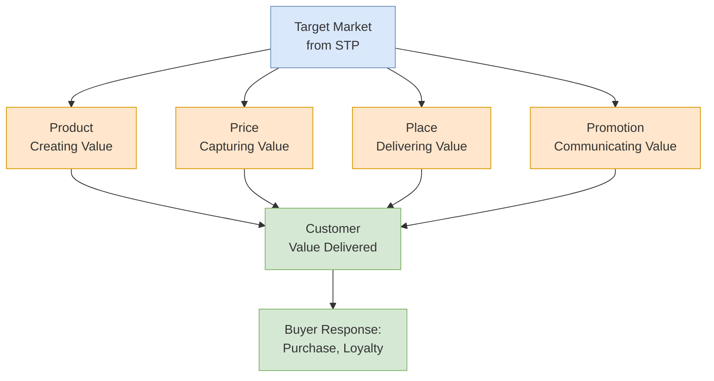

## 概述

行銷組合（Marketing Mix，4P）是由 E. Jerome McCarthy 系統化的行銷策略執行框架，涵蓋產品（Product）、價格（Price）、通路（Place）及促銷（Promotion）四大要素，在完成[[wiki/concepts/stp-marketing|STP]]分析後統一服務於品牌定位策略——競爭優勢公式 $V_A - P_A > V_B - P_B$ 揭示了四個P的分工：Product 和 Promotion 構建感知價值 V，Price 設定消費者成本 P，Place 決定可及性。產品決策從核心利益（顧客真正購買的是什麼）→實體產品（功能、設計、品牌）→增強產品（保修、安裝、支持）三層遞進，並沿引入→成長→成熟→衰退的產品生命周期在每個 P 動態調整：引入期以成本加成或撇脂定價為主、選擇性分銷、建立認知廣告；成熟期以比較廣告鞏固份額、強化分銷、提醒式促銷。價格是4P中唯一直接產生收入的要素，EEMT5560 數據顯示削減5%成本使 ROA 提升3.4個百分點而增加5%收入僅提升2.2個百分點，說明定價與成本結構的配合至關重要；成本加成定價（SP = 成本/(1-利潤率)）與基於成本的加成（SP = 成本×(1+加成率)）因標注方式不同常被混淆，兩者在相同百分比下給出不同售價。通路（Place）的核心決策是直接vs間接渠道，以及密集/選擇性/獨家分銷策略，向全渠道（Omnichannel）轉型的趨勢正在重塑 Place 的邊界——與[[wiki/concepts/ecommerce-models|電商模型]]和[[wiki/concepts/supply-chain-management|SCM]]的後端履約系統深度交融。促銷的整合行銷傳播（IMC）原則要求廣告、銷售促進、PR、直接行銷、個人銷售和口碑六大工具協調一致傳遞同一信息，Music2Go 模擬明確要求隨產品生命周期刷新促銷組合——保持引入期組合進入成熟期會使有效性評分持續下滑，即便預算不變。服務業需額外增加 People（服務人員）、Process（服務流程）、Physical evidence（有形線索）三個P，形成7P框架，對應服務的不可觸性、異質性、不可分離性和易逝性（IHIP）四大特性挑戰。

## What the Marketing Mix Is

The **Marketing Mix** refers to the set of tactical tools a firm uses to implement its marketing strategy and deliver value to the target market. The classic formulation -- **Product, Price, Place, and Promotion** (the 4Ps) -- was popularized by E. Jerome McCarthy and remains the standard framework taught in marketing courses worldwide. Each P represents a category of decisions that must be coordinated to create a coherent offering aligned with the firm's [[wiki/concepts/stp-marketing|STP]] positioning.

The 4Ps are not independent levers. A premium product positioned for affluent consumers requires premium pricing, selective distribution through upscale channels, and aspirational promotion. Misalignment between any element undermines the positioning. The competitive advantage formula $V_A - P_A > V_B - P_B$ unifies the mix: Product and Promotion build perceived value (V), Price sets the cost to the buyer (P), and Place determines accessibility.

### 4Ps, 4Cs, and 7Ps

Criticism that the 4Ps are seller-centric prompted Robert Lauterborn's **4Cs** reframing from the buyer's perspective: Product → **Customer solution**, Price → **Customer cost**, Place → **Convenience**, Promotion → **Communication**. For services, Booms and Bitner extended the mix to **7Ps**, adding **People** (employees who deliver the service), **Process** (procedures and flow of activities), and **Physical evidence** (tangible cues that signal service quality). The services additions reflect the IHIP characteristics (intangibility, heterogeneity, inseparability, perishability) that make pure 4P thinking insufficient for service businesses.

## Product

**Product** encompasses everything the firm offers to satisfy a customer need -- physical goods, services, experiences, events, persons, places, organizations, information, and ideas.

### Three Levels of Product

1. **Core customer value** -- the fundamental benefit or problem-solving service the customer is buying (e.g., a hotel guest buys "rest and sleep")
2. **Actual product** -- the tangible product with its features, design, quality level, brand name, and packaging
3. **Augmented product** -- additional services and benefits such as warranty, delivery, installation, after-sale support

### Consumer Product Classification

| Type | Buying Behavior | Price | Distribution | Promotion | Example |
|------|----------------|-------|-------------|-----------|---------|
| **Convenience** | Frequent, little planning, low involvement | Low | Widespread, intensive | Mass promotion by producer | Toothpaste, newspapers |
| **Shopping** | Less frequent, comparison on price/quality/style | Higher | Selective, fewer outlets | Advertising + personal selling | Furniture, clothing |
| **Specialty** | Strong brand preference, special purchase effort | High | Exclusive, one or few outlets | Targeted promotion | Luxury cars, designer goods |
| **Unsought** | Little awareness or active interest | Varies | Varies | Aggressive advertising + personal selling | Life insurance, blood donations |

### Services: The IHIP Framework

Services have four distinctive characteristics that create unique marketing challenges:

- **Intangibility** -- cannot be seen, tasted, felt before purchase; firms must "tangibilize" through physical evidence
- **Heterogeneity (Variability)** -- quality depends on who provides the service, when, where, and how
- **Inseparability** -- production and consumption occur simultaneously; the provider is part of the product
- **Perishability** -- cannot be stored for later sale; creates capacity management challenges (connecting to [[wiki/concepts/revenue-management|Revenue Management]])

### Brand Architecture

Brand architecture defines how a company organizes and names its portfolio of brands. The spectrum ranges from:

- **Branded house** -- a single master brand across all products (e.g., Virgin, Google)
- **Sub-brands** -- master brand with descriptive modifiers (e.g., Microsoft Office, Microsoft Azure)
- **Endorsed brands** -- individual brands backed by organizational endorsement (e.g., Courtyard by Marriott)
- **House of brands** -- independent brands with no visible corporate connection (e.g., P&G's Tide, Pampers, Gillette)
- **Hybrid** -- a mix of approaches across the portfolio

### Brand Development Matrix

| | Existing Product Category | New Product Category |
|---|---|---|
| **Existing Brand** | Line extension (new flavors, sizes) | Brand extension (new category) |
| **New Brand** | Multibrands (multiple brands in same category) | New brands |

### New Product Development (NPD)

The 8-stage NPD process: idea generation, idea screening, concept development and testing, marketing strategy development, business analysis, product development, test marketing, and commercialization. Each stage serves as a gate to filter ideas and reduce risk before committing greater resources. Test marketing may use **standard test markets** (full launch in selected cities), **controlled test markets** (panel of stores), or **simulated test markets** (lab settings with prototype shopping experiences).

### Product Life Cycle and 4P Alignment

The **Product Life Cycle (PLC)** traces a typical product from introduction through decline, and every P adjusts at each stage:

| Stage | Customers | Product | Price | Place | Promotion |
|-------|-----------|---------|-------|-------|-----------|
| **Introduction** | Innovators | Basic | Cost-plus or skimming | Selective | Build awareness (inform) |
| **Growth** | Early adopters, early majority | Extensions, new features | Penetration | Intensive | Build interest, comparative ads (persuade) |
| **Maturity** | Middle to late majority | Diversify models, repositioning | Match or beat competition | More intensive | Stress differences (remind) |
| **Decline** | Laggards | Phase out weak items | Cut price | Selective (drop unprofitable) | Minimal |

The PLC can be applied at the product-class level (soft drinks), product-form level (diet colas), or individual brand level (Diet Dr. Pepper). Shape and length vary dramatically: fads compress the curve into months; staples like toothpaste maintain a long maturity plateau for decades.

### Product Mix: Width, Length, Depth, Consistency

A **product mix** (or product assortment) is all the product lines and items a company offers for sale. It has four dimensions:

- **Width (breadth)** -- number of different product lines (P&G has beauty, grooming, health, home care lines)
- **Length** -- total number of items across all lines
- **Depth** -- number of versions of each product (Crest toothpaste in 6+ flavors, 3+ sizes, gel vs. paste)
- **Consistency** -- how closely related the lines are in end-use, production, or distribution

**Line stretching** (adding items at higher or lower price points) and **line filling** (adding items within current price range) are the main line-management moves.

## Price

**Price** is the only element of the marketing mix that produces revenue -- all others represent costs. Pricing decisions directly affect demand volume, profit margins, and brand perception.

### Pricing Approaches

**Cost-based pricing** starts with costs and adds a margin:
- **Markup on cost**: $\text{Selling Price} = \frac{\text{Unit Cost}}{1 - \text{desired margin}}$
- **Margin on selling price**: $\text{Margin \%} = \frac{SP - Cost}{SP}$

**Value-based pricing** starts with customer perceived value and works backward:
- Assess what the customer is willing to pay based on perceived benefits
- Design the product and cost structure to deliver profitably at that price
- Value-based pricing generally captures more consumer surplus than cost-based approaches

### Break-Even Analysis

Break-even volume determines the minimum units needed to cover all costs:

$$BEV = \frac{\text{Fixed Costs}}{\text{Price} - \text{Unit Variable Cost}}$$

Beyond break-even, each additional unit contributes (P - UVC) to profit. This connects directly to [[wiki/concepts/cvp-analysis|CVP Analysis]] concepts in managerial accounting.

### Price Elasticity of Demand

**Price elasticity** measures how sensitive demand is to price changes:

$$E = \frac{\%\ \Delta Q_d}{\%\ \Delta P}$$

- **Elastic demand** ($|E| > 1$): price cuts increase total revenue; common for products with many substitutes
- **Inelastic demand** ($|E| < 1$): price increases raise total revenue; common for necessities, addictive goods, products with few substitutes

Promotion can make demand more inelastic by building brand loyalty and perceived differentiation, giving the firm more pricing power.

### Cost-Based Pricing Arithmetic

The course distinguishes two confusable formulas:

- **Markup on cost** of 35% on a $300 cost: $SP = 300 \times 1.35 = \$405$, markup = $105.
- **Margin on selling price** of 35% on a $300 cost: $SP = 300 / 0.65 = \$461.54$, margin = $161.54.

The same percentage label yields different prices. Retailers typically quote margin on selling price; manufacturers sometimes quote markup on cost. Confusing the two misstates profitability and aligns with concepts covered in [[wiki/concepts/financial-ratios|Financial Ratios]].

### Market Structure and Pricing Latitude

Pricing freedom depends on market structure:

| Structure | Sellers | Differentiation | Pricing Power |
|-----------|---------|-----------------|---------------|
| **Pure competition** | Many | None (commodities) | Price taker |
| **Monopolistic competition** | Many | Some | Moderate |
| **Oligopoly** | Few | Varies | Interdependent pricing |
| **Pure monopoly** | One | N/A | Maximum (subject to regulation) |

### New Product Pricing Strategies

- **Penetration pricing** -- set a low initial price to attract a large number of buyers quickly and win market share. Works best when the market is price-sensitive, economies of scale exist, and low price discourages competitors. Risk: may discourage retailers from carrying the brand and may jeopardize profit objectives. Classic examples include Xiaomi smartphones and Costco's house brands.
- **Price skimming** -- set a high initial price to "skim" revenue layer by layer from segments willing to pay more, then reduce price in steps to tap price-sensitive segments. Works best when demand is inelastic at the upper price range, unit costs of small volume are acceptable, and competitors cannot easily enter. Classic examples include Apple iPhones at launch and newly patented pharmaceuticals.

### Price Adjustment Strategies

Beyond initial pricing, firms adjust prices through: **discounts and allowances** (cash, quantity, functional, seasonal, trade-in), **segmented pricing** (student, senior, peak/off-peak), **psychological pricing** ($9.99 instead of $10.00, reference prices), **promotional pricing** (loss leaders, special events, low-interest financing), **geographical pricing** (FOB origin, uniform delivered, zone pricing), **dynamic pricing** (real-time adjustment via algorithms -- foundational to [[wiki/concepts/revenue-management|revenue management]]), and **bundling** (combining products to capture surplus across complementary demand curves).

## Place (Distribution)

**Place** concerns how the product reaches the customer -- the design and management of marketing channels.

### Channel Structure

A **marketing channel** (distribution channel) is a set of interdependent organizations involved in making a product available for consumption. The fundamental choice is between:

- **Direct channels** -- producer sells directly to consumer (greater control, lower cost, direct customer feedback, but limited reach)
- **Indirect channels** -- one or more intermediaries (wholesalers, retailers) stand between producer and consumer (broader reach, established buying patterns, inventory investment by middlemen)

### Market Exposure Strategies

| Strategy | Description | Example |
|----------|-------------|---------|
| **Intensive** | Stock in as many outlets as possible | Candy, gum in supermarkets and convenience stores |
| **Selective** | Use more than one but fewer than all willing intermediaries | TVs and furniture in selected department stores |
| **Exclusive** | Very limited number of dealers with exclusive territorial rights | Lexus, Mercedes, BMW dealerships |

### Vertical Marketing Systems (VMS)

VMS are professionally managed, centrally coordinated channel systems:

- **Corporate VMS** -- single ownership of production and distribution (e.g., Zara controls manufacturing and retail)
- **Contractual VMS** -- independent firms joined through contracts, most commonly franchise organizations
- **Administered VMS** -- leadership through the size and power of a dominant "channel captain" (e.g., Walmart dictating terms to suppliers)

### Channel Conflict and Cooperation

- **Horizontal conflict** -- friction between firms at the same channel level (e.g., two Ford dealers poaching each other's territories, or Amazon third-party sellers undercutting each other on identical SKUs).
- **Vertical conflict** -- friction between different levels (e.g., manufacturer opening its own direct-to-consumer web store that competes with independent retailers; retailers demanding slotting fees from suppliers).
- **Multichannel conflict** -- a specific form of vertical conflict where the same customer segment can be served through multiple paths (no-frills/low-cost vs. full-service/full-cost), leading channels to cannibalize each other.
- **Channel captain** -- the member that coordinates, directs, and supports others; may be producer (Apple with its authorized resellers), wholesaler, or retailer (Walmart dictating terms to consumer-goods suppliers).
- **Hybrid channels** split functions: suppliers handle demand generation with their own salesforce, distributors handle physical distribution, and inside/outside specialists handle after-sales service.

### From Multichannel to Omnichannel

**Multichannel** distributes products across multiple platforms (stores, websites, marketplaces) but each channel operates in a silo without integration. **Omnichannel** creates a unified customer experience across all touchpoints, with a single view of the customer. The shift reflects moving from a product-centric (availability) to customer-centric (experience) distribution philosophy, connecting to [[wiki/concepts/ecommerce-models|E-Commerce Models]] and modern [[wiki/concepts/supply-chain-management|Supply Chain Management]].

### Retailing and Wholesaling

Retailers are classified by amount of service (self-service, limited-service, full-service), product lines (specialty, department, supermarket, convenience, superstore, category killer), and relative prices (discount, off-price, membership clubs). Evolving trends include entertainment integration, consolidation, strategic alliances, internationalization, and showrooming vs. webrooming dynamics.

**Wholesalers** perform functions including buying/assortment building, bulk-breaking, warehousing, transportation, financing, risk bearing, selling/promoting, market information, and management advice.

## Promotion

**Promotion** encompasses all activities that communicate the product's merits and persuade target customers to buy.

### Integrated Marketing Communications (IMC)

**IMC** is the principle of carefully integrating and coordinating all communication channels to deliver a clear, consistent, and compelling message about the organization and its products. The communication process follows: sender has idea, encodes message, channel carries message, receiver decodes message, with feedback and noise throughout.

### Promotional Tools

| Tool | Description | Strengths |
|------|-------------|-----------|
| **Advertising** | Paid, non-personal presentation by identified sponsor | Broad reach, repetition, expressiveness |
| **Sales Promotion** | Short-term incentives (coupons, contests, samples, rebates) | Immediate response, trial generation |
| **Events & Experiences** | Sponsored activities (sports, entertainment, causes) | Engagement, brand association |
| **PR & Publicity** | Unpaid media coverage, press releases, community relations | Credibility, cost-efficiency |
| **Direct & Interactive Marketing** | Catalogs, telemarketing, email, web | Personalization, measurability |
| **Word-of-Mouth** | Person-to-person, blogs, chat rooms | Trust, authenticity |
| **Personal Selling** | Face-to-face presentations, sales meetings, trade shows | Relationship building, complex sales |

### Promotion Across the Product Life Cycle

Promotional objectives and tools shift with PLC stage:

- **Introduction**: Inform -- use ads and press releases to build awareness
- **Growth**: Persuade -- comparative advertising, personal selling to channels
- **Maturity**: Remind -- reminder advertising, coupons to maintain share
- **Decline**: Minimal promotion, potential harvest or divest

### Advertising Strategy

Advertising is classified as **institutional** (promoting the organization's image: advocacy, pioneering, competitive, reminder) or **product** (promoting specific products: pioneering/informative, competitive/persuasive, reminder).

Message strategy identifies consumer benefits; advertising appeal should be meaningful, believable, and distinctive. **Message execution styles** include slice of life (people using the product in everyday settings), lifestyle (fits with a target lifestyle), fantasy (creates a dream world), mood/image (builds an evocative mood), musical (jingles, songs), personality symbol (mascot like the Geico Gecko), technical expertise, scientific evidence, and testimonial/endorsement (celebrities or typical users).

### Promotion and the Demand Curve

Promotion can affect demand in three ways relevant to pricing: (A) **make demand more inelastic** by building brand loyalty and perceived differentiation, giving pricing power; (B) **shift demand right** by attracting new buyers or increasing usage; (C) **both** -- the ideal outcome for mature brands. Differentiating promotion supports premium pricing via the fundamental value equation $V_A - P_A > V_B - P_B$.

### Worked Example: Music2Go Promotion Mix by PLC Stage

The Music2Go simulation makes the abstract "promotion mix varies by PLC stage" rule concrete through two tracked metrics: the **Sales Promotion Rating** (an effectiveness score from 1-100 built from expenditure and mix choices) and the **Promotion Mix Effectiveness** score that compares a product's mix -- trade shows, salesforce training, premiums/gifts, website/social, point-of-purchase displays, and rebates -- against the ideal mix for its current PLC stage. Teams are explicitly rewarded for **refreshing the sales promotion mix as products mature**: a product that keeps its introduction-era mix into maturity will see its effectiveness rating erode even if the budget is unchanged. The DreamWave student team operationalized this by starting each round's sales-promotion decision from the average mix and then running pairwise adjustments as a heuristic local search to climb toward the PLC-ideal mix.

The finale debrief surfaces two further rules that sharpen the textbook promotion framework:

1. **Set advertising budgets by the job to be done, not by % of sales.** Salvacruz cites A.C. Nielsen's warning that firms anchored to historical percent-of-sales formulas are "asking for trouble." The correct chain runs Advertising → Awareness → Purchase Intention → Market Share → Sales → Profits, with the budget sized to the awareness and intention gap the firm needs to close -- not to last year's revenue.
2. **Advertising and sales force are not substitutes.** Each promotional tool plays a distinct role in the IMC mix; cutting one to fund the other collapses the coordination that the fundamental value equation depends on.

### Push vs. Pull Strategies

- **Push strategy** -- producers push the product through the channel via trade promotion, personal selling to intermediaries, and training. Intermediaries then push it to end customers. Common in industrial goods and new product launches.
- **Pull strategy** -- producers aim advertising and consumer promotion at final consumers, creating demand that pulls the product through the channel. Common in branded consumer goods ("got milk?", "Intel Inside").

Most firms combine both, with the mix shifting over the PLC: push dominates at introduction (get shelf space), pull rises during growth and maturity (build consumer loyalty).

## Related Concepts

- [[wiki/concepts/stp-marketing|STP Marketing]]
- [[wiki/concepts/consumer-behavior|Consumer Behavior]]
- [[wiki/concepts/revenue-management|Revenue Management]]
- [[wiki/concepts/ecommerce-models|E-Commerce Models]]
- [[wiki/concepts/cvp-analysis|CVP Analysis]]
- [[wiki/concepts/supply-chain-management|Supply Chain Management]]
- [[wiki/concepts/financial-ratios|Financial Ratios]]
- [[wiki/concepts/porters-five-forces|Porter's Five Forces]]
- [[wiki/concepts/ab-testing|A/B Testing]]
- [[wiki/concepts/recommendation-systems|Recommendation Systems]]

## Source Materials

- [[wiki/sources/courses/marketing|SBMT5030 Marketing Management and Strategy]]
- Lecture 08: Product
- Lecture 09-01: Price
- Lecture 11-01: Promotion
- Lecture 11-02: Distribution
