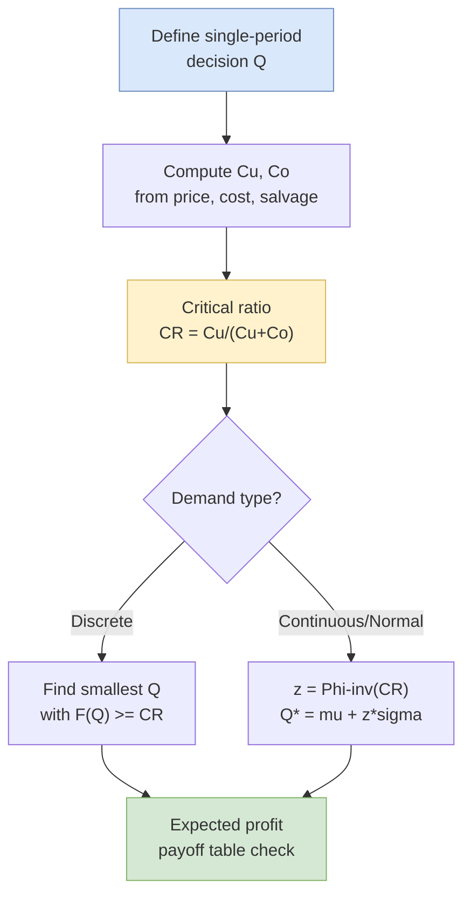

## 概述

報童問題（Newsvendor Problem）是單期庫存決策的經典模型，用於在需求不確定、只有一次訂購機會且產品具易逝性的情境下，求解最佳訂購量 Q*。其核心結果為臨界比率（Critical Ratio）：P(D ≤ Q*) = Cu/(Cu+Co)，其中 Cu 為缺貨成本（每單位未滿足需求的損失邊際利潤），Co 為過量成本（每單位滯銷品的損失，即成本減殘值）。此公式源自邊際分析：增加最後一單位訂購量的邊際期望收益等於邊際期望損失時即為最優，因此最優解是需求分佈的 Cu/(Cu+Co) 分位數。對於正態分佈需求，Q* = μ + zσ，其中 z 為對應臨界比率的標準正態分位數；若 Co > Cu，則 z 為負值，最優訂購量低於平均需求。報童框架廣泛應用於時裝零售、新鮮食品（如 Arome 麵包）、季節性商品，並直接延伸至收益管理中的座位保護（protection level）與超額預訂（overbooking）決策，是運籌學庫存理論與隨機服務系統的核心銜接點。

## Problem Definition

The **newsvendor problem** (also called the newsboy problem or single-period inventory problem) addresses a fundamental decision: how much to order (or produce) of a perishable product when demand is uncertain and there is only one ordering opportunity.

The three defining characteristics are:

1. **Uncertain demand** -- demand is not known at the time the order must be placed.
2. **Single ordering opportunity** -- the order quantity must be committed before demand is realized; there is no chance to reorder.
3. **Perishable product** -- unsold inventory has reduced value (salvage) or no value after the selling period.

Classic applications include newspapers (hence the name), fashion apparel, seasonal goods, Christmas trees, event-specific merchandise, and fresh food items like baked goods.

## Cost Structure

The model involves two types of cost from ordering the wrong quantity:

**Underage cost ($C_u$)** -- the cost per unit of ordering too few:
- $C_u = r - c$ (selling price minus cost)
- Represents lost profit from each unit of unmet demand (opportunity cost).
- Also called stockout cost or shortage cost.

**Overage cost ($C_o$)** -- the cost per unit of ordering too many:
- $C_o = c - s$ (cost minus salvage value)
- Represents the loss per unsold unit (cost minus whatever salvage value is recovered).
- Also called excess cost.

## The Critical Ratio

The optimal order quantity $Q^*$ is found by setting the expected marginal benefit of ordering one more unit equal to the expected marginal cost:

$$P(D > Q) \times C_u = P(D \leq Q) \times C_o$$

Since $P(D > Q) = 1 - P(D \leq Q)$, solving yields:

$$P(D \leq Q^*) = \frac{C_u}{C_u + C_o} = \text{Critical Ratio}$$

The critical ratio represents the **service level** -- the probability that demand will be met. It reflects the relative cost asymmetry between ordering too much versus too little:

- When $C_u \gg C_o$ (underage is much costlier): critical ratio approaches 1.0, meaning order more to avoid stockouts.
- When $C_o \gg C_u$ (overage is much costlier): critical ratio approaches 0, meaning order conservatively.

## Solution Approaches

### Discrete Demand (Payoff Table)

When demand takes only a small number of discrete values:

**Approach 1 -- Payoff table**: Construct a matrix of profit outcomes for each combination of production quantity Q and demand realization D. Calculate expected value for each Q; choose Q with maximum expected profit.

Net profit for each cell:
- If $D \geq Q$: profit $= C_u \times Q$ (all units sold)
- If $D < Q$: profit $= C_u \times D - C_o \times (Q - D)$

**Approach 2 -- Marginal analysis with cumulative probability**: Compute the critical ratio, then find the smallest Q such that P(D ≤ Q) ≥ critical ratio.

### Example: Cookie King at HKUST

- Selling price = \$7.9, Cost = \$4.9, Markdown price = \$2.9
- $C_u = 7.9 - 4.9 = 3.0$, $C_o = 4.9 - 2.9 = 2.0$
- Critical ratio $= \frac{3}{3+2} = 0.6$
- Demand distribution: 1800 (0.05), 2000 (0.10), 2200 (0.20), 2400 (0.30), 2600 (0.20), 2800 (0.10), 3000 (0.05)
- Cumulative: $P(D \leq 2200) = 0.35$, $P(D \leq 2400) = 0.65$
- Since 0.65 is the first value $\geq 0.6$, optimal $Q^* = 2{,}400$ units
- Expected profit = $6,650

### Continuous Demand (Normal Distribution)

When demand is approximately normally distributed with mean $\mu$ and standard deviation $\sigma$:

1. Compute the critical ratio: $\frac{C_u}{C_u + C_o}$
2. Find the z-score from the standard normal table: $F(z) = \text{critical ratio}$
3. Optimal order quantity: $Q^* = \mu + z\sigma$

### Example: Newspaper Vendor (Mr. Choi)

- Cost = \$4, Selling price = \$7, Salvage = \$0
- $C_u = 7 - 4 = 3$, $C_o = 4 - 0 = 4$
- Critical ratio $= \frac{3}{3+4} = 0.4286$
- From normal table: $z = -0.18$ (since $F(z) = 0.4286$ is below 0.5)
- Demand $\sim N(100, 12)$
- $Q^* = 100 + (-0.18)(12) = 97.84 \approx 98$ copies

A **negative z-score** means the optimal quantity is below the mean -- this happens when overage cost exceeds underage cost, making it costlier to overstock than understock.

### Case Study: Arome Bakery Replenishment

Arome Bakery, a 55-store Hong Kong chain acquired by Maxim's Group in 2008, uses the newsvendor framework to decide daily specialty-bun order quantities for each store. Headquarters issues a **basic order quantity** based on historical sales, which store managers adjust for weather, weekday patterns, promotions, and on-hand stock. Unsold fresh bakery items have a shelf life of a single day and must be returned to the central factory for disposal, making the one-shot perishability assumption almost literal.

Cost structure per specialty bun (disguised case data):

- Selling price $r = \text{HK\$}7.80$
- Out-of-factory cost $c = \text{HK\$}3.12$
- Salvage $s = 0$ (returns are destroyed)
- $C_u = 7.80 - 3.12 = \text{HK\$}4.68$ (lost margin per stockout)
- $C_o = 3.12 - 0 = \text{HK\$}3.12$ (loss per unsold bun)
- Critical ratio = $4.68 / (4.68 + 3.12) = 0.60$

From June 2012 sales data (Exhibit 2 of the case), the **Aberdeen store** had mean daily demand ≈ 1,158 with standard deviation ≈ 118. For a 0.60 critical ratio, $z \approx 0.25$, so $Q^* \approx 1{,}158 + 0.25(118) \approx 1{,}188$ buns per day. The **Jordan MTR store**, with much higher mean (3,098) and larger variance (sigma ≈ 650 due to weekday/weekend swings), reaches $Q^* \approx 3{,}260$.

A simpler 90th-percentile heuristic used in the case gives Aberdeen ≈ 1,400 and Jordan ≈ 4,200 — conservative because the implied service level (0.90) exceeds what the Cu/Co ratio justifies. The Arome case illustrates three recurring newsvendor pitfalls:

1. **Ignoring the cost asymmetry** — a flat 90th-percentile target over-orders when $C_o$ is substantial.
2. **Not tracking the loss metric** — stores were graded on a crude return-rate ceiling (5%) without accounting for lost-sale incidents.
3. **Misaligned incentives** — store managers were not shown cost data, so optimization ended at "hit 5%" rather than "minimize expected total mismatch cost."

Remedies included incentive transfers between stores, demand forecasting enhancements, and introducing cost transparency at the store-manager level.

### Case Study: Cookie King at HKUST

- Selling price = \$7.9, Cost = \$4.9, Markdown price = \$2.9
- $C_u = 3.0$, $C_o = 2.0$, Critical ratio = 0.60
- Discrete demand: 1800 (0.05), 2000 (0.10), 2200 (0.20), 2400 (0.30), 2600 (0.20), 2800 (0.10), 3000 (0.05)
- Cumulative: $P(D \leq 2200) = 0.35$, $P(D \leq 2400) = 0.65$ (first value $\geq 0.60$)
- Optimal $Q^* = 2{,}400$ units; expected profit $\approx \$6{,}650$

The **payoff table** approach arrives at the same answer: compute $E[\text{profit}|Q]$ for each candidate Q and pick the maximum. Both methods match exactly because marginal analysis is a first-order optimality condition for the payoff function.

## Connection to Revenue Management

The newsvendor framework extends directly to [[revenue-management|revenue management]] problems:

- **Capacity control (seat protection)**: How many seats to protect for full-fare passengers is a newsvendor problem where $C_u$ = full fare - discount fare and $C_o$ = discount fare.
- **Overbooking**: How many extra reservations to accept beyond capacity is a newsvendor problem where $C_u$ = ticket revenue (cost of empty seat) and $C_o$ = denied boarding compensation.

In capacity control, the "order quantity" becomes the protection level, and the "demand" is the full-fare demand. The same critical ratio formula determines the optimal protection level.

## Derivation of the Critical Ratio

The critical ratio follows from marginal analysis. Consider the decision to order one additional unit, from $Q$ to $Q+1$:

- The $(Q+1)^{\text{th}}$ unit generates profit $C_u$ if and only if realized demand exceeds $Q$ (probability $1 - F(Q)$).
- The $(Q+1)^{\text{th}}$ unit incurs loss $C_o$ if and only if realized demand is at most $Q$ (probability $F(Q)$).

**Expected marginal benefit of the extra unit:**

$$\Delta\pi(Q) = C_u \cdot [1 - F(Q)] - C_o \cdot F(Q)$$

Order more whenever $\Delta\pi(Q) > 0$; stop when $\Delta\pi(Q^*) = 0$:

$$C_u[1 - F(Q^*)] = C_o F(Q^*) \implies F(Q^*) = \frac{C_u}{C_u + C_o}$$

Because $F$ is monotone non-decreasing, the solution is unique (or forms an interval for discrete distributions).

## Decision Flow

## Key Insights

1. **The optimal quantity is rarely the mean demand** -- it shifts based on the cost ratio. Only when $C_u = C_o$ (critical ratio = 0.5) does $Q^*$ equal the median demand.
2. **Higher margin products warrant larger orders** -- when $C_u \gg C_o$, the critical ratio is high, pushing $Q^*$ above the mean.
3. **Service level interpretation** -- $P(D \leq Q^*) = \text{critical ratio}$ can be interpreted as the in-stock probability or service level, connecting inventory theory to service quality.
4. **The payoff table and marginal analysis always agree** -- both approaches yield the same optimal Q*, but marginal analysis is computationally simpler for large problems.

## Related Concepts

- [[revenue-management|Revenue Management]] -- Seat protection and overbooking are newsvendor problems in disguise; the critical ratio determines the protection level for higher-fare classes
- [[capacity-planning|Capacity Planning]] -- Single-shot capacity decisions (event staffing, seasonal hiring) mirror the newsvendor trade-off between overage and underage cost
- [[littles-law|Little's Law]] -- Companion operations identity; together they span static single-period and steady-state flow analysis
- [[queueing-theory|Queueing Theory]] -- Stochastic service analogue; newsvendor handles perishable one-shot inventory, queueing handles recurring arrivals
- [[arma-models|ARMA Models]] -- Demand forecasts driving $\mu$ and $\sigma$ typically come from time-series models; forecast error variance is the input that actually matters
- [[ab-testing|A/B Testing]] -- Promotional lift estimates from experiments update the demand distribution used in $Q^*$
- [[supply-chain-management|Supply Chain Management]] -- Multi-echelon extensions (risk pooling, postponement) generalise the single-location newsvendor
- [[wiki/mocs/operations-research|Operations Research MOC]] — Part of the OR PhD reading spine (Inventory Theory and Supply Chain)

## Source Materials

- [[wiki/sources/courses/service-ops|EEMT5520 Service Operations Management]]
- Newsvendor Model Slides
- Newsvendor Problem (Textbook)
