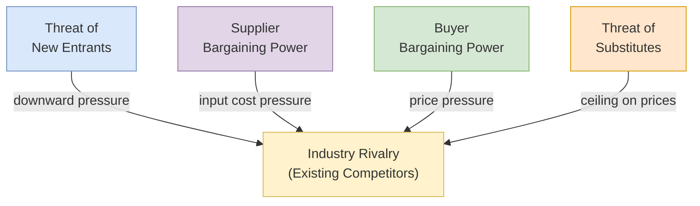

## 概述

波特五力分析是由 Michael E. Porter 於1979年在《哈佛商業評論》發表的產業結構分析框架，核心命題是：產業的長期獲利能力由產業結構（五力配置）決定，而非企業本身的產品或技術——1992-2010年美國產業研究印證了這一點，製藥業平均 ROIC 超過20%而航空業不足6%，差異完全可追溯至五力的結構性差異。五大力量分別為：新進入者威脅（進入壁壘高低，包括規模經濟、資本需求、轉換成本、政策與品牌忠誠度）、供應商議價能力（供應商集中度、投入差異化程度、前向整合威脅）、買方議價能力（買方集中度、產品標準化程度、向後整合威脅）、替代品威脅（替代品的價格-性能比與轉換成本）以及現有競爭者的競爭強度（競爭者數量、行業增長率、固定成本比例、退出壁壘）。應用時應定義清晰的產業邊界，對每個力量評估強/中/弱，再推導整體產業吸引力——對平台和網絡效應型業務需特別注意：網絡效應創造的贏家通吃動態從根本上改變了傳統五力對買方力量的假設，而[[wiki/concepts/ecommerce-models|電商平台]]的雙邊市場特性往往需要引入 Brandenburger & Nalebuff 的「互補者」作為第六力。EEMT5560 課程的六個産業案例（國泰航空、華為、沃爾瑪、利豐、順豐、Temu）展示了同一框架如何讀出截然不同的戰略現實：航空業問題是結構性而非執行性，華為通過垂直整合弱化了晶片供應商的壟斷力，而李豐的中間商角色被直連工廠的電商平台以近零轉換成本取代。框架的主要批評是靜態性（無法建模動態演化）和對平台/生態系統業務的有限適用性，Blue Ocean 策略是其主要替代思路。

## Core Framework

**Porter's Five Forces** is an industry analysis framework developed by Michael E. Porter of Harvard Business School, first published in his 1979 Harvard Business Review article "How Competitive Forces Shape Strategy." The central thesis is that an industry's long-term profitability is determined not by the product or technology involved, but by the **structure of the industry** -- specifically, the configuration of five competitive forces.

The framework shifts strategic thinking from focusing on direct competitors to understanding the broader competitive ecosystem. An industry where all five forces are strong (e.g., airlines) tends to have low average profitability, while an industry where forces are weak (e.g., enterprise software) tends to have high profitability.

Porter's original 1979 thesis: *industry structure determines average profitability more than firm-level decisions*. The empirical spread is dramatic -- a 1992-2010 study of US industries shows pharmaceuticals averaging 20%+ ROIC while airlines averaged below 6%, directly traceable to structural differences in the five forces.

### The Five Forces

#### 1. Threat of New Entrants

New entrants bring new capacity and a desire for market share, putting pressure on prices, costs, and investment. The threat depends on the height of **barriers to entry**:

- **Economies of scale** -- Incumbents with large production volumes enjoy lower per-unit costs. In MBS, companies that invest early in equipment capacity and achieve higher production volumes gain cost advantages over smaller competitors.
- **Capital requirements** -- Large upfront investments deter entry (e.g., semiconductor fabs, airlines)
- **Switching costs** -- Costs customers incur to change suppliers (e.g., enterprise software migration)
- **Access to distribution channels** -- Established relationships with distributors or retail networks
- **Government policy** -- Regulations, licensing requirements, patents
- **Brand identity and customer loyalty** -- Established brand recognition reduces the appeal of new entrants

**When the threat is high**: Incumbents must keep prices competitive and invest in barriers; profit margins are constrained.

#### 2. Bargaining Power of Suppliers

Powerful suppliers capture more value by charging higher prices, limiting quality, or shifting costs:

- **Supplier concentration** -- Few suppliers serving many buyers (e.g., Intel in PC processors)
- **Differentiation of inputs** -- Unique or specialized inputs that cannot be easily substituted
- **Switching costs** -- High cost of changing suppliers
- **Forward integration threat** -- Suppliers could enter the buyer's market
- **Importance of volume to supplier** -- Small buyers have less leverage

In MBS, raw material purchasing is a key decision -- material costs directly impact cost of goods sold. Purchasing managers must balance order quantities against holding costs and potential stockout situations.

#### 3. Bargaining Power of Buyers

Powerful buyers can force down prices, demand higher quality or more service, and play competitors against each other:

- **Buyer concentration** -- Few large buyers purchasing significant volumes
- **Product standardization** -- Undifferentiated products make switching easy
- **Price sensitivity** -- Buyers facing cost pressure are more aggressive negotiators
- **Backward integration threat** -- Buyers could produce the product themselves
- **Information availability** -- Well-informed buyers negotiate more effectively

In MBS, price elasticity directly determines how pricing decisions affect demand. Markets with higher price sensitivity require more careful pricing strategies, while markets where product differentiation (through R&D) reduces price sensitivity allow for premium pricing.

#### 4. Threat of Substitute Products or Services

Substitutes are products from outside the industry that fulfill the same function:

- **Price-performance trade-off** -- Substitutes that offer better value limit industry pricing
- **Switching costs** -- Low switching costs make substitution easier
- **Buyer propensity to substitute** -- Cultural or habitual factors affecting willingness to switch

Substitutes place a ceiling on prices and therefore on profitability. The key analytical question is: "What is the price-performance ratio of substitutes compared to the industry's product?"

#### 5. Intensity of Rivalry Among Existing Competitors

Direct competition among existing firms takes the form of price discounting, new product introductions, advertising campaigns, and service improvements:

- **Number and balance of competitors** -- Many similarly sized firms increase rivalry
- **Industry growth rate** -- Slow growth makes market share a zero-sum game
- **Fixed costs and capacity** -- High fixed costs create pressure to fill capacity, leading to price cuts
- **Product differentiation** -- Low differentiation intensifies price competition
- **Exit barriers** -- High exit barriers keep struggling competitors in the market, prolonging competition

In MBS Model 3 and 4, teams directly compete across four markets. Competitive dynamics include pricing strategies, marketing investment to attract demand, R&D for product quality differentiation, and production capacity races. The simulation vividly demonstrates how rivalry intensity affects profitability -- aggressive pricing wars can destroy value for all participants.

## Analytical Process

### Step-by-Step Application

1. **Define the industry** -- Clearly delineate the boundaries (product scope, geographic scope, value chain position)
2. **Identify the players** -- Map competitors, suppliers, buyers, potential entrants, and substitutes
3. **Assess each force** -- Rate as strong, moderate, or weak based on structural factors
4. **Determine overall industry attractiveness** -- The configuration of all five forces determines average profitability
5. **Identify strategic positioning** -- Find a position where forces are weakest, or where the firm can influence forces in its favor

### Complementary Analysis

Porter's Five Forces is typically used alongside other strategic frameworks:

| Framework | Relationship to Five Forces |
|-----------|----------------------------|
| **PESTEL** | Macro-environmental factors that shape the five forces |
| **SWOT** | Internal capabilities matched against industry forces |
| **Value Chain** | Identifies which activities create competitive advantage within the industry structure |
| **[[balanced-scorecard|Balanced Scorecard]]** | Translates strategic insights from five forces into measurable objectives |

## Connection to MBS Simulation

The [[wiki/entities/hkust|HKUST]] EEMT5560 Marco Business Simulation provides a microcosm for experiencing Porter's Five Forces across Model 3 and Model 4:

- **Rivalry**: 6-8 companies competing directly in 4 markets using 14-18 decisions per round. Competitive weapons include retail pricing per market, marketing spend (high/moderate/low impact on demand), R&D investment (quality differentiation affecting potential demand), and production capacity expansion.
- **Buyer power**: Manifested through **price elasticity of demand** -- customers shift between competitors based on relative pricing. Markets with more price-sensitive buyers force tighter margins. Students learn that differentiation through R&D reduces effective buyer power.
- **Supplier considerations**: Raw material purchasing decisions, including normal vs. urgent procurement (with a $1.50/unit premium in Model 4), and bank loans with interest rates modelling the cost of capital suppliers.
- **Entry barriers**: Equipment investment and R&D spending create scale-based cost advantages. Teams that build capacity early enjoy lower unit costs (see DuPont: 5% COGS reduction lifts ROA by +3.4 pp vs. only +2.2 pp from 5% sales growth).
- **Substitutes**: Though the MBS is single-product, the multi-market structure forces teams to consider product positioning and the price ceiling that substitute offerings in other markets impose.
- **Competitive strategy**: Teams must choose between **cost leadership** (low price, high volume, minimal R&D) and **differentiation** (R&D investment, premium pricing, brand building). Mixed or indecisive strategies typically underperform -- echoing Porter's warning against being "stuck in the middle."

### Breakeven Analysis as a Rivalry Lever

Because rivalry intensity is amplified by high fixed costs, MBS teams use cost-volume-profit ([[cvp-analysis|CVP]]) analysis to identify their breakeven volume:

$$Q_{BE} = \frac{FC}{SP - VC}$$

Where $FC$ = fixed costs (R&D, admin, depreciation, holding costs), $SP$ = selling price, $VC$ = variable cost per unit. Teams with lower $Q_{BE}$ can sustain price wars longer, which is why equipment investment (higher fixed cost but lower variable cost) is risky when rivalry is low but becomes a decisive advantage when rivalry is high and volumes are large.

The simulation demonstrates that sustainable competitive advantage comes not from any single decision but from the coherent integration of decisions across all functional areas -- a key insight that Five Forces analysis illuminates at the industry level.

## EEMT5560 Capstone Cases: Five Forces in Practice

The course's group-presentation capstone asks teams to apply Porter's Five Forces to a real company drawn from a curated list. The same framework reads very differently across these industries, which is the teaching point:

| Company | Dominant Force | How It Manifests |
|---------|----------------|------------------|
| **Cathay Pacific** | Rivalry + Substitutes | Long-haul rivalry from Gulf and mainland carriers plus substitution by Greater Bay Area high-speed rail compressed yields; legacy fleet and union costs became sunk fixed costs that intensified price wars. Case frames the airline's decline as a failure to adapt industry structure, not a failure of execution. |
| **Huawei** | Supplier power + Rivalry | US chip sanctions elevated supplier bargaining power to an existential level; Huawei responded by vertically integrating and betting billions on self-designed HiSilicon replacements, EV ecosystem partnerships, and R&D-led differentiation. Bucked a 22% China smartphone decline as the only growing brand -- a live demonstration of weakening rivalry via differentiation. |
| **Wal-Mart** | Buyer power (inverted) + Entry barriers | Wal-Mart's own buyer power over suppliers is the structural source of its cost advantage; its scale and distribution network raise entry barriers for would-be discounters. The case is the course's cost-leadership benchmark for MBS teams. |
| **Li & Fung** | Buyer power (toward the firm) + Substitutes | Direct-to-factory e-commerce eroded the intermediary value proposition; brands increasingly by-pass the trading house. The case shows how digital platforms can reshape an entire industry's value chain and reduce substitutes' switching costs to near zero. |
| **SF Express** | Rivalry + Buyer power | Intense rivalry in China express delivery (JD Logistics, YTO, STO, ZTO) on price; SF's premium-speed positioning attempts to segment out price-sensitive buyers. Contrasts directly with Wal-Mart's cost leadership -- the same semester covers both Porter generics. |
| **Temu / PDD** | Rivalry + Buyer power + Substitutes | Cross-border e-commerce rivalry with Shein and Amazon; low switching costs and commoditized product; buyer power amplified by content-creator-driven comparison shopping. Temu's strategy mirrors PDD's group-buying playbook in rural China but faces a ~15x higher US disposable-income ($39K vs. $2.6K) customer who has more substitutes. |

Each group presentation is graded on how concretely Five Forces maps onto the company's strategic reality -- the course explicitly rewards teams who show, for example, that Cathay Pacific's problem is structural (industry) rather than tactical (marketing), or that Li & Fung's erosion comes from a lowered entry barrier for direct-to-factory startups.

## Criticisms and Extensions

### Common Criticisms

- **Static model** -- Captures industry structure at a point in time but does not model dynamic changes well
- **Industry definition problems** -- Boundaries are increasingly blurred (e.g., is Apple in computers, phones, or entertainment?)
- **Ignores complementors** -- Andrew Grove and Brandenburger & Nalebuff added a "sixth force" for complementary products (e.g., apps complement smartphone hardware)
- **Assumes zero-sum competition** -- Does not account for value co-creation and ecosystem strategies
- **Limited applicability to platform and network businesses** -- Network effects fundamentally alter competitive dynamics in ways the original model does not capture

### Modern Extensions

- **Porter's 2008 update** -- Refined the framework with more emphasis on industry structure vs. short-term factors
- **Blue Ocean Strategy** (Kim & Mauborgne) -- Argues for creating uncontested market space rather than competing within existing industry boundaries
- **Ecosystem strategy** -- Considers interdependencies among multiple industries and platform dynamics

## Strengths and Limitations

**Strengths**:
- Provides a rigorous, structured approach to industry analysis
- Shifts focus from direct competitors to the full competitive ecosystem
- Applicable across all industries and geographies
- Identifies the root causes of profitability differences across industries

**Limitations**:
- Better suited for analyzing stable industries than rapidly evolving ones
- Focuses on industry-level profitability rather than firm-level competitive advantage
- Does not account for government as an independent force (beyond entry barriers)
- Assumes clear industry boundaries that may not exist in practice

## Related Concepts

- [[balanced-scorecard|Balanced Scorecard]] -- Translates Five Forces strategic insights into measurable organizational objectives across four perspectives.
- [[stp-marketing|STP Marketing]] -- Segmentation, targeting, and positioning decisions informed by industry structure analysis.
- [[supply-chain-management|Supply Chain Management]] -- Supply chain design choices shaped by supplier and buyer power dynamics.
- [[scor-model|SCOR Model]] -- Operationalizes the Source and Deliver processes where supplier and buyer power are directly felt.
- [[ecommerce-models|E-Commerce Models]] -- Digital business models that often reshape traditional industry boundaries and competitive forces.
- [[marketing-mix|Marketing Mix]] -- The 4Ps are the levers through which firms respond to competitive forces.
- [[consumer-behavior|Consumer Behavior]] -- Understanding buyers is essential to assessing buyer power.
- [[cvp-analysis|CVP Analysis]] -- Quantifies how high fixed costs intensify rivalry through the breakeven mechanism.
- [[ahp|Analytic Hierarchy Process]] -- Each of the five forces can serve as an AHP criterion when ranking markets by attractiveness.
- [[Data Envelopment Analysis (DEA)|Data Envelopment Analysis]] -- DEA peer analysis complements Five Forces by revealing which competitors set the efficiency benchmark.
- [[revenue-management|Revenue Management]] -- Pricing tactics that respond to buyer power and substitute availability.

## Source Materials

- EEMT5560 Lecture 01: Competitive Strategy & IPX
- EEMT5560 Lecture 13: MBS Model 3 Competition
- EEMT5560 Lecture 14: MBS Model 4 Competition
- Cathay Pacific Group Presentation Materials
- Huawei Strategic Choices Reading
- SF Express Operational Model
- Temu Group Presentation Script
- [[wiki/sources/courses/integrated-business|EEMT5560 Integrated Business Solutions]]
