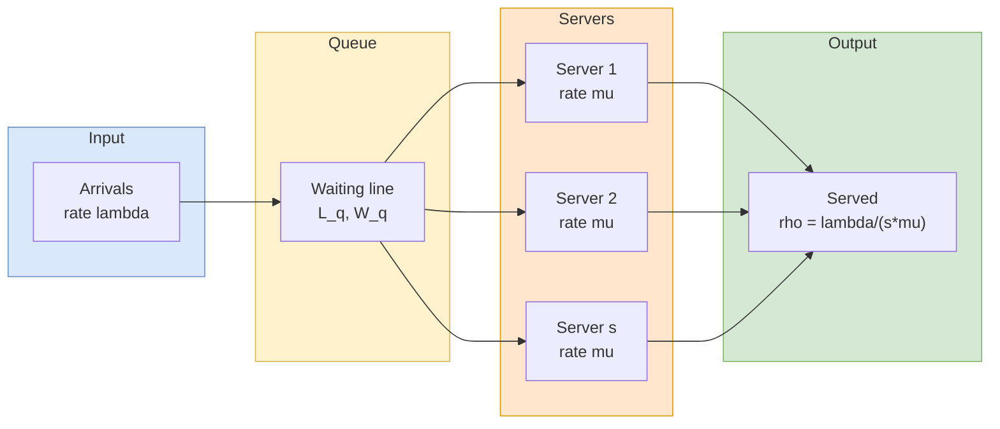

## 概述

排隊理論是分析等候線系統的數學框架，以隨機過程為基礎，預測顧客等待時間（W、Wq）、佇列長度（L、Lq）及伺服器利用率（ρ）等穩態績效指標。模型以 Kendall 符號 A/B/s 分類：M/M/1 為單伺服器泊松到達指數服務模型，M/M/s 擴展至多伺服器共享佇列，M/D/1 則採用確定性服務時間，其佇列長度僅為 M/M/1 的一半，直接量化了消除服務時間變異性的效益。排隊理論的核心洞見在於：即使平均利用率低於 100%，到達與服務的隨機變異仍會在高利用率下造成嚴重擁塞，M/M/1 公式 L = ρ/(1−ρ) 清楚顯示利用率趨近 1 時等候量呈非線性爆增。資源池化（pooling）是排隊理論最重要的管理含義之一：將多條獨立佇列合併為單一多伺服器佇列，在不增加總產能的情況下大幅縮短等待時間。所有排隊指標均由 Little's Law（L = λW）相互連結，構成一致性驗證的基礎；而等候的心理因素（Maister 八原則）則補充了純數學分析所無法涵蓋的顧客感知面向。

## Overview

**Queueing theory** provides mathematical models for systems where customers (or jobs, packets, etc.) arrive randomly, wait if necessary, and then receive service. The core challenge is that both arrival patterns and service times are stochastic, leading to congestion even when average capacity exceeds average demand.

Two distinct kinds of waiting arise in practice:

1. **Predictable waiting** — occurs when expected demand exceeds expected supply rate. Lines form because utilization >= 100%; this is a **capacity problem** that must be solved by adding resources or shifting demand.
2. **Unpredictable waiting** — occurs even when utilization is **below** 100%, purely due to variability in arrival and service processes. This is a **variability problem** solved by queue design, pooling, and service-time standardization.

The total flow time experienced by a customer equals waiting time plus service time: $W = W_q + 1/\mu$. The interarrival time and service time in classical models are modeled as **exponential** random variables; equivalently, the number of arrivals per unit time follows a **Poisson** distribution (memoryless property). "M" in Kendall notation stands for **Markovian/memoryless**.

Queueing models predict steady-state performance metrics:
- $L$ -- average number in the system
- $L_q$ -- average number waiting in the queue
- $W$ -- average time in the system
- $W_q$ -- average waiting time in the queue
- $\rho$ (rho) -- server utilization $= \frac{\lambda}{s\mu}$
- $P_0$ -- probability the system is empty

All these metrics are connected by [[littles-law|Little's Law]]: $L = \lambda W$ and $L_q = \lambda W_q$.

## Queue Configuration Flow

## Kendall Notation

Queueing models are classified using **Kendall notation** A/B/s(/K/N):

| Symbol | Meaning | Common Values |
|--------|---------|---------------|
| A | Arrival distribution | M (Markovian/Poisson), D (Deterministic), G (General) |
| B | Service distribution | M, D, G |
| s | Number of servers | 1, 2, ..., c |
| K | System capacity | (omitted if infinite) |
| N | Population size | (omitted if infinite) |

## M/M/1 Model

The simplest and most fundamental queueing model: single server, Poisson arrivals at rate $\lambda$, exponential service times at rate $\mu$.

**Stability condition**: $\rho = \frac{\lambda}{\mu} < 1$

**Performance formulas**:

| Metric | Formula |
|--------|---------|
| Utilization | $\rho = \frac{\lambda}{\mu}$ |
| Avg number in system | $L = \frac{\rho}{1-\rho} = \frac{\lambda}{\mu-\lambda}$ |
| Avg number in queue | $L_q = \frac{\rho^2}{1-\rho} = \frac{\lambda^2}{\mu(\mu-\lambda)}$ |
| Avg time in system | $W = \frac{1}{\mu-\lambda}$ |
| Avg wait in queue | $W_q = \frac{\lambda}{\mu(\mu-\lambda)} = \frac{\rho}{\mu-\lambda}$ |
| Prob of n in system | $P_n = (1-\rho)\rho^n$ |
| Prob of empty system | $P_0 = 1-\rho$ |

**Example (Pizza Hut single lane)**: $\lambda = 20$ cars/hr, $\mu = 24$ cars/hr. Then $\rho = 0.833$, $L = 5$ cars, $W = 15$ min, $W_q = 12.5$ min.

**Example (Pizza Hut takeaway counter)**: $\lambda = 25$ customers/hr and service time = 2 min ($\mu = 30$/hr). Then $\rho = 25/30 = 0.833$, $L_q = \rho^2/(1-\rho) = 0.694/0.167 \approx 4.17$ customers, and $W_q \approx 10$ min. Even though the staff appears busy only ~83% of the time, the **average** arriving customer still waits 10 minutes — a direct consequence of variability compounding at high utilization.

### Behavior at High Utilization

As $\rho$ approaches 1.0, performance degrades nonlinearly. The relationship $L = \frac{\rho}{1-\rho}$ means:

- At $\rho = 0.5$: $L = 1$ customer
- At $\rho = 0.8$: $L = 4$ customers
- At $\rho = 0.9$: $L = 9$ customers
- At $\rho = 0.95$: $L = 19$ customers

This exponential growth in congestion is a key insight: maintaining high utilization (above ~85%) causes severe waiting times.

## M/M/s Model (Multiple Servers)

Extends M/M/1 to **s identical servers** sharing a single queue. All customers wait in one line and proceed to the first available server.

**Stability condition**: $\rho = \frac{\lambda}{s\mu} < 1$

**Key formulas**:

The probability of an empty system $P_0$ is computed as:

$$P_0 = \left[\sum_{n=0}^{s-1} \frac{(\lambda/\mu)^n}{n!} + \frac{(\lambda/\mu)^s}{s!(1-\rho)}\right]^{-1}$$

The probability that an arriving customer must wait (all servers busy):

$$P_w = \frac{(\lambda/\mu)^s}{s!(1-\rho)} \times P_0$$

Then:
- $L_q = P_w \cdot \frac{\rho}{1-\rho}$
- $W_q = \frac{L_q}{\lambda}$
- $W = W_q + \frac{1}{\mu}$
- $L = \lambda W$

**Example (Pizza Hut two lanes)**: $\lambda = 20$ cars/hr, $s = 2$, $\mu = 24$ cars/hr per server. $\rho = \frac{20}{2 \times 24} = 0.417$. $W_q$ drops from 12.5 min to only 0.75 min -- a dramatic improvement from the pooling effect.

## Pooling Effect

Consolidating multiple separate single-server queues into one multi-server queue with the same total capacity yields significantly better performance. This is because:

1. **Idle capacity is shared**: If one server is idle while another has a queue, the idle server can absorb excess demand.
2. **Variability is absorbed**: Statistical averaging smooths out random fluctuations.
3. **The benefit is nonlinear**: The greatest improvement comes when merging the first few servers; returns diminish as s grows large.

This has direct managerial implications: a single queue feeding multiple tellers (bank model) outperforms multiple separate queues (traditional supermarket model).

### Pizza Hut Pooling Example

Two side-by-side drive-through lanes, each M/M/1 with $\lambda = 10$ cars/hr and $\mu = 24$ cars/hr, produce $\rho = 0.417$ and $W_q \approx 1.24$ min per lane. Merging them into a single M/M/2 with $\lambda = 20$ and $\mu = 24$ per server gives the same $\rho = 0.417$ but $W_q \approx 0.75$ min — a 40% reduction achieved without adding any capacity. At heavier loads, the improvement grows dramatically: comparing two M/M/1 systems at $\rho = 0.833$ ($W_q = 12.5$ min each) to a single M/M/2 at the same utilization, the pooled system yields $W_q \approx 2.2$ min, a nearly six-fold improvement.

## M/D/1 Model

When service time is **constant** (deterministic) rather than exponential:

- $L_q = \frac{\rho^2}{2(1-\rho)}$ -- exactly **half** the queue length of M/M/1
- $W_q = \frac{\rho}{2\mu(1-\rho)}$

The factor-of-two reduction occurs because removing variability from service times eliminates half the congestion. This motivates standardizing service processes where possible.

## M/M/c/K Model (Finite Capacity)

When the system can hold at most K customers (including those in service):
- Customers arriving when K are present are turned away (balking).
- The effective arrival rate is less than λ because some arrivals are lost.
- P_0 and P_n use modified formulas with a finite geometric sum.

This model applies to physical systems with limited waiting room (e.g., a parking lot with fixed spaces, a call center with limited hold slots).

## Limited Population Models

When the calling population is finite (N customers), arrival rates depend on the system state:
- If $n$ customers are in the system, arrival rate $= (N-n)\lambda$.
- As more units enter the system for service, fewer remain to generate new arrivals.

Applications include machine repair shops (N machines, each breaks down at rate λ; a finite pool of repair technicians serves them).

## Design Trade-offs

Queueing analysis supports key operational decisions:

| Decision | Trade-off |
|----------|-----------|
| Number of servers (s) | Cost of additional servers vs. reduced waiting |
| Service rate (μ) | Investment in faster processing vs. diminishing returns |
| Queue discipline | Fairness (FIFO) vs. efficiency (priority rules) |
| System capacity (K) | Space/cost vs. customer loss rate |

The goal is typically to find the minimum cost configuration that meets a service level target (e.g., average wait < 5 minutes, or probability of waiting < 10%).

## Psychology of Waiting

Even rigorous queueing math does not resolve the fact that customers care more about **perceived** wait time than actual wait time. Eight principles from David Maister (covered in the EEMT5520 waiting psychology module) guide queue design:

1. **Unoccupied time feels longer than occupied time** — distraction (mirrors in elevators, menu boards, TVs) shrinks perceived wait.
2. **Pre-process waiting feels longer than in-process waiting** — Starbucks baristas take orders immediately to signal that service has begun.
3. **Anxiety makes waits feel longer** — explicit reassurance ("I'll be back in 5 min") reduces stress.
4. **Uncertain waits feel longer than known, finite waits** — theme parks post expected wait times at queue checkpoints.
5. **Unexplained waits feel longer than explained waits** — airline delay announcements outperform silence.
6. **Unfair waits feel longer than equitable waits** — FIFO discipline is expected; exceptions (ER triage, Cathay Pacific premium check-in) must be visibly justified.
7. **Solo waits feel longer than group waits** — social interaction absorbs time.
8. **The more valuable the service, the longer people will wait** — iPhone launches vs. toothbrushes.

These behavioral levers complement — but do not replace — analytical queue design. The optimal combination is often to reduce actual $W_q$ with M/M/s analysis **and** reshape perception with environmental and communication design.

## Case Study: Fat Angelo's Waiting-Line Analysis

The Fat Angelo's Tsuen Wan location (26 tables, ~100 covers) illustrates **deterministic waiting-line analysis** when Poisson assumptions do not cleanly apply but arrival and departure counts are directly observable. From the case worksheet, parties arrive in a 15-minute bucket pattern peaking between 8:00 and 8:45 pm (10 and 12 parties arriving per quarter-hour). Average party size is 3.5 and average service cycle is 90 minutes, so at full occupancy one table frees every $90 / 26 = 3.5$ minutes.

The worksheet computes, per 15-minute window:

- $X$ = cumulative arrivals − cumulative departures (parties either dining or waiting)
- $Y = \min(X, 26)$ = tables actually used
- $Z = X - Y$ = parties waiting at period end
- Max expected wait $= Z \times 3.5$ minutes

Running the totals through the peak: by 8:30-8:45 pm, cumulative arrivals reach 53 and cumulative departures reach 13, giving $X = 40$ parties, $Z = 14$ waiting, max wait ≈ 49 minutes. Peak queue occurs at 8:45-9:00 pm with $X = 59 - 28 = 31$ and $Z = 5$ after tables begin freeing. Given that 40% of guests balk when the wait exceeds 30 minutes, roughly half of arrivals in the 7:45-9:00 pm window are at risk — the quantified case for early-bird discounting, Groupon off-peak diversion, and bar-based pre-process distraction (Maister principles 1, 2, and 4 above).

The lesson is that restaurants often face **deterministic oversubscription** (expected demand > capacity during a concentrated window) rather than M/M/s-style unpredictable waiting. Pooling more servers does not help when the dining room is the physical bottleneck; demand-shifting levers are the relevant response.

## Connection to Other Frameworks

- [[littles-law|Little's Law]] connects all queueing metrics: $L = \lambda W$.
- [[capacity-planning|Capacity planning]] determines if the system can be stable ($\rho < 1$); queueing theory quantifies congestion when it is.
- [[revenue-management|Revenue management]] uses queueing insights to manage demand for perishable capacity.
- [[newsvendor-problem|Newsvendor problem]] — both are single-period stochastic models, but newsvendor is about inventory (stock) while queueing is about flow (traffic).
- [[consumer-behavior|Consumer behavior]] — the psychology of waiting sits at the intersection of operations and consumer psychology, influencing repurchase intent and NPS.

## Related Concepts

- [[littles-law|Little's Law]]
- [[capacity-planning|Capacity Planning]]
- [[newsvendor-problem|Newsvendor Problem]]
- [[revenue-management|Revenue Management]]
- [[wiki/mocs/operations-research|Operations Research MOC]] — Part of the OR PhD reading spine (Queueing and Stochastic Service Systems)

## Source Materials

- [[wiki/sources/courses/service-ops|EEMT5520 Service Operations Management]]
- Queueing Models (Textbook)
- M/M/s Queueing Model Slides
