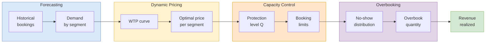

## 概述

收益管理（Revenue Management，又稱 Yield Management）是在產能固定且易逝的前提下，透過動態定價、產能控制與超額預訂三大策略將收益最大化的管理方法。其適用條件包括：產能無法儲存（空位即損失）、需求可依支付意願分層、預訂在消費前發生，以及需求具不確定性需透過預測管理。核心數學工具與報童問題完全一致：保護高票價座位的最優保護水平 Q* 由 F(Q*) = (f₁−f₂)/f₁ 決定，即報童臨界比率的直接應用；超額預訂量則以 Co（趕客賠償）> Cu（空位損失）的不對稱結構求解，導致最優超額預訂量通常低於預期缺席數。在多票價等級情境下，採用嵌套預訂限制（nested booking limits）逐對計算保護水平。此概念源自 1970 年代美國航空業管制鬆綁，現已擴展至酒店（需求控制圖）、租車、零售（Amazon 動態定價）及貨運產能（如 Cathay Pacific 貨運站案例），是運籌學與管理科學中定價理論與隨機庫存論的交匯點。

## Overview

**Revenue management** (also called **yield management**) is the practice of maximizing revenue from a fixed, perishable capacity by selling the right product to the right customer at the right time for the right price. It originated in the airline industry following deregulation in the late 1970s and has since spread to hotels, car rentals, entertainment, and other industries with similar characteristics.

Revenue management is applicable when:
- Capacity is **fixed and perishable** (unsold seats/rooms cannot be stored)
- Demand is **segmentable** (different customers have different willingness to pay)
- Products are **sold in advance** (booking occurs before consumption)
- **Demand is uncertain** (forecasting is necessary but imperfect)

## Strategic Framework

Revenue management operates at two levels:

### Dynamic Pricing (Strategic)

Dynamic pricing makes price a **management control variable** rather than a fixed parameter:

- **Market segmentation**: Set different prices for different customer segments based on willingness to pay (WTP). WTP is determined by customer characteristics (income, time sensitivity), product features (quality, brand), and availability of substitutes.
- **Forecasting**: Predict demand curves and booking patterns to set prices that maximize revenue = price x min(demand, capacity).
- **Optimization**: Find the price point that maximizes total revenue. With a single price, this means finding the price where the downward-sloping demand curve intersects marginal revenue = 0.

**Example (Textbook pricing)**: With WTP distribution ranging from \$20 to \$80, a single price of \$40 maximizes revenue at \$3,360 (84 customers × \$40). Market segmentation (charging each segment its WTP) would capture additional consumer surplus.

| Price | Frequency at WTP | Cumulative demand | Revenue |
|------:|-----------------:|------------------:|--------:|
| \$80  | 10 | 10 | \$800 |
| \$70  | 12 | 22 | \$1,540 |
| \$60  | 14 | 36 | \$2,160 |
| \$50  | 28 | 64 | \$3,200 |
| **\$40**  | **20** | **84** | **\$3,360** |
| \$30  | 10 | 94 | \$2,820 |
| \$20  | 6  | 100 | \$2,000 |

The revenue-maximizing uniform price is \$40. A first-degree price-discrimination strategy (charging each customer exactly their WTP) would yield \$5,320, a 58% lift — which is why airlines and hotels invest heavily in segmentation proxies (advance-purchase windows, Saturday-night stays, refundability, loyalty tier).

**Industry practice**: Amazon.com dynamically adjusts textbook prices -- the "Matching Supply and Demand" textbook ranged from $97.53 to $273.00 over a 6-year period.

### Yield Management (Tactical)

Yield management encompasses the operational decisions:

- **Overbooking** -- accepting more reservations than capacity to compensate for no-shows and cancellations.
- **Capacity control** -- limiting availability of discounted fares to protect capacity for higher-paying customers who book later.

## Capacity Control

Capacity control determines how to allocate limited capacity across fare classes. The key question: how many units to **protect** (reserve) for high-fare customers?

### Two-Class Protection Level

Consider an airline with capacity $C$, two fare classes (full fare $f_1$, discount fare $f_2$ where $f_1 > f_2$), and uncertain full-fare demand $D$:

The **protection level $Q$** determines how many seats are reserved for full-fare passengers. The remaining $C - Q$ seats are sold at discount prices.

Using marginal analysis (identical to the [[newsvendor-problem|newsvendor framework]]):

- **Expected cost of protecting too many** (demand doesn't materialize): $C_o \times F(Q)$, where $C_o = f_2$ (the discount fare revenue forgone by holding an empty seat).
- **Expected cost of protecting too few** (turning away full-fare passenger): $C_u \times (1 - F(Q))$, where $C_u = f_1 - f_2$ (the revenue difference).

Continue increasing protection level until:

$$F(Q) = \frac{C_u}{C_u + C_o} = \frac{f_1 - f_2}{f_1}$$

Then $Q^* = \mu + z\sigma$ where $z$ corresponds to this critical ratio.

### Example: Hong Kong to London Flight

- Capacity: 335 seats
- Full fare $f_1 = \$7{,}950$, Discount fare $f_2 = \$5{,}250$
- Full-fare demand $\sim N(\mu=25, \sigma=5)$
- $C_u = 7{,}950 - 5{,}250 = \$2{,}700$
- $C_o = \$5{,}250$ (the discount revenue lost if seat is held but full-fare customer doesn't appear)
- Critical factor $= \frac{2{,}700}{2{,}700 + 5{,}250} = 0.3396$
- From normal table: $z = -0.41$
- $Q^* = 25 + (-0.41)(5) = 22.95 \approx$ **23 seats** protected for full fare
- Booking limit for discount class $= 335 - 23 = 312$ seats

### Multiple Fare Classes

With $n$ fare classes where $f_1 > f_2 > \cdots > f_n$, the solution uses **nested booking limits**:
- Each higher fare class has access to capacity allocated to all lower classes.
- Protection levels are calculated pairwise between adjacent classes.
- This creates a nested structure where booking limits telescope outward.

### Decision Tree Approach

The same result can be derived using a decision tree:
- Decision node: increase protection level from Q to Q+1?
- If yes and demand materializes (probability $1-F(Q)$): gain full fare \$7,950
- If yes and demand doesn't (probability $F(Q)$): gain \$0 (seat empty)
- Expected value $= (1-F(Q)) \times \$7{,}950$
- Compare against certain discount revenue of \$5,250
- Continue as long as $(1-F(Q)) \times f_1 \geq f_2$

## Overbooking

Overbooking addresses the problem of **no-shows and cancellations** -- passengers who reserve but do not appear. Airlines, hotels, and restaurants routinely overbook because a fraction of reservations will not be honored.

### Approach 1: Average No-Shows

Simple method: overbook by the expected number of no-shows.
- $E(\text{no-shows}) = \sum n \cdot P(n \text{ no-shows})$
- Overbooking quantity = round(E(no-shows))

**Limitation**: This ignores the cost asymmetry between under- and over-overbooking.

### Overbooking No-Show Distribution (Course Example)

| # No-shows | 0 | 1 | 2 | 3 | 4 | 5 | 6 | 7 | 8 | 9 | 10 |
|------------|---|---|---|---|---|---|---|---|---|---|----|
| P          | .05 | .10 | .20 | .15 | .15 | .10 | .05 | .05 | .05 | .05 | .05 |
| Cum P      | .05 | .15 | .35 | .50 | .65 | .75 | .80 | .85 | .90 | .95 | 1.00 |

**Expected no-shows** = $0(.05) + 1(.10) + 2(.20) + 3(.15) + 4(.15) + 5(.10) + 6(.05) + 7(.05) + 8(.05) + 9(.05) + 10(.05) = 4.05$. Naive overbooking = 4 seats.

### Approach 2: Marginal Analysis (Payoff Table)

More rigorous: use the newsvendor framework where:
- $C_u$ = cost of underestimating no-shows = ticket price (revenue from an extra seat that could have been sold) = e.g., \$50
- $C_o$ = cost of overestimating no-shows = denied boarding compensation (bumping cost) = e.g., \$120
- Critical ratio $= \frac{C_u}{C_u + C_o} = \frac{50}{50+120} = 0.294$

Build a payoff table: rows = actual no-shows (with probabilities), columns = number of overbooked reservations. Compute expected cost for each overbooking level; choose the level with minimum expected cost.

The key insight is that **$C_o > C_u$ for most overbooking decisions** -- the cost of bumping a passenger (compensation, goodwill, potential regulatory penalties) typically exceeds the cost of an empty seat. This pushes the critical ratio below 0.5, meaning the optimal overbooking quantity is **less than** the expected number of no-shows.

Applying the critical ratio $0.294$ to the cumulative no-show distribution above: find the smallest $q$ with $P(\text{no-shows} \leq q) \geq 0.294$, which gives $q = 2$. So the optimal overbooking quantity is **2 seats**, not the naive 4 — a direct result of the asymmetry ($C_o = \$120$ vs $C_u = \$50$). Ignoring this asymmetry would more than double denied-boarding incidents in expectation.

## Revenue Management Flow

## Industry Applications

### Hotels
Hotels use **demand control charts** with expected reservation accumulation curves and 2-standard-deviation control limits plotted against days-before-arrival. When actual reservations exceed the upper control limit early, the property raises rates; when they fall below the lower limit, it opens discount channels (e.g., Hotwire, last-minute apps).

### Airlines
Airlines maintain multiple fare codes (B, M, L, Q, T, V) within the same physical cabin class, allocating different percentages of capacity across seasons. The course illustrates **seasonal allocation** for a sample airline:

| Fare class | Peak (Summer) | Shoulder (Fall) | Off-peak (Winter) | Shoulder (Spring) |
|-----------|--------------:|----------------:|------------------:|------------------:|
| B/M (full)  | 30% | 20% | 20% | 20% |
| L/Q (mid)   | 60% | 50% | 30% | 50% |
| T/V (deep discount) | 10% | 30% | 50% | 30% |

Full-fare allocation peaks in summer when demand is strongest and leisure price sensitivity is lowest; deep-discount availability swells in winter to fill capacity.

### Retail
Dynamic pricing at Amazon and other e-commerce platforms adjusts prices in near-real-time based on demand signals, competitor pricing, and inventory levels. The course cites the "Matching Supply and Demand" textbook, whose Amazon price ranged from \$97.53 to \$273.00 over six years — a 2.8× spread driven entirely by forecasting and demand-curve updates.

### Cathay Pacific Cargo
The [[wiki/entities/hkust|HKUST]] Cathay Pacific case (Ronald Lau, Kenny Yiu, Gary Chung, 2014) shows revenue-management logic applied to air cargo terminal capacity: SuperTerminal 1 at Hong Kong International Airport reached its 2.6M-tonne ceiling, forcing Cathay to weigh a HK\$4.8B captive terminal build (20-year concession) against renewing its HACTL contract. The decision hinged on protecting priority capacity for time-sensitive cargo (pharma, perishables, high-value) — structurally equivalent to protecting full-fare seats.

## Related Concepts

- [[newsvendor-problem|Newsvendor Problem]]
- [[capacity-planning|Capacity Planning]]
- [[queueing-theory|Queueing Theory]]
- [[littles-law|Little's Law]]
- [[wiki/mocs/operations-research|Operations Research MOC]] — Part of the OR PhD reading spine (Revenue Management and Dynamic Pricing)

## Source Materials

- [[wiki/sources/courses/service-ops|EEMT5520 Service Operations Management]]
- Revenue Management Slides
- Yield Management (Textbook)
