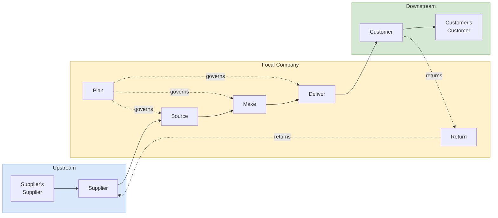

## 概述

供應鏈營運參考模型（SCOR）是由供應鏈協會（現為 APICS/ASCM）於1996年開發的標準化流程參考框架，將供應鏈從「供應商的供應商」到「客戶的客戶」的全鏈條活動劃分為計劃（Plan）、採購（Source）、製造（Make）、交付（Deliver）和退貨（Return）五大核心流程，並以啟用（Enable）流程提供管理基礎設施支撐。SCOR 的四層細化結構使其同時服務於戰略（L1：流程類型）、戰術（L2：流程類別，含按庫存生產/按訂單生產/工程訂單的配置選擇）、運營（L3：流程要素與最佳實踐）和執行（L4：企業自定義活動）四個決策層次，提供跨產業比較的共同語言。五大績效屬性（可靠性、響應性、敏捷性、成本、資產效率）各有對應 L1 指標：完美訂單率 = OnTime × InFull × DamageFree × AccurateDocs 的乘積（四個93-99%的強勁分項乘積仍僅得86.61%，揭示乘法公式的嚴苛性）；現金轉換周期 CCC = DIO + DSO - DPO（典型值 40+45-30=55天，但盲目縮短 CCC 可能惡化供應商關係或增加缺貨風險，須與填充率同步評估）。中國製藥案例量化了需求計劃技術的績效差異：Holt-Winters（MAD=325）顯著優於單指數平滑（MAD=825）和自適應平滑（MAD=1,014），說明捕捉趨勢與季節性的計劃工具是 SCOR Plan 流程的核心競爭力。「儀錶板勝於報表」是 SCOR 實施的關鍵原則：只維護5-6個頂層 KPI，每個指標必須可分解至負責人可直接影響的下層指標，避免40+指標產生的「分析癱瘓」——這與[[wiki/concepts/balanced-scorecard|BSC]]建議每視角4-7個指標的設計哲學高度一致。

## Core Framework

The **Supply Chain Operations Reference (SCOR) Model** is a process reference framework developed by the Supply Chain Council in 1996 (now part of APICS/ASCM, rebranded as the Association for Supply Chain Management). It provides a standardized vocabulary, process taxonomy, and performance metrics for describing, measuring, and improving supply chain operations. SCOR is organized around five core management processes that span the entire supply chain from supplier's supplier to customer's customer. It is a key framework in [[supply-chain-management|Supply Chain Management]] and is used in EEMT5560 at [[wiki/entities/hkust|HKUST]] to structure the Marco Business Simulation's functional decisions.

### The Five Core Processes

#### 1. Plan

The **Plan** process encompasses all activities related to demand-supply balancing and resource allocation:

- **Demand planning** -- Forecasting customer demand using techniques such as exponential smoothing, moving averages, and Holt-Winters methods (as demonstrated in the EEMT5560 Chinese Pharmaceuticals case, where Holt-Winters achieved the lowest MAD of 325)
- **Supply planning** -- Determining production capacity, inventory policies, and procurement schedules
- **Sales & Operations Planning (S&OP)** -- Cross-functional alignment of demand forecasts with production and financial plans
- **Inventory planning** -- Setting safety stock levels, reorder points, and replenishment frequencies. Key distinction: **inventory level** (physical stock on hand) vs. **inventory position** (level + units on order minus backorders)

#### 2. Source

The **Source** process covers procurement and supplier management:

- **Supplier selection** -- Evaluating and choosing suppliers based on multiple criteria (cost, quality, reliability, flexibility). Tools like [[ahp|AHP]] can structure the multi-criteria evaluation
- **Purchase order management** -- Regular and urgent purchasing. In the MBS simulation, urgent purchases incur a $1.50/unit premium
- **Receiving and verification** -- Incoming quality inspection and material acceptance
- **Raw material inventory management** -- Balancing holding costs against stockout risks

#### 3. Make

The **Make** process encompasses all production and manufacturing activities:

- **Production scheduling** -- Allocating capacity across products and markets. In MBS, this involves shift planning (1-3 shifts with overtime at 1.5x labor cost)
- **Manufacturing execution** -- Converting raw materials to finished goods with material conversion rates affecting actual output
- **Quality management** -- R&D investment impacts product quality and subsequently demand
- **Equipment management** -- Maintenance spending affects production efficiency (coefficient of material change)

#### 4. Deliver

The **Deliver** process manages order fulfillment and distribution:

- **Order management** -- Processing customer orders and allocating inventory
- **Warehouse management** -- Finished goods storage and handling
- **Transportation management** -- Logistics cost optimization across markets
- **Customer delivery** -- The "last mile" connecting production to consumption

#### 5. Return

The **Return** process handles reverse logistics:

- **Defective product returns** -- Managing returns from customers
- **Warranty and repair processes** -- Post-sale support
- **Recycling and disposal** -- End-of-life product management

### Enable

A sixth supporting process, **Enable**, provides the management infrastructure:

- Performance management and KPI tracking
- Information systems and data management
- Regulatory compliance
- Risk management

## SCOR Performance Attributes

SCOR defines five performance attributes, each with associated Level 1 metrics. The first three are **customer-facing** (what customers experience) and the last two are **internal** (how the company operates):

| Attribute | Orientation | Definition | Key Level-1 Metric |
|-----------|-------------|------------|--------------------|
| **Reliability** | Customer | Ability to perform tasks as expected | Perfect Order Fulfillment (%) |
| **Responsiveness** | Customer | Speed at which tasks are performed | Order Fulfillment Cycle Time (days) |
| **Agility** | Customer | Ability to respond to external changes | Upside/Downside Supply Chain Flexibility & Adaptability |
| **Cost** | Internal | Cost of operating supply chain processes | Total Supply Chain Management Cost (% of revenue) |
| **Asset Management** | Internal | Effectiveness of asset utilization | Cash-to-Cash Cycle Time, Return on Fixed Assets |

### The Six EEMT5560 Supply Chain KPIs

The course reading "Supply Chain Performance Dashboards" advocates a small, focused KPI dashboard -- modelled on an airliner's multi-function display -- with six metrics that collectively cover all five SCOR attributes:

1. **Perfect Order** (Reliability) -- Composite = OnTime% x InFull% x DamageFree% x AccurateDocs%. Example: $0.98 \times 0.93 \times 0.99 \times 0.96 = 0.8661$, i.e., **86.61%** perfect order. The multiplicative formula is unforgiving: four strong components easily yield a modest composite.
2. **Fill Rate** (Reliability) -- Order fill, line fill, and unit fill, measuring first-attempt delivery success at three granularities.
3. **Customer Order Cycle Time** (Responsiveness) -- Days from purchase order receipt to delivery completion.
4. **Cash-to-Cash Cycle Time** (Asset Management) -- $CCC = DIO + DSO - DPO$ where DIO = Days Inventory Outstanding, DSO = Days Sales Outstanding, DPO = Days Payable Outstanding. Lower is better because less working capital is tied up.
5. **Inventory Days of Supply** (Asset Management) -- Inventory on hand / average daily consumption.
6. **Total Supply Chain Management Cost as % of Sales** (Cost) -- The headline financial KPI for supply chain executives.

The reading emphasizes that **"paralysis by analysis"** is a real risk -- 40+ KPIs produce noise, not insight. Keep 5-6 top-level KPIs on the dashboard and track secondary metrics only as drill-down when anomalies appear. This echoes the [[balanced-scorecard|Balanced Scorecard]] guidance of 15-25 total measures across all perspectives.

### Worked KPI Numerics (from the Dashboard Reading)

The article runs two numeric examples that are reproduced in class:

- **Perfect Order composite**: OnTime $0.98 \times$ InFull $0.93 \times$ DamageFree $0.99 \times$ AccurateDocs $0.96 = 0.8661$, i.e. **86.61%**. Four components in the "very good" 93-99% range still multiply down to a disappointingly mid-80s top-line -- which is exactly the reason it is useful as a headline KPI. Teams often react by wanting to replace the multiplicative formula with an average; the course specifically warns against this because averaging hides the tail problem.
- **Cash-to-Cash Cycle Time**: $DIO + DSO - DPO = 40 + 45 - 30 = 55$ days. The reading cautions that "fixing" C2C by stretching DPO risks supplier relationships, and shrinking DIO risks stockouts -- so a lower number is not automatically better and must be read alongside fill rate and customer order cycle time.

### Cascading KPIs to Lower Tiers

The reading's most operational advice is that each cross-functional KPI on the multi-function display must **decompose into a small set of actionable lower-tier KPIs owned by a specific team**. Example from the article: Perfect Order cascades for the transport manager into (1) % units damaged in transit, (2) % POD documents accurately completed, (3) % shipments dispatched on time. TSCMC%S cascades into outbound delivery cost %, warehouse cost %, inbound freight %. The rule of thumb: *each KPI must be actionable by the person seeing it* -- if a team cannot influence the metric, it does not belong on their dashboard.

## SCOR Levels of Detail

SCOR operates at four levels of increasing specificity:

1. **Level 1 -- Process Types**: The five core processes (Plan, Source, Make, Deliver, Return). Defines scope and strategic performance targets.
2. **Level 2 -- Process Categories**: Distinguishes between make-to-stock, make-to-order, and engineer-to-order configurations. Defines the supply chain's operational strategy.
3. **Level 3 -- Process Elements**: Detailed process flow definitions with inputs, outputs, and associated metrics. This is where best practices and capabilities are defined.
4. **Level 4 -- Implementation**: Company-specific activities. Not standardized by SCOR; each organization defines its own procedures.

## Application to Business Simulation

The MBS (Marco Business Simulation) used in EEMT5560 directly mirrors SCOR processes:

- **Plan**: Demand forecasting, S&OP coordination, production capacity planning
- **Source**: Raw material purchasing decisions, supplier management, inventory management
- **Make**: Production quantity allocation, shift scheduling, equipment and maintenance investment
- **Deliver**: Multi-market distribution, logistics cost management
- **Performance metrics**: Financial statements, DuPont analysis, departmental KPIs, and breakeven analysis all serve as SCOR-aligned performance measurement

## Industry Applications

- **Manufacturing**: End-to-end process mapping, supplier performance benchmarking
- **Retail**: Demand-driven replenishment, omnichannel fulfillment optimization
- **Healthcare**: Medical supply chain standardization, hospital procurement improvement
- **Automotive**: Tier-1/Tier-2 supplier coordination, just-in-time delivery management

## Strengths and Limitations

**Strengths**:
- Provides a common language across industries and organizations
- Hierarchical structure allows both strategic and operational views
- Built-in benchmarking through standardized metrics
- Supports both process improvement and supply chain redesign

**Limitations**:
- Does not cover sales and marketing, product development, or post-delivery customer support in depth
- Can be overly complex for small organizations
- Implementation requires significant effort in process mapping and data collection
- The model is descriptive, not prescriptive -- it tells you what to measure but not how to fix problems

## Chinese Pharmaceuticals Case: SCOR in Practice

The EEMT5560 Chinese Pharmaceuticals case applies SCOR thinking to a Hong Kong notoginseng (田七) distributor sourcing super-fine powder from Yunnan suppliers. The supply chain spans:

- **Source**: 4-6 week lead time from Yunnan supplier to HK warehouse, plus 7-9 days quality testing.
- **Make**: 8 weeks at contract manufacturer in Hong Kong converting raw powder to finished notoginseng products.
- **Deliver**: Distribution to retail outlets in Hong Kong and Macau.
- **Plan**: Monthly reordering cadence driven by exponential-smoothing forecasts.

The case illustrates why demand planning matters. Students compare forecasting techniques by Mean Absolute Deviation (MAD):

| Method | MAD | Comment |
|--------|-----|---------|
| Simple exponential smoothing ($\alpha = 0.4$) | 825 | Default; ignores trend and seasonality |
| Optimized $\alpha$ (Solver, $\alpha = 1.0$) | 479 | Degenerates to "last period equals forecast" |
| Adaptive smoothing ($\alpha_{t+1} = |$ percent error $|_t$) | 1,014 | Worse because reactive $\alpha$ amplifies noise |
| **Holt-Winters (trend + seasonality)** | **325** | Best -- captures the slight upward trend and seasonal fluctuation in the raw sales data |

The case also introduces **forecast-driven replenishment with 2-month lead time** plus a 20% buffer for customer gifts. It distinguishes **inventory level** (on-hand minus backorders) from **inventory position** (level plus on-order) -- a crucial distinction for any reorder-point policy in the Plan process.

## Related Concepts

- [[supply-chain-management|Supply Chain Management]] -- The broader discipline that SCOR systematizes with a common process taxonomy.
- [[wiki/concepts/logistics-and-transportation|Logistics and Transportation]] -- The Deliver and Return processes in SCOR directly map to freight and logistics execution.
- [[Data Envelopment Analysis (DEA)|Data Envelopment Analysis]] -- Can use SCOR Level-1 metrics as DEA inputs/outputs for benchmarking supply chain efficiency across units.
- [[balanced-scorecard|Balanced Scorecard]] -- Complementary framework; BSC provides the strategic perspective while SCOR provides operational detail. SCOR's Cost and Asset Management attributes feed directly into the BSC Financial Perspective.
- [[erp|ERP]] -- Enterprise systems (SAP IBP, Oracle SCM Cloud, Blue Yonder) that implement SCOR-aligned process workflows.
- [[capacity-planning|Capacity Planning]] -- A key element within SCOR's Plan and Make processes.
- [[ahp|Analytic Hierarchy Process]] -- Used to weight SCOR performance attributes when a composite supply chain score is needed.
- [[newsvendor-problem|Newsvendor Problem]] -- Informs inventory policies inside the SCOR Plan process for perishable or single-period items.
- [[littles-law|Little's Law]] -- Relates inventory, throughput, and flow time in Deliver and Make processes.
- [[arma-models|ARMA Models]] -- Time-series forecasting tools applicable to SCOR demand planning beyond basic exponential smoothing.
- [[linear-regression|Linear Regression]] -- Alternative demand forecasting method; Holt-Winters is preferred when seasonality is present.
- [[porters-five-forces|Porter's Five Forces]] -- The Source process is shaped by supplier bargaining power.
- [[wiki/mocs/operations-research|Operations Research MOC]] — Part of the OR PhD reading spine (Inventory Theory and Supply Chain)

## Source Materials

- EEMT5560 Lecture 01: IPX Introduction
- EEMT5560 Lecture 05: Chinese Pharmaceuticals
- Reading: Supply Chain Performance Dashboards
- Case Study: Chinese Pharmaceuticals
- [[wiki/sources/courses/integrated-business|EEMT5560 Integrated Business Solutions]]
