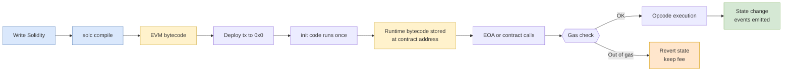

## 概述

智能合約是部署在區塊鏈上的自動執行程式，當預設條件滿足時自動執行合約條款，無需中介機構介入——這一概念由 Nick Szabo 於1994年提出，並在2015年以太坊啟動後成為現實。以太坊虛擬機（EVM）是一個基於棧的256位圖靈完備執行環境，透過 Gas 機制（每個操作碼皆有固定 Gas 成本）將圖靈停機問題轉化為經濟約束：無限迴圈耗盡 Gas 後自動回滾而非卡死網絡，其中 SSTORE 操作的20,000 Gas 成本比算術操作昂貴6,000倍以上，使合約設計必須嚴格優化持久化存儲的使用。EVM 的全局狀態轉移函數 $\sigma' = \Upsilon(\sigma, T)$ 保證了確定性與可複現性，而 Solidity 等高級語言將業務邏輯編譯為 EVM 字節碼，支援 ERC-20（可替代代幣）、ERC-721（NFT）及 ERC-4626（收益金庫）等標準化接口，構成[[defi|DeFi]]生態的可組合積木。安全性是智能合約的核心挑戰：Luu et al. (2016) 對19,366份已部署合約的分析發現約45%含有漏洞，重入攻擊（The DAO事件，2016年，約6,000萬美元損失）、整數溢出、預言機操縱及訪問控制缺陷是主要漏洞類別，需透過「檢查-效果-互動」模式、形式化驗證（Certora、K框架）及 OpenZeppelin 標準庫加以防禦。智能合約的不可篡改性是雙刃劍：它保證了無信任執行，卻使錯誤修復必須依賴代理模式（UUPS、Diamond）或遷移，因此保守工程設計與事前審計是高價值合約的剛性要求。

## Definition and Origins

A **smart contract** is a program stored on a blockchain that automatically executes when predetermined conditions are met. The concept was first proposed by **Nick Szabo** in 1994, who described it as "a computerized transaction protocol that executes the terms of a contract." Practical implementation became possible only with Ethereum's launch in 2015. Unlike Bitcoin's intentionally limited scripting language, Ethereum was designed from the ground up to support arbitrary, Turing-complete computation on-chain — enabling what Vitalik Buterin called a "cryptographically secure transactional singleton machine with shared-state."

Smart contracts eliminate the need for trusted intermediaries by encoding agreement terms directly in code. Once deployed, the contract's behavior is deterministic and immutable — it executes exactly as written, verifiable by every node in the network. This property enables **trustless coordination** among parties who may not know or trust each other, and it replaces notarization, escrow, and clearing functions with code.

## Bitcoin Script vs Ethereum: Motivation

Bitcoin Script is intentionally restricted. The EEMT6000H course enumerates five limitations that directly motivate Ethereum:

1. **Lack of Turing-completeness**: No loops; complex transactions impossible.
2. **Lack of state**: UTXOs are binary (spent / unspent) — no multi-stage stateful scripts.
3. **Blockchain-blindness**: Scripts cannot read the nonce or previous block hash.
4. **Block size cap**: Bitcoin blocks are capped at 1 MB, constraining complex transactions.
5. **Value-blindness**: Scripts cannot exert fine-grained control over amounts.

Ethereum addresses all five: it is Turing-complete, maintains persistent state, exposes block metadata via opcodes (`BLOCKHASH`, `TIMESTAMP`), raises gas-based block sizing, and gives contracts full arithmetic over balances.

## Ethereum Virtual Machine (EVM)

The **Ethereum Virtual Machine (EVM)** is the runtime environment for smart contracts. It is a **stack-based, 256-bit virtual machine** that executes compiled bytecode. Key characteristics:

- **Turing-complete**: Supports loops, conditionals, and arbitrary state manipulation.
- **Deterministic**: Given identical state and input, every node produces identical output — essential for consensus.
- **Isolated / sandboxed**: Each contract executes in its own environment; contracts interact only through message calls, not shared memory.
- **Account-based state model**: Ethereum maintains a global state tree mapping addresses to account states (balance, nonce, storage root, code hash). This contrasts with Bitcoin's stateless UTXO model.

Two account types exist:

| Field | Externally Owned Account (EOA) | Contract Account |
|---|---|---|
| Controlled by | Private key (ECDSA on secp256k1) | Deployed bytecode |
| Initiates transactions | Yes | No (reacts to calls) |
| Persistent storage | No | Yes (Merkle Patricia trie) |
| `codeHash` | `keccak256("")` | Hash of deployed bytecode |

### EVM State Transition

The EVM is formally a state transition function:

$$\sigma' = \Upsilon(\sigma, T)$$

where $\sigma$ is the world state, $T$ is a transaction, and $\Upsilon$ is the EVM execution function. At each opcode the execution environment is the 8-tuple `(block_state, gas, memory, transaction, message, code, stack, pc)`. Access is split across three memory regions: the **stack** (LIFO, up to 1024 elements of 256 bits), **memory** (byte-addressable, expansible), and **long-term storage** (persistent key/value, 32-byte slots).

### EVM Opcodes

The EVM defines ~140 opcodes covering arithmetic (`ADD`, `MUL`, `SUB`, `DIV`, `MOD`, `EXP`), comparison/logic (`LT`, `GT`, `EQ`, `AND`, `OR`, `XOR`, `NOT`), cryptographic operations (`SHA3` / `KECCAK256`), environment queries (`CALLER`, `CALLVALUE`, `GASPRICE`, `BLOCKHASH`, `TIMESTAMP`), storage (`SLOAD`, `SSTORE`, `MLOAD`, `MSTORE`), control flow (`JUMP`, `JUMPI`, `PC`), and system operations (`CALL`, `DELEGATECALL`, `STATICCALL`, `CREATE`, `CREATE2`, `SELFDESTRUCT`, `RETURN`, `REVERT`). Each opcode has a defined gas cost reflecting its computational and storage expense.

## Gas Mechanism

The **gas mechanism** is Ethereum's solution to the **halting problem** — the impossibility of determining in advance whether an arbitrary program will terminate (Turing 1936). Rather than solving it computationally, Ethereum solves it economically: every operation costs gas, and every transaction has a finite gas budget.

| Parameter | Description |
|---|---|
| `gas limit` (startgas) | Maximum gas units the sender is willing to consume |
| `gas price` | Wei per gas unit the sender is willing to pay |
| `max fee` | `gas limit × gas price` = maximum transaction cost (in wei) |
| `gas used` | Actual gas consumed during execution |
| `refund` | `(gas limit − gas used) × gas price` returned to sender |

At transaction start, `startgas × gasprice` wei are deducted. If execution exceeds `gas limit`, the transaction **reverts** — all state changes are rolled back, but the gas fee is still consumed. This prevents DoS via infinite loops while ensuring miners / validators are compensated for computation actually performed.

**Representative gas costs** (pre-EIP-1559):

| Opcode / operation | Gas |
|---|---|
| `ADD`, `SUB`, `NOT`, `LT`, `GT`, `EQ` | 3 |
| `MUL`, `DIV`, `MOD` | 5 |
| `EXP` (base) | 10 + 50/byte |
| `SHA3` / `KECCAK256` | 30 + 6 per 32-byte word |
| `SLOAD` | 200 |
| `SSTORE` (new non-zero) | 20,000 |
| `SSTORE` (clear to zero) | 5,000 + 15,000 refund |
| `CALL` (base) | 700 |
| `CREATE` | 32,000 |
| `LOG0` (+ topics) | 375 + 375/topic + 8/byte data |
| Tx base | 21,000 |
| Tx data byte (non-zero) | 68 |

Storage is by far the most expensive operation. Smart contract optimization often focuses on minimizing `SSTORE` calls, packing state variables into single 32-byte slots, and using `memory` or `calldata` instead of persistent `storage`. The `SELFDESTRUCT` refund and storage clearing refund further incentivize garbage collection of unused state.

### Ether Denominations

Ether uses an 18-decimal system. $1~\text{Ether} = 10^{18}~\text{wei}$. Key denominations:

| Unit | Wei | Ether |
|---|---|---|
| wei | 1 | $10^{-18}$ |
| Gwei (nano-ether) | $10^{9}$ | $10^{-9}$ |
| Szabo (micro-ether) | $10^{12}$ | $10^{-6}$ |
| Finney (milli-ether) | $10^{15}$ | $10^{-3}$ |
| Ether | $10^{18}$ | 1 |

Gas prices are typically quoted in **Gwei** (e.g., 20 Gwei per gas unit during normal load, 100-500+ Gwei during congestion).

## Smart Contract Lifecycle



## Solidity Programming

**Solidity** is the primary high-level language for Ethereum smart contracts. It is statically typed, supports inheritance, libraries, and complex user-defined types. Solidity compiles to EVM bytecode via `solc`. A minimal example:

```solidity
// SPDX-License-Identifier: GPL-3.0
pragma solidity ^0.8.0;

contract HelloWorld {
    function helloWorld() public pure returns (string memory) {
        return "Hello, World!";
    }
}
```

### Minimum Viable Token

A stripped-down fungible token contract illustrates state, events, and access:

```solidity
contract AppToken {
    mapping(address => uint256) public balanceOf;
    event Transfer(address indexed from, address indexed to, uint256 value);

    constructor(uint256 initialSupply) {
        balanceOf[msg.sender] = initialSupply;
    }

    function transfer(address to, uint256 value) public returns (bool) {
        require(balanceOf[msg.sender] >= value, "insufficient");
        require(balanceOf[to] + value >= balanceOf[to], "overflow");
        balanceOf[msg.sender] -= value;
        balanceOf[to] += value;
        emit Transfer(msg.sender, to, value);
        return true;
    }
}
```

Key language features relevant to blockchain development:

- **State variables**: Stored permanently in contract storage (expensive — each 32-byte slot costs 20,000 gas to initialize).
- **Function visibility**: `public`, `private`, `internal`, `external`. `external` is cheaper than `public` for calls from outside because arguments read from `calldata` instead of being copied to `memory`.
- **Modifiers**: Reusable conditions (e.g., `onlyOwner`) applied to functions for access control.
- **Events**: Logged on-chain for off-chain monitoring. Cheaper than storage — events use log opcodes (`LOG0`–`LOG4`).
- **Mappings**: `mapping(K => V)` — primary keyed data structure, O(1) lookup, non-iterable.
- **`payable` / `receive()` / `fallback()`**: Special functions that let a contract accept ether. `receive()` runs on plain ether transfers with no calldata; `fallback()` runs on unknown function selectors. With only 2300 gas forwarded via `.transfer()` / `.send()`, these can only perform minimal logging.
- **Anti-replay `nonce`**: Every EOA has a nonce incremented per transaction, preventing replays.

Other EVM languages: **Vyper** (Python-like, emphasizing simplicity and auditability — no inheritance, modifiers, inline assembly, or recursion; goal is a precise gas upper bound per call) and **Yul** (low-level intermediate language for manual optimization).

## Token Standards

Smart contracts enable **tokenization** — representing assets, rights, or utility as on-chain tokens. The two foundational standards:

### ERC-20 (Fungible Tokens)

The **ERC-20** standard defines an interface for fungible tokens — every unit is interchangeable. Required functions:

```solidity
function totalSupply() external view returns (uint256);
function balanceOf(address account) external view returns (uint256);
function transfer(address to, uint256 amount) external returns (bool);
function approve(address spender, uint256 amount) external returns (bool);
function allowance(address owner, address spender) external view returns (uint256);
function transferFrom(address from, address to, uint256 amount) external returns (bool);

event Transfer(address indexed from, address indexed to, uint256 value);
event Approval(address indexed owner, address indexed spender, uint256 value);
```

ERC-20 tokens power stablecoins (USDT, USDC, DAI), governance tokens (UNI, AAVE, COMP), and utility tokens. The standard's simplicity enabled the 2017 ICO boom and remains the backbone of [[defi|DeFi]] token interactions.

### ERC-721 (Non-Fungible Tokens)

The **ERC-721** standard defines non-fungible tokens (NFTs) — each token has a unique `tokenId` and is not interchangeable. Key functions include `ownerOf(tokenId)`, `safeTransferFrom()`, and optional metadata extensions (`tokenURI`) typically returning IPFS or HTTPS JSON. NFTs represent digital art, gaming items, real estate deeds, and identity credentials.

### ERC-20 vs ERC-721 Comparison

| Feature | ERC-20 | ERC-721 |
|---|---|---|
| Fungibility | Fungible | Non-fungible |
| Unit identifier | Amount (`uint256`) | `tokenId` (`uint256`) |
| Divisibility | `decimals` (typically 18) | Indivisible |
| Ownership tracking | `balanceOf` mapping | `ownerOf` mapping keyed by `tokenId` |
| Canonical use | Currencies, governance | Collectibles, deeds |
| Approval scope | Amount allowance | Per-token or `setApprovalForAll` |
| Typical metadata | name, symbol, decimals | name, symbol, `tokenURI` → JSON |

### Additional Standards

- **ERC-777**: Advanced fungible token with hooks (`tokensReceived`), backwards-compatible with ERC-20.
- **ERC-1155**: Multi-token standard supporting both fungible and non-fungible tokens in a single contract — reduces deployment costs for gaming and collectible platforms.
- **ERC-4626**: Tokenized vault standard for yield-bearing tokens — standardizes the interface for [[defi|DeFi]] lending pools and yield aggregators.

## Use Cases and Applications

Smart contracts extend far beyond simple token transfers:

- **Decentralized Finance**: Lending, borrowing, exchange, derivatives, insurance — see [[defi|DeFi]].
- **Token systems**: Custom currencies, loyalty points, equity tokens — all using ERC-20/ERC-721 foundations.
- **Prediction markets**: Decentralized betting on real-world outcomes with automated settlement (Augur, Polymarket).
- **Supply chain management**: Tracking provenance, automating payments on delivery confirmation — an intersection with [[supply-chain-management|supply chain]] systems.
- **IoT integration**: Machine-to-machine payments, automated service-level agreements.
- **DAOs**: Governance structures where voting, treasury management, and proposal execution are encoded in contracts.
- **Escrow / multisig**: M-of-N key authorization, replacing traditional escrow agents.
- **Domain registration**: ENS (Ethereum Name Service) maps human-readable names to addresses.

## Security Considerations

Smart contract security is critical because deployed code is immutable (without proxy patterns) and manages real value. Common vulnerability classes:

- **Reentrancy**: External calls before state updates allow recursive fund extraction. The DAO hack (June 2016, ~$60M drained, triggered Ethereum hard fork) is the canonical example. Mitigation: checks-effects-interactions pattern, `ReentrancyGuard`. Empirically, **Luu et al. (2016)** ran the *Oyente* symbolic execution tool over 19,366 deployed Ethereum contracts holding 3,068,654 ETH and flagged **8,833 (≈45%)** as containing at least one vulnerability — establishing the baseline that motivates contract-level audits and access-control patterns such as ZKP-mediated authorization (see [[wiki/sources/courses/blockchain|blockchain security notes]]).
- **Integer overflow/underflow**: Resolved post-Solidity 0.8.0 with built-in checked arithmetic.
- **Front-running / MEV**: Miners/validators can reorder transactions to extract value. Mitigation: commit-reveal, private mempools, threshold encryption.
- **Oracle manipulation**: Contracts relying on on-chain price feeds (e.g., spot Uniswap prices) can be exploited via flash loans that temporarily distort pool state. Mitigation: TWAP (time-weighted average prices), Chainlink decentralized oracles.
- **Access control failures**: Missing or incorrect permission checks on privileged functions (the Parity multisig freeze, November 2017, locked ~$280M).
- **Delegatecall to untrusted code**: `DELEGATECALL` executes target code in the caller's storage context, enabling storage collisions.
- **`tx.origin` phishing**: Using `tx.origin` instead of `msg.sender` for authorization can be exploited by wrapper contracts.

Best practices include formal verification (Certora, K-framework), extensive testing (Foundry, Hardhat), audit by specialized firms (OpenZeppelin, Trail of Bits, ConsenSys Diligence), bug bounties (Immunefi), and use of established libraries (OpenZeppelin Contracts).

## Key Findings

- The gas mechanism transforms an unsolvable CS problem (halting) into an economic constraint, making Turing-complete on-chain computation practical and DoS-resistant.
- Storage operations dominate smart contract gas costs — `SSTORE` at 20,000 gas is ~6,667× more expensive than `ADD`. Contract design should minimize persistent state writes.
- Token standards (ERC-20, ERC-721, ERC-1155) created a composable ecosystem where tokens from any contract interoperate seamlessly with exchanges, wallets, and DeFi protocols — this is the foundation of [[defi|DeFi composability]].
- Smart contract immutability is a double-edged sword: it guarantees trustless execution but makes bug fixes impossible without upgrade patterns (proxies, EIP-1822 UUPS, EIP-2535 Diamonds, migrations).
- Security incidents (The DAO, Parity, bZx, Wormhole) demonstrate that code is law only as good as the code — formal methods and conservative engineering are non-negotiable for value-bearing contracts.

## Related Concepts

- [[defi|DeFi]] — Decentralized finance protocols built on smart contracts
- [[cryptography|Cryptography]] — Hash functions (Keccak-256), digital signatures (ECDSA/secp256k1), and elliptic curves underpinning blockchain security
- [[web-architecture|Web Architecture]] — Distributed systems and P2P networks enabling decentralized computation
- [[ecommerce-models|E-Commerce Models]] — Platform economics disrupted by smart contract-based alternatives
- [[supply-chain-management|Supply Chain Management]] — Provenance tracking and automated settlement use cases

## Source Materials

- [[wiki/sources/courses/blockchain|EEMT6000H Introduction to Blockchain Technology]] — Lectures 4-5 (primary), Lectures 3, 6-7 (supporting)
