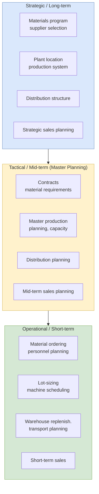

## 概述

供應鏈管理（SCM）是協調從原物料供應商到最終消費者之間所有採購、生產、分銷與交付活動的策略、流程與系統，覆蓋多供應商、多產品、多通路的複雜網絡結構。SCM 系統（如 SAP APO 及其後繼雲端平台 IBP）位於[[wiki/concepts/erp|ERP]]執行層之上的計劃層，透過統計需求預測（Holt-Winters 三重指數平滑等）、混合整數規劃（SNP 供應網絡優化：最小化總成本 = 庫存持有 + 運輸 + 採購 + 罰則，約束包括產能平衡方程式、安全庫存下界及公平分配規則）、多層次有能力批量計劃（PP/DS 生產詳細排程）及全球可用承諾（GATP 的 ATP 公式：$ATP(t) = \min_{s \geq t} \{\text{supply}(s)\}$）實現最優資源配置。供應鏈績效由[[wiki/concepts/scor-model|SCOR 模型]]的五大屬性衡量：可靠性（完美訂單率 = OnTime × InFull × DamageFree × AccurateDocs 的乘積，86.61%的典型案例揭示乘法公式的嚴苛性）、響應性（訂單履行周期）、敏捷性（重新計劃時間）、成本（SCM 總成本佔收入比）及資產效率（現金轉換周期 CCC = DIO + DSO - DPO）。Lenovo 供應鏈智能（SCI）平台案例展示了數字化轉型的核心挑戰：COVID-19 期間 PC 需求激增15%而訂單交貨率下降10%、過時庫存上升50%，Lenovo 選擇自建平台而非 SAP APO 包裝工作流的原因在於跨35+工廠、2,000+供應商的需求-供應決策複雜度超出傳統參數化流程的能力邊界。[[wiki/concepts/newsvendor-problem|報童問題]]的臨界比率邏輯、[[wiki/concepts/littles-law|利特爾定律]]的庫存-吞吐量-流程時間恆等式，以及[[wiki/concepts/queueing-theory|排隊理論]]的容量利用率分析，共同構成 SCM 計劃決策的運籌學基礎。

## What It Is

**Supply Chain Management (SCM)** encompasses the planning, execution, and optimization of all activities involved in sourcing, procurement, production, and delivery of products from raw material suppliers through to end consumers. SCM systems are enterprise software platforms that sit alongside and above [[wiki/concepts/erp|ERP]] systems, providing advanced planning and optimization capabilities that go beyond ERP's transactional processing.

While ERP handles the **execution layer** -- recording purchase orders, production orders, shipments, and invoices -- SCM systems operate at the **planning layer**, using mathematical models, statistical forecasting, and optimization algorithms to determine *what* to produce, *where* to source, *how much* inventory to hold, and *when* to ship. The three-layer architecture positions supply chain planning at the top (scenarios, analysis, optimization, decision support), transaction processing/ERP in the middle, and supply chain execution at the bottom (customer order fulfillment, warehouse and transportation management).

## Why It Matters

Modern supply chains face extraordinary complexity across three dimensions:

- **Multi-supply**: Multiple suppliers, owned factories, and outsourced factories with varying costs, capacities, and lead times
- **Multi-product**: Diverse product portfolios with different demand patterns, shelf lives, and production requirements
- **Multi-channel**: Retail, distributors, enterprise customers, and direct-to-consumer channels each with distinct fulfillment requirements

Primary challenges that make SCM systems essential:

- **Demand uncertainty and volatility**: Customer demand is inherently unpredictable and subject to seasonal, promotional, and macroeconomic effects
- **Globalization vs. protectionism**: Supply chains span continents, exposing them to trade policy shifts, tariffs, and geopolitical disruption
- **Escalating consumer expectations**: Same-day delivery, mass customization, and seamless omnichannel experiences raise the bar continuously
- **New product introductions**: Shorter product lifecycles demand faster planning cycles and more agile supply networks
- **Disruption risk**: Natural disasters, pandemics, geopolitical incidents, and supplier failures can cascade through interconnected supply networks -- the COVID-19 era surfaced all of these simultaneously

A SAPinsider survey of 298 businesses (September 2020) identified the top drivers for SCM investment: need for increased end-to-end visibility of real-time supply chain operations (45%) and increasingly complex operations requiring closer collaboration between planning and execution (41%). The DART framework from the same survey highlights that the top requirement is **deep integration between supply chain planning and operational execution** (87% of respondents).

## How It Works

### SCM System Capabilities

SCM systems optimize resource allocation and utilization decisions across several domains:

- **Supply network planning**: Determining optimal production quantities, sourcing decisions, and distribution flows across the entire network
- **Optimal inventory**: Balancing service levels against holding costs, considering safety stock targets, demand variability, and lead time uncertainty -- closely related to [[wiki/concepts/newsvendor-problem|newsvendor]] and [[wiki/concepts/littles-law|Little's Law]] reasoning
- **Pricing strategy**: Coordinating pricing with supply constraints and demand patterns (see also [[wiki/concepts/revenue-management|revenue management]])
- **What-if scenario planning**: Responding to disruptions such as supplier failures, price changes, shipment delays, or geopolitical incidents

### Supply Chain Planning Framework

Supply chain planning spans three time horizons across four functional areas (procurement, production, distribution, sales):

| Horizon | Procurement | Production | Distribution | Sales |
|---|---|---|---|---|
| **Long-term** | Materials program, supplier selection, cooperations | Plant location, production system | Physical distribution structure | Product program, strategic sales planning |
| **Mid-term** | Personnel planning, material requirements, contracts | Master production planning, capacity planning | Distribution planning | Mid-term sales planning |
| **Short-term** | Personnel planning, ordering materials | Lot-sizing, machine scheduling, shop floor control | Warehouse replenishment, transport planning | Short-term sales planning |

The mid-term planning level (enclosed within **Master Planning**) is where most SCM optimization takes place, balancing supply and demand across the network over a planning horizon of weeks to months.

### SAP APO Components

**SAP Advanced Planner and Optimizer (APO)** is SAP's legacy SCM planning suite, structured into five major application components:

#### 1. Demand Planning (DP)

Generates demand forecasts using statistical methods and market research inputs. The DP process follows a structured workflow:

1. Transfer historical data from an InfoCube
2. Define the planning book (data views and key figures)
3. Create forecast profiles (model selection criteria)
4. Calculate proportional factors (for disaggregation)
5. Create aggregate groups (for hierarchical forecasting)
6. Calculate statistical forecast
7. Apply judgmental adjustments and promotion planning
8. Release the demand plan

SAP DP supports a comprehensive library of forecasting models aligned with classical time-series theory:

| Pattern | Methods Available |
|---|---|
| **Constant** | Single exponential smoothing, moving average, weighted moving average |
| **Trend** | Holt's method (double exponential smoothing), [[wiki/concepts/linear-regression|linear regression]] |
| **Seasonal** | Seasonal models with/without trend |
| **Trend + Season** | Winters' method (triple exponential smoothing), seasonal linear regression |
| **Automatic** | Model selection procedures that test for demand pattern and optimize parameters |

The DP **"what to expect / what not to expect"** summary: DP delivers a structured, transparent forecasting process, but simple forecasting models alone will not significantly reduce forecast error -- human expertise and promotion planning inputs remain essential. The forecasting cycle includes analyzing results, improving forecast quality, monitoring accuracy, and incorporating promotion planning before releasing the final demand plan.

#### 2. Supply Network Planning (SNP)

Creates feasible plans for distribution, production, replenishment, and procurement across the entire supply network. SNP is the most analytically intensive APO component.

The SNP process is iterative: forecast from Demand Planning -> define planning profile -> SNP optimization run -> simulation of alternative models (micro-level) -> analyze the plan -> adjust -> release SNP plan -> convert to PP/DS orders.

The **primary objective of SNP is to minimize total supply chain costs** subject to defined sets of constraints. This is formulated as a **mixed integer programming** problem:

- **Objective function**: Minimize total costs (inventory holding costs + transportation + procurement + penalty)
- **Constraints**: Production capacities, inventory balance equations, non-negativity, fair-share allocation, maximum stock limits, push/pull rules
- **Cost categories**: Explicit costs (transportation, storage) and implicit/penalty costs (safety stock violations, missed demand)

The optimization considers: lot sizes from production, transportation equipment capacity, major production runs, network optimizer decisions (product orders, procurement orders), and deployment optimizer decisions (stock transport orders). SNP's "what not to expect" caveat: full potential of medium-term planning is not achieved with just one optimization run -- several scenarios must be compared.

A typical SNP problem involves multiple distribution centers, forward warehouses, sub-distribution centers, and factories across a geographic network -- optimizing total supply chain costs, service levels, safety stock targets, fair-share allocation, maximum stock limits, transportation costs, and push/pull rules simultaneously.

#### 3. Production Planning and Detailed Scheduling (PP/DS)

Handles manufacturing-level planning including:

- **Material requirements explosion**: Planned orders are decomposed into dependent demands via MRP from a bill of materials (BOM)
- **Lot-sizing**: Multi-level capacitated lot-sizing problem to determine economic production batch sizes
- **Sequencing and scheduling**: Assigning operations to machines/resources with sequence-dependent setup times -- a significantly harder problem than simple sequencing

PP/DS addresses three types of production environments:

| Environment | Layout | Utilization | Product Diversity | Production Stages |
|---|---|---|---|---|
| **Job shop / Open shop** | Grouped similar resources | Unstable | Many, great diversity | Many (>10) |
| **Flow line with setups** | Routing determines ordering | Stable, high (>0.8) | Few, many variants | 1 to 3 |
| **One-of-a-kind** | Resources moved to product | Unstable, low to high | Few individual (projects) | Large (>100) |

Solution approaches range from exact methods to heuristics, meta-heuristics, genetic algorithms, and simulation. Sequencing rules for job shops include **shortest processing time (SPT)** and **remaining slack time** (due time minus planned start time). For project-based environments, the **RCPSP (Resource-Constrained Project Scheduling Problem)** framework applies; for assembly lines, line-balancing problems with and without significant setup times are considered. PP/DS is advantageous for automated production processes with stable plans; manual production systems or environments with high uncertainty will hardly benefit, and the system does not provide simultaneous lot-sizing and scheduling.

**Worked job-shop example (6 jobs)**: The SPT rule yields flow times IT6=6, IT3=15, IT1=27, IT4=39, IT5=54, IT2=78 -- total flow time 78 hours, average flow time 219/6 = 36.5 hours. The SPT rule always minimizes average flow time. If only IT5 is late (due at 48, finishes at 54), the total penalty is (54 - 48) x $3 = $18. With sequence-dependent setup times, even a simple 5-3-4-6-2-1 ordering can incur aggregate setup costs of 15 + 8 + 9 = 32 units, illustrating why setup-dependent scheduling is substantially harder than plain SPT. [[wiki/concepts/capacity-planning|Capacity planning]] and [[wiki/concepts/queueing-theory|queueing theory]] inform the underlying utilization dynamics.

#### 4. Global Availability (GATP)

Manages replenishment and delivery-on-time commitments, providing **available-to-promise (ATP)** functionality that checks real-time inventory and production capacity before confirming customer orders. GATP extends the concept from a single distribution center to a global network.

**Worked ATP example**: Define `ATP(t)` as the quantity that can be promised for a new order due at time t, given a supply vector over the planning horizon. With supply `{3, 8, 6, 9}` over 4 periods:
- `ATP(1) = min{3, 8, 6, 9} = 3`
- `ATP(2) = min{8, 6, 9} = 6`
- `ATP(3) = min{6, 9} = 6`
- `ATP(4) = min{9} = 9`

Two-step rule-based procedures determine whether a customer request can be fulfilled and from which source. GATP's "what to expect" is reliable due-date and quantity promises, but only when underlying plans are stable.

#### 5. Transportation Planning and Vehicle Scheduling (TP/VS)

Optimizes transportation routes, vehicle loading, and delivery schedules to minimize logistics costs while meeting delivery time windows. A **Transport Load Builder (TLB) profile** parameterizes how orders aggregate into shipments. TP/VS exchanges data with deployment and SNP modules through a shared planning framework. Its limitation: complicated real-world restrictions like driver working-hour regulations are difficult to model directly.

### SAP IBP: The Next Generation

**SAP Integrated Business Planning (IBP)** is the cloud-based successor to SAP APO, designed for the S/4HANA era. IBP consolidates planning functions into a unified platform with enhanced collaboration, real-time analytics, and what-if simulation capabilities. Key technologies desired by organizations (SAPinsider survey): Sales & Operations Planning solution (**85%**), advanced statistical forecasting for demand management (**85%**), inventory planning and optimization (**84%**), supply forecasting (**82%**). IBP's flagship process flow is an end-to-end **S&OP** loop covering demand review, supply review (with both heuristic and optimizer-based paths), and reconciliation review.

### SCM Implementation Roadmap

McKinsey recommends a **three-step process** for implementing new supply-chain-planning IT:

1. **Process redesign**: Identify pain points in current planning processes, define future-state processes and align responsibilities, prioritize pilots for testing
2. **Vendor selection**: Outline high-level business requirements for proposal requests, define 2-3 use cases for vendor demos, create a single-page vendor selection criteria sheet
3. **Implementation road map**: Prioritize features into "must have" and "nice to have," organize development into sprints of 1-2 months, increase user acceptance through early and intensive investment in testing and training

## SCM and ERP Relationship

SCM and ERP are complementary but distinct:

- **ERP** provides the transactional backbone -- recording what happened (orders placed, goods shipped, invoices posted)
- **SCM** provides the planning intelligence -- deciding what should happen (optimal quantities, routes, schedules)

SCM systems consume ERP data (historical transactions, master data) and feed decisions back into ERP for execution (planned orders converted to production orders, stock transfer orders). Information flows bi-directionally between SAP ERP and APO for global ATP checks, master data synchronization, and plan execution.

## Performance Measurement

SCM performance is measured using the [[wiki/concepts/scor-model|SCOR (Supply Chain Operations Reference) model]], which defines metrics across five performance attributes:

| Attribute | Level 1 Metric | Level 2 Examples |
|---|---|---|
| **Delivery Reliability** | Delivery Performance, Perfect Order Fulfillment | On-time, in-full delivery rates |
| **Responsiveness** | Order Fulfillment Lead Times | Customer authorization to order entry, manufacturing to ship, warehouse to customer |
| **Agility** | Supply Chain Response Time | Re-plan, source, make, deliver response times |
| **Costs** | Total SC Management Costs, Warranty/Returns Processing | COGS, order management, material acquisition, planning, inventory carrying, IT costs |
| **Asset Efficiency** | Cash-to-Cash Cycle Time, Asset Turns | Inventory days of supply, days sales outstanding, days payable outstanding |

The **cash-to-cash cycle time (CCC)** is a particularly important metric:

`CCC = Days Inventory Outstanding + Days Sales Outstanding - Days Payable Outstanding`

It measures how long cash is tied up in the supply chain before being recovered from customers. **Worked example** from the course analytics lecture: with accounts receivable moving from $400 to $500, inventory from $500 to $300, accounts payable from $300 to $100, sales of $1,000 and COGS of $700 over a 31-day month:
- Inventory days = ($500 + $300)/2 / ($700/31) = 17.7 days
- Receivables days = ($400 + $600)/2 / ($1,000/31) = 15.5 days
- Payables days = ($300 + $100)/2 / ($700/31) = 8.8 days
- **CCC = 17.7 + 15.5 - 8.8 = 24.4 days**

## Practical Example: Lenovo Supply Chain Intelligence

Lenovo's **Supply Chain Intelligence (SCI) platform** (HBP case UST116, Gurumurthi & Lau 2022) illustrates how a major electronics firm responds to supply chain volatility. Since acquiring IBM's PC division in 2005, Lenovo has held the #1 global PC position (24.6% share in 2021, $70B+ FY2022-23 revenue) and built a reputation for supply chain excellence. The physical network is large: **35+ manufacturing facilities** across Japan, US, Mexico, India, Brazil, Argentina, Germany, Hungary and multiple Chinese sites (Hefei, Wuhan, Shenzhen), **2,000+ suppliers**, and **100M+ devices** shipped annually to **180 markets**. During COVID-19, PC demand surged **15%** while supplier, manufacturing, and logistics bottlenecks cascaded worldwide; order-to-delivery performance dropped **10%** vs. pre-COVID and obsolete inventory rose **50%** year-over-year.

Maggie Duan's team built the SCI platform (initiative launched 2017, deployment accelerated by COVID) to (1) centralize disparate databases, (2) connect end-to-end supply chain transactions, and (3) integrate several planning and enabling tools into a single portal. The SCI framework wraps eight end-to-end functions -- new product introduction, demand management, order management, inventory control, manufacturing & scheduling, procurement, logistics & warehouse, and quality management -- around the common backbone of end-to-end on-time delivery as the anchor KPI. The case is used in class to discuss how an internally developed platform compares against packaged SAP APO/IBP: Lenovo picks a build-over-buy path because the demand-to-source decisions across hundreds of SKUs and 35+ plants exceed what a middle-manager-driven packaged workflow can handle, and because data-silo unification and metric alignment across legacy tools are the hardest part -- not the optimization models themselves. The case also illustrates why SCM digital transformation is fundamentally a **people-process-technology** exercise: point technologies like RFID offered only siloed gains, and the [[wiki/concepts/erp|ERP]]-embedded bullwhip-style data asymmetries across suppliers were the binding constraint on customer-metric improvement.

## Related Concepts

- [[wiki/concepts/logistics-and-transportation|Logistics and Transportation]] -- physical movement execution layer of SCM
- [[wiki/concepts/erp|Enterprise Resource Planning (ERP)]] -- SCM planning layer sits above ERP transaction processing
- [[wiki/concepts/crm|Customer Relationship Management (CRM)]] -- customer demand signals from CRM feed SCM planning
- [[wiki/concepts/scor-model|SCOR Model]] -- SCM performance measurement framework
- [[wiki/concepts/linear-regression|Linear Regression]] -- statistical forecasting model used in SAP DP
- [[wiki/concepts/capacity-planning|Capacity Planning]] -- underlying constraint in SNP and PP/DS
- [[wiki/concepts/queueing-theory|Queueing Theory]] -- production scheduling and utilization dynamics
- [[wiki/concepts/littles-law|Little's Law]] -- inventory / WIP / throughput relationship
- [[wiki/concepts/newsvendor-problem|Newsvendor Problem]] -- single-period inventory trade-off underlying safety stock
- [[wiki/concepts/revenue-management|Revenue Management]] -- pricing coordination with supply constraints
- [[wiki/concepts/npv|Net Present Value]] -- justification for SCM IT investment
- [[wiki/concepts/time-value-of-money|Time Value of Money]] -- foundation for CCC and NPV reasoning
- [[wiki/mocs/operations-research|Operations Research MOC]] — Part of the OR PhD reading spine (Inventory Theory and Supply Chain)

## Source Materials

- [[wiki/sources/courses/enterprise-systems|EEMT5360 Enterprise Systems for Digital Transformation]]
