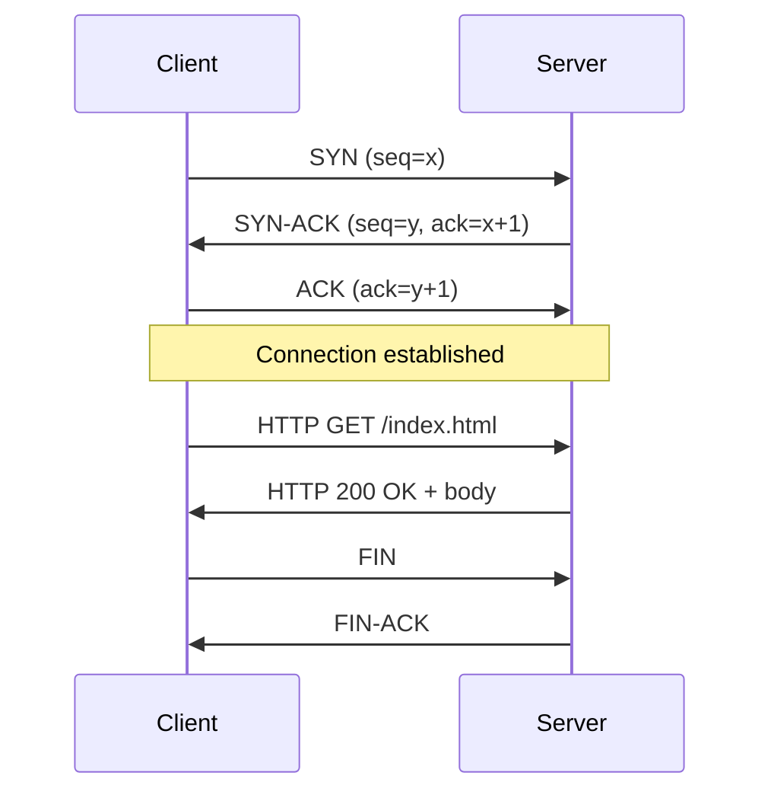
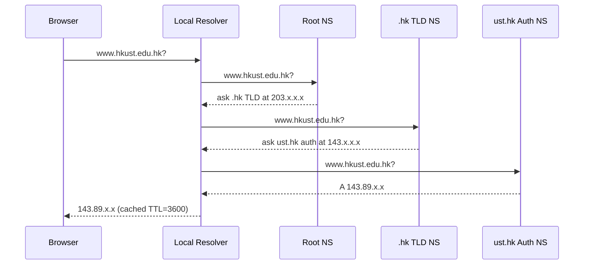

## 概述

網絡架構是電子商務的技術基石，涵蓋從 TCP/IP 網路層（封包交換、IP 定址、路由）到傳輸層（TCP 三向握手提供可靠有序傳輸，UDP 提供低延遲無連接傳輸）再到應用層（HTTP/HTTPS 請求-回應模型、DNS 分層解析、RESTful API 設計）的完整協定堆疊。HTTP 的無狀態設計雖然簡化了水平擴展，卻將會話管理的複雜性推至應用層，由此衍生出 Cookie（附屬性 HttpOnly、Secure、SameSite 防禦 XSS 與 CSRF）、URL 重寫及隱藏表單欄位三種狀態維持機制。從 HTTP/1.1（文本幀、每連接一請求）到 HTTP/2（二進位幀、多路復用流、HPACK 標頭壓縮）再到 HTTP/3（基於 QUIC/UDP、消除 TCP 層頭端阻塞、單次 RTT 握手），每一代協定演進均直接緩解了其前代的性能瓶頸。REST 的六大約束（無狀態、可快取、統一接口、分層系統、按需程式碼、客戶端-伺服器分離）使其成為電子商務 API 設計的主流風格，而 GraphQL 則通過客戶端指定查詢結構解決了 REST 的過度/不足抓取問題。網絡架構的性能模型直接連結[[queueing-theory|排隊理論]]——封包交換網絡中的壅塞本質上是服務隊列的等待問題，可用 M/M/1 或 M/M/c 模型近似分析；而 TLS/SSL 加密握手則依賴[[cryptography|密碼學]]中的非對稱加密（金鑰交換）與對稱加密（批量數據加密）組合。

## Core Mechanism

Web architecture refers to the layered system of protocols, naming conventions, and state-management techniques that enable communication between clients (browsers, apps) and servers over the Internet. The architecture is best understood as a stack, where each layer provides services to the layer above it.

### The TCP/IP Protocol Stack

The modern Internet operates on a four-layer model:

| Layer | Purpose | Key Protocols |
|---|---|---|
| **Application** | End-user services and data formatting | HTTP, HTTPS, FTP, SMTP, DNS |
| **Transport** | Reliable (or unreliable) end-to-end delivery | TCP, UDP |
| **Network** | Logical addressing and routing across networks | IP (IPv4, IPv6), ICMP |
| **Data Link** | Physical addressing and local network delivery | Ethernet, Wi-Fi (802.11) |

**TCP (Transmission Control Protocol)** provides reliable, ordered, error-checked delivery of a byte stream. It uses a three-way handshake to establish connections and implements flow control and congestion avoidance. This reliability makes TCP the default choice for web traffic.



The three-way handshake costs one round-trip time (RTT) before any application data flows. This is why HTTP/2 multiplexes multiple requests over a single TCP connection, and why HTTP/3 moves to QUIC-over-UDP to fold transport and TLS handshakes into a single round trip.

**UDP (User Datagram Protocol)** is connectionless — it sends datagrams without establishing a session, guaranteeing neither delivery nor ordering. UDP is faster and lower-overhead, making it suitable for real-time applications (video streaming, VoIP, online gaming, DNS queries) where occasional packet loss is acceptable or where application-layer retransmission is preferable to TCP's conservative defaults.

### Packet Switching vs. Circuit Switching

The Internet's underlying transport model is **packet switching**: messages are chopped into ~2048-4096 byte packets, each with source and destination addresses, routed independently, and reassembled at the receiver. This contrasts with **circuit switching** (classical telephony), which reserves end-to-end capacity for the duration of a call. Packet switching trades guaranteed performance for statistical multiplexing — thousands of flows can share the same link because they rarely all transmit at peak simultaneously. Congestion manifests as queueing rather than call blocking, which ties directly into [[wiki/concepts/queueing-theory|Queueing Theory]] and [[wiki/concepts/littles-law|Little's Law]] for capacity planning of web backends.

### DNS — Domain Name System

DNS translates human-readable domain names (e.g., `www.hkust.edu.hk`) into IP addresses. The resolution process follows a hierarchical structure:

1. **Client query** → local DNS resolver (often ISP-provided or public like 8.8.8.8).
2. **Root nameserver** → directs to the appropriate TLD nameserver (`.hk`, `.com`, `.org`).
3. **TLD nameserver** → directs to the authoritative nameserver for the domain.
4. **Authoritative nameserver** → returns the IP address (A record) or other record types (CNAME, MX, TXT).

DNS supports two query modes:
- **Recursive**: The resolver does all the work and returns a final answer to the client.
- **Iterative**: The resolver returns referrals, and the client follows the chain itself.



Caching at every level (browser, OS, resolver) reduces lookup latency. TTL (Time to Live) values control how long cached records remain valid. Common record types: **A** (IPv4), **AAAA** (IPv6), **CNAME** (alias), **MX** (mail), **TXT** (metadata, DKIM, SPF), **NS** (nameserver), **SOA** (zone authority).

### HTTP — HyperText Transfer Protocol

HTTP is the application-layer protocol that powers the web. Key characteristics:

- **Request-response model**: The client sends a request; the server returns a response. Each exchange is independent.
- **Stateless**: HTTP itself maintains no memory of previous requests. Every request is self-contained.
- **Text-based**: Headers and request lines are human-readable (though HTTP/2 uses binary framing).

**HTTP Methods**:

| Method | Purpose | Idempotent | Safe |
|---|---|---|---|
| GET | Retrieve a resource | Yes | Yes |
| POST | Submit data (create) | No | No |
| PUT | Replace a resource entirely | Yes | No |
| DELETE | Remove a resource | Yes | No |
| PATCH | Partially modify a resource | No | No |

**Status Codes** follow a systematic scheme:
- **1xx** — Informational (100 Continue)
- **2xx** — Success (200 OK, 201 Created, 204 No Content)
- **3xx** — Redirection (301 Moved Permanently, 302 Found, 304 Not Modified)
- **4xx** — Client error (400 Bad Request, 401 Unauthorized, 403 Forbidden, 404 Not Found)
- **5xx** — Server error (500 Internal Server Error, 502 Bad Gateway, 503 Service Unavailable)

### HTTPS and SSL/TLS

**HTTPS** layers HTTP over **TLS (Transport Layer Security)**, providing encryption, authentication, and integrity. The TLS handshake:

1. Client sends ClientHello (supported cipher suites, TLS version).
2. Server responds with ServerHello, its certificate (containing public key), and chosen cipher suite.
3. Client verifies the certificate against trusted CAs, generates a pre-master secret, encrypts it with the server's public key.
4. Both sides derive session keys from the pre-master secret.
5. Symmetric encryption begins for the remainder of the session.

This mechanism connects directly to the cryptographic primitives covered in [[wiki/concepts/cryptography|Cryptography]].

### REST — Representational State Transfer

**REST** is an architectural style (not a protocol) for designing networked APIs. Its constraints:

- **Stateless**: Each request contains all information needed. No server-side session required.
- **Resource-oriented**: Every entity is a resource identified by a URI (e.g., `/api/products/42`).
- **Uniform interface**: Standard HTTP methods map to CRUD operations. Representations (JSON, XML) are negotiated via content types.
- **Cacheable**: Responses declare cacheability via headers (`Cache-Control`, `ETag`).
- **Layered system**: Clients cannot tell whether they connect to the origin server or an intermediary (load balancer, CDN).

REST is the dominant API style in modern e-commerce platforms. Alternatives include **GraphQL** (client-specified query structure) and legacy **SOAP** (XML-based, contract-first, heavier overhead).

### Session Management

HTTP's statelessness creates a problem for e-commerce: shopping carts, login states, and user preferences must persist across requests. Every HTTP GET or POST request opens a new TCP connection and, without explicit session tracking, the server cannot link two requests from the same user. Three mechanisms address this:

**Cookies**:
- Server sends `Set-Cookie` header in the response.
- Browser stores the cookie and sends it back with every subsequent request to the same domain.
- Attributes: `Expires`/`Max-Age` (lifetime), `HttpOnly` (no JavaScript access), `Secure` (HTTPS only), `SameSite` (CSRF protection).
- Session cookies (no expiry) vs. persistent cookies.

**URL Rewriting**:
- Session ID appended to URLs as a query parameter (e.g., `?sessionid=abc123`).
- Works when cookies are disabled but exposes the session ID in browser history and referrer headers — a security risk.

**Hidden Form Fields**:
- Session data embedded in HTML forms as `<input type="hidden">`.
- Only works for form-based navigation; not suitable for general browsing.

In practice, **cookies are the standard mechanism**. Modern frameworks (Django, Express, Spring) abstract session management into middleware that handles cookie creation, storage (server-side session stores like Redis), and expiration automatically.

```mermaid
sequenceDiagram
    participant B as Browser
    participant S as Server
    participant St as Session Store
    B->>S: POST /sign-in (name=AJ, pw=...)
    S->>St: create session (SESSID=12145, user=AJ)
    S-->>B: 200 OK<br>Set-Cookie: SESSID=12145; HttpOnly; Secure
    B->>S: GET /cart<br>Cookie: SESSID=12145
    S->>St: lookup SESSID=12145
    St-->>S: user=AJ, cart=[item1,item2]
    S-->>B: 200 OK (cart page)
```

**Worked example — EEMT5540 HW1 cookie round-trip**. The course homework drills the mechanism end-to-end with a three-file PHP pipeline on the student's ITSC webspace. `set_cookie.html` (a form with `name` and `pin` inputs) submits to `start_session.php`, which concatenates the two inputs into a session ID (e.g. `Ajay1234`) and issues `Set-Cookie: ECOM_HW=Ajay1234; Max-Age=300`. A second form button then invokes `report_session.php`, which reads `$_COOKIE['ECOM_HW']` and echoes it back — proving the browser attached the cookie automatically on the subsequent request. The 5-minute `Max-Age` and the absence of `HttpOnly`/`Secure` flags in the base assignment highlight exactly the attributes real e-commerce sites must add to defend against XSS and sniffing.

**Session security** is critical in e-commerce. Three canonical attacks:
- **Session hijacking**: Attacker steals the cookie (via XSS, network sniffing on HTTP) and replays it. Defences: `HttpOnly` (blocks JavaScript access), `Secure` (only send over HTTPS).
- **Session fixation**: Attacker gives the victim a known session ID, waits for login, then hijacks. Defence: regenerate session ID on login.
- **CSRF (Cross-Site Request Forgery)**: Attacker's site triggers a state-changing request to the target site using the victim's cookies. Defences: `SameSite=Strict` or `Lax`, CSRF tokens, Origin header checks.

## Key Findings

- The layered architecture means failures can be isolated: a DNS misconfiguration does not affect TCP reliability, and an HTTP error does not imply network failure.
- HTTP's statelessness is a deliberate design choice that enables horizontal scaling (any server can handle any request), but it shifts state-management complexity to the application layer.
- REST's dominance in e-commerce APIs stems from its alignment with HTTP — no additional protocol overhead, natural caching, and tool ecosystem support.
- Session security is critical in e-commerce: session hijacking (stealing cookies), session fixation (forcing a known session ID), and CSRF attacks all exploit session management weaknesses. The `HttpOnly`, `Secure`, and `SameSite` cookie attributes are the primary defenses.
- The transition from HTTP/1.1 to HTTP/2 (binary framing, multiplexing, server push) and HTTP/3 (QUIC over UDP) improves performance without changing the fundamental request-response semantics.

## Comparison: HTTP/1.1 vs HTTP/2 vs HTTP/3

| Feature | HTTP/1.1 (1997) | HTTP/2 (2015) | HTTP/3 (2022) |
|---|---|---|---|
| Transport | TCP | TCP | QUIC (UDP) |
| Framing | Text | Binary | Binary |
| Multiplexing | No (1 req/conn) | Yes (streams) | Yes (no HoL block) |
| Header compression | None | HPACK | QPACK |
| Server push | No | Yes (deprecated) | Yes |
| TLS | Optional | Effectively required | Mandatory |
| Handshake RTTs | 3 (TCP + TLS 1.2) | 3 | 1 (0 on resume) |

HTTP/2's stream multiplexing fixed the "head-of-line blocking" problem where a single slow request blocked an entire TCP connection. HTTP/3 goes further by moving to UDP-based QUIC, which eliminates TCP-level head-of-line blocking when packets are lost — a lost packet only stalls the affected stream, not all streams on the connection.

## Related Concepts

- [[wiki/concepts/cryptography|Cryptography]] — SSL/TLS encryption underpinning HTTPS
- [[wiki/concepts/ecommerce-models|E-Commerce Models]] — Business models built on web infrastructure
- [[wiki/concepts/erp|ERP]] — Enterprise systems that expose REST APIs for integration
- [[wiki/concepts/queueing-theory|Queueing Theory]] — Analytical framework for packet-switched congestion
- [[wiki/concepts/littles-law|Little's Law]] — Capacity planning relationship for web request queues
- [[wiki/concepts/capacity-planning|Capacity Planning]] — Sizing web infrastructure
- [[wiki/concepts/nlp-basics|NLP Basics]] — Text processing on crawled web content
- [[wiki/entities/hkust|HKUST]] — Source institution for course material

## Source Materials

- [[wiki/sources/courses/ecommerce|EEMT5540 IT for E-Commerce Applications]]
- Lecture 01: Web Protocols & Sessions
