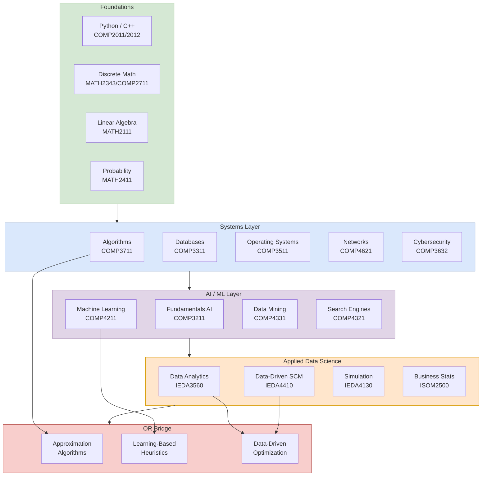

## 概述

此 MOC 整合 HKUST 電腦科學與資料科學的學習路徑，涵蓋從程式設計基礎（COMP1001）到機器學習、搜尋引擎、資料挖掘及資訊安全的完整知識體系。連結 COMP、MATH 及 IEDA 的相關課程與概念頁面，為資料科學導向的 OR 研究提供方法論支撐。

## Purpose

This MOC maps the **computer science and data science** knowledge base, drawing from three departments:

- **COMP** — Algorithms, AI, systems, networks, databases, security, ML
- **MATH** — Discrete mathematics, linear algebra, probability theory (shared foundations)
- **IEDA** — Data analytics, supply chain ML, simulation, search/retrieval

The reading paths here support two goals:
1. **CS fundamentals** — for students who took IEDA/MATH but need a solid CS grounding
2. **Data science for OR** — connecting ML/AI methods to OR research applications (approximation algorithms, learning-based heuristics, data-driven optimization)

## Knowledge Architecture

## Reading Path 1: CS Foundations

**Start here if you have a math background but limited programming experience.**

### Concept Foundations
- [[wiki/concepts/algorithms-and-data-structures|Algorithms and Data Structures]] — sorting, searching, graph algorithms, complexity classes (P, NP, NP-complete), dynamic programming as algorithm design
- [[wiki/concepts/database-systems|Database Systems]] — relational model, SQL, normalization, transactions (ACID), B-trees, NoSQL

### Course Sources
- [[wiki/sources/courses/hkust-comp-intro-courses|COMP1001/1021/2011/2012/2611/2711]] — App Inventor → Python → C++ → OOP → MIPS assembly; complete intro sequence
- [[wiki/sources/courses/hkust-discrete-math|MATH2343/COMP2711 Discrete Mathematics]] — propositional logic, combinatorics, graph theory, proof techniques, NP-completeness foundations
- [[wiki/sources/courses/comp-algorithms|COMP3711 Algorithms]] — divide-and-conquer, greedy, DP, graph algorithms, max flow, NP-completeness; CLRS textbook
- [[wiki/sources/courses/comp-database-systems|COMP3311 Database Systems]] — relational algebra, SQL, ER diagrams, normalization, transactions, indexing
- [[wiki/sources/courses/comp-operating-systems|COMP3511 Operating Systems]] — process/thread management, scheduling, synchronization, virtual memory, file systems
- [[wiki/sources/courses/comp-computer-networks|COMP4621 Computer Networks]] — TCP/IP stack, HTTP, DNS, congestion control (AIMD), routing (BGP, OSPF), SDN; Kurose & Ross

Papers: *(none yet)*

---

## Reading Path 2: Security and Cryptography

**For digital trust infrastructure and privacy-preserving computation.**

### Concept Foundations
- [[wiki/concepts/cryptography|Cryptography]] — AES, RSA, ECDSA, SHA-256, digital signatures, PKI, zero-knowledge proofs

### Course Sources
- [[wiki/sources/courses/comp-cybersecurity|COMP3632 Cybersecurity]] — CIA triad, AES/RSA/SHA, TLS, OWASP Top 10, buffer overflow, ASLR/DEP, web/network security
- [[wiki/sources/courses/blockchain|EEMT6000H Blockchain Technology]] — zk-SNARK IoT authentication, Ethereum, Solidity, DeFi

Papers: *(none yet)*

---

## Reading Path 3: Artificial Intelligence

**Classical AI planning, inference, and reasoning methods.**

### Course Sources
- [[wiki/sources/courses/comp-fundamentals-ai|COMP3211 Fundamentals of AI]] — Russell & Norvig AIMA; search (BFS/DFS/A*), adversarial search (minimax, alpha-beta), constraint satisfaction, Bayesian networks, HMMs, intro ML

Papers: *(none yet)*

---

## Reading Path 4: Machine Learning

**Statistical learning theory and modern ML methods.**

### Concept Foundations
- [[wiki/concepts/machine-learning-advanced|Machine Learning (Advanced)]] — SVM (kernel trick, dual problem), neural networks (backprop, vanishing gradient), CNNs, RNNs, VC theory, PAC learning
- [[wiki/concepts/linear-regression|Linear Regression]] — OLS, multicollinearity, residual diagnostics, regularization (ridge, lasso)
- [[wiki/concepts/logistic-regression|Logistic Regression]] — binary classification, sigmoid, maximum likelihood, ROC curves
- [[wiki/concepts/decision-trees|Decision Trees]] — CART, information gain, pruning, Random Forest, XGBoost, gradient boosting
- [[wiki/concepts/clustering|Clustering]] — k-means, hierarchical (Ward linkage), DBSCAN, elbow method, silhouette score
- [[wiki/concepts/pca|PCA]] — eigendecomposition, variance explained, scree plot, connection to SVD

### Course Sources
- [[wiki/sources/courses/comp-machine-learning|COMP4211 Machine Learning]] — SVM, backprop, CNNs, VC theory, PAC learning; theoretical grounding
- [[wiki/sources/courses/applied-statistics|EEMT5500 Applied Statistics & Data Analytics]] — 8 applied case studies (Moneyball, Framingham, Netflix); sklearn pipeline; 7-model fraud classifier

Papers: *(none yet)*

---

## Reading Path 5: Information Retrieval and Data Mining

**Large-scale data processing, search, and pattern discovery.**

### Concept Foundations
- [[wiki/concepts/nlp-basics|NLP Basics]] — tokenization, TF-IDF, word2vec, transformers intro, sentiment analysis
- [[wiki/concepts/recommendation-systems|Recommendation Systems]] — collaborative filtering, matrix factorization (SVD), content-based, hybrid; Netflix Prize

### Course Sources
- [[wiki/sources/courses/comp-search-engines|COMP4321 Search Engines]] — information retrieval theory; Blair & Maron (1985) recall precision problem; TF-IDF; BM25; PageRank; HITS; dense retrieval (DPR); learned sparse retrieval (SPLADE); ColBERT
- [[wiki/sources/courses/comp-data-mining|COMP4331 Data Mining]] — Han/Kamber/Pei textbook; Apriori/FP-growth (association rules); k-means/hierarchical/DBSCAN; BM25; PageRank; data preprocessing pipeline
- [[wiki/sources/courses/isom-ebusiness-web-analytics|ISOM3310 E-Business and Web Analytics]] — Business Model Canvas; SEO; clickstream analysis; web data mining; digital marketing metrics

Papers: *(none yet)*

---

## Reading Path 6: Data Analytics for OR

**Applied data science methods with direct OR applications.**

### Concept Foundations
- [[wiki/concepts/hypothesis-testing|Hypothesis Testing]] — z/t-tests, ANOVA, power analysis, p-value interpretation, multiple comparisons
- [[wiki/concepts/ab-testing|A/B Testing]] — hypothesis testing, sample size, Type I/II errors, lift measurement, multi-armed bandits
- [[wiki/concepts/simulation|Simulation]] — Monte Carlo, discrete-event simulation, variance reduction, output analysis
- [[wiki/concepts/benfords-law|Benford's Law]] — first-digit distribution, anomaly detection, fraud detection

### Course Sources
- [[wiki/sources/courses/ieda-data-analytics|IEDA3560 Data Analytics]] — Python/sklearn; supply chain ML; demand forecasting with ML; classification for inventory management
- [[wiki/sources/courses/ieda-data-driven-scm|IEDA4410 Data-Driven Supply Chain Management]] — Simchi-Levi textbook; ML for demand, inventory, pricing; feature engineering for SCM
- [[wiki/sources/courses/ieda-system-simulation|IEDA4130 System Simulation]] — Law & Kelton textbook; Arena/SimPy; common random numbers; input modeling; output confidence intervals
- [[wiki/sources/courses/isom-business-statistics|ISOM2500 Business Statistics]] — Berenson/Levine; full inference pipeline; ANOVA; multiple regression; Stat Tools
- [[wiki/sources/courses/isom-quantitative-analysis|ISOM1500 Quantitative Analysis]] — intro statistics; decision trees; EVPI; Excel Solver

Papers: *(none yet)*

---

## OR Bridge: CS Methods in OR Research

### Algorithms → OR
- **NP-completeness** (COMP3711 → [[wiki/concepts/algorithms-and-data-structures|Algorithms]]) — explains why VRP, integer programming require heuristics
- **Approximation algorithms** (COMP3711) — 2-approx vertex cover, Christofides 1.5-approx TSP; bridge to OR approximation literature
- **Max-flow/min-cut** (COMP3711 → [[wiki/concepts/network-flows|Network Flows]]) — combinatorial optimization backbone
- **Dynamic programming** (COMP3711) — recurrence relations; optimal substructure; connects to Bellman equations in MDPs

### ML → OR
- **Learning-based heuristics** — using ML models to warm-start B&B solvers; predict branching decisions
- **Data-driven optimization** — replacing distributional assumptions with empirical data (Sample Average Approximation)
- **Predict-then-optimize** — end-to-end learning for decision-making under uncertainty

### Search/IR → OR
- **COMP4321 dense retrieval** — connects to embedding-based similarity search; relevant for RAG-based knowledge systems (this wiki's own retrieval architecture)
- **COMP4331 frequent itemset mining** — market basket analysis; inventory association rules

## Sub-Areas Not Yet Covered

- **Reinforcement Learning** — no concept page yet; needed for MDP, ADP, OR reinforcement learning applications
- **Deep Learning for Combinatorial Optimization** — graph neural networks for TSP/VRP; attention models; pointer networks
- **Explainability / Fairness** — SHAP, LIME; relevant when ML is embedded in OR decision systems

When a paper introducing one of these is ingested, create a stub concept page and wire it here.

## Key Concept Pages Summary

| Concept | Path | Role |
|---|---|---|
| [[wiki/concepts/algorithms-and-data-structures\|Algorithms & Data Structures]] | CS Foundations | NP-completeness, graph algorithms, DP |
| [[wiki/concepts/database-systems\|Database Systems]] | CS Foundations | SQL, ACID, indexing, NoSQL |
| [[wiki/concepts/cryptography\|Cryptography]] | Security | AES, RSA, ZKPs |
| [[wiki/concepts/machine-learning-advanced\|ML (Advanced)]] | ML | SVM, backprop, VC theory |
| [[wiki/concepts/linear-regression\|Linear Regression]] | ML | OLS, regularization |
| [[wiki/concepts/logistic-regression\|Logistic Regression]] | ML | Classification, ROC |
| [[wiki/concepts/decision-trees\|Decision Trees]] | ML | CART, Random Forest, XGBoost |
| [[wiki/concepts/clustering\|Clustering]] | ML | k-means, DBSCAN, hierarchical |
| [[wiki/concepts/pca\|PCA]] | ML | Dimensionality reduction, SVD |
| [[wiki/concepts/nlp-basics\|NLP Basics]] | IR / Mining | TF-IDF, word2vec, transformers |
| [[wiki/concepts/recommendation-systems\|Recommendation Systems]] | IR / Mining | Collaborative filtering, SVD |
| [[wiki/concepts/simulation\|Simulation]] | Data Analytics / OR | Monte Carlo, discrete-event |
| [[wiki/concepts/hypothesis-testing\|Hypothesis Testing]] | Data Analytics | z/t-tests, ANOVA, power |
| [[wiki/concepts/ab-testing\|A/B Testing]] | Data Analytics | Experimentation framework |
| [[wiki/concepts/benfords-law\|Benford's Law]] | Data Analytics | Anomaly detection |

## External References

- **NeurIPS / ICML / ICLR** — premier machine learning conferences
- **VLDB / SIGMOD** — database and data management
- **ACM SIGIR** — information retrieval
- **arXiv cs.LG / cs.AI / cs.DS** — ML, AI, and algorithms preprints
- **OR + ML crossover**: *INFORMS Journal on Computing*, *Machine Learning* (Springer), *Journal of Machine Learning Research*
