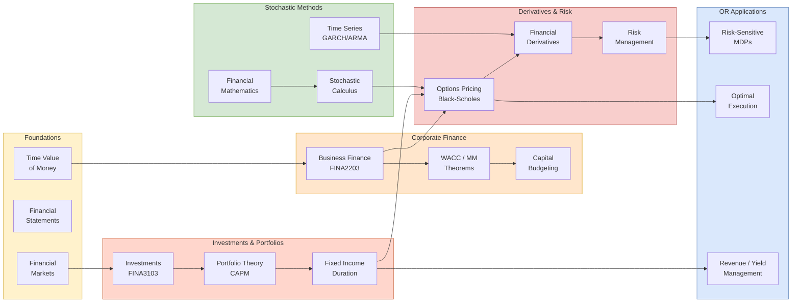

## 概述

此 MOC 整合 HKUST 金融工程學習路徑，涵蓋從個人財務基礎到隨機微積分與衍生品定價的完整知識體系。匯集 FINA、MATH 及 IEDA 三個系別的相關課程，並連結數量金融概念頁面，為兼讀 OR 博士班的金融工程研究方向提供導覽。

## Purpose

This MOC maps the **quantitative finance and financial engineering** knowledge base across three departments:

- **FINA** — Investments, corporate finance, capital markets
- **MATH** — Stochastic calculus, financial mathematics, measure theory
- **IEDA** — Financial derivatives pricing, risk management, engineering economics

The reading paths here are self-contained: starting from time value of money, they lead all the way to Black-Scholes derivation, exotic options, and risk-sensitive MDPs. This track is the most direct bridge between HKUST coursework and OR PhD research in financial engineering, optimal execution, and risk management.

## Knowledge Architecture

## Reading Path 1: Foundations → Corporate Finance

**Start here if you have no finance background.**

### Concept Foundations
- [[wiki/concepts/time-value-of-money|Time Value of Money]] — PV, FV, compound interest, annuities, effective rates. The single most reused concept in all of finance.
- [[wiki/concepts/npv|Net Present Value (NPV)]] — capital budgeting decision rule; $\sum CF_t/(1+r)^t$.
- [[wiki/concepts/irr|Internal Rate of Return (IRR)]] — discount rate making NPV = 0; incremental ERR for mutually exclusive projects.
- [[wiki/concepts/depreciation|Depreciation]] — straight-line, DB, SYD, MACRS; tax shield = depreciation × tax rate.
- [[wiki/concepts/cvp-analysis|CVP Analysis]] — break-even, contribution margin, operating leverage.
- [[wiki/concepts/financial-statements|Financial Statements]] — balance sheet, income statement, cash flow; GAAP/IFRS.
- [[wiki/concepts/financial-ratios|Financial Ratios]] — liquidity, profitability, leverage, DuPont decomposition.

### Course Sources
- [[wiki/sources/courses/fina-personal-finance|FINA1203 Personal Finance]] — entry-level; MPF, HK context, personal financial planning
- [[wiki/sources/courses/fina-financial-markets|FINA1303 Financial Markets]] — HK market structure, HKEX, Hang Seng Index, LERS currency board
- [[wiki/sources/courses/fina-business-finance|FINA2203 Business Finance]] — Brealey/Myers/Allen; MM theorems, WACC, payout policy
- [[wiki/sources/courses/fina-financial-management|FINA2303 Financial Management]] — Ross/Westerfield; BBA non-finance focus
- [[wiki/sources/courses/engineering-economics|EEMT5510 Engineering Economics]] — TVM/NPV/IRR/MACRS from IE perspective; lifecycle cost analysis
- [[wiki/sources/courses/ieda-engineering-economy|IEDA3230 Engineering Economy]] — engineering economy; after-tax cash flow; real options intro
- [[wiki/sources/courses/accounting|SBMT5010 Accounting for Managers]] — managerial accounting; fixed/variable costs; CVP; budgeting

### Concept Pages
- [[wiki/concepts/corporate-finance|Corporate Finance]] — MM theorems, WACC, agency costs, capital structure

Papers: *(none yet)*

---

## Reading Path 2: Investments and Portfolio Theory

**After completing Path 1, or if you have basic TVM knowledge.**

### Concept Foundations
- [[wiki/concepts/portfolio-theory|Portfolio Theory]] — Markowitz mean-variance frontier, CAPM, Sharpe ratio, Black-Litterman model
- [[wiki/concepts/fixed-income|Fixed Income]] — bond pricing, duration, convexity, yield curve, credit risk models

### Course Sources
- [[wiki/sources/courses/fina-investments|FINA3103 Investments]] — Bodie/Kane/Marcus; CAPM, APT, Fama-French, attribution analysis

Papers: *(none yet)*

---

## Reading Path 3: Derivatives and Options Pricing

**Requires Path 2 + basic calculus.**

### Concept Foundations
- [[wiki/concepts/options-pricing|Options Pricing]] — put-call parity, Black-Scholes formula, Greeks, binomial trees, risk-neutral pricing, real options

### Course Sources
- [[wiki/sources/courses/ieda-financial-derivatives|IEDA3330 Financial Derivatives]] — forwards, futures, swaps, options; Hull's textbook; intro-level
- [[wiki/sources/courses/ieda-financial-derivatives-advanced|IEDA4331 Financial Derivatives (Advanced)]] — advanced derivatives; volatility surface; exotic options
- [[wiki/sources/courses/hkust-financial-mathematics|MATH4424/4514 Financial Mathematics]] — Shreve; no-arbitrage; Girsanov theorem; Black-Scholes via Itô; numerical methods (finite difference, Monte Carlo); barrier/Asian/lookback options

Papers: *(none yet)*

---

## Reading Path 4: Stochastic Calculus and Quantitative Methods

**Core mathematical infrastructure for derivatives and OR applications.**

### Concept Foundations
- [[wiki/concepts/stochastic-calculus|Stochastic Calculus]] — Brownian motion, Itô's lemma, stochastic differential equations, GBM, Black-Scholes PDE derivation
- [[wiki/concepts/stochastic-processes|Stochastic Processes]] — DTMC, Poisson process, CTMC, renewal theory, martingales

### Course Sources
- [[wiki/sources/courses/hkust-stochastic-modeling|MATH4432 Stochastic Modeling]] — DTMC, Poisson, CTMC, renewal theory, Jackson networks, martingales intro
- [[wiki/sources/courses/hkust-financial-mathematics|MATH4424/4514 Financial Mathematics]] — rigorous stochastic calculus; Girsanov; risk-neutral measure
- [[wiki/sources/courses/hkust-advanced-analysis|MATH3033/4033 Advanced Analysis]] — Lebesgue integration; L^p spaces; Radon-Nikodym (foundational for probability measures)
- [[wiki/sources/courses/hkust-odes-pdes|MATH2351/3343 ODEs and PDEs]] — Laplace transforms; Fourier series; heat/wave/Laplace equations; Black-Scholes PDE as heat equation

Papers: *(none yet)*

---

## Reading Path 5: Financial Time Series

**Time series methods applied to financial data.**

### Concept Foundations
- [[wiki/concepts/arma-models|ARMA Models]] — AR(p), MA(q), ARIMA; Box-Jenkins methodology; stationarity; ACF/PACF identification
- [[wiki/concepts/garch|GARCH]] — ARCH/GARCH(1,1); volatility clustering; EGARCH asymmetry; DCC-GARCH
- [[wiki/concepts/cointegration|Co-integration]] — common stochastic trends; Engle-Granger; Johansen; VECM; pairs trading

### Course Sources
- [[wiki/sources/courses/financial-time-series|MSBD5006 Quantitative Analysis of Financial Time Series]] — Tsay textbook; HFT (ARFIMA, ACD); VIX-MOVE cointegration; GJR-GARCH Asian options; VECM pairs trade

### OR-Relevant Artifacts (from MSBD5006)

| Project | OR Bridge |
|---|---|
| 2016 Moutai HFT (ARFIMA + ACD on tick data) | Hawkes-process limit-order-book literature; optimal execution |
| 2010 VIX–MOVE–TED spread cointegration | Cross-asset volatility contagion; risk-sensitive MDP formulation |
| 2009 CLP vs HK Electric VECM pairs trade | VECM residual → optimal-stopping problem |
| 2019 GJR-GARCH Asian options | Monte Carlo, importance sampling, control variates |

Papers: *(none yet)*

---

## Reading Path 6: Risk Management and OR Applications

**Where financial engineering meets OR research.**

### Concept Foundations
- [[wiki/concepts/simulation|Simulation]] — Monte Carlo for derivative pricing; variance reduction (antithetics, control variates, importance sampling)

### Course Sources
- [[wiki/sources/courses/ieda-financial-analytics|IEDA4510 System Risk Management]] — credit/market/operational risk; VaR; stress testing; risk regulation
- [[wiki/sources/courses/ieda-system-simulation|IEDA4130 System Simulation]] — Monte Carlo methods; discrete-event simulation; variance reduction techniques

### OR Sub-Areas Not Yet Covered

The following OR sub-areas connect directly to financial engineering and have no concept pages yet:

- **Optimal Execution / Market Microstructure** — Almgren-Chriss model, TWAP/VWAP, dark pools, limit order books
- **Risk-Sensitive MDPs** — Markovian risk measures, CVaR-constrained policies, mean-variance MDP formulations
- **Real Options** — abandonment/expansion/switching options; binomial tree valuation; timing problems

When a paper introducing one of these is ingested, create a stub concept page and wire it into this reading path.

Papers: *(none yet)*

---

## Key Concept Pages Summary

| Concept | Layer | Key Connection |
|---|---|---|
| [[wiki/concepts/time-value-of-money\|Time Value of Money]] | Foundations | Base for all discounted cash flow analysis |
| [[wiki/concepts/npv\|NPV]] | Foundations | Capital budgeting; real options extensions |
| [[wiki/concepts/corporate-finance\|Corporate Finance]] | Corp Finance | WACC; MM theorems; agency costs |
| [[wiki/concepts/portfolio-theory\|Portfolio Theory]] | Investments | CAPM; mean-variance; Black-Litterman |
| [[wiki/concepts/fixed-income\|Fixed Income]] | Investments | Duration; yield curve; credit risk |
| [[wiki/concepts/options-pricing\|Options Pricing]] | Derivatives | Black-Scholes; Greeks; binomial trees |
| [[wiki/concepts/stochastic-calculus\|Stochastic Calculus]] | Stochastic | Itô's lemma; GBM; BS derivation |
| [[wiki/concepts/stochastic-processes\|Stochastic Processes]] | Stochastic | DTMC; Poisson; martingales |
| [[wiki/concepts/arma-models\|ARMA Models]] | Time Series | Box-Jenkins; volatility forecasting |
| [[wiki/concepts/garch\|GARCH]] | Time Series | Volatility clustering; option pricing |
| [[wiki/concepts/cointegration\|Co-integration]] | Time Series | Statistical arbitrage; pairs trading |
| [[wiki/concepts/simulation\|Simulation]] | Risk / OR | Monte Carlo pricing; variance reduction |

## External References

- **Journal of Finance** — asset pricing, corporate finance, and market microstructure
- **Review of Financial Studies** — empirical and theoretical finance
- **Mathematical Finance** — stochastic methods for financial engineering
- **SIAM Journal on Financial Mathematics** — optimization and numerical methods for finance
- **arXiv q-fin** — quantitative finance preprints (q-fin.PM, q-fin.MF, q-fin.TR)
