## 概述

此 MOC 為 HKUST 全部課程來源頁面提供分層導覽，將 78 門課程按知識層次與系別組織成可瀏覽的學習路徑。從數學基礎（MATH）到核心方法（IEDA/COMP/STAT），再到整合碩士課程（EEMT/MSBD/SBMT），展示各學科知識如何層層構建。

## Knowledge Layers

The 78 HKUST course pages are organized into five knowledge layers. Each layer builds on the one below. Colors correspond to graph node colors.

```mermaid
graph TD
    subgraph L5["Layer 5 — MSc Integration (Deep Violet #6C3483)"]
        MSC1[EEMT5360<br>Enterprise Systems]
        MSC2[EEMT5500<br>Applied Statistics]
        MSC3[EEMT5510<br>Engineering Economics]
        MSC4[EEMT5520<br>Service Operations]
        MSC5[EEMT5540<br>IT for E-Commerce]
        MSC6[EEMT5560<br>Integrated Business]
        MSC7[EEMT6000H<br>Blockchain]
        MSC8[MSBD5006<br>Financial Time Series]
        MSC9[SBMT5010<br>Accounting for Managers]
        MSC10[SBMT5030<br>Marketing Management]
    end

    subgraph L4["Layer 4 — Advanced Specializations"]
        subgraph L4M["MATH Advanced (Green)"]
            M7[MATH4432<br>Stochastic Modeling]
            M8[MATH4424/4514<br>Financial Math]
            M9[MATH3033/4033<br>Real Analysis]
        end
        subgraph L4C["COMP Advanced (Blue)"]
            C7[COMP4211<br>Machine Learning]
            C8[COMP4321<br>Search Engines]
            C9[COMP4331<br>Data Mining]
            C10[COMP4621<br>Networks]
        end
        subgraph L4I["IEDA Advanced (Orange)"]
            I9[IEDA4100<br>Supply Mgmt]
            I10[IEDA4130<br>Simulation]
            I11[IEDA4331<br>Financial Deriv]
            I12[IEDA4410<br>Data-Driven SCM]
            I13[IEDA4420<br>Demand Mgmt]
            I14[IEDA4510<br>System Risk]
        end
        subgraph L4F["FINA/ECON Advanced"]
            F3[FINA3103<br>Investments]
            E2[ECON2113<br>Microeconomics]
            E3[ECON2123<br>Macroeconomics]
        end
    end

    subgraph L3["Layer 3 — Core Disciplines"]
        subgraph L3I["IEDA Core (Orange)"]
            I3[IEDA3010<br>OR I]
            I4[IEDA3250<br>Stochastic Models]
            I5[IEDA3270<br>Quality Eng]
            I6[IEDA3300<br>Industrial Data]
            I7[IEDA3410<br>Routing & Fleet]
            I8[IEDA3460<br>Demand & Supply]
        end
        subgraph L3C["COMP Core (Blue)"]
            C3[COMP3211<br>Fundamentals AI]
            C4[COMP3311<br>Databases]
            C5[COMP3511<br>OS]
            C6[COMP3632<br>Cybersecurity]
            C7B[COMP3711<br>Algorithms]
        end
        subgraph L3S["ISOM / ACCT / MGMT (Teal / Red / Pink)"]
            S3[ISOM2700<br>Operations Mgmt]
            S4[ISOM3000E<br>Digital Strategy]
            S5[ISOM3310<br>Web Analytics]
            A2[ACCT2200<br>Managerial Acct]
            A3[ACCT3610<br>Business Law]
            MG2[MGMT2110<br>Org Behavior]
        end
        subgraph L3F["FINA Core (Gold)"]
            F1[FINA1303<br>Financial Markets]
            F2[FINA2203<br>Business Finance]
            F2B[FINA2303<br>Financial Mgmt]
        end
    end

    subgraph L2["Layer 2 — Methods & Tools"]
        subgraph L2M["MATH Methods (Green)"]
            M4[MATH2011/2023<br>Multivariable Calc]
            M5[MATH2351/3343<br>ODEs & PDEs]
            M6[MATH2343<br>Discrete Math]
        end
        subgraph L2I["IEDA Methods (Orange)"]
            I1B[IEDA2520<br>Probability]
            I2B[IEDA2540<br>Statistics]
            I2C[IEDA3230<br>Eng Economy]
            I2D[IEDA3330<br>Financial Deriv]
            I2E[IEDA3560<br>Data Analytics]
        end
        subgraph L2S["ISOM / ACCT (Teal / Red)"]
            S1[ISOM1500<br>Quant Analysis]
            S2[ISOM2500<br>Business Stats]
            S2B[ISOM2400<br>E-Commerce]
            S2C[ISOM2010<br>IT & Excel]
            A1[ACCT2010<br>Principles Acct]
            MG1[MGMT1110<br>Intro Mgmt]
        end
    end

    subgraph L1["Layer 1 — Foundations"]
        subgraph L1M["MATH Foundations (Green)"]
            M1[MATH1003/1012–1024<br>Calculus]
            M2[MATH2111/2131<br>Linear Algebra]
            M3[MATH2411/2511<br>Probability & Stats]
        end
        subgraph L1C["COMP Foundations (Blue)"]
            C1[COMP1001/1021<br>IT Essentials]
            C2[COMP2011/2012<br>C++ / OOP]
            C2B[COMP2611<br>Architecture]
        end
        subgraph L1P["PHYS / FINA Foundations (Gray / Gold)"]
            P1[PHYS1001–1003<br>Intro Physics]
            P2[PHYS1112/1114/1312<br>Adv Physics]
            F0[FINA1203<br>Personal Finance]
            E1[ECON2103<br>Intro Economics]
            IS1[ISOM1700<br>Intro Business]
        end
        subgraph L1I["IEDA Foundations (Orange)"]
            I1[IEDA1010/1020<br>Prof Development]
            I2[IEDA2010<br>IE Survey]
            I2A[IEDA2200<br>Eng Management]
            I2B2[IEDA2410<br>Logistics]
        end
    end

    L1 --> L2
    L2 --> L3
    L3 --> L4
    L4 --> L5

    style L5 fill:#e8e0f0,stroke:#6C3483
    style L4M fill:#d5e8d4,stroke:#27AE60
    style L4C fill:#dae8fc,stroke:#2980B9
    style L4I fill:#ffe6cc,stroke:#E87722
    style L4F fill:#fff9e6,stroke:#F39C12
    style L3I fill:#ffe6cc,stroke:#E87722
    style L3C fill:#dae8fc,stroke:#2980B9
    style L3S fill:#e0f5f1,stroke:#1ABC9C
    style L3F fill:#fff9e6,stroke:#F39C12
    style L2M fill:#d5e8d4,stroke:#27AE60
    style L2I fill:#ffe6cc,stroke:#E87722
    style L2S fill:#e0f5f1,stroke:#1ABC9C
    style L1M fill:#d5e8d4,stroke:#27AE60
    style L1C fill:#dae8fc,stroke:#2980B9
    style L1P fill:#f5f5f5,stroke:#7F8C8D
    style L1I fill:#ffe6cc,stroke:#E87722
```

## Color Legend (Graph Node Colors)

Course nodes are colored by **knowledge layer** (not by department). Concepts, MOCs and entities retain their own colors.

| Color | Hex | Layer | Description |
|---|---|---|---|
| Baby Blue | `#85C1E9` | Layer 1 — Foundations | 1xxx-level courses: calculus, intro physics, intro CS, personal finance |
| Emerald | `#2ECC71` | Layer 2 — Methods | 2xxx-level courses: linear algebra, probability, ODEs, stats, micro/macro |
| Amber | `#F39C12` | Layer 3 — Core Disciplines | 3xxx-level courses: OR I, algorithms, AI, investments, quality eng |
| Coral | `#E74C3C` | Layer 4 — Advanced | 4xxx-level courses: ML, simulation, supply chain, financial derivatives |
| Orchid | `#AF7AC5` | Layer 5 — MSc Integration | EEMT/MSBD/SBMT graduate courses |
| Sage Green | `#6B8E23` | Concepts | 68 concept pages |
| Teal-Blue | `#580BA9` | MOCs | Navigation / map-of-content pages |
| Orange | `#FF8000` | Entities | Entity pages (HKUST, etc.) |

## Navigation by Department

### IEDA — Industrial Engineering and Decision Analytics

Covers the full OR/IE stack: probability → stochastic models → LP/IP → simulation → supply chain → financial derivatives.

**Foundations**
- [[wiki/sources/courses/ieda-professional-development|IEDA1010/1020 Professional Development]]
- [[wiki/sources/courses/ieda-industrial-engineering-survey|IEDA2010 Industrial Engineering Survey]]
- [[wiki/sources/courses/ieda-engineering-management|IEDA2200 Engineering Management]]
- [[wiki/sources/courses/ieda-logistics-freight-transportation|IEDA2410 Logistics and Freight Transportation]]
- [[wiki/sources/courses/ieda-probability-for-engineers|IEDA2520 Probability for Engineers]]
- [[wiki/sources/courses/ieda-engineering-statistics|IEDA2540 Engineering Statistics]]

**Core**
- [[wiki/sources/courses/ieda-operations-research-i|IEDA3010 Operations Research I]] ← LP/IP/DP entry point
- [[wiki/sources/courses/ieda-engineering-economy|IEDA3230 Engineering Economy]]
- [[wiki/sources/courses/ieda-stochastic-models|IEDA3250 Stochastic Models]] ← queueing theory entry point
- [[wiki/sources/courses/ieda-quality-engineering|IEDA3270 Quality Engineering]]
- [[wiki/sources/courses/ieda-industrial-data-systems|IEDA3300 Industrial Data Systems]]
- [[wiki/sources/courses/ieda-ecommerce-technology|IEDA3302 E-Commerce Technology]]
- [[wiki/sources/courses/ieda-financial-derivatives|IEDA3330 Financial Derivatives]]
- [[wiki/sources/courses/ieda-routing-fleet-management|IEDA3410 Routing and Fleet Management]] ← VRP entry point
- [[wiki/sources/courses/ieda-demand-supply-analytics|IEDA3460 Demand and Supply Analytics]]
- [[wiki/sources/courses/ieda-data-analytics|IEDA3560 Data Analytics]]
- [[wiki/sources/courses/ieda-transportation-systems|IEDA3901 Transportation Systems]]

**Advanced**
- [[wiki/sources/courses/ieda-supply-management|IEDA4100 Supply Management]]
- [[wiki/sources/courses/ieda-system-simulation|IEDA4130 System Simulation]] ← Monte Carlo entry point
- [[wiki/sources/courses/ieda-service-engineering|IEDA4180 Service Engineering]]
- [[wiki/sources/courses/ieda-human-machine-systems|IEDA4200 Design of Logistics and Manufacturing Systems]]
- [[wiki/sources/courses/ieda-financial-derivatives-advanced|IEDA4331 Financial Derivatives (Advanced)]]
- [[wiki/sources/courses/ieda-data-driven-scm|IEDA4410 Data-Driven Supply Chain Management]]
- [[wiki/sources/courses/ieda-demand-management|IEDA4420 Demand Management]]
- [[wiki/sources/courses/ieda-financial-analytics|IEDA4510 System Risk Management]]
- [[wiki/sources/courses/ieda-fyp|IEDA4960 Final Year Project]]

### MATH — Mathematics

Provides the formal analysis backbone: calculus → linear algebra → probability → ODEs → stochastic → financial math.

- [[wiki/sources/courses/hkust-calculus-sequence|MATH1003/1012–1024 Calculus]]
- [[wiki/sources/courses/hkust-linear-algebra|MATH2111/2131 Linear Algebra]]
- [[wiki/sources/courses/hkust-probability-statistics|MATH2411/2511 Probability and Statistics]]
- [[wiki/sources/courses/hkust-multivariable-calculus|MATH2011/2023 Multivariable Calculus]]
- [[wiki/sources/courses/hkust-discrete-math|MATH2343/COMP2711 Discrete Mathematics]]
- [[wiki/sources/courses/hkust-odes-pdes|MATH2351/3343 ODEs and PDEs]]
- [[wiki/sources/courses/hkust-stochastic-modeling|MATH4432 Stochastic Modeling]]
- [[wiki/sources/courses/hkust-financial-mathematics|MATH4424/4514 Financial Mathematics]]
- [[wiki/sources/courses/hkust-advanced-analysis|MATH3033/4033 Advanced Analysis]]

### COMP — Computer Science and Engineering

Provides the computational backbone: programming → algorithms → AI/ML → systems → networks.

- [[wiki/sources/courses/hkust-comp-intro-courses|COMP1001/1021/2011/2012/2611/2711 Introductory CS]]
- [[wiki/sources/courses/comp-fundamentals-ai|COMP3211 Fundamentals of AI]]
- [[wiki/sources/courses/comp-database-systems|COMP3311 Database Systems]]
- [[wiki/sources/courses/comp-operating-systems|COMP3511 Operating Systems]]
- [[wiki/sources/courses/comp-cybersecurity|COMP3632 Cybersecurity]]
- [[wiki/sources/courses/comp-algorithms|COMP3711 Design and Analysis of Algorithms]]
- [[wiki/sources/courses/comp-machine-learning|COMP4211 Machine Learning]]
- [[wiki/sources/courses/comp-search-engines|COMP4321 Search Engines]]
- [[wiki/sources/courses/comp-data-mining|COMP4331 Data Mining]]
- [[wiki/sources/courses/comp-computer-networks|COMP4621 Computer Networks]]

### FINA — Finance

Builds the quantitative finance and investment management skills.

- [[wiki/sources/courses/fina-personal-finance|FINA1203 Personal Finance]]
- [[wiki/sources/courses/fina-financial-markets|FINA1303 Introduction to Financial Markets]]
- [[wiki/sources/courses/fina-business-finance|FINA2203 Business Finance]]
- [[wiki/sources/courses/fina-financial-management|FINA2303 Financial Management]]
- [[wiki/sources/courses/fina-investments|FINA3103 Investments]]

### ECON — Economics

Provides micro/macro theory grounding for behavioral and market analysis.

- [[wiki/sources/courses/econ-introductory-economics|ECON2103 Introductory Economics]]
- [[wiki/sources/courses/econ-microeconomics|ECON2113 Microeconomic Theory]]
- [[wiki/sources/courses/econ-macroeconomics|ECON2123 Macroeconomic Theory]]

### ISOM — Information Systems, Operations and Management

Covers business statistics, operations management, and digital business strategy.

- [[wiki/sources/courses/isom-quantitative-analysis|ISOM1500 Quantitative Analysis for Business]]
- [[wiki/sources/courses/isom-introduction-to-business|ISOM1700 Introduction to Business]]
- [[wiki/sources/courses/isom-computers-business-applications|ISOM2010 Computers and Business Applications]]
- [[wiki/sources/courses/isom-ecommerce|ISOM2400 E-Commerce]]
- [[wiki/sources/courses/isom-business-statistics|ISOM2500 Business Statistics]]
- [[wiki/sources/courses/isom-operations-management|ISOM2700 Operations Management]]
- [[wiki/sources/courses/isom-digital-business-strategy|ISOM3000E Digital Business Strategy]]
- [[wiki/sources/courses/isom-ebusiness-web-analytics|ISOM3310 E-Business and Web Analytics]]

### ACCT — Accounting

Financial and managerial accounting, plus legal/ethical foundations.

- [[wiki/sources/courses/acct-principles-of-accounting|ACCT2010 Principles of Accounting I]]
- [[wiki/sources/courses/acct-managerial-accounting|ACCT2200 Managerial Accounting]]
- [[wiki/sources/courses/acct-business-law|ACCT3610 Business Law and Ethics]]

### MGMT — Management

Organizational behavior and management theory.

- [[wiki/sources/courses/mgmt-introduction-to-management|MGMT1110 Introduction to Management]]
- [[wiki/sources/courses/mgmt-organizational-behavior|MGMT2110 Organizational Behavior]]

### PHYS — Physics

Classical mechanics, thermodynamics, electromagnetism, and quantum intro.

- [[wiki/sources/courses/phys-intro-courses|PHYS1001/1002/1003 Introductory Physics]]
- [[wiki/sources/courses/phys-advanced-courses|PHYS1112/1114/1312 Advanced Physics]]

### MSc — Graduate Programs (EEMT / MSBD / SBMT)

Integrative MSc courses that synthesize undergraduate fundamentals for professional and research applications.

- [[wiki/sources/courses/enterprise-systems|EEMT5360 Enterprise Systems]]
- [[wiki/sources/courses/applied-statistics|EEMT5500 Applied Statistics & Data Analytics]]
- [[wiki/sources/courses/engineering-economics|EEMT5510 Engineering Economics]]
- [[wiki/sources/courses/service-ops|EEMT5520 Service Operations Management]]
- [[wiki/sources/courses/ecommerce|EEMT5540 IT for E-Commerce]]
- [[wiki/sources/courses/integrated-business|EEMT5560 Integrated Business Solutions]]
- [[wiki/sources/courses/blockchain|EEMT6000H Blockchain Technology]]
- [[wiki/sources/courses/financial-time-series|MSBD5006 Quantitative Analysis of Financial Time Series]]
- [[wiki/sources/courses/accounting|SBMT5010 Accounting for Managers]]
- [[wiki/sources/courses/marketing|SBMT5030 Marketing Management]]

## Cross-Department Reading Paths

For research-oriented reading that cuts across departments, see the thematic MOCs:

- [[wiki/mocs/operations-research|Operations Research MOC]] — LP/IP, queueing, inventory, revenue management, financial engineering, statistical learning
- [[wiki/mocs/financial-engineering|Financial Engineering MOC]] — FINA + MATH + IEDA derivatives track
- [[wiki/mocs/cs-data-science|CS and Data Science MOC]] — COMP + MATH + IEDA analytics track

## Suggested Study Sequences

### OR PhD Preparation
1. MATH1003 → MATH2111 → MATH2411 → MATH4432 (probability spine)
2. IEDA2520 → IEDA3010 → IEDA3250 → IEDA4130 (OR methods spine)
3. COMP3711 → COMP4211 → IEDA3560 → IEDA4410 (computational methods)
4. EEMT5500 → EEMT5520 → MSBD5006 (MSc integration)

### Financial Engineering Track
1. MATH1003 → MATH2111 → MATH2411 → MATH4432 → MATH4424
2. FINA1303 → FINA2203 → FINA3103 → IEDA3330 → IEDA4331
3. MSBD5006 (time series + derivatives)

### Data Science / ML Track
1. MATH2411 → IEDA2540 → ISOM2500 (statistics foundations)
2. COMP2011 → COMP3711 → COMP3211 → COMP4211 (CS + ML spine)
3. IEDA3560 → COMP4331 → COMP4321 (applied analytics)
4. EEMT5500 (applied data science capstone)
