## 概述

本知識庫服務於 HKUST 碩士課程及本科課程的系統整理與兼讀 Operations Research 博士班的文獻累積，現已涵蓋 IEDA、MATH、COMP、FINA、ECON、ISOM、ACCT、MGMT、PHYS 等九個系別共 78 門課程。知識網絡橫跨統計學習、金融工程、運籌優化、計算機科學及商業管理，目前收錄 78 個課程來源、68 個概念、1 個實體、4 個 MOC，共約 155 個知識頁面。Obsidian 圖形視圖按系別（10 種顏色）區分節點，MOC 導覽頁提供分層閱讀路徑。

## Knowledge Map

The 78 courses and 68 concept pages are organized into five knowledge layers. Course nodes in the Obsidian graph are color-coded by department; concepts are sage green; MOCs are teal-blue.

```mermaid
graph TD
    subgraph MSC["MSc Integration (Deep Violet) — Layer 5"]
        direction LR
        MS1[EEMT5500<br>Applied Stats]
        MS2[EEMT5520<br>Service Ops]
        MS3[MSBD5006<br>Fin Time Series]
        MS4[EEMT5560<br>Integrated Biz]
        MS5[EEMT6000H<br>Blockchain]
    end

    subgraph ADV["Advanced Specializations — Layer 4"]
        direction LR
        subgraph A1["MATH (Green)"]
            AM1[Stochastic<br>Modeling]
            AM2[Financial<br>Math]
            AM3[Real Analysis]
        end
        subgraph A2["COMP (Blue)"]
            AC1[ML<br>COMP4211]
            AC2[Data Mining<br>COMP4331]
            AC3[Search<br>COMP4321]
        end
        subgraph A3["IEDA (Orange)"]
            AI1[Simulation<br>IEDA4130]
            AI2[Data-Driven SCM<br>IEDA4410]
            AI3[Fin Derivatives<br>IEDA4331]
        end
    end

    subgraph CORE["Core Disciplines — Layer 3"]
        direction LR
        subgraph C1["IEDA OR Core (Orange)"]
            CI1[OR I<br>IEDA3010]
            CI2[Stochastic<br>IEDA3250]
            CI3[Routing<br>IEDA3410]
        end
        subgraph C2["COMP Systems (Blue)"]
            CC1[Algorithms<br>COMP3711]
            CC2[AI<br>COMP3211]
            CC3[Databases<br>COMP3311]
        end
        subgraph C3["FINA/ECON (Gold/Purple)"]
            CF1[Business Finance<br>FINA2203]
            CF2[Investments<br>FINA3103]
            CE1[Microeconomics<br>ECON2113]
        end
        subgraph C4["ISOM/ACCT/MGMT"]
            CS1[Ops Mgmt<br>ISOM2700]
            CS2[Biz Statistics<br>ISOM2500]
            CA1[Mgr Accounting<br>ACCT2200]
        end
    end

    subgraph METH["Methods & Tools — Layer 2"]
        direction LR
        subgraph M1["MATH Methods (Green)"]
            MM1[Multivariable<br>Calc]
            MM2[ODEs & PDEs]
            MM3[Discrete Math]
        end
        subgraph M2["IEDA Methods (Orange)"]
            MI1[Probability<br>IEDA2520]
            MI2[Statistics<br>IEDA2540]
            MI3[Data Analytics<br>IEDA3560]
        end
    end

    subgraph FOUND["Foundations — Layer 1"]
        direction LR
        subgraph F1["MATH (Green)"]
            FM1[Calculus]
            FM2[Linear Algebra]
            FM3[Probability]
        end
        subgraph F2["COMP (Blue)"]
            FC1[Python / C++]
            FC2[Architecture]
        end
        subgraph F3["PHYS/ECON/FINA (Gray/Purple/Gold)"]
            FP1[Intro Physics]
            FE1[Intro Economics]
            FF1[Personal Finance]
        end
    end

    FOUND --> METH
    METH --> CORE
    CORE --> ADV
    ADV --> MSC

    style MSC fill:#e8e0f0,stroke:#6C3483
    style A1 fill:#d5e8d4,stroke:#27AE60
    style A2 fill:#dae8fc,stroke:#2980B9
    style A3 fill:#ffe6cc,stroke:#E87722
    style C1 fill:#ffe6cc,stroke:#E87722
    style C2 fill:#dae8fc,stroke:#2980B9
    style C3 fill:#fff9e6,stroke:#F39C12
    style C4 fill:#e0f5f1,stroke:#1ABC9C
    style M1 fill:#d5e8d4,stroke:#27AE60
    style M2 fill:#ffe6cc,stroke:#E87722
    style F1 fill:#d5e8d4,stroke:#27AE60
    style F2 fill:#dae8fc,stroke:#2980B9
    style F3 fill:#f5f5f5,stroke:#7F8C8D
```

## HKUST Course Knowledge

The wiki now covers 78 courses across [[wiki/entities/hkust|HKUST]]'s MSc programs and undergraduate departments.

### Statistics & Machine Learning
[[wiki/sources/courses/applied-statistics|EEMT5500]] (MSc) anchors the applied ML cluster through 8 case studies. The undergraduate pipeline extends this with [[wiki/sources/courses/ieda-data-analytics|IEDA3560]] (Python ML in supply chain), [[wiki/sources/courses/comp-machine-learning|COMP4211]] (SVM, backprop, CNNs, VC theory), [[wiki/sources/courses/comp-data-mining|COMP4331]] (Apriori, FP-growth, DBSCAN, BM25), and [[wiki/sources/courses/comp-search-engines|COMP4321]] (IR, TF-IDF, PageRank, dense retrieval). Concept pages: [[wiki/concepts/hypothesis-testing|hypothesis testing]], [[wiki/concepts/machine-learning-advanced|ML (advanced)]], [[wiki/concepts/simulation|simulation]], plus the original 9 ML concepts.

### Mathematical Foundations
The MATH sequence ([[wiki/sources/courses/hkust-calculus-sequence|calculus]], [[wiki/sources/courses/hkust-linear-algebra|linear algebra]], [[wiki/sources/courses/hkust-probability-statistics|probability/statistics]], [[wiki/sources/courses/hkust-multivariable-calculus|multivariable calculus]], [[wiki/sources/courses/hkust-odes-pdes|ODEs/PDEs]], [[wiki/sources/courses/hkust-stochastic-modeling|stochastic modeling]], [[wiki/sources/courses/hkust-financial-mathematics|financial mathematics]], [[wiki/sources/courses/hkust-advanced-analysis|real analysis/measure theory]]) provides the formal underpinning. Concept pages: [[wiki/concepts/linear-algebra|linear algebra]], [[wiki/concepts/probability-theory|probability theory]], [[wiki/concepts/differential-equations|differential equations]], [[wiki/concepts/stochastic-processes|stochastic processes]], [[wiki/concepts/stochastic-calculus|stochastic calculus]], [[wiki/concepts/optimization|optimization]].

### Operations Research Core
[[wiki/sources/courses/ieda-operations-research-i|IEDA3010]] is the OR methods anchor covering LP, IP, DP, and network models. Supporting courses: [[wiki/sources/courses/ieda-stochastic-models|IEDA3250]] (DTMC, CTMC, M/M/c, Jackson networks), [[wiki/sources/courses/ieda-routing-fleet-management|IEDA3410]] (VRP, fleet management), [[wiki/sources/courses/ieda-system-simulation|IEDA4130]] (discrete-event simulation, variance reduction). New concept pages: [[wiki/concepts/linear-programming|linear programming]], [[wiki/concepts/integer-programming|integer programming]], [[wiki/concepts/network-flows|network flows]], [[wiki/concepts/vehicle-routing-problem|VRP]], [[wiki/concepts/facility-location|facility location]], [[wiki/concepts/game-theory|game theory]].

### Financial Engineering
The FINA sequence ([[wiki/sources/courses/fina-financial-markets|FINA1303]], [[wiki/sources/courses/fina-business-finance|FINA2203]], [[wiki/sources/courses/fina-investments|FINA3103]]) plus [[wiki/sources/courses/ieda-financial-derivatives|IEDA3330]]/[[wiki/sources/courses/ieda-financial-derivatives-advanced|IEDA4331]] covers the quantitative finance stack. Concept pages: [[wiki/concepts/portfolio-theory|portfolio theory]], [[wiki/concepts/options-pricing|options pricing]], [[wiki/concepts/fixed-income|fixed income]], [[wiki/concepts/corporate-finance|corporate finance]], [[wiki/concepts/stochastic-calculus|stochastic calculus]] (Black-Scholes derivation via Itô's lemma).

### Supply Chain & Logistics
[[wiki/sources/courses/ieda-supply-management|IEDA4100]], [[wiki/sources/courses/ieda-data-driven-scm|IEDA4410]], [[wiki/sources/courses/ieda-demand-supply-analytics|IEDA3460]], and [[wiki/sources/courses/ieda-demand-management|IEDA4420]] build a complete supply chain analytics stack from Nahmias inventory models through Simchi-Levi data-driven SCM. New concept page: [[wiki/concepts/logistics-and-transportation|logistics and transportation]].

### Finance & Economics (MSc/Undergrad)
[[wiki/sources/courses/engineering-economics|EEMT5510]] and [[wiki/sources/courses/ieda-engineering-economy|IEDA3230]] cover TVM/NPV/IRR. [[wiki/sources/courses/econ-microeconomics|ECON2113]] and [[wiki/sources/courses/econ-macroeconomics|ECON2123]] add micro/macro theory. New concept pages: [[wiki/concepts/microeconomics|microeconomics]], [[wiki/concepts/macroeconomics|macroeconomics]], [[wiki/concepts/managerial-accounting|managerial accounting]].

### Computer Science
The COMP sequence from [[wiki/sources/courses/hkust-comp-intro-courses|intro programming]] through [[wiki/sources/courses/comp-operating-systems|OS]], [[wiki/sources/courses/comp-cybersecurity|cybersecurity]], and [[wiki/sources/courses/comp-computer-networks|networking]] adds CS fundamentals. [[wiki/sources/courses/comp-fundamentals-ai|COMP3211 AI]] covers search, minimax, Bayesian networks, and ML intro. New concept pages: [[wiki/concepts/algorithms-and-data-structures|algorithms and data structures]], [[wiki/concepts/database-systems|database systems]].

### Platform Economics & Digital Business
[[wiki/sources/courses/isom-digital-business-strategy|ISOM3000E]] (Platform Revolution textbook) and [[wiki/sources/courses/isom-ebusiness-web-analytics|ISOM3310]] add platform network effects, two-sided markets, and web analytics to the technology cluster.

### Business Strategy & Management
[[wiki/sources/courses/mgmt-introduction-to-management|MGMT1110]] and [[wiki/sources/courses/mgmt-organizational-behavior|MGMT2110]] (Robbins & Judge OB textbook) add management theory. New concept pages: [[wiki/concepts/organizational-behavior|organizational behavior]]. Quality engineering covered in [[wiki/sources/courses/ieda-quality-engineering|IEDA3270]] → concept page [[wiki/concepts/statistical-quality-control|statistical quality control]].

## Knowledge Base Status

| Category | Count |
|----------|-------|
| Source pages (courses) | 78 |
| Concept pages | 68 |
| Entity pages | 1 |
| Analysis pages | 0 |
| MOC navigation | 4 |
| **Total** | **~155** |

Cross-references connect all 68 concept pages into a navigable graph spanning OR methods, financial engineering, ML/AI, and CS fundamentals. Four MOCs provide guided reading paths. Obsidian graph node colors are assigned by department (10 colors) — see [[wiki/mocs/hkust-courses|HKUST Courses Knowledge Map]] for the legend.

## Navigation

- [[wiki/index|Wiki Index]] — full page catalog with directory tree
- [[wiki/mocs/hkust-courses|HKUST Courses Knowledge Map]] — layered department navigator with color legend
- [[wiki/mocs/operations-research|Operations Research MOC]] — PhD reading spine (12 paths)
- [[wiki/mocs/financial-engineering|Financial Engineering MOC]] — FINA + MATH + IEDA derivatives track
- [[wiki/mocs/cs-data-science|CS and Data Science MOC]] — COMP + MATH + IEDA analytics track
- [[wiki/log|Activity Log]] — maintenance history
