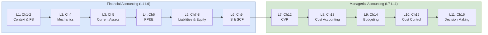

## 概述

SBMT5010「管理者會計學」是香港科技大學商學院為非會計背景管理碩士生（MBA/EMBA）開設的核心必修課，採用 Marshall、McManus & Viele 的《Accounting: What the Numbers Mean》（第 11 版）為主要教材。課程分為財務會計（第 1–6 講）與管理會計（第 7–11 講）兩大模塊：前者從會計方程式（資產 = 負債 + 股東權益）與複式簿記出發，系統介紹三大財務報表（資產負債表、損益表、現金流量表）的編製邏輯、電流資產估值（FIFO/LIFO/加權平均）、固定資產折舊及負債與股東權益結構；後者轉向管理決策，涵蓋成本-數量-利潤分析（CVP）、主預算編制、彈性預算與標準成本差異分析，以及以 NPV/IRR 為核心的資本預算。課程以國美零售 2023 年報（收入較 2019 年峰值縮跌逾 98%、股東權益淨虧 93 億人民幣）作為貫穿全學期的實戰案例，展示財務困境下每一個會計概念的真實後果；同時引入 Apple FY2023 Form 10-K 作為健康企業的對比案例，幫助學生掌握解讀 GAAP 與 IFRS 財務報告的實務判斷力。課程強調從數字背後識別商業模式優劣，是為工程及技術背景管理者補足財務語言的重要橋樑課程。

## Course Overview

**SBMT5010 Accounting for Managers** is a graduate-level course at [[wiki/entities/hkust|HKUST]] designed for non-accounting professionals. It spans nine lecture blocks organized into two halves: **financial accounting** (Lectures 1-6) and **managerial accounting** (Lectures 7-11). The textbook is Marshall, McManus, and Viele, *Accounting: What the Numbers Mean* (11th ed.), and the running real-world case is the **Gome Retail Holdings Limited 2023 Annual Report** — a Chinese consumer-electronics retailer in severe financial distress whose statements illustrate almost every pathology the course teaches. The course builds from first principles — what accounting is and who uses it — through to capital budgeting decisions that rely on the outputs of both halves.

## Curriculum Map

## Financial Accounting (Lectures 1-6)

### Lecture 1: Financial Accounting and Its Economic Context (Ch. 1-2)

Accounting serves as the **information system** that measures, processes, and communicates financial data to stakeholders. Users fall into two groups:

- **External users** — investors, creditors, analysts, regulators — rely on financial accounting governed by **GAAP** (U.S.) or **IFRS** (international). The key standard-setting bodies are the **FASB** (Financial Accounting Standards Board) and **IASB** (International Accounting Standards Board). The SEC delegates rule-making authority to the FASB for U.S. public companies.
- **Internal users** — managers at all levels — use managerial accounting, which is not bound by external reporting standards and can be tailored for planning, control, and decision support.

The course introduces the four primary [[financial-statements|financial statements]]:

| Statement | Purpose | Time Dimension |
|---|---|---|
| **Balance Sheet** | Snapshot of assets, liabilities, and equity | Point in time |
| **Income Statement** | Revenue minus expenses | Period |
| **Statement of Cash Flows** | Cash inflows/outflows by operating/investing/financing | Period |
| **Statement of Shareholders' Equity** | Changes in equity accounts | Period |

The **accounting equation** — $\text{Assets} = \text{Liabilities} + \text{Stockholders' Equity}$ — is the foundational identity from which every transaction derives. Gome's 2023 report illustrates what happens when this identity flips: total liabilities (RMB 39.2 bn) exceed total assets (RMB 30.0 bn), producing a **negative equity** ("net deficit") of RMB 9.3 bn — technical insolvency.

### Lecture 2: Mechanics of Accounting (Ch. 4)

**Double-entry bookkeeping** requires every transaction to affect at least two accounts, keeping the accounting equation in balance. Debits and credits follow strict rules:

| Account Type | Normal Balance | Increased By | Decreased By |
|---|---|---|---|
| Assets | Debit | Debit | Credit |
| Expenses | Debit | Debit | Credit |
| Liabilities | Credit | Credit | Debit |
| Equity | Credit | Credit | Debit |
| Revenue | Credit | Credit | Debit |

The lecture walks through six canonical transactions (Marshall Ch. 4) that exercise every side of the equation:

1. **Stockholders invest $2,000 cash** — Dr. Cash 2,000 / Cr. Paid-in Capital 2,000 (A↑, SE↑).
2. **Borrow $6,000 from a bank** — Dr. Cash 6,000 / Cr. Notes Payable 6,000 (A↑, L↑).
3. **Purchase $10,000 equipment with $2,000 cash and $8,000 note** — Dr. Equipment 10,000 / Cr. Cash 2,000 / Cr. Notes Payable 8,000 (A↑/A↓/L↑).
4. **Sell equipment costing $3,000 for $3,000 on account** — Dr. Accounts Receivable 3,000 / Cr. Equipment 3,000 (A↑/A↓).
5. **Provide services for $8,000 cash** — Dr. Cash 8,000 / Cr. Service Revenue 8,000 (A↑, SE↑ via revenue).
6. **Pay wages $2,000 cash** — Dr. Wage Expense 2,000 / Cr. Cash 2,000 (SE↓ via expense, A↓).

Each entry is posted to **T-accounts** (left side = debit, right side = credit). A **trial balance** then lists all account balances to verify total debits equal total credits before adjusting entries and financial statements are prepared. The full accounting cycle runs: source documents → journal → ledger → unadjusted trial balance → adjusting entries → adjusted trial balance → financial statements → closing entries → post-closing trial balance.

### Lecture 3: Current Assets (Ch. 5)

Current assets are resources expected to be converted to cash or consumed within one year (or one operating cycle). Key topics:

- **Cash and cash equivalents** — Bank reconciliation adjusts the book balance for outstanding checks, deposits in transit, bank charges, NSF checks, and errors. Two columns (book side, bank side) must converge on the same adjusted balance.
- **Accounts receivable** — Reported at **net realizable value** (gross A/R minus allowance for doubtful accounts). Two estimation methods: (a) percentage-of-sales (income statement approach, focuses on matching bad-debt expense to revenue), and (b) aging-of-receivables (balance sheet approach, focuses on reporting A/R at NRV).
- **Inventory valuation** — Three cost-flow assumptions:
  - **FIFO** (First-In, First-Out): Oldest costs go to COGS; ending inventory reflects recent prices. Produces higher net income in inflation.
  - **LIFO** (Last-In, First-Out): Most recent costs go to COGS; ending inventory at older prices. Produces lower income and tax, but **prohibited under IFRS**.
  - **Weighted average**: Blended cost across all units — dampens swings.
- **Lower of cost or market (LCM)** — Inventory is written down if market value drops below cost (conservatism principle). Gome 2023 disclosed a reversal of inventory provisions of RMB 37 m, suggesting aggressive earlier write-downs.

### Lecture 4: PP&E and Other Noncurrent Assets (Ch. 6)

Long-lived tangible assets are capitalized at historical cost (purchase price + transportation + installation) and depreciated over their useful lives. Methods include straight-line, units-of-production, and accelerated (declining balance, sum-of-years-digits). See [[depreciation|depreciation]] for the full mechanics and journal entries. Intangible assets (patents, copyrights, goodwill) are amortized or tested for impairment. Gome recorded an RMB 841 m impairment loss on right-of-use assets in 2023 — a signal that its store leases were no longer expected to generate recoverable cash flows.

### Lecture 5: Liabilities and Owner's Equity (Ch. 7-8)

**Current liabilities** include accounts payable, wages payable, unearned revenue, and the current portion of long-term debt. Interest calculation matters:

- **Straight basis**: $\text{Interest} = \text{Face Value} \times \text{Rate} \times \text{Time}$.
- **Discount basis**: Borrower receives face value minus interest upfront; effective rate exceeds stated rate.

**Noncurrent liabilities** focus on **bonds payable**:
- Bonds issued at par (market rate = coupon), at a premium (market rate < coupon), or at a discount (market rate > coupon).
- Premium/discount amortization adjusts interest expense over the bond's life using the **effective interest method**. This ties directly to [[time-value-of-money|time-value-of-money]] since bond prices are the present value of coupon + principal cash flows.

**Owner's equity** components:
- **Common stock** and **additional paid-in capital** — Contributed capital.
- **Preferred stock** — Carries dividend preference; may be cumulative (missed dividends accumulate as dividends in arrears, which must be paid before common dividends).
- **Retained earnings** — Accumulated net income minus dividends declared.
- **Treasury stock** — Shares repurchased by the company; contra-equity account. Gome holds RMB 445 m of treasury shares.
- **Dividends**: Cash dividends reduce retained earnings; stock dividends redistribute equity without cash outflow; stock splits increase shares outstanding without changing total equity.

### Lecture 6: Income Statement and Statement of Cash Flows (Ch. 9)

**Revenue recognition** follows the principle that revenue is recorded when earned and realizable — typically at the point of delivery or when performance obligations are satisfied. Under ASC 606 / IFRS 15, this is formalized as a five-step process (identify contract, identify performance obligations, determine transaction price, allocate, recognize).

**Income statement formats**:
- **Single-step**: Total revenues minus total expenses = net income.
- **Multi-step**: Separates operating from non-operating items, showing gross profit, operating income, and net income as distinct subtotals.

Key calculations:
- $\text{COGS} = \text{Beginning Inventory} + \text{Purchases} - \text{Ending Inventory}$
- $\text{Gross Profit} = \text{Net Sales} - \text{COGS}$
- $\text{Gross Profit Ratio} = \text{Gross Profit} \div \text{Net Sales}$
- $EPS = \frac{\text{Net Income} - \text{Preferred Dividends}}{\text{Weighted-Average Common Shares Outstanding}}$

**Gome 2023 multi-step walk-through (RMB '000)**:

| Line | 2023 | 2022 |
|---|---:|---:|
| Revenue | 646,904 | 17,444,480 |
| Cost of sales | (472,667) | (15,625,097) |
| **Gross profit** | **174,237** | **1,819,383** |
| Other income and gains | 600,024 | 1,169,345 |
| Selling and distribution | (1,675,216) | (4,726,477) |
| Administrative | (1,475,539) | (2,913,233) |
| Impairment of goodwill | (841,156) | (9,214,521) |
| Other impairments and losses | (4,093,977) | (4,876,079) |
| **Loss before finance and tax** | **(7,310,195)** | **(18,751,762)** |
| Finance costs | (2,816,911) | (1,703,331) |
| Finance income | 44,504 | 169,596 |
| **Loss before tax** | **(10,082,602)** | **(20,285,497)** |
| Income tax | (8,422) | 79,194 |
| **Loss for the year** | **(10,091,024)** | **(20,206,303)** |
| Basic LPS | (RMB 22.3 fen) | (RMB 58.6 fen) |

Revenue collapsed **96.3%** year-over-year (RMB 17.4 bn → RMB 0.65 bn), and by 98.9% from the 2019 peak of RMB 59.5 bn, because major suppliers suspended shipments. The gross margin still held at 26.9% in 2023, barely above 2022's 10.4%, but was wiped out many times over by operating expenses and finance costs.

**Statement of Cash Flows** classifies cash movements into three buckets:
- **Operating activities** — Cash from core business operations. The indirect method starts with net income and adjusts for non-cash items ([[depreciation|depreciation]], impairments, amortization) and changes in working capital. The direct method lists actual cash receipts/payments.
- **Investing activities** — Purchases/sales of long-term assets, investments.
- **Financing activities** — Issuing/repaying debt, issuing/repurchasing stock, paying dividends.

**Gome 2023 cash flow summary (RMB '000)**:

| Activity | 2023 | 2022 |
|---|---:|---:|
| Operating | +1,112,771 | +820,725 |
| Investing | +373,090 | (167,911) |
| Financing | (1,589,276) | (4,727,350) |
| **Net change in cash** | **(103,415)** | **(4,074,536)** |
| Cash at end of year | 66,247 | 169,713 |

Note the striking gap between accounting loss (RMB 10.1 bn) and operating cash inflow (RMB 1.1 bn) — the difference is almost entirely non-cash impairments and finance cost accruals that the indirect method adds back. Non-cash transactions (e.g., converting debt to equity) are disclosed separately.

## Managerial Accounting (Lectures 7-11)

### Lecture 7: Managerial Accounting and CVP Analysis (Ch. 12)

Managerial accounting is **internal, forward-looking, and unregulated**. It supports planning, control, and decision-making rather than external reporting.

**Cost behavior** classifies costs by how they respond to changes in activity volume:
- **Variable costs** — Change proportionally with activity (e.g., direct materials).
- **Fixed costs** — Remain constant within the **relevant range** (e.g., rent, salaries).
- **Semivariable (mixed) costs** — Contain both fixed and variable components. The **high-low method** estimates variable cost per unit as $\frac{\text{Cost}_{\text{high}} - \text{Cost}_{\text{low}}}{\text{Activity}_{\text{high}} - \text{Activity}_{\text{low}}}$, then backs out fixed cost.

**[[cvp-analysis|Cost-Volume-Profit (CVP) analysis]]** examines the relationship between costs, volume, and profit:
- **Contribution margin (CM)** $= \text{Selling Price} - \text{Variable Cost per Unit}$.
- **CM ratio** $= \frac{CM}{\text{Selling Price}}$.
- **Break-even point**: Units $= \frac{\text{Fixed Costs}}{CM}$; Revenue $= \frac{\text{Fixed Costs}}{\text{CM Ratio}}$.
- **Target profit**: Units $= \frac{\text{Fixed Costs} + \text{Target Profit}}{CM}$.
- **Margin of safety** $= \text{Actual Sales} - \text{Break-even Sales}$; expressed as a percentage it signals downside tolerance.
- **Operating leverage** $= \frac{\text{Contribution Margin}}{\text{Operating Income}}$. Higher leverage means greater profit sensitivity to volume changes.

### Lecture 8-9: Cost Accounting and Budgeting (Ch. 13-14)

Cost accounting allocates manufacturing costs (direct materials, direct labor, manufacturing overhead) to products via job-order or process costing. Overhead is applied using a predetermined rate. Budgeting (Ch. 14) builds a **master budget** top-down from the sales forecast through production, materials, labor, overhead, and cash budgets, culminating in pro-forma financial statements.

### Lecture 10: Cost Control (Ch. 15)

- **Flexible budgets** adjust budgeted figures to actual activity levels, enabling meaningful variance analysis.
- **Standard costing** sets predetermined costs per unit for materials, labor, and overhead.
- **Variance analysis**:
  - **Materials**: Price variance = (Actual price − Standard price) × Actual quantity; Quantity variance = (Actual quantity − Standard quantity) × Standard price.
  - **Labor**: Rate variance and efficiency variance follow the same pattern.
  - **Overhead**: Spending, efficiency, and volume variances.

Variances are labeled **favorable (F)** when actual costs are below standard and **unfavorable (U)** when above. Investigation thresholds (often 5-10% or a dollar amount) guide management attention under a management-by-exception philosophy.

### Lecture 11: Costs for Decision Making (Ch. 16)

Decision-making relies on identifying **relevant costs** — future costs that differ between alternatives:

- **Differential costs** — Costs that change between options.
- **Opportunity costs** — Benefits forgone from the next-best alternative. Always relevant but never recorded in accounting books.
- **Sunk costs** — Past costs that cannot be recovered. Never relevant for future decisions.
- **Allocated costs** — Relevant only if avoidable.

**Short-run decision types**:
- **Special pricing** — Accept if incremental revenue exceeds incremental cost (given spare capacity).
- **Make-or-buy** — Compare avoidable internal costs with external purchase price, including opportunity costs of freed capacity.
- **Segment continuation** — Keep a segment if its contribution margin exceeds avoidable fixed costs.
- **Product mix under constraints** — Rank products by contribution margin per unit of the binding constraint (e.g., machine hours, labor hours).

**Capital budgeting** (long-run decisions) relies on [[time-value-of-money|time-value-of-money]]:
- **[[npv|Net Present Value (NPV)]]** — Sum of discounted future cash flows minus initial investment. Accept if $NPV > 0$.
- **[[irr|Internal Rate of Return (IRR)]]** — Discount rate that makes $NPV = 0$. Accept if $IRR > \text{cost of capital}$.
- **Payback period** — Time to recover the initial investment. Simple but ignores time value of money and post-payback cash flows.
- **Cost of capital** — Weighted average of debt and equity costs; serves as the discount rate for NPV.

## Running Case: Gome Retail 2023

The Gome case threads through every lecture. Key figures and teaching moments:

| Metric | 2019 | 2023 |
|---|---:|---:|
| Revenue (RMB m) | 59,483 | 647 |
| Loss to owners (RMB m) | (2,590) | (10,057) |
| Total assets (RMB m) | 71,872 | 29,978 |
| Total liabilities (RMB m) | 63,711 | 39,237 |
| Net (liabilities) assets (RMB m) | 8,161 | (9,260) |

- **Going concern**: Auditor (Elite Partners CPA) flagged material uncertainty because current liabilities exceeded current assets by RMB 32.8 bn.
- **Revenue collapse**: A 99% drop over five years, tied to supplier suspensions and a failed pivot to "Home·Living" omni-retail.
- **Impairments dominate losses**: RMB 0.8 bn goodwill impairment (2023) follows RMB 9.2 bn in 2022, showing how acquisition premiums unwind when cash flow disappoints.
- **Working capital crisis**: Cash fell from RMB 4.4 bn (2022 start) to RMB 66 m (2023 end) — barely one day of 2019-scale operations.

## Case Studies

The course uses two real annual reports to move students from mechanics to interpretation.

| Case | Scope | What it exercises |
|---|---|---|
| **Gome Retail 2023 Annual Report** | Balance sheet, income statement, cash flow, notes | Reading a distressed IFRS filing; negative equity, going-concern flag, impairment cascade; working-capital deficit; accrual-vs-cash divergence |
| **Apple Inc. FY2023 Form 10-K** | Consolidated BS, IS, SCF, equity statement | Reading a healthy US GAAP filing; interpreting accumulated deficit alongside record profit; buyback-driven equity shrinkage; commercial-paper current-liability strategy |

**Gome vs. Apple teaching arc**: the balance-sheet contrast is covered in detail on [[financial-statements|financial statements]] — Apple's $352.6 bn of total assets against a $214 m accumulated deficit is paired with Gome's RMB 30 bn of assets against a RMB 9.3 bn net deficit to show that equity-section signs are only meaningful once the underlying business model is understood.

## References

- Marshall, D. H., McManus, W. W., & Viele, D. F. (2020). *Accounting: What the Numbers Mean* (11th ed.). McGraw-Hill Education. — adopted textbook; end-of-chapter problems form the HW drill layer above. Not maintained as a separate source page.

## Key Findings

- The accounting equation ($A = L + SE$) underpins every recording, reporting, and analysis technique in the course — Gome's negative equity case drives home why.
- **GAAP vs. IFRS** differences (e.g., LIFO prohibition under IFRS, development cost capitalization) are practically important for multinational managers.
- CVP analysis provides a powerful but simplified model; real-world applications must account for multiple products, stepped fixed costs, and non-linear cost behavior.
- Variance analysis is most useful when combined with management-by-exception — investigating only material deviations.
- NPV is theoretically superior to IRR or payback because it directly measures value creation in currency units and handles unconventional cash flows, though IRR remains popular for its intuitive percentage format.
- The distinction between relevant and irrelevant costs (especially sunk costs and allocated costs) is the single most important concept for managerial decision-making.
- Reading statements is as much about pattern recognition as arithmetic: Gome's cash flow showing positive operating flow while the income statement shows RMB 10 bn losses is a textbook example of how accrual accounting and cash can diverge.

## Related Concepts

- [[financial-statements|Financial Statements]]
- [[cvp-analysis|CVP Analysis]]
- [[npv|Net Present Value]]
- [[irr|Internal Rate of Return]]
- [[time-value-of-money|Time Value of Money]]
- [[depreciation|Depreciation]]
- [[financial-ratios|Financial Ratios]]
- [[erp|Enterprise Resource Planning]]
- [[balanced-scorecard|Balanced Scorecard]]
- [[benfords-law|Benford's Law]]

## Source Materials

- Ch.1 Financial Accounting & Its Economic Context
- Ch.2 The Financial Statements
- Ch.4 Mechanics of Accounting
- Ch.5 Current Assets
- Ch.6 PP&E
- Ch.7-8 Liabilities and Owner's Equity
- Ch.9 Income Statement and Cash Flows
- Ch.12 Managerial Accounting and CVP Analysis
- Ch.15 Cost Control
- Ch.16 Costs for Decision Making
- Gome Retail 2023 Annual Report
- Apple Inc. 2023 10-K
- Marshall, McManus & Viele, Accounting: What the Numbers Mean, 11e
