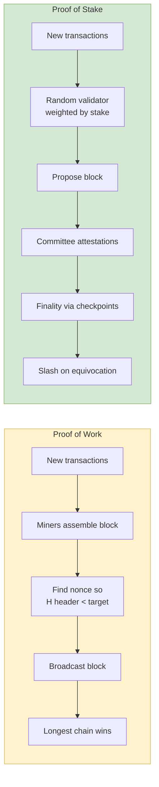

## 概述

EEMT6000H「區塊鏈技術導論」是香港科技大學工程管理碩士（MSc EEMT）課程的選修科，由 Prof. James Lei 於週六上午授課，評核方式為出席（20%）、作業（15%）、期中（15%）及期末專案（50%）。課程以七場講座系統涵蓋區塊鏈技術的完整堆疊：從密碼學基礎（SHA-256 雜湊函數、橢圓曲線 ECDSA 數位簽章、Merkle 樹）出發，深入比特幣協議（UTXO 模型、Bitcoin Script、工作量證明挖礦、難度調整、51% 攻擊的 Gambler's Ruin 分析）、以太坊與智能合約（帳戶模型 vs. UTXO、EVM Gas 機制、Solidity 語言）、代幣經濟學與穩定幣（法幣抵押型 USDT/USDC、加密資產超額抵押型 DAI、算法型穩定幣的死亡螺旋風險）、去中心化金融 DeFi（Uniswap v2 AMM 恆積公式 x·y=k、Compound 借貸協議、閃電貸套利與預言機攻擊）及企業級區塊鏈（Hyperledger Fabric 的執行-排序-驗證架構、通道隱私機制、CAP 定理與共識機制比較）。兩次作業涵蓋 SHA-256 難度謎題計算、ECDSA 簽章驗證及 Solidity 合約編寫，期末專案以作者自身研究（零知識證明智能家居認證系統）為具體成果，連結 IoT 安全、ZKP 密碼學與 zk-Rollup 擴容技術，展示 OR 視角下區塊鏈作為去中心化信任基礎設施的研究潛力。

## Course Overview

**EEMT6000H Introduction to Blockchain Technology** is offered as part of the [[wiki/entities/hkust|HKUST]] Engineering Management program. Instructor: **Prof. James Lei**. Schedule: Saturdays 10:00am-12:50pm. A parallel lab course **ISOM3000H — Blockchain Programming in Business Applications** covers hands-on Solidity development.

The course spans seven lectures progressing from foundational concepts (distributed ledger technology, [[cryptography|Cryptography]]) through Bitcoin and Ethereum protocols, [[smart-contracts|Smart Contracts]], tokenomics, [[defi|DeFi]], and enterprise blockchain solutions.

## Lecture 1 — Introduction to Blockchain and DLT

The course opens with the historical context of **distributed ledger technology (DLT)**, framing blockchain as a convergence of information and communication technologies. Key themes include the evolution from centralized databases to peer-to-peer networks, the role of [[cryptography|Cryptography]] in enabling trustless systems, and the distinction between permissioned and permissionless ledgers. Blockchain is introduced as a chain of blocks containing transaction records, secured by cryptographic hashes and maintained by a distributed consensus protocol — a synthesis of [[web-architecture|P2P distributed systems]] and primitive cryptography.

## Lecture 2 — Sharing Economy, Web3.0, and Bitcoin Foundations

**Part 1** examines the sharing economy and its evolution toward Web3.0. Traditional platform models (Uber, Airbnb) extract value through intermediation; Web3.0 proposes replacing these with tokenized, decentralized alternatives governed by **DAOs (Decentralized Autonomous Organizations)**. Data ownership shifts from platforms to users — a direct challenge to the [[ecommerce-models|platform ecommerce model]].

**Part 2** introduces the Bitcoin whitepaper (Satoshi Nakamoto, 2008) and supporting monetary theory. Key frameworks include **Modern Monetary Theory (MMT)**, the **Cantillon Effect** (proximity to money creation confers advantage), and **Hayek's denationalization of money** — the argument for competing private currencies. Cryptographic foundations are introduced: **hash functions** (SHA-256, preimage resistance, collision resistance, birthday attack at $O(2^{n/2})$), **symmetric encryption** (XOR-based block ciphers), and **public-key cryptography** (digital signatures, non-repudiation). Bitcoin uses **elliptic curve cryptography** on secp256k1 with curve equation $y^2 = x^3 + 7 \pmod{p}$.

## Lecture 3 — Bitcoin Protocol: Transactions, Mining, and Proof of Work

A deep dive into the Bitcoin protocol. **Transactions** use the **UTXO (Unspent Transaction Output)** model — each transaction consumes previous outputs and creates new ones. Transaction structure includes version, inputs (with `scriptSig`), outputs (with `scriptPubKey` and value), and locktime. Typical size: ~404 bytes. **Bitcoin Script** is a stack-based, intentionally non-Turing-complete language; a canonical P2PKH locking script is:

```
scriptPubKey: OP_DUP OP_HASH160 <pubKeyHash> OP_EQUALVERIFY OP_CHECKSIG
scriptSig:    <sig> <pubKey>
```

Nodes execute the scripts concatenated (input script followed by output script) and accept the transaction if the stack ends with TRUE.

### Block Structure and Merkle Trees

Each block contains a header (previous block hash, nonce, Merkle root, timestamp, difficulty target) plus a body (transaction list). Blocks are linked via **double SHA-256** hashing: $H(x) = \text{SHA256}(\text{SHA256}(x))$ — the second layer mitigates length-extension attacks. **Merkle trees** provide efficient transaction verification: proving inclusion of a transaction requires only $O(\log n)$ intermediate hashes to reconstruct the Merkle root.

### Proof of Work Puzzle

Mining is the process of finding a nonce such that:

$$H(\text{prevBlockHash} \parallel \text{merkleRoot} \parallel \text{nonce}) < \text{target}$$

Equivalently, the block hash must begin with a requisite number of leading zero bits (~17 zeros in 2024). The puzzle satisfies three requirements: (1) computationally difficult, (2) parameterizable, (3) easily verifiable — it is a **partial hash-preimage puzzle**. Because the 32-bit block-header nonce space is exhausted by an Antminer S19P (110 TH/s) in $2^{32}/1.1 \times 10^{14} \approx 39~\mu\text{s}$, miners must also vary the **coinbase nonce**, which propagates up the Merkle tree.

### Difficulty Adjustment, Halving, Rewards

Difficulty re-targets every **2,016 blocks** (≈2 weeks) via:

$$D_{\text{next}} = D_{\text{prev}} \times \frac{2~\text{weeks}}{\text{time to mine last 2016 blocks}}$$

Target block time is ~10 minutes — a design compromise between fast settlement and fork probability. The **coinbase transaction** creates new BTC; the block reward started at 50 BTC and halves every **210,000 blocks** (~4 years), converging via geometric sum to a hard cap of **21 million BTC** (~2140). As of the lecture, ~18.97M BTC (~90%) are in circulation. Mining hardware progression: CPU (20 MH/s) → GPU (200 MH/s) → FPGA (1 GH/s) → ASIC (10 TH/s). **Mining pools** reduce variance; pay-per-share, proportional, and PPLNS schemes each have different incentive trade-offs, and **pool hopping** exploits proportional pools.

### Attacks and Defences

- **51% attack / double-spend**: Probability of attacker catching up follows the Gambler's Ruin: $p_C(j) = (q/p)^j$ if $q<p$. Bob's required confirmation depth depends on attacker hashrate fraction.
- **Selfish mining**: Block-withholding becomes profitable at >25% hashrate.
- **Feather forking**: Threaten to fork with $q$ hashrate to orphan a block with probability $q^2$, used for censorship.
- **Eclipse / race attacks** on 0-confirmation merchants.

**SPV (Simplified Payment Verification)** nodes store only block headers (~83 MB vs 516 GB for the full chain) and query full nodes for Merkle branches — the design described in Section 8 of Nakamoto's paper.

## Lecture 4 — Ethereum and Smart Contracts

Bitcoin's limitations directly motivate Ethereum: (1) **lack of Turing-completeness**, (2) **lack of state** (UTXO is spent or unspent — no stateful multi-stage scripts), (3) **blockchain-blindness** (no access to block metadata inside scripts), (4) the **1 MB block size cap**, and (5) **value-blindness** (scripts cannot control fine-grained amounts). Ethereum, proposed by Vitalik Buterin, is defined as a "cryptographically secure transactional singleton machine with shared-state" — a **transaction-based state machine** supporting arbitrary computation.

Ethereum uses an **account-based model** (not UTXO) with two account types:

| Field | Externally Owned Account (EOA) | Contract Account |
|---|---|---|
| Controlled by | Private key | Deployed bytecode |
| Can initiate transactions | Yes | No (only reacts) |
| Contains | Address, balance, nonce | Address, balance, nonce, storageRoot, codeHash |
| Persistent storage | No | Yes (Merkle Patricia trie) |

The native asset is **Ether**. Initial supply: 60M from 2014 presale + 12M developer fund. Block reward was 5 ETH per block (~15-17 sec intervals) with 2-3 ETH uncle/aunt rewards; annual issuance capped at ~18M ETH. Ethereum transitioned from Proof of Work to **Proof of Stake** on September 15, 2022 ("The Merge"), eliminating ~99.95% of energy consumption.

[[smart-contracts|Smart contracts]] are self-executing programs deployed on the blockchain. The **Ethereum Virtual Machine (EVM)** is a stack-based 256-bit virtual machine executing contract bytecode. The **gas mechanism** solves the halting problem — every opcode has a gas cost, and transactions specify `startgas` (maximum gas) and `gasprice` (wei per gas unit). If execution exceeds the gas limit, all state changes revert but the gas fee is still consumed. Storage dominates: `SSTORE` costs 20,000 gas (with 15,000 gas refund on clearing); base transaction cost is 21,000 gas. Ether denominations: 1 Ether $= 10^{18}$ wei; gas prices are quoted in Gwei ($10^9$ wei).

Solidity is the dominant high-level language; Vyper (Python-like, auditability-focused) and Yul (low-level IR) target the same EVM bytecode. Lecture 4 introduces **Hello World**, **AppToken**, **Ballot**, and **Bank** contract examples. Language features covered: state variables, function visibility (`public`, `private`, `internal`, `external`), modifiers (e.g., `onlyOwner`), events (log opcodes, 375 gas base), `payable` / `receive()` / `fallback()` functions, `selfdestruct`, and anti-replay `nonce` semantics.

## Lecture 5 — Tokenomics and Stablecoins

**Cryptoeconomics** combines cryptography and economic incentives to design decentralized protocols. **Tokenomics** studies token design within this framework. Tokens serve six roles: **RIGHT** (governance, voting), **VALUE EXCHANGE** (medium of exchange), **TOLL** (access fees), **FUNCTION** (utility within dApps), **CURRENCY** (payment), and **EARNINGS** (profit sharing). Evaluating **token-market fit** requires assessing whether a token is genuinely needed versus using existing payment rails.

Case studies illustrate tokenomics pitfalls. **FCoin** (May 2018) implemented **trans-fee mining** — users earned FT tokens proportional to trading fees, with an 80% revenue distribution. The 51% community reward allocation caused massive token dilution; new tokens were minted daily as `rev / token_price`, forming a reflexive loop that collapsed FT from ~\$1.00 to ~\$0.25. **Haowan.ba** demonstrated similar dynamics in a gaming context with "playing-is-mining" incentives and expiring mining machines.

[[defi|Stablecoins]] are covered in detail and are the key bridge to Lecture 6. Three categories are distinguished:

| Type | Mechanism | Examples | Key Risk |
|---|---|---|---|
| Fiat-collateralized (custodial) | 1:1 fiat reserves | USDT, USDC, BUSD, GUSD, PUSD | Counterparty, reserve composition |
| Crypto-collateralized (synthetic) | Over-collateralized crypto vaults | DAI (MakerDAO), RAI (Reflexer) | Liquidation cascade, oracle |
| Algorithmic (un-collateralized) | Supply rebasing, seigniorage shares | FRAX, FEI, IRON, OHM | Bank-run reflexivity |

US-regulated stablecoins (GUSD, PUSD) are approved by **NYDFS** with monthly reserve audits. The stablecoin market grew from **$5.6B in 2020 to over $130B by 2022**. The lecture also discusses **stablecoin disintermediation** — if issuers hold non-deposit reserves, bank deposits and lending capacity shrink, indirectly affecting commercial paper markets and the real economy.

## Lecture 6 — Decentralized Finance (DeFi)

This lecture maps traditional financial services to their [[defi|DeFi]] counterparts across every category: money (stablecoins), banking (Aave, Compound), exchanges (Uniswap, Curve, dYdX), brokerage (Synthetix, GMX), insurance (Nexus Mutual), payments (Lightning Network, bridges), and asset management (Yearn, Convex).

**AMM math (Uniswap v2 constant product)**: Given reserves $(x, y)$ with invariant $x \cdot y = k$, a trader depositing $\Delta y$ receives:

$$\Delta x = x - \frac{k}{y + (1-f)\Delta y}$$

where $f = 0.003$ is the swap fee. The lecture works a concrete example: pool of (100 A, 10 B); Alice swaps 1 B → pool becomes $(100 \cdot 10 / 10.9997, 10.9997) = (90.9116, 10.9997)$, so Alice receives $100 - 90.9116 = 9.0884$ A. The effective price of B fell from 10 A → 8.26 A (slippage plus price impact). LP shares are issued as $\sqrt{xy}$.

**Lending (Compound / Aave)**: Suppliers deposit into a pool and receive interest-bearing **cTokens** / **aTokens**. Borrowers post collateral (over-collateralized); interest rates adjust algorithmically based on pool utilization. **Liquidation** triggers when $\text{value(debt)} > \text{collateralFactor} \times \text{value(collateral)}$. Compound collateral factors: ETH/DAI ~75%, UNI ~60%, YFI ~35%.

**Flash loans** are DeFi-native: uncollateralized loans that must be borrowed and repaid in a single transaction. Use cases include risk-free arbitrage, collateral swaps, and — notoriously — **oracle price manipulation** attacks (e.g., the sUSD/ETH exploit that yielded ~1935.87 ETH in a single transaction).

**Oracles**: 1-signer, M-of-N, and Schelling-point designs are compared; Chainlink is the dominant decentralized oracle network. Price oracle manipulation via flash loans is a recurring attack vector.

## Lecture 7 — Consensus Mechanisms and Enterprise Blockchain

Distributed-systems fundamentals anchor the lecture: **CAP theorem** (consistency, availability, partition-tolerance — pick two), safety vs liveness (Lamport 1977), synchronous / asynchronous / partially-synchronous network models, and **FLP impossibility** for deterministic asynchronous consensus.

### Consensus Family Comparison

| Mechanism | Safety | Liveness | Throughput | Finality | Byzantine Tol. |
|---|---|---|---|---|---|
| PoW (Nakamoto) | Eventual consistency; 51% attack threshold | Miner incentives | ~7 TPS (BTC) | Probabilistic | 50% |
| PoS (Ethereum) | Slashing for equivocation | Validator rotation | ~30 TPS | Probabilistic + checkpoint finality | 33% |
| PBFT | Deterministic | Three-phase voting | 1000s TPS | Instant | 33% |
| Paxos / Raft | Deterministic | Leader election | High | Instant | 0% (crash-only) |
| Hyperledger Fabric | Execute-order-validate | Ordering service (Raft) | High | Instant | Depends on orderer |

PoS replaces hash-power lotteries with stake-weighted validator selection. Key issue: the **nothing-at-stake problem** — validators have no cost to sign conflicting chains. Ethereum solves this with **slashing**: a validator's stake is destroyed if they sign two blocks at the same height, detected via a fraud-proof containing both signatures.

**Blockchains are categorized** as public (permissionless — Bitcoin, Ethereum), consortium (permissioned, multi-organization), or private (single organization). Enterprise use cases favor consortium/private chains for regulatory compliance and performance.

**Hyperledger Fabric** (Linux Foundation / IBM) is the primary enterprise blockchain framework discussed. Modular pluggable consensus, **channel-based privacy** (sub-ledgers isolating data between subsets of members), **chaincode** (smart contracts in Go/Java/Node.js), and a distinctive **execute-order-validate** transaction flow that avoids non-determinism by validating read/write sets after ordering. **Blockchain-as-a-Service (BaaS)** offerings from IBM (IBP), Oracle, Amazon Managed Blockchain, Alibaba, Microsoft Azure, SAP, Baidu BBE, and Tencent TBaaS lower the barrier to enterprise adoption. The **IBM Crypto Anchor Verifier** demonstrates blockchain integration with physical supply chains using optical verification.

## Consensus Flow Diagram



## Key Findings

- Bitcoin's intentional limitations (non-Turing-complete scripting, UTXO) buy security and simplicity but restrict functionality, directly motivating Ethereum's account-based, Turing-complete design.
- The **gas mechanism** transforms an unsolvable CS problem (halting) into an economic constraint — every opcode has a concrete price, making arbitrary on-chain computation practical.
- **51% attack** security is quantified via the Gambler's Ruin: probability of double-spend success decays geometrically in confirmation depth $z$ at $(q/p)^z$ when attacker has less than half the hashrate.
- **Tokenomics failures** (FCoin's trans-fee mining, IRON/UST algorithmic stablecoins) demonstrate that poorly designed incentive structures create reflexive death spirals — crypto's version of bank runs on wholesale money-like assets.
- **DeFi composability** is both its greatest strength (rapid innovation, "money Legos") and greatest risk (flash-loan-driven oracle manipulation, liquidation cascades).
- **Enterprise blockchain** (Hyperledger Fabric) makes fundamentally different trade-offs — sacrificing decentralization for privacy, throughput, and regulatory compliance, enabling cross-organizational coordination in [[supply-chain-management|supply chain]], trade finance, and provenance tracking.

## Related Concepts

- [[smart-contracts|Smart Contracts]] — Ethereum smart contracts, EVM, gas mechanism, Solidity
- [[defi|DeFi]] — Decentralized finance, AMMs, lending protocols, stablecoins
- [[cryptography|Cryptography]] — Hash functions, digital signatures, elliptic curve cryptography, ZKP primitives
- [[web-architecture|Web Architecture]] — Distributed systems, P2P networks, Web3.0 paradigm
- [[ecommerce-models|E-Commerce Models]] — Platform economics, sharing economy, tokenized business models
- [[supply-chain-management|Supply Chain Management]] — Enterprise blockchain provenance tracking use cases
- [[financial-statements|Financial Statements]] — Reserve accounting and audit context for stablecoin issuers
- [[wiki/entities/hkust|HKUST]] — Host institution for the course

## Source Materials

- Zyskind et al. (2015) — Decentralizing Privacy
- Luu et al. (2016) — Making Smart Contracts Smarter
- Huang et al. (2024) — zk-Rollup Data Availability
- Dorri et al. (2017) — Blockchain for IoT Security: Smart Home Case Study
- Dorri et al. (2017) — Towards an Optimized Blockchain for IoT
- Lecture 1: Introduction
- Lecture 2 Part 1: Sharing Economy & Web3.0
- Lecture 2 Part 2: Bitcoin & Blockchain
- Lecture 3: Mining & Proof of Work
- Lecture 4: Ethereum & Smart Contracts
- Lecture 5: Smart Contracts & Tokenomics
- Lecture 6: Decentralized Finance
- Lecture 7: Consensus & Enterprise Blockchain
