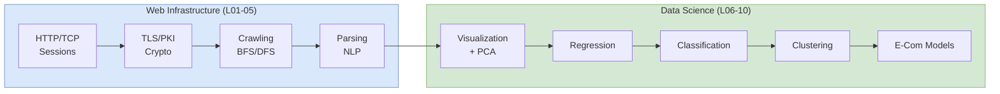

## 概述

EEMT5540「電子商務資訊技術應用」是香港科技大學工程管理碩士（MSc EEMT）課程的核心必修科，橫跨 14 週，以 Python（scikit-learn、Plotly、Pandas、NumPy）為全程實作工具。課程分為兩大弧線：網絡基礎設施與安全（第 1–5 講），涵蓋 TCP/IP 協議棧、HTTP 無狀態請求-回應、Cookie 會話管理、DNS 層級解析、TLS 握手與 PKI 信任鏈、RSA 與 AES 加密原理、數字簽名與 CA 機構，以及基於 BFS/DFS 的網絡爬蟲與 BeautifulSoup HTML 解析；以及電商數據科學（第 6–10 講），涵蓋 Plotly 數據可視化（Anscombe 四重奏警示）、PCA 降維（特征值分解、Scree 圖）、線性迴歸需求預測、KNN/決策樹/邏輯迴歸/SVM/Naïve Bayes 分類方法、K-Means 及 GMM 聚類，以及電商商業模式（B2B/B2C/C2C、支付系統、共享經濟、社交電商）。面向工程管理背景的碩士生，課程以完整的數據管道（爬取→清洗→可視化→建模）為主線，配合 Airbnb/eBay.vn 哈佛商業案例及 Kaggle 數據集小組項目。四次作業分別覆蓋 PHP 會話 Cookie、Kaggle 入門、PCA 實作及分類模型比較，為 EEMT5500（應用統計）的 R 技術棧提供 Python 側的互補，是修讀 EEMT5560（整合商業解決方案）前的重要技術預備課程。

## Course Overview

EEMT5540 at [[wiki/entities/hkust|HKUST]] spans 14 weeks and covers the technology stack underlying modern e-commerce, from low-level web protocols up through machine-learning methods used for business analytics. The course is structured in two broad arcs:

1. **Web Infrastructure & Security** (Lectures 01-05): Protocols, cryptography, web crawling, parsing.
2. **Data Science for Commerce** (Lectures 06-10): Visualization, dimensionality reduction, regression, classification, clustering, and e-commerce business models.

Tutorials are Python-based, using **scikit-learn**, **Plotly**, **Pandas**, and **NumPy** with datasets sourced from Kaggle. The course treats engineering management students as practitioners: every lecture pairs conceptual exposition with a runnable notebook.

## Pedagogical Pipeline

The arrow from parsing to visualization reflects the real-world pipeline: raw HTML is crawled, parsed into tabular features, visualized to guide feature selection, then modeled. Business-model context (Lecture 10) closes the loop by framing why any of this matters commercially.

## Lecture-by-Lecture Summary

### Lecture 01 — Web Protocols & Sessions

Covers the foundational layers of web communication. Key topics:

- **Packet switching**: Messages are broken into packets of ~2048-4096 bytes with source/destination addresses. Error probability scales with message length, motivating retransmission of lost chunks rather than entire messages.
- **TCP/IP stack**: Application, Transport, Network, Data Link layers. TCP provides reliable, ordered delivery via handshaking, acknowledgements, flow control, and congestion control; UDP is connectionless and faster but unreliable (used by streaming media, DNS, VoIP).
- **Circuit vs. packet switching**: Circuit switching reserves end-to-end resources (telephone model); packet switching shares links statistically, accepting queueing but enabling massive concurrency — see [[wiki/concepts/queueing-theory|Queueing Theory]] for the underlying math.
- **HTTP**: Request/response model, status codes (1xx-5xx), methods (GET, POST, PUT, DELETE). HTTP is stateless by default — each GET/POST creates a new TCP connection and the server "forgets" the client.
- **DNS**: Hierarchical name resolution from root servers through TLD to authoritative nameservers. Recursive vs. iterative queries.
- **Session management**: Cookies (server-set via `Set-Cookie`, client-returned in every subsequent request header), URL rewriting, hidden form fields. The lecture demonstrates session tracking with a PHP CGI example: server returns `Set-Cookie: ECOM=Loving_6000D; expires=now+2400s`, and the client echoes it back on the next request.
- **REST**: Representational State Transfer — resource-oriented, stateless, uses standard HTTP methods. Contrasted with SOAP.

See [[wiki/concepts/web-architecture|Web Architecture]] for an expanded treatment.

### Lecture 02 — Basics of Secure Communications

Introduces cryptographic primitives used in e-commerce security:

- **Attack taxonomy**: passive (packet sniffing), active (spoofing, cryptographic brute-force, virus/worm/trojan), denial of service, social engineering. The course motivates defences from this threat model.
- **Symmetric encryption**: DES (64-bit blocks, 56-bit key, Feistel cipher), AES (128-bit blocks, 128/192/256-bit keys). The lecture derives symmetric encryption from the XOR identity: $(B \oplus A) \oplus A = B$, so XORing data with a shared key encrypts, and XORing the ciphertext with the same key recovers plaintext. This is the foundation of the one-time pad and, by extension, DES/AES round functions.
- **One-time pad**: Provably secure if the key is truly random, at least as long as the message, and used only once. Shifts ciphertext letter frequencies toward uniform, defeating the frequency analysis that broke the Caesar cipher.
- **Asymmetric encryption**: RSA (based on integer factorization), ECDSA (elliptic curve, shorter keys for equivalent strength). The key-distribution problem for symmetric keys ($\binom{N}{2} = N(N-1)/2$ keys for $N$ parties) motivates asymmetric schemes.
- **RSA worked example** (from lecture): Alice picks $p=23, q=41$, computes $N = pq = 943$, chooses $e=7$ relatively prime to $(p-1)(q-1)=880$. Bob encrypts $M=35$ as $C = 35^7 \bmod 943 = 545$. Alice solves $7d \equiv 1 \pmod{880}$ to get $d=503$ and recovers $M = 545^{503} \bmod 943 = 35$.
- **Hash functions**: SHA-256 for message integrity. Properties: deterministic, one-way, collision-resistant.
- **Digital signatures**: Sign with private key, verify with public key. Provides authentication, integrity, non-repudiation.
- **PKI**: Certificate Authorities, certificate chains, trust hierarchies. Common CAs covered: VeriSign, Comodo, GoDaddy, DigiCert.
- **TLS handshake**: Client and server exchange random nonces $r_c, r_s$, verify certificates via CA, then the client generates a pre-master secret `pms`, encrypts it with the server's public key, and both sides derive the session password `pass` from $(r_c, r_s, pms)$. The remainder of the session uses symmetric encryption with this derived key on port 443.

See [[wiki/concepts/cryptography|Cryptography]] for deeper coverage.

### Lecture 03 — Web Crawling & Graph Search

Covers the mechanics of systematically retrieving web content:

- **Web crawlers**: Breadth-first vs. depth-first traversal of the web graph. Politeness policies, robots.txt compliance.
- **Graph representations**: Adjacency matrix vs. adjacency list. Directed vs. undirected graphs.
- **BFS**: Queue-based traversal, level-order discovery. Optimal for shortest-path in unweighted graphs.
- **DFS**: Stack-based (or recursive) traversal, explores deeply before backtracking.
- **Python implementation**: Using `requests` and `BeautifulSoup` for HTTP fetching and HTML parsing.

### Lecture 05 — Parsing & NLP

Focuses on extracting structured data from unstructured text:

- **HTML parsing**: DOM tree traversal, tag selection, attribute filtering with BeautifulSoup.
- **Regular expressions**: Pattern matching for text extraction — character classes, quantifiers, groups, anchors.
- **NLP basics**: Tokenization, stemming, stop-word removal. Bag-of-words model. TF-IDF weighting for term importance. See [[wiki/concepts/nlp-basics|NLP Basics]] for extended treatment.
- **Text processing pipeline**: Raw HTML → cleaned text → tokens → feature vectors, which then feed into [[wiki/concepts/logistic-regression|Logistic Regression]] or other classifiers for sentiment/category prediction.

### Lecture 06 — Visualization & Dimensionality Reduction

Two interleaved topics covering data exploration and feature engineering:

**Data Visualization** with Plotly:
- Histogram, scatter plot, box plot, correlation heatmap.
- **Anscombe's quartet**: Four datasets with identical summary statistics but visually distinct distributions — demonstrates why visualization matters.
- Interactive plotting with `plotly.express` and `plotly.graph_objects`.

**Dimensionality Reduction**:
- **Motivation**: Curse of dimensionality — high-dimensional data is sparse, distance metrics degrade, models overfit.
- **Missing Value Ratio (MVR)**: Drop features with excessive missing values.
- **Low Variance Filter**: Remove features with near-zero variance (carry little information).
- **High Correlation Filter**: Among correlated feature pairs, drop the one with lower importance.
- **PCA (Principal Component Analysis)**: Orthogonal transformation projecting data onto directions of maximum variance. Eigenvalue decomposition of covariance matrix. Scree plot for selecting number of components. See [[wiki/concepts/pca|PCA]] for the full derivation.

### Lecture 07 — Regression & Demand Forecasting

Covers predictive modeling for continuous outcomes:

- **Linear regression**: Ordinary least squares (OLS). Minimizes sum of squared residuals $\sum_i (y_i - \hat{y}_i)^2$. Closed-form solution via normal equations $\hat{\beta} = (X^\top X)^{-1} X^\top y$.
- **Polynomial regression**: Extends linear model with polynomial features. Higher degree → more flexible but risk of overfitting.
- **Train/test split**: Hold-out validation to estimate generalization error. Typically 70-80% train, 20-30% test.
- **RMS Error (RMSE)**: Root mean square error as primary evaluation metric. Lower RMSE indicates better fit on test data.
- **Overfitting**: Model memorizes training noise rather than learning signal. Detected when training error is much lower than test error.
- **Application**: Demand forecasting for e-commerce — predicting sales volume from price, seasonality, marketing spend. Connects to [[wiki/concepts/revenue-management|Revenue Management]] and the [[wiki/concepts/newsvendor-problem|Newsvendor Problem]] downstream.

See [[wiki/concepts/linear-regression|Linear Regression]] for the general method.

### Lecture 08 — Classification

Surveys the major classification algorithms:

- **K-Nearest Neighbors (KNN)**: Instance-based learning. Classify by majority vote of k nearest neighbors. Distance metrics: Euclidean, Manhattan. Choice of k affects bias-variance tradeoff.
- **Decision Trees**: Recursive partitioning by feature thresholds. Splitting criteria: Gini impurity, information gain (entropy). Prone to overfitting without pruning. See [[wiki/concepts/decision-trees|Decision Trees]].
- **Logistic Regression**: Linear model with sigmoid activation $\sigma(z) = 1/(1+e^{-z})$ for binary classification. Outputs probabilities. Decision boundary is a hyperplane. See [[wiki/concepts/logistic-regression|Logistic Regression]].
- **Support Vector Machines (SVM)**: Finds maximum-margin hyperplane. Kernel trick for non-linear boundaries (RBF, polynomial kernels). Effective in high dimensions.
- **Naive Bayes**: Probabilistic classifier based on Bayes' theorem with conditional independence assumption. Fast, works well with text data. Types: Gaussian, Multinomial, Bernoulli.
- **Evaluation**: Confusion matrix, accuracy, precision, recall, F1 score. For e-commerce fraud detection, recall (catching fraud) typically dominates precision.

### Lecture 09 — Clustering

Covers unsupervised grouping of data:

- **K-Means (Lloyd's algorithm)**: Initialize k centroids → assign points to nearest centroid → recompute centroids → repeat until convergence. Sensitive to initialization.
- **K-Means++**: Improved initialization that spreads initial centroids apart, reducing convergence to poor local optima.
- **Choosing k**: Elbow method (plot inertia vs. k), silhouette score (measures cohesion vs. separation, range [-1, 1]).
- **Gaussian Mixture Models (GMM)**: Soft clustering via expectation-maximization (EM). Each cluster is a Gaussian distribution. Points have probabilistic membership across clusters.
- **Applications**: Customer segmentation (for [[wiki/concepts/stp-marketing|STP Marketing]] and [[wiki/concepts/crm|CRM]]), market basket analysis, anomaly detection, foundation for [[wiki/concepts/recommendation-systems|Recommendation Systems]].

See [[wiki/concepts/clustering|Clustering]] for extended discussion.

### Lecture 10 — E-Commerce Systems

Provides the business context for the technical material:

- **E-Commerce taxonomy**: B2B, B2C, C2C, C2B, G2C. Pure e-commerce (fully digital) vs. partial e-commerce (click-and-mortar).
- **Turban framework**: Infrastructure → people → public policy → technical standards → business partners → support services.
- **Digital economy characteristics**: Reduced information asymmetry, lower transaction costs, network effects, long tail economics.
- **Payment systems**: Credit card flow (cardholder → PSP → acquirer → card network → issuer), P2P payments (WeChat Pay, AliPay, PayPal), blockchain-based (Bitcoin fundamentals — mining, proof of work, distributed ledger).
- **Online advertising**: CPM, CPC, CPA models. Search advertising, display advertising, social media advertising.
- **Sharing economy**: Platform economics of Uber, AirBnB — two-sided markets, trust mechanisms, regulatory challenges.
- **Social commerce**: Leveraging social networks for product discovery, reviews, group buying.

See [[wiki/concepts/ecommerce-models|E-Commerce Models]] for deeper analysis.

## Case Studies & Past Projects

Beyond the ten lectures, the course uses two Harvard Business School / JITTC teaching cases and a rotating set of student data projects. The cases ground the abstract taxonomy of [[wiki/concepts/ecommerce-models|E-Commerce Models]] in concrete strategy decisions, and the past projects show how the Python + scikit-learn stack is applied end-to-end.

| Artifact | Type | Companies / Domain | Primary Lens | Course Link |
|---|---|---|---|---|
| **Airbnb, Etsy, Uber: Acquiring the First Thousand Customers** (HBS 516-094, Teixeira & Brown, 2016) | HBS case | Airbnb, Etsy, Uber | Cold-start of two-sided marketplaces, network effects, growth hacking (Airbnb's Craigslist bot) | [[wiki/concepts/ecommerce-models\|E-Commerce Models]] § sharing economy and platform economics |
| **Choosing e-commerce strategies: a case study of eBay.vn partnership** (JITTC JIT083, Le-Nguyen & Guo, 2016) | JITTC teaching case | Peacesoft / eBay.vn (Vietnam) | Cross-border e-commerce strategy, trust and shipping constraints, ecosystem extension vs. greenfield build | [[wiki/concepts/ecommerce-models\|E-Commerce Models]] § B2C/C2C, payment systems |

Student projects have tackled Gapminder CO2/forestry panels, OpenRice cuisine preference, and HK/Beijing housing prices via crawl → pandas → regression/clustering/random-forest pipelines — illustrating how the full data pipeline applies to real-world e-commerce and urban analytics problems.

## Key Findings

- The course bridges **technical infrastructure** (protocols, security) with **data-driven business analytics** (ML methods), reflecting the dual skill set required for modern e-commerce roles.
- Python with scikit-learn serves as the unifying practical tool across all data science lectures.
- The progression from web crawling → parsing → feature engineering → modeling mirrors a real-world data pipeline.
- E-commerce payment systems are evolving rapidly from traditional credit card networks toward P2P and blockchain-based alternatives, each with distinct trust and settlement mechanisms.
- Visualization is emphasized as a prerequisite to modeling, not an afterthought — Anscombe's quartet is the canonical example.

## Related Concepts

- [[wiki/concepts/web-architecture|Web Architecture]]
- [[wiki/concepts/cryptography|Cryptography]]
- [[wiki/concepts/ecommerce-models|E-Commerce Models]]
- [[wiki/concepts/clustering|Clustering]]
- [[wiki/concepts/linear-regression|Linear Regression]]
- [[wiki/concepts/logistic-regression|Logistic Regression]]
- [[wiki/concepts/decision-trees|Decision Trees]]
- [[wiki/concepts/pca|PCA]]
- [[wiki/concepts/nlp-basics|NLP Basics]]
- [[wiki/concepts/recommendation-systems|Recommendation Systems]]
- [[wiki/concepts/crm|CRM]]
- [[wiki/concepts/smart-contracts|Smart Contracts]]
- [[wiki/concepts/revenue-management|Revenue Management]]
- [[wiki/entities/hkust|HKUST]]

## Source Materials

- HBS 516-094: Airbnb, Etsy, Uber — Acquiring the First Thousand Customers
- JITTC JIT083: eBay.vn Partnership Case
- HW1: Web Sessions & IoT
- HW3: Visualization & Dimensionality Reduction
- HW4: Classification
- Project Brief (2024)
- Lecture 01: Web Protocols & Sessions
- Lecture 02: Secure Communications
- Lecture 03: Web Crawling & Graph Search
- Lecture 05: Parsing & NLP
- Lecture 06: Visualization & Dimensionality Reduction
- Lecture 07: Regression & Demand Forecasting
- Lecture 08: Classification
- Lecture 09: Clustering
- Lecture 10: E-Commerce Systems
