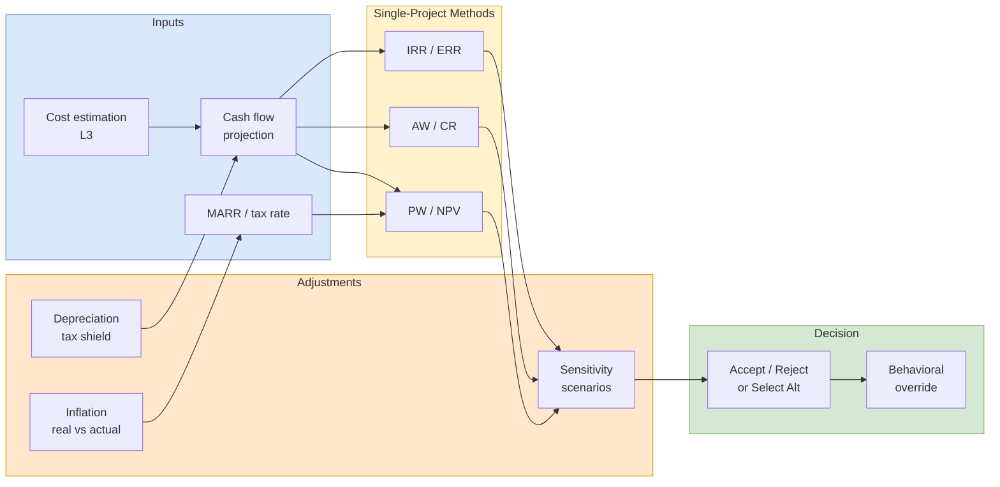

## 概述

EEMT5510「工程經濟與成本管理」是香港科技大學工業工程及決策分析學系（IEDA）的研究生課程，由祁金博士主講，屬工程管理碩士（MSc EEMT）課程的必修科目之一。課程以 Sullivan 的《Engineering Economy》為主要教材，系統涵蓋工程項目經濟評估的七大原則與核心工具：成本概念分類（固定/變動/機會/沉沒成本）及 CVP 損益平衡分析、成本估算技術（WBS 自下而上法、冪指數模型、學習曲線）、資金時間價值的六大換算因子（PW/FW/AW/FW/CW 方法）、單一及多方案比較（NPV/IRR/AW/BCR 準則、增量分析）、折舊與稅後現金流（SL/DB/SYD/MACRS，ATCF 計算）、不確定性與多屬性決策（敏感性分析、決策樹期望值、AHP 層次分析法）、通貨膨脹（名義與實際利率的 Fisher 方程、匯率影響）及行為經濟學（前景理論、框架效應、雙曲折現）。課程評核包括四次作業、兩個 Ivey 商學院案例（多倫多房屋租買決策、Trionym 3D 打印機廠 NPV 決策樹）及小組專案（JD.com/房地產 ERR 分析），並以香港薪俸稅計算及 WeeWork 聯合辦公 AW 分析等本地案例增強實用性，是工程管理、OR 及財務工程研究方向學生的定量決策分析核心基礎。

## Course Overview

EEMT5510 provides a systematic framework for evaluating the economic merits of engineering projects and business decisions. The course spans cost fundamentals, time value of money, project evaluation methods, depreciation, and behavioral dimensions of decision-making. It is taught in the Industrial Engineering and Decision Analytics department at [[wiki/entities/hkust|HKUST]] and is part of the Engineering Enterprise Management Technology (EEMT) MSc program. Assessment consists of two Ivey case discussions (the "Time Value of Money: Buy vs. Rent" case and "Trionym Systems" prescriptive analytics case) and a team project.

### Course Structure

| Lecture | Topic | Key Outputs |
|---|---|---|
| L1 | Introduction & Seven Principles | Decision framework, cash-flow viewpoint |
| L2 | Cost Terminology & Design Economics | Fixed/variable costs, breakeven, [[cvp-analysis\|CVP Analysis]] |
| L3 | Cost Estimation Techniques | WBS, cost indexes, power-sizing, learning curves |
| L4 | Time Value of Money | Six factors, compounding, equivalence, [[time-value-of-money\|TVM]] |
| L5 | Evaluating a Single Project | PW/FW/AW/IRR, MARR, bond valuation, [[npv\|NPV]], [[irr\|IRR]] |
| L6 | Project Comparison & Selection | Incremental analysis, unequal lives, study period |
| L7 | Depreciation & Income Taxes | SL/DB/SYD/MACRS, ATCF, [[depreciation\|Depreciation]] |
| L8 | Uncertainty & Multiattributes | Sensitivity, decision trees, [[ahp\|AHP]] |
| L9 | Price Changes | Real vs. actual dollars, inflation, exchange rates |
| L10 | Case Studies | Ivey case integration |
| L11 | Behavioral Economics | Prospect theory, framing, [[behavioral-economics\|Behavioral Economics]] |

### Seven Principles of Engineering Economy

The course is anchored by seven foundational principles (L1):

1. **Develop the alternatives** — The choice is among alternatives; identify them and define them for analysis.
2. **Focus on the differences** — Only the differences among alternatives are relevant to their comparison.
3. **Use a consistent viewpoint** — Prospective outcomes should be developed from a consistently defined viewpoint.
4. **Use a common unit of measure** — Using a common unit of measure to enumerate as many prospective outcomes as possible simplifies analysis.
5. **Consider all relevant criteria** — Selection of a preferred alternative requires the use of a criterion or several criteria.
6. **Make uncertainty explicit** — Uncertainty is inherent in projecting future outcomes and should be recognized in analysis.
7. **Revisit your decisions** — Improved decision-making results from an adaptive process that involves ongoing review of initial projections and decisions.

## Cost Concepts (L2)

### Cost Terminology

Costs are classified along several dimensions:

- **Fixed costs** remain constant regardless of output level (e.g., rent, insurance). **Variable costs** change in proportion to activity (e.g., raw materials, direct labor). Some costs are **semi-variable** with both fixed and variable components.
- **Incremental costs** arise from changes in output or activity levels. The incremental cost of producing one additional unit is the **marginal cost**.
- **Recurring costs** are repetitive and predictable; **nonrecurring costs** are one-time or irregular (e.g., a patent filing).
- **Direct costs** can be traced to a specific product, function, or process. **Indirect costs** (overhead) are shared across multiple cost objects and allocated via cost drivers. **Standard costs** are predetermined per-unit costs used for planning and control.
- **Cash costs** involve actual cash transactions. **Book costs** are non-cash charges reflected in accounting (e.g., [[depreciation|Depreciation]]).
- **Sunk costs** are past expenditures irrecoverable regardless of future decisions — they should not influence prospective analysis. **Opportunity costs** represent the value of the best foregone alternative.
- **Life-cycle costs** capture the total cost across a product's entire life: development, production, operations, maintenance, and disposal.

### Cost-Volume-Profit Relationships

At a given output level, total cost $= FC + VC \cdot Q$. The **breakeven point** is where total revenue equals total cost. This framework underlies [[cvp-analysis|CVP Analysis]] decisions. With a linear inverse demand $p = a - bD$, profit becomes $\Pi = -bD^2 + (a-c_v)D - FC$, which is maximized at $D^* = (a - c_v)/(2b)$. Breakeven quantities solve the quadratic $aD - bD^2 = FC + c_v D$.

**Worked example (L2 Ex. 2.7, HW1 Problem 1)**: A circuit board plant has $FC = \$42{,}000/\text{month}$, $c_v = \$53$, $p = 150 - 0.02D$, and capacity 4,000 units. Optimal output $D^* = (150 - 53)/(2 \cdot 0.02) = 2{,}425$ units, maximum profit $= \$75{,}612.50$, breakevens at $D \approx 481$ and $D \approx 4{,}369$ — so production is profitable in the range $(481, 4{,}000]$. Compare this to the photocopier problem in HW1 (Price $= 1000 - 0.2D$, $FC = \$200{,}000$, $c_v = \$200$) where profit-maximizing demand is $D^* = 2{,}000$ units at price \$600, yielding profit $\$600{,}000$.

### Cost-Driven Design Optimization

A three-step optimization for engineering design (L2 Ex. 2.8, ship velocity): (1) identify the design variable, (2) express total cost as a function of the variable, and (3) minimize. For a ship with operating cost $C_O = knv^2$ and cargo cost $C_C = 1500n/v$ per mile, the total cost is $C_T = knv^2 + 1500n/v$, and $dC_T/dv = 0$ gives $v^* = (1500/(2k))^{1/3}$. With the anchor data ($100/mi at 12 mph gives $k = 0.694$), the optimal velocity is $v^* = 10.26$ mph.

## Cost Estimation (L3)

### Estimation Approaches

- **Top-down (parametric)**: Uses historical data and scaling relationships. Faster but less precise. Appropriate for early-stage estimates.
- **Bottom-up (detailed)**: Builds estimates from a **Work Breakdown Structure (WBS)**, costing each element individually. More accurate but resource-intensive.

### Cost Indexes

Cost indexes adjust historical costs for price changes over time:

$$C_n = C_k \times \frac{I_n}{I_k}$$

where $C_n$ is the estimated cost at time $n$, $C_k$ is the known cost at time $k$, and $I_n / I_k$ is the ratio of cost indexes. **Composite indexes** weight multiple component indexes for broader applicability.

### Power-Sizing Model

Scales equipment costs by capacity:

$$C_A = C_B \times \left(\frac{S_A}{S_B}\right)^x$$

where $x$ is the cost-capacity factor (typically 0.4-0.8; the **six-tenths rule** uses $x = 0.6$ as a default).

### Learning Curves

Unit production time decreases as cumulative output increases: $T_N = T_1 \times N^b$ where $b = \log(s) / \log(2)$ and $s$ is the learning rate. An 80% learning curve means each doubling of cumulative output reduces unit time by 20%.

**Worked example (HW1 Problem 2)**: If the 6th unit takes 15 man-hours and the 12th unit takes 10 man-hours, then $15/10 = s^{\log_2(6) - \log_2(12)} = s^{-1}$, so $s = 0.667$ — a 66.7% learning curve.

## Time Value of Money (L4)

The foundational principle is that money has **time value** — a dollar today is worth more than a dollar in the future due to its earning potential. See [[time-value-of-money|TVM]] for detailed treatment.

**Key formulas**:

| Factor | Formula | Notation |
|--------|---------|----------|
| Single-payment compound amount | $F = P(1+i)^N$ | $(F/P, i\%, N)$ |
| Single-payment present worth | $P = F(1+i)^{-N}$ | $(P/F, i\%, N)$ |
| Uniform series sinking fund | $A = F \frac{i}{(1+i)^N - 1}$ | $(A/F, i\%, N)$ |
| Uniform series capital recovery | $A = P \frac{i(1+i)^N}{(1+i)^N - 1}$ | $(A/P, i\%, N)$ |
| Uniform series compound amount | $F = A \frac{(1+i)^N - 1}{i}$ | $(F/A, i\%, N)$ |
| Uniform series present worth | $P = A \frac{(1+i)^N - 1}{i(1+i)^N}$ | $(P/A, i\%, N)$ |

**Cash flow diagrams** provide visual representation: upward arrows for receipts, downward arrows for disbursements, plotted along a time axis.

**Worked example (HW1 Problem 5 — Rule of 72)**: To double money at 8% annual interest, the doubling time is $\approx 72/8 = 9$ years. To grow \$2,000 to \$16,000 (three doublings) takes about $27$ years. The exact solution from $16{,}000 = 2{,}000(1.08)^N$ gives $N = \ln(8)/\ln(1.08) = 27.02$ years.

**Worked example (HW1 Problem 4 — Bragging Rights)**: An investor claims to have turned \$10,000 in year 2000 into \$100,000 in year 2023. The implied annual return is $i = 10^{1/23} - 1 \approx 10.53\%$ — solid but consistent with the 10% benchmark, not remarkable.

## Project Evaluation Methods (L5)

The **Minimum Attractive Rate of Return (MARR)** is the threshold return rate for investment acceptance. It reflects the opportunity cost of capital.

### Present Worth (PW) Method

Convert all cash flows to time zero: $PW(i) = \sum_{k=0}^{N} F_k (P/F, i\%, k)$. **Decision rule**: Accept if $PW(\text{MARR}) \geq 0$. See [[npv|NPV]] for detailed treatment.

### Future Worth (FW) Method

Equivalent to PW but at the end of the study period: $FW(i) = PW(i) \times (F/P, i\%, N)$. Same accept/reject conclusion as PW.

### Annual Worth (AW) Method

Converts all cash flows to an equivalent uniform annual series:

$$AW = R - E - CR$$

where $R$ = annual equivalent revenues, $E$ = annual equivalent expenses, and **Capital Recovery (CR)**:

$$CR = I \cdot (A/P, i\%, N) - S \cdot (A/F, i\%, N)$$

with $I$ = initial investment and $S$ = salvage value.

### Capitalized Worth (CW) Method

For perpetual projects: $CW = \frac{A}{i}$ where $A$ is the annual equivalent cost.

### Internal Rate of Return (IRR)

The rate $i^*$ at which the PW of all cash flows equals zero. **Decision rule**: Accept if $IRR \geq MARR$. See [[irr|IRR]] for detailed treatment including drawbacks.

### Bond Valuation

Bond price is the present value of future cash flows:

$$P = C(P/F, i\%, N) + rZ(P/A, i\%, N)$$

where $C$ = face value, $r$ = coupon rate per period, $Z$ = face value, $i$ = yield per period, and $N$ = number of periods.

**Worked example (HW2 Problem 4 — Green Bond)**: A $10{,}000 face-value 3-year bond pays a 4.75% coupon ($475/year) and sells for $10{,}200$. The yield solves $0 = -10{,}200 + 475(P/A, i^*, 3) + 10{,}000(P/F, i^*, 3)$. Interpolation between trials at 4.0% (PW $= +8.13$) and 4.5% (PW $= -131.28$) gives $i^* \approx 4.03\%$ — below the coupon rate because the bond trades at a premium.

## Project Comparison and Selection (L6)

### Investment vs. Cost Alternatives

- **Investment alternatives**: Generate positive revenues. Select the one with the highest PW of net cash flows (provided PW >= 0).
- **Cost alternatives**: All serve a required function; revenues are absent or identical. Select the one with the lowest PW of costs.

### Incremental Analysis

When comparing mutually exclusive alternatives, rank by increasing initial investment. The **base alternative** is the least-cost option (or do-nothing for investment alternatives). Evaluate each increment of investment: accept the increment if its incremental IRR >= MARR.

### Study Period Method

When alternatives have unequal lives, either use AW (which handles this naturally for repeatable alternatives) or define a common **study period** and handle terminal values explicitly.

**Worked example (HW3 Problem 2 — Pioneer Construction ERR)**: Five equipment alternatives (A-E, capital investments \$46K-\$65K, 10-year life) are ranked by ERR at $\epsilon = 18\%$ MARR. Equipment A's ERR (17.7%) is below MARR so it cannot serve as the base. Incremental analysis on $\Delta(C-B)$ gives $\Delta ERR = 26.3\% > MARR$, so C is preferred over B. $\Delta(D-C) = 8.9\% < MARR$ rejects D. $\Delta(E-C) = 24.2\% > MARR$ selects E as the final choice — illustrating why direct comparison of individual ERRs (highest was E at 21.9%) can still mislead without incremental reasoning.

**Worked example (HW3 Problem 5 — WeeWork Co-working)**: $10M building, 12-year horizon, \$3.3M furnishings replaced at $k=0,4,8$, \$250K/year O&M, 25% salvage on building, 100 offices rented 80% at \$3,000/month, MARR = 10%. Annual revenue $= 100 \cdot 0.8 \cdot 3000 \cdot 12 = \$2{,}880{,}000$. AW$(10\%) = 2{,}880{,}000 - 250{,}000 - 10{,}000{,}000(A/P, 10\%, 12) + 2{,}500{,}000(A/F, 10\%, 12) - 3{,}300{,}000(A/P, 10\%, 4) = \$238{,}221 > 0$. Sensitivity: capital can rise 17.6%, MARR can rise to 12.31% (23.1% headroom), but occupancy can only drop 8.3% before reversing the decision — **occupancy rate is the most sensitive driver**.

## Depreciation (L7)

**Depreciation** allocates the cost of a tangible asset over its useful life. See [[depreciation|Depreciation]] for methods and formulas.

Key methods covered:
- **Straight-Line (SL)**: Equal annual charge: $d_k = (B - SV_N) / N$
- **Declining Balance (DB)**: Constant percentage of book value: $d_k = B(1-R)^{k-1} \cdot R$ where $R$ is the depreciation rate
- **Sum-of-Years-Digits (SYD)**: Accelerated method using fraction $\frac{N-k+1}{\text{SYD}}$ where $\text{SYD} = N(N+1)/2$
- **MACRS**: US tax depreciation system with prescribed recovery periods and rates. The Hong Kong depreciation regime is similar.

### After-Tax Cash Flows

$$\text{ATCF}_k = (R_k - E_k - d_k)(1 - t) + d_k$$

**Worked example (HW3 Problem 4)**: Asset cost \$120K + \$40K installation = \$160K basis; 6-year SL depreciation to $SV = \$10{,}000$ gives $d_k = \$25{,}000$/year. Revenue \$35K/year, O&M starts \$8K and grows by \$1K/year. Effective tax rate 30%, after-tax MARR = 12%. Terminal year adds \$50K resale and \$10K untax-depreciated write-off. Tabulating ATCF year-by-year and discounting yields $PW = -\$38{,}459$ — the project is rejected. Note the course adopts a "no negative tax" convention: if TI < 0, no tax refund is granted.

### Hong Kong Salary Tax Example (L7)

EEMT5510 uses the HK progressive tax schedule (2% / 6% / 10% / 14% / 17% brackets on the first four \$50K slices, 17% thereafter) to demonstrate **marginal vs. effective tax rates**. For taxable salary = \$348,000: tax $= (348{,}000 - 200{,}000)(0.17) + 16{,}000 = \$41{,}160$. The lecture also explores separate-vs-joint assessment for a married couple to show how tax minimization depends on the income split.

## Uncertainty and Multiattribute Decisions (L8)

The course treats uncertainty through sensitivity analysis, scenario analysis, decision trees, and expected-value/variance analysis of present worth. A **decision-reversal sensitivity** pass (HW3 Problem 5) identifies the minimum percent change in each input that would flip the accept/reject decision; the factor with the smallest tolerance is the most sensitive.

**Worked example (HW4 Problem 3 — PW distribution)**: Nine cash-flow scenarios yield NPVs from -\$12,945 to \$11,327 with joint probabilities $p(j)$. Then $E[PW] = \$3.78M$, $V[PW] = 36.93 \times 10^6$, $SD(PW) = \$6{,}077$, and $\Pr\{PW > 0\} = 0.45$. Multi-stage decisions use folded-back decision trees (HW4 Problem 4 — Build vs. Rent with \$5M expansion option) to pick the minimum-expected-cost strategy.

Multiattribute evaluation uses the **Analytic Hierarchy Process** (see [[ahp|AHP]]) to elicit pairwise comparisons on non-monetary criteria and combine them with monetary measures via weighted additive utility.

## Price Changes (L9)

Inflation introduces a distinction between **actual (nominal) dollars** and **real (constant) dollars**. The relationship between the combined (nominal) rate $i_c$, the real rate $i_r$, and the inflation rate $f$ is:

$$1 + i_c = (1 + i_r)(1 + f) \implies i_c = i_r + f + i_r f$$

**Worked example (HW4 Problem 1 — Country B Investment)**: Before-tax MARR in Z-Kron = 20%, Country B currency devalues 4% per year against the Z-Kron. The combined rate used for Country B dollar cash flows is $i_c = 0.20 + 0.04 + (0.20)(0.04) = 24.8\%$. With initial investment \$188M, Year 1 cash flow -\$40M, and Years 2-10 at \$80M, $PW(24.8\%) = +\$3.23M > 0$ — marginal accept.

**Worked example (HW4 Problem 2 — Heat Pump)**: Electricity inflates at 10%/year, other costs at 6% general inflation, MARR (nominal) = 15%. Using geometric gradient series, the actual-dollar $PW = -\$10{,}871$, which converts to an AW of -\$1,859 in actual dollars or -\$1,309 in real dollars (at $i_r = (1.15/1.06) - 1 = 8.5\%$).

## Case Studies (L10)

### Ivey Case: Buy vs. Rent (W14403)

Rebecca Young (Toronto MBA grad) considers buying a \$600K condo vs. renting at \$3,000/month. Key inputs: 20% down payment, 1.5% local and 1.5% provincial deed-transfer taxes, \$2,000 closing fees, mortgage at 4% quoted rate (Canadian semi-annual compounding) amortized over 25 years with a 10-year term, condo fees \$1,055/month + \$300 property tax + \$600/year maintenance, opportunity cost on down-payment capital, and 5% realtor + \$2,000 fees on sale. Students analyze four scenarios (price flat; -10%/flat/+10%; 2% inflation; 5% appreciation) at 2-, 5-, and 10-year horizons — a direct application of [[time-value-of-money|TVM]] and [[npv|NPV]] to a personal decision.

### Ivey Case: Trionym Systems (W15178)

Trionym, a Northern California 3-D printer manufacturer, considers a \$50M plant with 5-year life and \$5M salvage for its RB-5000 product. Demand is \$100M or \$200M at 60/40 odds with 25%/year growth. A competitor (PrintTech) may enter at 50% probability, dropping Trionym's share from 40% to 30%. COGS is 70% (40% prob) or 80% (60% prob) of sales. The firm's criteria: **profitability index ≥ 1.1** and **$\Pr(NPV > 0) \geq 75\%$**. At 40% tax rate and 10% discount rate, students build a decision tree with joint probabilities, compute expected NPV, and perform sensitivity analysis. The case integrates [[decision-trees|Decision Trees]] with engineering economy to illustrate **prescriptive analytics**.

## Behavioral Economics (L11)

Traditional engineering economy assumes rational, utility-maximizing agents. **Behavioral economics** documents systematic deviations. See [[behavioral-economics|Behavioral Economics]] for full treatment.

Key topics:
- **Bounded rationality** (Kahneman): Cognitive limitations lead to heuristics and biases. Decision-makers **satisfice** rather than optimize.
- **Prospect theory**: People evaluate outcomes relative to a reference point; the value function is S-shaped (concave for gains, convex for losses) with **loss aversion** — losses loom larger than equivalent gains ($\lambda \approx 2.25$).
- **St. Petersburg Paradox**: A doubling game has infinite expected value but people pay little to play; resolved by Bernoulli's $u(x) = \ln x$ utility giving finite $E[u]$.
- **Framing effects**: Choices are influenced by how options are presented (e.g., the Asian Disease Problem: "200 saved" elicits sure-thing preferences; "400 die" elicits gambling).
- **Ambiguity aversion**: People prefer known probabilities over unknown ones (Ellsberg's Paradox with 50/50 vs. unknown-ratio urns).
- **Time inconsistency**: Present-biased preferences and **hyperbolic discounting** lead to procrastination. Preference reversal: prefer "\$110 in 31 days" over "\$100 in 30 days" but choose "\$100 today" over "\$110 tomorrow".
- **Regret**: In a lottery-ticket exchange experiment, fewer than 50% traded tickets (high regret anticipation), versus over 90% who traded pens (low regret).
- **Fairness**: Ultimatum game shows people reject unfair splits at personal cost. Applied to engineering project negotiations and cost-sharing.

## Case Studies / Projects

The course uses two Ivey cases and an open team project as integrative assessments. The table below summarizes the named scenarios that drive most of the hands-on analytical work.

| Artifact | Type | Scenario | Analytical Tools | Key Result |
|---|---|---|---|---|
| Ivey W14403 — Buy vs. Rent | Case Study #1 | Rebecca Young's \$600K Toronto condo purchase vs. \$3,000/month rental, 2-/5-/10-year horizons, four price paths | Canadian semi-annual mortgage amortization, opportunity cost on down payment, scenario analysis | Decision hinges on horizon and appreciation: longer horizons and positive appreciation favor buying, short horizons + flat prices favor renting |
| Ivey W15178 — Trionym Systems | Case Study #2 | \$50M 3-D printer plant (RB-5000), 5-year life, \$5M salvage, stochastic demand (\$100M/\$200M at 60/40), PrintTech entry risk (50%), COGS 70% or 80% | Decision tree with joint probabilities, [[npv\|NPV]] with 40% tax + 10% MARR, \$V(NPV)\$, profitability index, \$\Pr(NPV>0)\$ | Evaluate vs. PI ≥ 1.1 AND \$\Pr(NPV>0) \geq 75\%\$; the sensitivity of the 75% threshold (dropped to 65%) becomes the decisive factor |
| Project Sample 1 — Qingdao City Complex | Team Project | 1.5 billion yuan mixed-use real estate (rental + sale) on 115,535 m² land, 246,900 m² building area, 5% bank loan 7-year term, 2021-2029 horizon | Detailed VAT / urban-construction / stamp tax decomposition, sensitivity on interest rate (4.5-5.5%) × cash flow (±10%) via Debt Coverage Ratio | \$PW(2021) \approx \$176\text{M yuan at } MARR = 10\%\$; DCR stays > 1.49 across all nine stress scenarios — financially robust |
| Project Sample 2 — JD.com Financial Analysis | Team Project | 2017-Q1 to 2022-Q2 quarterly cash flows (21 periods) for JD.com vs. Alibaba and Amazon; COVID-19 impact | **External Rate of Return (ERR)** with PW(outflows) at 10-year CN government bond yield and FW(inflows) at 3-month deposit rate; \$PW_{out}(1+ERR)^{21} = FW_{in}\$; stress test on 8 cost/revenue factors at MARR = 5% | Nominal ERR: JD 4.79%, Alibaba 3.97%, Amazon 2.46%. **Cost of sales** is #1 sensitivity driver, followed by online shopping revenue. Recommendations: automation to cut labor cost, AI/big-data R&D, warehouse 3PL monetization |

See [[financial-ratios|Financial Ratios]] for the JD.com DuPont-style interpretation of the ERR sensitivity ranking.

## Evaluation Pipeline

## Related Concepts

- [[time-value-of-money|TVM]]
- [[npv|NPV]]
- [[irr|IRR]]
- [[depreciation|Depreciation]]
- [[behavioral-economics|Behavioral Economics]]
- [[cvp-analysis|CVP Analysis]]
- [[financial-ratios|Financial Ratios]]
- [[decision-trees|Decision Trees]]
- [[ahp|AHP]]

## Source Materials

- L1 - Introduction
- L2 - Cost Terminology
- L3 - Cost Estimation
- L4 - Time Value of Money
- L5 - Evaluating a Single Project
- L6 - Project Comparison and Selection
- L7 - Depreciation and Income Taxes
- L11 - Behavioral Economics
