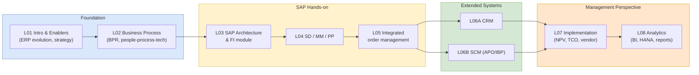

## 概述

EEMT5360「企業系統與數字化轉型」是香港科技大學商學院 ISOM 系由 Ronald S. Lau 博士主講的研究生課程，屬工程管理碩士（MSc EEMT）課程的核心必修科。課程以 SAP 為主軸，系統介紹企業資訊系統（ERP、CRM、SCM）的理論架構與導入實務，涵蓋 ERP 歷史演進（EOQ→MRP→MRP II→ERP→S/4HANA）、業務流程管理與 BPR（人-流程-技術三角）、SAP 模組架構（SD/MM/PP/FI/CO）的系統整合與 T-code 操作、SAP APO/IBP 供應鏈規劃（DP 統計預測、SNP 混合整數規劃最小化供應鏈總成本、PP/DS 排程啟發式）、SAP HANA 記憶體內運算（OLTP/OLAP 合一、表格壓縮比較）、CRM 系統（操作型/分析型/協作型 CRM、Salesforce Einstein AI 應用）及企業系統導入方法論（NPV/TCO 財務評估、SAP ASAP 方法論、直接/分階段/並行/試點部署策略比較）。課程以 Global Bike Inc.（GBI）SAP 訓練數據集進行六次上機實驗，並以 Lenovo 供應鏈智能化、Bloom & Grow ERP 選型（AHP 加權評分結合 7 年 NPV/TCO）及 Cathay Pacific 電子貨運單 BPR 為案例，幫助學生從技術、流程與管理三個層面評估企業系統投資、設計導入路徑，並以商業分析支援決策，是工程管理研究方向的重要整合性課程。

## Course Overview

**EEMT5360 Enterprise Systems for Digital Transformation** is a graduate-level course offered by the ISOM department at [[wiki/entities/hkust|HKUST]] Business School. Taught by Ronald S. Lau, Ph.D., the course provides a hands-on examination of enterprise information systems and their role in enabling digital transformation. The curriculum spans seven major lecture topics -- ERP fundamentals, business process management, SAP products and architecture, CRM systems, SCM systems, implementation methodology, and business analytics -- and pairs them with SAP Fiori/GUI lab exercises on the Global Bike Inc. (GBI) training dataset plus two business cases (Lenovo's Supply Chain Intelligence initiative and Bloom & Grow Asia's ERP selection via [[wiki/concepts/ahp|AHP]]).

## Pedagogical Structure

## Lecture Summaries

### L01A -- Introduction to Enterprise Systems

Introduces the definition of **Enterprise Resource Planning (ERP)** as an integrated suite of application modules spanning manufacturing, human resources, financials, and supply chain, connected via a common database. Contrasts enterprise systems with functional (siloed) systems across five dimensions: scope, database, process, output, and adaptability.

Key historical development timeline: **EOQ (1913) -> MRP (1960s-70s) -> MRP II (1980s) -> ERP (1990s) -> ERM (2000s)**. Discusses evolving IS roles from automate to informate to transformate. Covers competitive strategy frameworks including Porter's generic strategies (cost leadership, differentiation, focus -- see [[wiki/concepts/porters-five-forces|Porter's Five Forces]] for the related industry-analysis lens) and Treacy & Wiersema's three value disciplines: **operational excellence**, **product leadership**, and **customer intimacy**.

Market structure is segmented into tiers: Tier 1 (multinationals with revenue over US$1B, dominated by **SAP** and **Oracle/PeopleSoft/JD Edwards**), Tier 2 (US$250M-$1B, contested by SAGE, Infor/SSA/Baan, Microsoft Dynamics), and Tier 3-4 (SMEs, where open-source and cloud options like Odoo/OpenERP and NetSuite are gaining traction). Gartner 2020 data shows the global CRM market (~$70B) now exceeds ERP (~$40B), with SCM at ~$23B. Chinese regional players -- **Yonyou, Kingdee, Inspur** -- dominate their home market due to localization and regulatory fit.

Introduces the **digital transformation maturity model**: automation -> integration -> synchronization -> optimization -> transformation. Examines impacts on supply chain including faster fulfillment, real-time inventory visibility, and demand-driven replenishment.

### L02A -- Business Process Management

Defines a **business process** (per Davenport and Short, 1990) as "a set of logically related tasks performed to achieve a defined business outcome." Three characteristics distinguish a process: (1) it has customers (internal or external), (2) it crosses organizational boundaries, and (3) it delivers value-added transformation. Contrasts the **functional view** (vertical silos of sales, engineering, purchasing, production, accounting, logistics) with the **process view** (horizontal cross-functional flows like order-to-cash, procure-to-pay, and new product development).

Covers **Business Process Reengineering (BPR)** -- the fundamental rethinking and radical redesign of business processes for dramatic improvement. BPR as a "clean slate" approach can create competitive advantage but carries high failure rates (60-80%) and heavy resource demands. **ERP-enabled reengineering** is positioned as a middle path: it uses pre-built reference models and process blueprints ("paving the cow paths" is the anti-pattern), lowers risk, and is more cost-effective than clean-slate redesign. Introduces the **people-process-technology triangle** as the foundation for successful transformation; Oliver Wight's aphorism -- "you can have the best hammer in the world, but it doesn't necessarily make you a good carpenter" -- captures why technology alone is insufficient.

Presents McKinsey's five approaches for the **next-generation operating model**: lean process redesign, digitization, business process outsourcing (BPO), intelligent process automation, and advanced analytics. Process improvement patterns highlighted include: converting serial to parallel steps, eliminating excess reviews/approvals/inspections, removing non-value-adding steps, and breaking bottlenecks. Process diagrams are the primary documentation tool for "as-is" vs. "to-be" mapping.

### L03A -- SAP Products and Architecture

Details **SAP AG** history: founded 1972 in Weinheim, Germany by five ex-IBM engineers; SAP = **Systems, Applications, and Products in Data Processing**. Product evolution: **R/2 (1979, mainframe) -> R/3 (1992, client/server) -> Business Suite (2004, SOA) -> S/4HANA (2015, in-memory)**. SAP also launched SME-targeted products in 2006: **All-in-One (A1)** and **Business One (B1)**. Corporate fact sheet as of July 2024: ~107,000 employees, ~437,000 customers in 190+ countries.

**SAP S/4HANA** is the next-generation ERP suite built on the **HANA in-memory, column-oriented database**, combining OLTP and OLAP capabilities in a single platform. Key features include: SAP Fiori UX (hardware-independent, mobile-ready), parallel processing, dramatic data compression (a benchmark example: traditional DB 593 GB -> HANA 118 GB -> S/4HANA 42 GB), and real-time analytics without ETL to a separate warehouse. A classical booking transaction that used to touch 15 tables (BKPF, BSEG x3, BSIS x2, BSIK, BSET, LFC1, GLT0 x3, COBK, COEP, COSP) is simplified in S/4HANA to just 4 tables. Cloud subscription and traditional on-premise licensing are both supported, with cloud giving automatic quarterly innovation upgrades and SAP-managed maintenance.

Core SAP ERP modules: **SD** (Sales & Distribution), **MM** (Materials Management), **PP** (Production Planning), **FI** (Financial Accounting), **CO** (Controlling), **AM** (Asset Management), **QM** (Quality Management), **PM** (Plant Maintenance), **HR** (Human Resources), plus **PS** (Project System), **WF** (Workflow), and **IS** (Industry Solutions). Three user interfaces: **SAP GUI** (thick client via SAProuter), **SAP Web GUI** (browser), and **SAP Fiori** (role-based launchpad). Transactions are initiated via **t-codes** typed into the command field (e.g., `MM01` create material master, `MM02` change material master, `FB50` post G/L document). Prefix `/n` opens a t-code in the current window; `/o` opens a new window (GUI only). Matchcodes are used to search master data. The standard training dataset is **GBI (Global Bike Inc.)**, which replaced the older **IDES (Internet Demonstration and Evaluation System)**; IDES company codes 1000 (Germany) and 3000 (US) contained the most complete reference scenarios.

### L04 -- SAP SD, MM, PP and Integrated Order Management

The sales order management process in SAP SD follows the pipeline **Pre-sales Activities -> Sales Order Entry -> Check Availability -> Pick Materials -> Pack Materials -> Post Goods Issue -> Invoice Customer -> Receipt of Customer Payment**. The general cross-functional flow distributes tasks across Customer (inquiries, quotation receipt, purchase order, goods receipt, payment), Sales (quotation, credit check, sales order processing, inventory sourcing), Distribution (pick-and-pack, post goods issue), and Accounting (invoice, receivables).

**MM procurement** mirrors SD on the inbound side: Purchase Requisition -> Purchase Order -> Procurement -> Goods Receipt -> Invoice Receipt -> Payment to Vendor. MM is structured around eight components: Material Master, Foreign Trade, Inventory Management, Purchasing, Invoice Verification, Valuation, Physical Inventory, and Warehouse Management.

**PP (Production Planning)** introduces the **material master** (used by all logistics apps), **BOM (Bill of Materials)** with low-level codes assigned automatically to determine planning sequence and cost roll-up, and the MRP planning run. PP ties together Basic Data, MRP, and Work Scheduling views. Organizationally, SAP enforces a hierarchy of Client -> Company Code -> Plant -> Storage Location -> Work Center. GBI's structure (Global Bike Inc. in Dallas and Global Bike Germany GmbH in Heidelberg) is used in lab exercises.

The **integrated SD-PP-MM flow** illustrates how a single customer sales order cascades: Sales Order Entry triggers Check Availability (against MM inventory), which may trigger MPS/MRP in PP, producing Planned Orders that become Production Orders or Purchase Requisitions in MM, with subsequent Goods Receipt posting to FI via automatic account determination.

### L06A -- Customer Relationship Management

Defines [[wiki/concepts/crm|CRM]] as both a strategy and a category of enterprise software for managing customer interactions across the full lifecycle. Three CRM types are complementary:

- **Operational CRM**: Front-office (sales force automation, marketing automation, service automation) and back-office (order management, billing) automation -- synergy between Marketing (lead nurturing) and Sales (deal closing) is a core design goal
- **Analytical CRM**: Data warehouse, data mining, and predictive analytics for customer insights (churn, CLV, next-best-action)
- **Collaborative CRM**: Multi-channel customer interaction management (phone, email, web, social, self-service portals)

Covers marketing analytics progression: **descriptive** (what happened?) -> **diagnostic** (why?) -> **predictive** (what will happen?) -> **prescriptive** (what should we do?). The lecture uses the "looking for keys under the streetlight" parable to illustrate why most analytics stays descriptive. Data mining is framed as a multidisciplinary field drawing from statistics, machine learning, and database systems; techniques include [[wiki/concepts/clustering|clustering]] for segmentation, [[wiki/concepts/logistic-regression|logistic regression]] and [[wiki/concepts/decision-trees|decision trees]] for churn, association rules for market basket analysis, and [[wiki/concepts/nlp-basics|NLP]] for sentiment. [[wiki/concepts/recommendation-systems|Recommendation systems]] appear in Commerce Cloud contexts (tailored product sorting, search).

**Salesforce Einstein** is profiled as the canonical AI-augmented CRM: Einstein Discovery (pattern recognition), Einstein Prediction Builder (churn/CLV), Einstein Next Best Action (recommendation + automation), Einstein Language (intent/sentiment + Bots), and Einstein Vision (image recognition for brand/product). Use cases span Sales (lead prioritization, pipeline trends), Service (chatbots, case triage), Marketing (predictive insights, personalization), and Commerce (product recommendations, search anticipation).

### L06B -- Supply Chain Management Systems

Covers [[wiki/concepts/supply-chain-management|SCM]] systems with focus on **SAP APO (Advanced Planner and Optimizer)** and **SAP IBP (Integrated Business Planning)**. SCM systems address multi-supply, multi-product, multi-channel complexity and answer "what-if" questions: What if a factory can't fulfill an order? What if material prices spike? What if a critical shipment is delayed? What if a geopolitical incident disrupts supply? Top drivers for SCM investment (SAPinsider 298-business survey, September 2020): end-to-end real-time visibility (45%) and planning-execution collaboration (41%).

Three-layer architecture: **supply chain planning** (scenarios, analysis, optimization) sits above **transaction processing/ERP**, which sits above **supply chain execution** (order fulfillment, warehouse, transportation).

**SAP APO** components:
- **Demand Planning (DP)**: Statistical forecasting using exponential smoothing, Holt (trend), Winters (trend + season), moving average, and [[wiki/concepts/linear-regression|linear regression]]; planning book, forecast profile, proportional factor, aggregate groups, and promotion planning are key DP artifacts
- **Supply Network Planning (SNP)**: Uses **mixed integer programming** to minimize total supply chain costs (inventory holding + transportation + penalty) subject to capacity, inventory balance, and non-negativity constraints
- **Production Planning and Detailed Scheduling (PP/DS)**: Decomposes planned orders via MRP, solves multi-level capacitated lot-sizing, and sequences operations with sequence-dependent setup times. Solution approaches include SPT (shortest processing time) for job shops, heuristics, meta-heuristics, genetic algorithms, and simulation. Three environments -- job shop, flow line with setups, one-of-a-kind projects -- require different scheduling approaches
- **Global Availability (GATP)**: Rule-based available-to-promise. Worked example: with supply vector `{3,8,6,9}` over 4 periods, `ATP(1) = min{3,8,6,9} = 3`, `ATP(2) = min{8,6,9} = 6`, etc.
- **Transportation Planning/Vehicle Scheduling (TP/VS)**: Optimizes routes and loads using Transport Load Builder (TLB) profiles

Each module has a "what to expect" and "what not to expect" summary: e.g., PP/DS is advantageous for automated production but does not deliver simultaneous lot-sizing and scheduling; DP provides structured forecasting but needs human judgment to significantly reduce error.

**SAP IBP** is the cloud-based S/4HANA-era successor: unified S&OP process flow, what-if simulation, tighter collaboration. Most-desired IBP capabilities (SAPinsider survey): S&OP solution (85%), advanced statistical forecasting (85%), inventory planning and optimization (84%), supply forecasting (82%).

McKinsey's three-step implementation roadmap for supply chain IT: (1) Process redesign, (2) Vendor selection, (3) Implementation road map with sprints of 1-2 months and intensive upfront testing/training investment.

### L07A -- Enterprise Systems Implementation

Presents the four-stage implementation process: **Planning -> Selection -> Installation -> Deployment**.

- **Planning**: Business case development, feasibility and risk study, **SMART objectives** (specific, measurable, achievable, relevant, time-bound), organizational readiness assessment across four dimensions (technical, functional, resources, corporate culture -- rated Ready/Limited/Weak), project governance structure with an identified champion and a matrix organization drawing from affected functional areas
- **Selection**: Software requirements (must-have vs. nice-to-have), process mapping (as-is vs. to-be), vendor selection criteria (total cost of ownership, support, functionality, integrator experience). CLP Power's functional requirements list is used as a template
- **Installation**: Methodology selection. Customization levels in order of increasing risk are **Configuration** (preferred, uses supplied settings) -> **Enhancement** (add reports/screens) -> **Development** (workarounds via ABAP Workbench) -> **Modification** (change existing code, not recommended). The SAP **Implementation Guide (IMG)** is the primary configuration tool
- **Deployment**: Transition strategy choices are **Direct (big bang)**, **Phased** (by module/area/location), **Parallel**, or **Pilot**. A full **conference room pilot** tests end-to-end before go-live; go-live readiness checklist covers master data entry, data conversion from legacy, stress test, training, and contingency planning

Cloud ERP adoption grew from 6% (2017) to 47% (2021). Cloud pros: easier maintenance, high scalability, remote access, automatic upgrades. Cloud cons: perceived lower data security, internet dependency, limited customization.

**Financial evaluation** methods: [[wiki/concepts/npv|Net Present Value (NPV)]], [[wiki/concepts/irr|Internal Rate of Return (IRR)]] (discount rate yielding NPV = 0), payback period, and **Total Cost of Ownership (TCO)** (NPV of cash outflows). Worked NPV example: $1,000 initial investment, cash flows $350/$450/$400/$300 over four years at 12% discount rate gives NPV = -1000 + 312.50 + 358.74 + 284.71 + 190.66 = **+$146.61**, so the project clears the hurdle rate. Typical implementation costs: professional services 45%, in-house staff 20%, software licenses 20%, IT infrastructure 15%. Industry-average ranges: Internal 11-65%, Hardware 10-40%, Consulting 5-56%, Software 14-26%. Mid-size companies ($50M-$1B): 14-16 months, 3-5% of annual revenue. Large companies (over $1B): 31-34 months, 2-3% of annual revenue.

Non-financial criteria: system functionality, process fit, ease of customization, user friendliness, system integrator capability, consulting team industry experience, support/maintenance, references.

**Triple constraint** (scope, time, cost) determines project outcomes: successful (all three met), challenged (some met), or failed. High-profile failure cases cited: **Volkswagen** (parts shipment delays and inventory build-up), **Hershey** (third-quarter earnings down 18.6% after peak-season rollout), **Whirlpool** (appliances stranded on loading docks), **Dell** (project cancelled after two years). Success factors: clear objectives, executive support, user involvement, experienced project manager, minimized customization, and adequate go-live preparation. Agile is generally preferred over waterfall for large projects because cross-functional module-based teams have end-to-end ownership.

Implementation methodology phases differ by vendor: SAP uses Project Preparation -> Business Blueprint -> Realization -> Final Preparation -> Go Live + Support; Oracle uses Define -> Train -> Model -> Configure -> Go Live + Refine; Microsoft uses Planning/Analysis -> Design -> Construction -> Deliver and Install.

### L08A -- Business Analytics

Distinguishes **Business Intelligence (BI)** from **Business Analytics (BA)**. BI uses past and current data for present-day decisions (descriptive analytics). BA uses historical data to predict future outcomes (predictive and prescriptive analytics).

Four analytics types mapped to the Gartner analytics maturity model:
- **Descriptive**: What happened? (reports, dashboards, geographic distribution of A/P)
- **Diagnostic**: Why did it happen? (drill-down, "Why did sales drop 15%?")
- **Predictive**: What will happen? (statistical models, ML, "seasonal drop trend implies 15% slowdown in next 8 weeks")
- **Prescriptive**: How do we make it happen? (optimization, "how many planes to maximize passenger capacity while minimizing fuel?")

Analytics maturity progresses from raw data -> cleaned data -> standard reports -> ad hoc reports/OLAP -> generic predictive analytics -> predictive modeling -> optimization. Competitive analytics requires three capabilities: a data-oriented culture, information management, and analytics expertise.

Real-world predictive analytics cases: **Target** predicting customer pregnancy from shopping behavior; **Tesco UK** issuing 100 million personalized coupons annually across 13 countries with 3.6x higher redemption; **Netflix** $1M prize for recommender improvement; a top-5 US health insurer predicting 18-month mortality to trigger end-of-life counseling; **Con Edison** predicting energy distribution cable failure with thrice-hourly risk updates.

Business analytics uses the [[wiki/concepts/scor-model|SCOR model]] for process-based KPIs across five attributes: delivery reliability (delivery performance, perfect order fulfillment), responsiveness (order fulfillment lead times), agility (supply chain response time), costs (total SCM costs, warranty/returns), and asset efficiency (cash-to-cash cycle, asset turns). **Cash-to-cash cycle time (CCC)** = Days Inventory Outstanding + Days Sales Outstanding - Days Payable Outstanding. Worked example: with average inventory $400, AR $500, AP $200, COGS $700/31 days, sales $1000/31 days, CCC = 17.7 + 15.5 - 8.8 = **24.4 days**.

Business analytics applications: SAP-FI for financial accounting (balance sheet, P&L, cash flow), SAP-CO for management accounting (cost center, profitability analysis, activity-based costing), SAP-SEM for [[wiki/concepts/balanced-scorecard|balanced scorecard]]. The market trend is a shift from IT-led reporting to business-led self-service analytics, with modern platforms supporting greater accessibility and agility. In-memory analytics (exemplified by SAP HANA) brings OLTP and OLAP together for real-time drill-down on transactional data.

## Case Studies

The course pairs concept-heavy lectures with four named business cases spanning SCM, ERP selection, and process redesign. Each case exercises multiple frameworks and is used in class for team presentations and written submissions.

| Case | Primary concept(s) | Key takeaways |
|---|---|---|
| **Lenovo -- Supply Chain Intelligence (UST116, 2022)** | [[wiki/concepts/supply-chain-management\|SCM]], digital transformation, [[wiki/concepts/erp\|ERP]] integration | Fall 2021, Maggie Duan's global supply chain team builds an internal SCI portal to unify 2,000+ suppliers, 35+ facilities, 180 markets, and 100M+ devices/year amid a 15% pandemic demand surge. Pre-existing pain: order-to-delivery down 10% vs. pre-COVID, obsolete inventory up 50% YoY, siloed legacy planners, and ATP/forecast opacity. The case reinforces that digital transformation is a triangle of people, process, and technology -- tools like RFID and point ML are insufficient without end-to-end metric alignment and cross-functional process redesign, and an in-house platform is compared against packaged SAP APO/IBP. |
| **Bloom & Grow (I) -- ERP Strategy & Planning (UST059, 2017)** | [[wiki/concepts/erp\|ERP]] implementation pitfalls, vendor selection, requirements fit | 2014 HK distributor of 30+ maternity/baby brands across 5 countries picks NetSuite on price alone, then discovers it lacks multi-subsidiary, multi-currency, multi-language, and FIFO costing -- all table-stakes for its operating model. Switches to open-source xTuple for customizability and hits data-integrity bugs, a broken costing module, and VPN connectivity failures. Demonstrates how skipping a structured requirements assessment and cost-first vendor selection generates 30+ months of rework, and motivates the Case (B) formal selection exercise. |
| **Bloom & Grow (B) -- ERP System Selection** | [[wiki/concepts/ahp\|AHP]], [[wiki/concepts/npv\|NPV]] / TCO, vendor scoring | Formal re-selection among SAP, NetSuite, QuickBooks, and MYOB using AHP on five criteria (Functionality, Technology, Support, Process Fit, Maintenance) combined with a 7-year NPV/TCO at 15% hurdle. Eigenvector criterion weights come out Functionality 0.361 > Maintenance 0.257 > Process Fit 0.211 > Support 0.109 > Technology 0.062; overall AHP scores rank NetSuite 0.267, QuickBooks 0.277, SAP 0.307, MYOB 0.148 (NetSuite wins once normalized against relative TCO). NPVs: SAP -$30k, NetSuite +$525k, QuickBooks +$38k, MYOB +$747k -- illustrates why the highest-NPV vendor (MYOB) can still lose on qualitative fit. |
| **Cathay Pacific Cargo (B) -- Integrated e-Freight** (UST019B, 2014) | Business process reengineering, people-process-technology alignment | Cathay Pacific's Jackson Chan leads the push to 100% electronic airway bills (e-AWB) and a fully paperless global cargo operation by 2015, anchored on the new HK$5.9B Cathay Pacific Cargo Terminal (WOS + HK$1.4B MHS) with quick-transfer cutting transit from 8 to 5 hours. Used in L02 to discuss cross-stakeholder coordination (shippers, forwarders, customs, origin/destination staff), government alignment, and how a greenfield facility lets an organization design people, process, and technology together rather than "paving the cow paths." |

## Lab Exercises

All labs use the **GBI (Global Bike Inc.)** training dataset on SAP. Three lab exercise sets cover: (1) SD/MM/PP transactional processes, (2) Master data and make-to-stock flows, (3) Reports and pivot table analysis. An Odoo workshop introduces an open-source ERP alternative.

## Key Findings

- [[wiki/concepts/erp|ERP]] systems have evolved through five generations, from inventory optimization (EOQ) to full digital transformation platforms, with each step broadening scope
- **SAP dominates** the enterprise systems market with ~437,000 customers globally; S/4HANA represents a paradigm shift with in-memory computing that collapses OLTP/OLAP and reduces table count dramatically (15 -> 4 for booking transactions)
- The **people-process-technology triangle** is fundamental to successful enterprise system implementation; technology alone is insufficient, and BPR's 60-80% failure rate shows why ERP-enabled reengineering is the preferred middle path
- ERP implementation is expensive (2-5% of annual revenue) and time-consuming (14-34 months) with difficult-to-quantify ROI; the triple constraint of scope/time/cost governs project outcomes
- [[wiki/concepts/crm|CRM]] and [[wiki/concepts/supply-chain-management|SCM]] extend core ERP capabilities to external stakeholders (customers and suppliers respectively); the global CRM market ($70B) now exceeds ERP ($40B)
- Cloud ERP adoption jumped from 6% (2017) to 47% (2021), nearly matching on-premise and signaling a fundamental shift in deployment models
- Business analytics maturity progresses from descriptive to prescriptive, with competitive advantage concentrated in organizations that master predictive and prescriptive analytics combined with a data-oriented culture

## Related Concepts

- [[wiki/concepts/erp|Enterprise Resource Planning (ERP)]]
- [[wiki/concepts/crm|Customer Relationship Management (CRM)]]
- [[wiki/concepts/supply-chain-management|Supply Chain Management (SCM)]]
- [[wiki/concepts/scor-model|SCOR Model]] -- SCM performance measurement
- [[wiki/concepts/balanced-scorecard|Balanced Scorecard]] -- SAP-SEM integration
- [[wiki/concepts/npv|Net Present Value (NPV)]] and [[wiki/concepts/irr|Internal Rate of Return (IRR)]] -- implementation justification
- [[wiki/concepts/time-value-of-money|Time Value of Money]] -- foundation for financial evaluation
- [[wiki/concepts/linear-regression|Linear Regression]] -- SAP DP statistical forecasting
- [[wiki/concepts/clustering|Clustering]] -- customer segmentation in analytical CRM
- [[wiki/concepts/decision-trees|Decision Trees]] and [[wiki/concepts/logistic-regression|Logistic Regression]] -- churn models
- [[wiki/concepts/recommendation-systems|Recommendation Systems]] -- Einstein, commerce personalization
- [[wiki/concepts/ahp|Analytic Hierarchy Process (AHP)]] -- used in the Bloom & Grow ERP selection case
- [[wiki/concepts/porters-five-forces|Porter's Five Forces]] -- competitive strategy lens

## Source Materials

- L01A: Introduction to Enterprise Systems
- L02A: Business Process Management
- L03A: SAP Products and Architecture
- L04A: SAP Sales & Distribution
- L04B: SAP Materials Management
- L04C: SAP Production Planning
- L05A: Integrated Order Management
- L06A: Customer Relationship Management
- L06B: Supply Chain Management Systems
- L07A: Enterprise Systems Implementation
- L08A: Business Analytics
- Case 1: Lenovo Supply Chain Intelligence
- Case 2: Bloom & Grow Asia (I) ERP Strategy & Planning
- Case 2B: Bloom & Grow Asia (B) ERP Selection data
- Case 2B: Bloom & Grow AHP eigenvector calculations
- CX Cargo (B): Cathay Pacific Integrated e-Freight Implementation
