## 概述

MSBD5006「金融時間序列定量分析」是香港科技大學 MSBD（大數據技術理學碩士）課程的研究生選修科，密切跟隨 Tsay 的《Analysis of Financial Time Series》（第 2/3 版，Wiley）展開，以 R 語言（`fGarch`、`vars`、`MTS` 套件）作為全程實作工具。課程從資產回報率的基本定義（簡單回報率 vs. 對數回報率的時間可加性優勢）與金融時間序列的程式化事實（波動率聚集、厚尾、非對稱槓桿效應）出發，系統介紹線性均值方程模型（AR(p)、MA(q)、ARMA(p,q)、ARIMA(p,d,q)、Box-Jenkins 四步法：識別→估計→診斷→預測，Ljung-Box Q 統計量，AIC/BIC 模型選擇）、條件異方差模型（ARCH(m)、GARCH(1,1)、IGARCH、EGARCH Nelson 1991、TGARCH/GJR Glosten-Jagannathan-Runkle 1993、GARCH-M 風險溢價模型，MLE 估計與回溯測試診斷）、多元線性時間序列（VAR(p) OLS 方程組估計、多元 Ljung-Box 檢定、VARMA 識別與 Kronecker 指數）及共整合分析（Engle-Granger 兩步法、Johansen 跡統計量與最大特征值統計量、VECM 誤差修正模型、α 調整速度矩陣）。三次作業分別覆蓋 ARMA 建模（CRSP 十分位、美國 CPI/GNP）、季節性 ARIMA（房貸利率、Alcoa 盈利）及 GARCH/EGARCH/GARCH-M（SBUX、S&P500、P&G、美元/歐元），並附有歷屆學生專案（港股配對交易、VIX 風險預警、亞式期權 GJR-GARCH Monte Carlo 定價），直接對接 OR 研究中隨機控制、最優執行及衍生品定價等前沿課題。

## Course Overview

**MSBD5006** is a graduate-level course in the [[wiki/entities/hkust|HKUST]] MSBD program covering the theory and practice of financial time series analysis. The course follows the textbook *Analysis of Financial Time Series* (Tsay, 2nd edition) and is structured around progressively complex modeling frameworks, starting from basic return definitions and building toward multivariate cointegration models and multivariate volatility (BEKK, DCC).

### Lecture Sequence

| Lecture | Topic | Key Models |
|---------|-------|------------|
| 1 | Financial Time Series Introduction | Asset returns (simple, log, multi-period), distributional properties, stylized facts |
| 2 | Linear Time Series Models | AR(p), MA(q), stationarity, ACF/PACF, Ljung-Box $Q(m)$ |
| 3 | ARMA and Non-Stationary Models | ARMA(p,q), Box-Jenkins, ARIMA(p,d,q), unit roots, ADF |
| 4-5 | Conditional Heteroscedastic Models | ARCH(m), GARCH(1,1), EGARCH, TGARCH/GJR, GARCH-M, IGARCH, stochastic volatility |
| 6 | High-Frequency Data & Realized Volatility | Microstructure, realized variance |
| 7-8 | Multivariate Linear Time Series | VAR(p), VMA, VARMA, cross-correlation matrix, multivariate Ljung-Box $Q_k(m)$ |
| 9 | Cointegration and VECM | Engle-Granger, Johansen trace / max-eigenvalue tests, error correction |
| 10-11 | Multivariate Volatility | BEKK, DCC, CCC, principal volatility components |

## Key Concepts Covered

### Asset Returns

The course begins with foundational definitions of financial returns:

- **Simple return**: $R_t = \frac{P_t - P_{t-1}}{P_{t-1}}$
- **Log return**: $r_t = \ln(P_t) - \ln(P_{t-1}) = \ln(1 + R_t)$
- **Multi-period log return**: $r_t(k) = r_t + r_{t-1} + \cdots + r_{t-k+1}$ (additive over time)
- **Simple multi-period return**: $1 + R_t(k) = \prod_{i=0}^{k-1}(1 + R_{t-i})$ (multiplicative)
- **Portfolio return**: $R_{p,t} = \sum_i w_i R_{i,t}$ (simple returns are linearly aggregable across assets)

Log returns are preferred for time-series modeling because they aggregate additively over time and are closer to normally distributed under the random walk hypothesis, while simple returns are preferred for cross-sectional portfolio computations.

### Stationarity and Autocorrelation

A time series $\{r_t\}$ is **weakly stationary** (second-order stationary) if:
1. $E(r_t) = \mu$ (constant mean)
2. $\text{Var}(r_t) = \gamma_0 < \infty$
3. $\text{Cov}(r_t, r_{t-l}) = \gamma_l$ depends only on lag $l$, not on $t$

The **ACF** $\rho_l = \gamma_l / \gamma_0$ and **PACF** are the primary diagnostic tools for model identification. The **Ljung-Box Q statistic** aggregates multiple lags:

$$Q(m) = T(T+2) \sum_{l=1}^{m} \frac{\hat{\rho}_l^2}{T - l} \sim \chi^2(m - p - q)$$

where $T$ is the sample size and $p + q$ is the number of fitted ARMA parameters.

### Linear Time Series Models

- **AR(p)**: $r_t = \phi_0 + \phi_1 r_{t-1} + \cdots + \phi_p r_{t-p} + a_t$. Stationary when all roots of $1 - \phi_1 z - \cdots - \phi_p z^p = 0$ lie outside the unit circle. ACF tails off; PACF cuts off after lag $p$.
- **MA(q)**: $r_t = c_0 + a_t - \theta_1 a_{t-1} - \cdots - \theta_q a_{t-q}$. Always stationary; invertible when MA roots are outside the unit circle. ACF cuts off after lag $q$.
- **ARMA(p,q)**: Both components combined; ACF and PACF both tail off.
- **ARIMA(p,d,q)**: $(1-B)^d r_t \sim \text{ARMA}(p,q)$, where $B$ is the backshift operator. $d = 1$ typically converts log prices into log returns.

### Box-Jenkins Methodology

The four-step iterative procedure, covered in detail in [[arma-models|ARMA Models]]:

1. **Specification**: Use ACF/PACF, EACF, or information criteria to identify candidate orders $(p, q)$.
2. **Estimation**: Conditional LSE or conditional MLE. For AR, OLS suffices; for MA/ARMA, iterative MLE is used.
3. **Diagnostic checking**: Ljung-Box test $Q(m)$ on residuals; visual ACF/PACF inspection; Jarque-Bera normality test.
4. **Forecasting**: Minimum MSE forecast $\hat{r}_{t+h} = E(r_{t+h} | \mathcal{F}_t)$ with confidence intervals.

Model selection uses $\text{AIC} = -2\ln(L) + 2k$ or $\text{BIC} = -2\ln(L) + k\ln(T)$. BIC is consistent (selects the true model as $T \to \infty$); AIC is efficient for prediction.

### Volatility Models

Financial returns exhibit **volatility clustering** and **excess kurtosis** (leptokurtosis). The ARCH/GARCH family addresses these:

- **ARCH(m)** (Engle, 1982): $\sigma_t^2 = \alpha_0 + \sum_{i=1}^m \alpha_i a_{t-i}^2$
- **GARCH(1,1)** (Bollerslev, 1986): $\sigma_t^2 = \alpha_0 + \alpha_1 a_{t-1}^2 + \beta_1 \sigma_{t-1}^2$, with $\alpha_0 > 0$, $\alpha_1 \geq 0$, $\beta_1 \geq 0$, and $\alpha_1 + \beta_1 < 1$ for stationarity. Unconditional variance is $\sigma^2 = \alpha_0 / (1 - \alpha_1 - \beta_1)$.
- **IGARCH**: $\alpha_1 + \beta_1 = 1$; shocks to variance are permanent.
- **EGARCH** (Nelson, 1991): $\ln(\sigma_t^2) = \alpha_0 + \beta_1 \ln(\sigma_{t-1}^2) + \alpha_1 g(\varepsilon_{t-1})$, where $g(\varepsilon_t) = \theta \varepsilon_t + \gamma(|\varepsilon_t| - E|\varepsilon_t|)$ captures asymmetric leverage.
- **TGARCH/GJR** (Glosten, Jagannathan, Runkle, 1993): $\sigma_t^2 = \alpha_0 + (\alpha_1 + \gamma_1 N_{t-1}) a_{t-1}^2 + \beta_1 \sigma_{t-1}^2$, where $N_{t-1} = \mathbf{1}\{a_{t-1} < 0\}$.
- **GARCH-M**: $r_t = \mu + c \cdot \sigma_t^2 + a_t$, embedding a risk premium.

Estimation uses **conditional MLE**. For AR(1)-GARCH(1,1) with Gaussian innovations:

$$\ell(\lambda) = -\frac{T}{2}\ln(2\pi) - \frac{1}{2}\sum_{t=1}^T \left[\ln \sigma_t^2(\lambda) + \frac{a_t^2(\phi)}{\sigma_t^2(\lambda)}\right]$$

where $a_t(\phi) = r_t - \phi r_{t-1}$ and $\sigma_t^2(\lambda) = \alpha_0 + \alpha_1 a_{t-1}^2 + \beta_1 \sigma_{t-1}^2$. Heavy-tailed innovations (Student-$t$ or GED) replace the Gaussian when standardized residuals show excess kurtosis.

Diagnostics apply the Ljung-Box test to both standardized residuals $\tilde{e}_t = a_t / \hat{\sigma}_t$ and their squares $\tilde{e}_t^2$.

### Multivariate Models and Cointegration

- **VAR(p)**: $r_t = \phi_0 + \Phi_1 r_{t-1} + \cdots + \Phi_p r_{t-p} + a_t$, where $r_t$ is $k$-dimensional. Fitted by OLS equation-by-equation (efficient because regressors are identical across equations). Total parameters: $k^2 p + k$.
- **Multivariate Ljung-Box**: $Q_k(m) = T^2 \sum_{l=1}^m \frac{1}{T-l} \text{tr}(\hat{\Gamma}'(l) \hat{\Gamma}^{-1}(0) \hat{\Gamma}(l) \hat{\Gamma}^{-1}(0)) \sim \chi^2(k^2 m - g)$, where $g$ is the number of estimated parameters.
- **VARMA(p,q)**: Combines VAR and VMA; suffers from identifiability issues (different VARMA parameterizations can share the same autocovariance structure). Kronecker indices or Scalar Component Models are used to resolve identification.
- **Cointegration** (Engle-Granger, 1987): If all components of $y_t$ are I(1) and there exists a non-zero $\beta$ such that $\beta' y_t \sim I(0)$, then $y_t$ is cointegrated with cointegrating vector $\beta$.
- **VECM(p)**: $\Delta y_t = \alpha \beta' y_{t-1} + \sum_{i=1}^{p-1} \Phi_i^* \Delta y_{t-i} + \varepsilon_t$, where $\alpha$ is the adjustment speed and $\beta$ is the cointegrating matrix. $\alpha \beta' = -\Phi(1)$.
- **Johansen test**: Two statistics for $H_0$: at most $r$ cointegrating vectors:
  - Trace: $\lambda_{\text{trace}} = -T \sum_{i=r+1}^k \ln(1 - \hat{\lambda}_i)$
  - Max eigenvalue: $\lambda_{\max} = -T \ln(1 - \hat{\lambda}_{r+1})$

## Course Pipeline Diagram

```mermaid
graph LR
    subgraph data["Data & Stylized Facts"]
        A[Prices P_t] --> B[Log returns r_t]
        B --> C[Check stationarity<br>ACF/PACF/ADF]
    end

    subgraph mean["Mean Equation"]
        C --> D{Stationary?}
        D -->|No| E[Difference<br>d=1]
        E --> F[Fit ARMA]
        D -->|Yes| F
        F --> G[Box-Jenkins<br>diagnostics]
    end

    subgraph var["Variance Equation"]
        G --> H[Ljung-Box on<br>squared residuals]
        H -->|ARCH effect| I[Fit GARCH/EGARCH/TGARCH]
        I --> J[MLE optimization]
    end

    subgraph multi["Multivariate"]
        J --> K[VAR / VARMA]
        K --> L{All I<br>1?}
        L -->|Yes, cointegrated| M[VECM / Johansen]
        L -->|No| N[Stationary VAR]
    end

    subgraph output["Output"]
        M --> O[Forecast + CI]
        N --> O
    end

    style data fill:#dae8fc,stroke:#6c8ebf
    style mean fill:#fff2cc,stroke:#d6b656
    style var fill:#ffe6cc,stroke:#d79b00
    style multi fill:#e1d5e7,stroke:#9673a6
    style output fill:#d5e8d4,stroke:#82b366
```



## R Implementation

The course uses three main R packages, each covering a complementary layer of the modeling stack:

- **`fGarch`**: GARCH model fitting via `garchFit(~arma(1,0) + garch(1,1), data=r, cond.dist="std")`, supporting joint ARMA-GARCH mean-variance specifications with Gaussian, Student-$t$, GED, or skewed innovations.
- **`vars`**: VAR estimation via `VAR()`, lag selection via `VARselect()`, diagnostics via `serial.test()` and `arch.test()`, impulse response via `irf()`, and forecast error variance decomposition via `fevd()`.
- **`MTS`** (by Tsay): Multivariate time series via `VARorder()`, `VARMA()`, `refVARMA()` for parameter refinement, `MTSdiag()`, `ECMvar()` for error-correction VARs, `dccFit()` and `BEKK11()` for multivariate volatility.

Typical workflow for GARCH:

```r
library(fGarch)
fit <- garchFit(~arma(1,0) + garch(1,1), data=sp500_ret,
                cond.dist="std", trace=FALSE)
summary(fit)                   # coefficients, Ljung-Box, Jarque-Bera
res <- residuals(fit, standardize=TRUE)
Box.test(res,   lag=10, type="Ljung-Box")  # mean adequacy
Box.test(res^2, lag=10, type="Ljung-Box")  # variance adequacy
predict(fit, n.ahead=5, plot=TRUE)
```

Typical workflow for VAR with model refinement:

```r
library(vars); library(MTS)
VARselect(y, lag.max=10, type="const")$selection   # AIC/BIC/HQ/FPE
fit <- VAR(y, p=2, type="const")
serial.test(fit, lags.pt=16, type="PT.adjusted")
irf(fit, n.ahead=10, boot=TRUE)
# VARMA refinement in MTS:
m1 <- VARMA(y, p=1, q=1)
m2 <- refVARMA(m1, thres=1.96)   # drop insignificant params
MTSdiag(m2, gof=24)
```

## Case Studies & Datasets

The course is anchored by a catalog of past student projects that apply ARMA, GARCH, and cointegration methods to real financial questions. These are the high-value artifacts for OR-adjacent empirical work (volatility forecasting, pairs trading, risk early-warning, derivative pricing). The three homework sets drill the same toolkit on textbook datasets (CRSP deciles, US CPI and GNP, mortgage rates, Alcoa earnings, SBUX/S&P GARCH, P&G, USD/EUR IGARCH) and are covered inside [[arma-models|ARMA Models]], [[garch|GARCH]], and [[cointegration|Co-integration]] rather than cataloged here.

### Student Project Catalog

The **Selected Projects** directory archives final MAFS/MSBD5006 reports applying the course methodology to real financial questions. These are high-value for an **Operations Research PhD literature review** because they demonstrate the full pipeline (data sourcing, Box-Jenkins, GARCH, multivariate, out-of-sample backtest) on problems that recur in stochastic control, optimal execution, market microstructure, and risk-aware portfolio optimization.

| Year | Project | Dataset | Method | Finding / OR Angle |
|---|---|---|---|---|
| 2009 | **Pair-trading on HK utilities** (CHAN et al.) | CLP `0002.HK` + HK Electric `0006.HK`, weekly, 2003-2009 | Bivariate return correlation + GARCH(1,1) on the log price-ratio for range forecasting; volume-adjusted entry | Correlations strongly reject independence; GARCH-based range-forecast trading strategy outperforms fixed-threshold pairs trading. Directly relevant to [[cointegration\|cointegration]]-based statistical arbitrage literature in OR (e.g. Avellaneda-Lee 2010). |
| 2010 | **Risk early-warning indicators** (HON, YU, LAI) | VIX, MOVE, TED spread, daily 1995-2009 (3914 obs, Bloomberg) | ARMA-GARCH on each index; FARMA (long-memory) extension in appendix; bivariate VAR on S&P + VIX | Builds a tri-signal warning system post-Lehman. VIX-MOVE-TED triangulation is a natural multivariate state variable for **regime-switching inventory control** and **risk-constrained MDP** formulations in OR. |
| 2011 | **What drives HK house prices** (CHAN et al.) | Centa-City Index (CCI), Aggregate Balance, 1M/3M HIBOR, USD Index, HSI, CPI, GDP | Multi-stage bivariate VAR($p$) on $\Delta\log \text{CCI}$ vs. each driver; Granger causality; combined model | Most interest-rate / FX drivers fail Granger causality into CCI; HSI and aggregate balance have detectable lead-lag. Canonical OR application: **housing-market state forecasting for mortgage portfolio ALM**. |
| 2012 | **Can technical indicators predict markets?** (projcet_MAFS) | HSI daily returns + OBV, MACD, BIAS, KDJ, PSY | VARMA(1,1) for each indicator pair; AR-EGARCH with technical-indicator multifactor model | Most indicators statistically insignificant in VARMA sense; BIAS and MACD show marginal predictability. Benchmark case for **rule-vs-model forecasting** in algorithmic trading research. |
| 2013 | **The Adam Cheng effect on HSI** (Report-2) | HSI daily returns, 1992-2012, with dummy indicators for Adam Cheng TV broadcast periods | AR(1,3,4)-GARCH(1,2) with dummy in mean-only, variance-only, and both equations | Dummy in **variance equation** is statistically significant while mean-equation dummy is not — volatility responds to the event even though expected return does not. Methodologically clean event-study template usable as an OR **outlier-aware inventory / market-making** robustness check. |
| 2016 | **High-frequency dynamics of SHA:600519 (Moutai)** (ts project-2015-2016) | Tick data for Kweichow Moutai, 2013-01 to 2014-02 | Mid-quote duration modeling; ARFIMA$(p,d,q)$ with $d\in(-0.5, 0.5)$; ACD (Engle-Russell); PCD (McCulloch-Tsay) extensions | Log-durations show long memory with fractional $d$; classical ACD insufficient. Directly connects to the **Poisson/Hawkes-process limit-order-book literature** at the core of modern high-frequency OR. |
| 2019 | **Pricing Asian options with GJR-GARCH** (Group-13) | 16 commodities (WTI, natural gas, ethanol, gold, silver, agri), daily log returns | GJR-GARCH(1,1,1) volatility + Monte Carlo for arithmetic-average Asian call/put | MC-GJR outperforms lognormal BSM on crude oil calls and natural gas puts. Connects [[garch\|GARCH]] to derivative pricing and **risk-neutral volatility simulation for options market-making**. |

### OR PhD Leverage Points

The most promising datasets / project templates for a future OR-finance research agenda:

1. **Moutai high-frequency (2016)** — the ACD/PCD and ARFIMA apparatus connects directly to Hawkes-process order-flow models (Bacry-Muzy-Mastromatteo) and to optimal execution (Almgren-Chriss, Cartea-Jaimungal).
2. **VIX-MOVE-TED (2010)** — a three-dimensional state for regime-aware portfolio control is a natural lab for approximate dynamic programming and risk-sensitive MDPs.
3. **CLP/HKE pair-trading (2009)** — a canonical pairs-trading harness; a PhD extension could replace GARCH-on-ratio with a full VECM + stochastic-spread optimal-stopping formulation.
4. **Asian options via GJR-GARCH (2019)** — a direct bridge between econometric volatility and simulation-based pricing, and a concrete case for **variance-reduction research** (control variates, importance sampling) in option pricing.

## Key Findings

- Log returns are preferred over simple returns for time-series modeling due to additive temporal aggregation and approximately symmetric distributions.
- The Box-Jenkins four-step methodology provides a systematic framework for ARMA model building, and is applied to the mean equation *before* volatility modeling.
- GARCH(1,1) captures the two main stylized facts of financial returns (volatility clustering and heavy tails) with just three parameters; typical daily equity estimates yield $\alpha_1 \approx 0.05-0.15$ and $\beta_1 \approx 0.80-0.95$, with persistence $\alpha_1 + \beta_1 \approx 0.95-0.99$.
- Asymmetric GARCH variants (EGARCH, TGARCH/GJR) are empirically important because negative returns typically increase volatility more than positive returns of equal magnitude (the leverage effect).
- Cointegration analysis is essential for pairs trading, yield-curve modeling, and long-run equilibrium relationships. Individual non-stationarity does not preclude stationary linear combinations; differencing alone discards valuable long-run information.
- The Johansen procedure is generally preferred over Engle-Granger when $k > 2$ or when there may be multiple cointegrating vectors, since it jointly estimates all cointegrating relationships via reduced-rank regression.

## Related Concepts

- [[arma-models|ARMA Models]] -- Linear mean equation and Box-Jenkins workflow
- [[garch|GARCH Models]] -- Volatility modeling and asymmetric variants
- [[cointegration|Cointegration and Multivariate Time Series]] -- VAR, VARMA, VECM
- [[linear-regression|Linear Regression]] -- AR models are a special case; cointegrating regression is OLS on I(1) series
- [[pca|Principal Component Analysis]] -- Used for dimension reduction in large VAR / factor models
- [[logistic-regression|Logistic Regression]] -- Probit/logit return-sign models are a natural discrete-response counterpart

## Source Materials

- MSBD5006 Lectures (Main)
- Lecture 2: Linear Time Series Models
- Lecture 3: ARMA and Non-Stationary Models
- Lecture 4-5: Conditional Heteroscedastic Models
- Lecture 6: ARCH Testing and GARCH Variants
- Lecture 7: ARMA-GARCH and EGARCH
- Lecture 9: Multivariate Models and Cointegration
- R: GARCH Simulation
- R: VARMA Analysis
- Tsay, *Analysis of Financial Time Series*, 2nd ed.

### Homework Sets

- HW1: ACF/PACF, Box-Jenkins, AR/MA on CRSP, CPI, GNP
- HW2: Seasonal ARIMA on mortgage rates, Decile 1, Alcoa earnings
- HW3: GARCH / IGARCH / GARCH-M / EGARCH on SBUX, S&P, PG, USD/EUR

### Selected Student Projects (MAFS513 / MAFS5130 / MSBD5006)

- 2009 — Pair trading CLP vs HK Electric with GARCH range forecasts
- 2010 — Risk early-warning indicators: VIX, MOVE, TED spread
- 2011 — Drivers of HK house prices (Centa-City Index)
- 2012 — Technical indicators on HSI (VARMA, EGARCH)
- 2013 — The Adam Cheng effect on Hang Seng Index
- 2016 — HFT dynamics and long-memory ACD on SHA:600519 Moutai
- 2019 — Pricing Asian options with GJR-GARCH + Monte Carlo

### Textbook Reference

The course closely follows **Tsay (2010), *Analysis of Financial Time Series*, 2nd/3rd ed., Wiley**. Canonical chapter references used in homework feedback: §2.8.1 (log transformation of sign-changing series), §2 p.29 & 50 (ARMA intercept vs. mean), §2 p.36-37 (business-cycle period from complex AR roots), §2 p.44 (degrees-of-freedom correction for the Ljung-Box test on fitted residuals). The textbook is not ingested as a separate source summary — treat Tsay's chapter-numbered references as canonical when needed.
