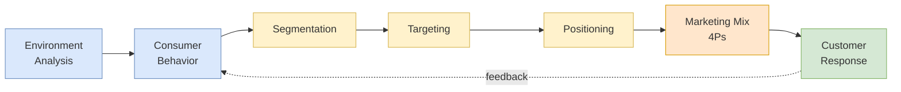

<!-- 2026-04-11 HW/test ingest: added Music2Go simulation case, 5Cs framework, Customer Journey Map / persona material from Decision 5 Finale, and Assessments appendix. -->

## 概述

SBMT5030「市場營銷管理與策略」是香港科技大學商學院為 MBA/EMBA 學生開設的核心必修課，由市場系 JC Salvacruz 教授主講，採用 Kotler & Armstrong 的《Principles of Marketing》（第 19 版，Pearson，2023）為主要教材。課程圍繞 5Cs 情境分析框架（Customer、Company、Competitors、Collaborators、Context）與 4Ps 行銷組合展開，系統涵蓋 11 講內容：行銷概念與策略規劃（BCG 矩陣、Ansoff 產品-市場擴張矩陣）、行銷環境分析、行銷資訊系統與市場調研（Cola Wars 可口可樂 New Coke 失敗案例）、消費者行為（刺激-回應模型、文化/社會/個人/心理因素）、STP 框架（細分基礎：地理/人口/心理/行為；目標化策略；定位圖與競爭優勢公式 V_A - P_A > V_B - P_B）、產品策略（三層產品模型、PLC 四階段、品牌架構：Marriott 30+ 品牌組合、NPD 八步驟）、定價策略（成本加成 vs. 價值定價、損益平衡分析、滲透 vs. 撇脂定價）、促銷整合行銷傳播（IMC，依 PLC 階段調整：告知→說服→提醒）及通路策略（垂直行銷系統 VMS、全渠道 omnichannel）。學期貫穿 Music2Go 耳機行業電腦模擬（Smartsims 平台，5 輪決策，競爭評分以銷售額、毛利率及市場份額為準），並以顧客旅程地圖（CJM）和消費者人物誌（Persona）作為課程結尾，將分析框架落實為可操作的市場策略設計工具。

## Course Overview

**SBMT5030 Marketing Management and Strategy** is a core MBA/EMBA course at HKUST Business School, taught by Professor JC Salvacruz from the Department of Marketing. The course provides a comprehensive foundation in marketing theory and practice, structured around the classic marketing management framework from Kotler's textbook.

The course spans 11 lecture modules covering the full marketing planning process: from understanding the marketing environment and consumer behavior, through strategic segmentation and positioning, to tactical execution across the four Ps of the [[wiki/concepts/marketing-mix|Marketing Mix]]. It is taught at [[wiki/entities/hkust|HKUST]] Business School and follows Kotler and Armstrong's *Principles of Marketing* (19th ed., 2023) as the primary textbook. The course is framed explicitly around two overlapping lenses: the **5Cs** (Customer, Company, Competitors, Collaborators, Context) for situation analysis, and the **4Ps** for tactical execution. A semester-long team simulation, **Music2Go**, operationalizes both lenses against live competitor teams.

## Course-Wide Strategic Flow

The arrows emphasize that marketing is not a one-shot plan: customer response feeds back into environment scanning and consumer behavior analysis, creating a continuous learning loop that modern [[wiki/concepts/crm|CRM]] systems and [[wiki/concepts/ab-testing|A/B testing]] infrastructure operationalize at scale.

## Lecture Structure

| Lecture | Topic | Key Frameworks |
|---------|-------|----------------|
| 01 | Course Introduction | Marketing definition, course structure |
| 02-01 | The Marketing Concept | Customer value, marketing orientations (production, product, selling, marketing, societal) |
| 02-02 | Company and Marketing Strategy | Strategic planning, BCG matrix, Ansoff matrix, value chain |
| 03 | Marketing Environment | Macro/micro environment analysis |
| 04 | Marketing Information | MIS, marketing research, internal data, marketing intelligence, Cola Wars case study |
| 05 | Consumer and Buyer Behavior | Stimulus-response model, cultural/social/personal/psychological factors, B2B segmentation |
| 06 | Intro to Music2Go | Simulation overview, team formation, World 1 / World 2 structure, decision cadence |
| 07 | STP | Segmentation bases, targeting strategies, positioning maps, competitive advantage |
| 08 | Product | Product levels, classification, services (IHIP), branding, brand architecture, NPD |
| 09-01 | Price | Cost-based vs. value-based pricing, break-even analysis, price elasticity, penetration vs. skimming |
| 11-01 | Promotion | IMC, promotional tools, advertising types, message execution, PLC-based promotion strategy |
| 11-02 | Distribution (Place) | Channel structure, VMS, market exposure strategies, retailing, wholesaling, omnichannel |

## Key Frameworks and Models

### Marketing Foundations (Lectures 01-02)
- **Marketing** defined as the process of creating, communicating, delivering, and exchanging offerings of value for customers, clients, partners, and society at large.
- Five marketing orientations, presented as a historical progression: **production** (efficient, low-cost, mass distribution -- Ford Model T era), **product** (continuous quality improvement -- engineering-led firms), **selling** (aggressive push of inventory -- unsought goods), **marketing** (sense-and-respond to customer needs -- customer-centric), and **societal marketing** (balance customer wants, firm profits, and long-run societal welfare -- sustainability era).
- **Strategic planning tools**: BCG Growth-Share Matrix classifies SBUs into stars, cash cows, question marks, and dogs on market-growth vs. relative-share axes. Ansoff's Product-Market Expansion Grid identifies four growth paths: market penetration (existing products, existing markets), market development (existing products, new markets), product development (new products, existing markets), and diversification (new products, new markets). These link to strategic analysis via [[wiki/concepts/porters-five-forces|Porter's Five Forces]] and [[wiki/concepts/balanced-scorecard|Balanced Scorecard]] for execution monitoring.
- **Value chain analysis** and the importance of aligning marketing strategy with overall corporate strategy. The sustainable company lecture emphasizes triple-bottom-line thinking (people, planet, profit).

### Marketing Information Systems (Lecture 04)
- **MIS** comprises internal databases, marketing intelligence (publicly available competitor/market data), and marketing research (systematic data collection for specific problems).
- **Cola Wars case study**: Coca-Cola's "Project Kansas" -- 2 years, 190,000 taste tests, $4M spent on market research that led to New Coke in 1985. The research focused on taste but failed to capture brand loyalty and emotional attachment, resulting in consumer backlash and the return of "Classic Coke."

### Consumer Behavior (Lecture 05)
- **Stimulus-Response Model**: Marketing and environmental stimuli enter the "Buyer's Black Box" (buyer characteristics + decision process) to produce purchase decisions.
- Four factor categories: cultural (culture, subculture, social class), social (reference groups, family, roles/status), personal (age, occupation, lifestyle, personality), and psychological (motivation, perception, learning, beliefs/attitudes).
- **East vs. West cultural differences** in consumer behavior: collectivism vs. individualism, high-context vs. low-context communication.
- **B2B segmentation variables**: demographic, operating variables, purchasing approaches, situational factors, personal characteristics.

See [[wiki/concepts/consumer-behavior|Consumer Behavior]] for detailed treatment.

### STP Framework (Lecture 07)
- **Segmentation bases**: geographic, demographic, psychographic, behavioral (occasion, benefits sought, usage rate, loyalty status).
- **Targeting strategies**: undifferentiated (mass), differentiated (multi-segment), concentrated (niche), micromarketing (local/individual).
- **Positioning**: perceptual maps, competitive advantage formula $V_A - P_A > V_B - P_B$, positioning statement format.
- Examples: gasoline market segmentation (road warriors, true blues, generation F3, homebodies, price shoppers), Coca-Cola's multi-segment approach, Marriott's brand portfolio.

See [[wiki/concepts/stp-marketing|STP Marketing]] for detailed treatment.

### Product Strategy (Lecture 08)
- **Three product levels (Onion Skin Model)**: core customer value (basic benefit -- "transportation"), actual product (features, brand, quality, styling, packaging -- engine size, color, warranty), augmented product (delivery, financing, after-sale service, maintenance contract).
- **Consumer product types**: convenience (staples, impulse, emergency -- low involvement, widespread distribution), shopping (comparison-driven, selective distribution), specialty (strong brand preference, exclusive distribution), unsought (low awareness, aggressive push).
- **Service characteristics (IHIP)**: Intangible, Heterogeneous (variable), Inseparable (simultaneous production/consumption), Perishable. Perishability is central to [[wiki/concepts/revenue-management|Revenue Management]] practices in airlines and hotels.
- **Brand architecture spectrum**: branded house, sub-brands, endorsed brands, house of brands, hybrid. Marriott's 30+ hotel brands (Fairfield Inn to Ritz-Carlton) is the canonical multi-brand example.
- **Brand equity**: the differential effect a brand has on customer response. Measured in willingness-to-pay premium, loyalty, awareness, and resilience to price competition.
- **Brand development matrix**: line extension (new flavors/sizes), brand extension (new categories), multibrands (multiple brands in same category -- P&G detergents), new brands.
- **New Product Development (NPD)** 8-stage process: idea generation, idea screening, concept development/testing, marketing strategy, business analysis, product development, test marketing, commercialization. Each stage is a filter gate before committing more resources.
- **Product Life Cycle (PLC)**: four phases (introduction, growth, maturity, decline) with distinct strategic prescriptions across the 4Ps:

| Stage | Sales | Profits | Customers | Product | Price | Distribution | Promotion |
|-------|-------|---------|-----------|---------|-------|--------------|-----------|
| Introduction | Low | Negative | Innovators | Basic | Cost-plus | Selective | Build awareness (Inform) |
| Growth | Rapidly rising | High, peak | Early adopters | Extensions | Penetration | Intensive | Build interest (Persuade) |
| Maturity | Peak, then decline | Declining | Middle majority | Diversify models | Match/beat competition | More intensive | Stress differences (Remind) |
| Decline | Falling | Falling | Laggards | Phase out weak | Cut | Selective | Minimal |

### Pricing Strategy (Lecture 09-01)
- **Cost-based pricing** arithmetic: with 35% *markup on cost* on a $300 cost, selling price is $405 (1.35 × 300). With 35% *margin on selling price* on a $300 cost, selling price is $461.54 ($300 / 0.65). The distinction is frequently tested and matters for financial reporting, connecting to [[wiki/concepts/cvp-analysis|CVP Analysis]] and [[wiki/concepts/financial-statements|Financial Statements]].
- **Value-based pricing**: setting price based on perceived customer value rather than cost. Requires target costing -- engineering the cost structure backward from what the market will bear.
- **Break-even analysis**: $BEV = \frac{FC}{P - UVC}$, where FC = fixed costs, P = price, UVC = unit variable cost. Each additional unit contributes (P - UVC) to profit after break-even.
- **Market structures**: pure competition, monopolistic competition, oligopolistic competition, pure monopoly -- each creates different pricing latitude.
- **Price elasticity of demand**: elastic ($|E| > 1$) vs. inelastic ($|E| < 1$) vs. unit elastic ($|E| = 1$). Promotion can shift demand rightward, make it more inelastic, or both.
- **New product pricing**: penetration pricing (low price for market share, works when market is price-sensitive, economies of scale exist, and low price deters entry) vs. price skimming (high initial price aimed at early adopters willing to pay premium; works when demand is inelastic at high prices and competitors cannot quickly enter).

### Promotion (Lecture 11-01)
- **Integrated Marketing Communications (IMC)**: coordinating all communication channels for a clear, consistent, compelling message.
- **Promotion objectives**: inform (introduction stage), persuade (growth stage), remind (maturity stage).
- **Promotional tools**: advertising, sales promotion, events/experiences, PR/publicity, direct/interactive marketing, word-of-mouth, personal selling.
- **Advertising types**: institutional (advocacy, pioneering, competitive, reminder) vs. product (pioneering/informative, competitive/persuasive, reminder).
- **Message execution styles**: slice of life, lifestyle, fantasy, mood/image, musical, personality symbol, technical expertise, scientific evidence, testimonial/endorsement.
- **Promotion and the demand curve**: promotion can make demand more inelastic, shift demand right, or both.

### Distribution / Place (Lecture 11-02)
- **Marketing channel**: set of interdependent organizations involved in making a product available for consumption.
- **Channel structure**: direct (producer to customer) vs. indirect (through intermediaries).
- **Market exposure strategies**: intensive (maximum outlets), selective (limited intermediaries), exclusive (very few dealers).
- **Vertical Marketing Systems (VMS)**: corporate (single ownership), contractual (franchise), administered (channel captain dominance).
- **Channel management decisions**: selecting, motivating, evaluating channel members, managing conflict.
- **Channel conflict**: horizontal (same level) vs. vertical (different levels).
- **Retailing types**: self-service, limited-service, full-service; specialty stores, department stores, supermarkets, convenience stores, superstores, category killers, discount stores, off-price retailers.
- **Wholesaling functions**: buying/assortment building, bulk-breaking, warehousing, transportation, financing, risk bearing, market information.
- **Multichannel vs. omnichannel**: multichannel focuses on product availability across siloed channels; omnichannel focuses on customer experience with unified touchpoints.

See [[wiki/concepts/marketing-mix|Marketing Mix]] for detailed treatment of the 4Ps framework.

## Case Studies & Simulations

The course mixes canonical lecture vignettes with a semester-long team simulation and in-class worked examples. The table below is the single source of truth for cases in this course -- lecture-only vignettes appear in the upper block, multi-session simulations and worked cases in the lower block.

| Case | Lecture / Source | Lesson |
|------|------------------|--------|
| **Cola Wars / New Coke (1985)** | 04 Marketing Information | Project Kansas spent $4M on 190,000 taste tests and still produced a strategic failure because the research missed the emotional and cultural bond consumers had with "Classic Coke." See [[consumer-behavior\|Consumer Behavior]]. |
| **Marriott brand portfolio** | 07 STP, 08 Product | Differentiated targeting through a 30+ brand architecture from Fairfield Inn (economy) to Ritz-Carlton (luxury). Canonical [[stp-marketing\|STP]] multi-segment example. |
| **Coca-Cola segmentation** | 07 STP | Multi-segment approach: Classic (mainstream), Diet Coke (weight-conscious female), Coke Zero (male), regional/flavor variants. [[stp-marketing\|STP]] textbook case. |
| **Gasoline market** | 07 STP | Five behavioral segments -- road warriors, true blues, generation F3, homebodies, price shoppers. Behavioral [[stp-marketing\|segmentation]]. |
| **Ford Model T ("any color, so long as it's black")** | 07 STP | Canonical undifferentiated (mass) marketing example, illustrating production orientation and the pre-[[stp-marketing\|STP]] era. |
| **Panera Bread** | 07 STP | Psychographic [[stp-marketing\|segmentation]] targeting a "healthy eating lifestyle" subculture. |
| **MINI Cooper** | 05 Consumer Behavior | Personality-based segmentation from [[consumer-behavior\|Consumer Behavior]]: "adventurous, individualistic, open-minded, creative, tech-savvy" self-concepts. |
| **Disney Social Media Moms** | 05 Consumer Behavior | Opinion-leader cultivation via 175-200 mom influencers annually. [[consumer-behavior\|Reference-group]] influence. |
| **Beyond Meat free trial** | 05 Consumer Behavior | Adoption-curve acceleration by removing the trial barrier ("try some free -- zip, zero, zilch"). [[consumer-behavior\|Diffusion-of-innovations]] lever. |
| **Dominos 30-minute guarantee** | 07 STP | Value proposition differentiator -- not price, but delivery certainty. [[stp-marketing\|Positioning]] by service attribute. |
| **Volvo (safety), BMW (driving), Apple (design)** | 07 STP | Image-differentiation [[stp-marketing\|positioning]] anchors. |
| **P&G product mix** | 08 Product | Width (product lines), length (items per line), depth (variants), consistency. Classic [[marketing-mix\|product-mix]] decomposition. |
| **McDonald's 5 customer journeys** | Finale (Customer Journey Map) | McDonald's segments its customer base by occasion -- e.g., "Weekday Lunch in a Rush" -- and designs distinct journey maps (context, progression, emotion) at each touchpoint rather than a single generic funnel. |
| **NBTC Holland: Ding Yi & Zhang Xiang personas** | Finale (Personas) | Dutch tourism board built two Chinese-market personas from regional field research (Beijing, Shanghai, Guangzhou, Hangzhou, Xiamen, Chengdu) to anchor lifestyle-based segmentation and creative decisions. Illustrates that personas are "hyper-segmentation," not demographic boxes. |
| **Music2Go simulation** | 06 Intro to M2Go + semester-long team project | Smartsims-hosted headphone-industry simulation run across two competing "Worlds" (6 firms per World). Each team runs a fictional consumer-electronics firm selling three product lines -- **Music**, **Gaming**, and **Fitness** headphones -- through 5 decision rounds (Periods 2024-2028). Every round, teams set price, product specs, advertising budget and media mix (TV/print/radio/digital/social), sales promotion mix (trade shows, SF training, premiums, POS displays, rebates), and retailer incentives. Market reports provide segment sizes, perceptual maps, product awareness, Sales Promotion Ratings, and Promotion Mix Effectiveness vs. PLC stage. The finale evaluates teams on sales, market share, gross margin, and Total Marketing Contribution. Key lessons from Prof. Salvacruz's debrief: set ad budgets by the job to be done (not % of sales), refresh the sales-promotion mix as products mature, competitor analysis is central, forecast discipline matters (over-estimation → inventory costs, under-estimation → opportunity costs), and marketing strategy must be comprehensive rather than modular. The simulation is used to bridge classroom frameworks to the 5Cs and to PLC-driven 4P coordination. |
| **Music2Go -- Team DreamWave (World 2)** | Final presentation artifact | Student team DreamWave Inc. (tagline "Wisdom Every Move") ran three products -- **DreamTune** (Music), **DreamCast** (Gaming), and **Dream Fit** (Fitness). The team treated sales promotion and advertising budget allocation as a heuristic search problem: starting from the average mix, then doing pairwise adjustments to climb toward local maxima in Promotion Mix Effectiveness. Round 4-5 saw them price DreamTune at \$139-\$140 (vs. market average \$137-\$138) and capture 18.7 → 20.8% segment share. Illustrates how a structured search loop over simulation inputs can operationalize the abstract "coordinate the 4Ps" advice. |
| **Customer Journey Map (CJM)** framework | Finale | Three lenses per touchpoint: **Context** (where/when the interaction occurs), **Progression** (how each step enables the next), **Emotion** (how the customer feels). Applied in class to McDonald's, Spotify, online bill payment, and a worked BanX loan/mortgage example walking Awareness → Information → Advice → Becomes a Customer → Service & Transaction → Share. |

## Key Takeaways

- Marketing strategy follows a clear sequence: analyze the environment, understand consumers, segment-target-position, then execute through the 4Ps. Each step feeds the next, and customer response feeds back into environment scanning.
- The **competitive advantage formula** ($V_A - P_A > V_B - P_B$) is the unifying principle: a firm wins when its value-minus-price surplus exceeds competitors'. Every 4P decision must either raise V or lower effective P for the target segment.
- **Market research pitfalls** (Cola Wars case) demonstrate that quantitative data can miss emotional and cultural dimensions of consumer behavior -- a lesson that bridges traditional marketing to [[wiki/concepts/behavioral-economics|behavioral economics]].
- Modern distribution is evolving from multichannel to **omnichannel**, with ecosystem thinking replacing siloed channel management. The unit of analysis shifts from "product availability" to "customer experience."
- Promotional strategy must align with the **product life cycle stage** -- inform at introduction, persuade during growth, remind in maturity, minimize in decline.
- **Cost arithmetic matters**: a 35% markup-on-cost ≠ 35% margin-on-selling-price. Marketers must speak the language of [[wiki/concepts/financial-ratios|financial ratios]] and managerial accounting.
- **Porter's generic strategies** warn against being "stuck in the middle" between cost leadership and differentiation -- a positioning error that forfeits both scale economies and price premiums.

## References

- **Kotler, P., Armstrong, G., & Balasubramanian, S. (2023). *Principles of Marketing* (19th ed., Rental Edition). Pearson.** Primary textbook; chapter structure maps directly onto the 11 course lecture modules. Referenced across all 4P and STP lectures as the foundational source. The raw PDF is retained under `raw/courses/SBMT5030 Marketing Management and Strategy/` for targeted lookup but is not ingested as a separate wiki source -- all conceptual material relevant to this course is surfaced through the lecture notes and the three concept pages.
- **Smartsims -- Music2Go Principles of Marketing Simulation.** Commercial teaching simulation authored by Smartsims International, used by Prof. Salvacruz as the course's integrating team project.

## Related Concepts

- [[wiki/concepts/stp-marketing|STP Marketing]]
- [[wiki/concepts/marketing-mix|Marketing Mix]]
- [[wiki/concepts/consumer-behavior|Consumer Behavior]]
- [[wiki/concepts/cvp-analysis|CVP Analysis]]
- [[wiki/concepts/supply-chain-management|Supply Chain Management]]
- [[wiki/concepts/ecommerce-models|E-Commerce Models]]
- [[wiki/concepts/porters-five-forces|Porter's Five Forces]]

## Source Materials

- Lecture 01: Course Introduction
- Lecture 02-01: The Marketing Concept
- Lecture 02-02: Company and Marketing Strategy
- Lecture 04: Marketing Information
- Lecture 05: Consumer and Buyer Behavior
- Lecture 06: Intro to Music2Go
- Lecture 07: STP
- Lecture 08: Product
- Lecture 09-01: Price
- Lecture 11-01: Promotion
- Lecture 11-02: Distribution
- Music2Go Decision 5 Finale (CJM, personas, debrief)
- Music2Go Final Report Guide
- SBMT5030 Course Syllabus (5Cs framework)
